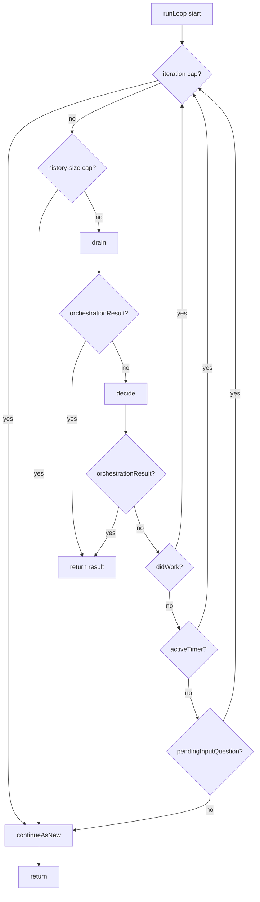
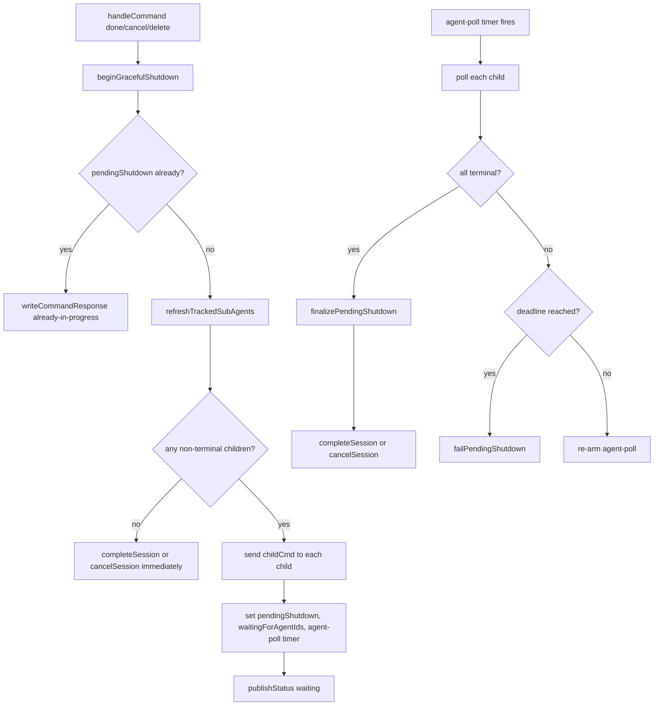
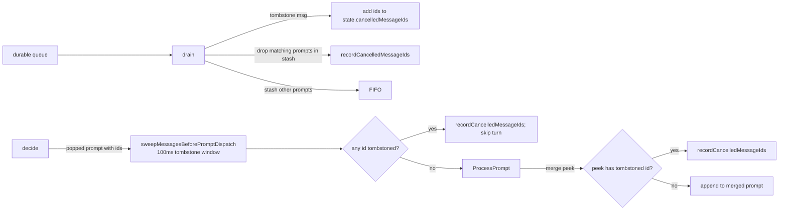

# Orchestration Design

This document is the canonical reference for the durable session orchestration:
its module layout, runtime model, control flow, and replay invariants.

The orchestration is the durable coordinator for a session. It dequeues client
and child events, decides when to run an LLM turn, manages timers and
hydration, and bounds duroxide history with continue-as-new.

It does **not** own tool implementations or Copilot SDK session state. Those
live in worker activities and the session manager.

Primary source: [`packages/sdk/src/orchestration/`](../../../packages/sdk/src/orchestration).
The current latest version is `1.0.82`. Frozen prior versions live as siblings
(single files `packages/sdk/src/orchestration_1_0_47.ts` … `_1_0_51.ts`, then
directories `orchestration_1_0_52/` … `orchestration_1_0_81/`) and run
unchanged for any in-flight execution that started against them.

In 1.0.81, Stop and Steer are handled inside the worker's turn activity through
the session catalog. The orchestration yields that activity directly; it no
longer races `runTurn` against `stopTurn.<n>`. Version 1.0.80 and older keep
their original Stop path.

In 1.0.82, queued work no longer waits behind a timer (issue 192): `drain` runs
queued prompts and answers at once whatever timer is armed, and `decide` merges
every queued prompt past timer items into one turn. The KV FIFO compacts
instead of dropping items. Version 1.0.81 and older keep the old queue.

---

## 1. Module Layout

```text
src/orchestration/
  index.ts       durable entrypoint (5 lines: createRuntime then runLoop)
  runtime.ts     createRuntime, runLoop, startup gates, versioned tracing
  state.ts       DurableSessionState, DurableSessionRuntime, createInitialState, constants
  utils.ts       pure helpers — prompt parsing, context-usage reducer, error classifiers
  lifecycle.ts   status, response/command writers, affinity release, summarize,
                 child digest, cron action, cancellation tombstones, continueAsNew, handleCommand
  queue.ts       KV FIFO primitives, drain, decide, processAnswer, processPendingChildDigest
  turn.ts        processPrompt, handleTurnResult, processTimer, retry / lossy-handoff
  agents.ts      sub-agent tracking, tool actions (spawn/message/check/etc.), shutdown cascade
```

### Dependency direction

```text
index.ts ──► runtime.ts
              │
              ├─► state.ts ──► utils.ts
              ├─► lifecycle.ts
              └─► queue.ts ──► turn.ts ──► lifecycle.ts ──► agents.ts ──► lifecycle.ts
                                            │                              │
                                            └─► agents.ts ─────────────────┘
```

Cycle between `lifecycle.ts ↔ agents.ts` is intentional: `handleCommand` calls
into `beginGracefulShutdown`, and shutdown writers call back into
`writeCommandResponse` / `publishStatus`. ES module function references resolve
at call time, so this is safe.

---

## 2. Runtime And State

Every helper takes a single `runtime: DurableSessionRuntime`:

```ts
interface DurableSessionRuntime {
    ctx:      DuroxideOrchestrationCtx;   // duroxide primitives
    input:    OrchestrationInput;          // wire input for this execution
    versions: { currentVersion; latestVersion };
    manager:  SessionManagerProxy;
    session:  SessionProxy;                // mutable — replaced when affinity rotates
    state:    DurableSessionState;         // mutable orchestration state
    options:  DurableSessionOptions;       // immutable per-execution thresholds
}
```

`state` is the durable control state. Helpers mutate `runtime.state.*` directly
— there is no closure of `let`s and there are no adapter shapes.

`options` holds per-execution thresholds derived from input
(`idleTimeout`, `inputGracePeriod`, `isSystem`, `parentSessionId`,
`nestingLevel`, `baseSystemMessage`). These do not change inside an execution.
Legacy `dehydrateThreshold` and `checkpointInterval` inputs are accepted but
ignored.

### Key state fields

| Field | Carried across CAN | Notes |
|---|---|---|
| `iteration` | yes | LLM-turn counter |
| `loopIteration` | no | resets each execution; bounded by `MAX_ITERATIONS_PER_EXECUTION` |
| `config` | yes | session config; mutated by `set_model`, agent merge, task-context injection |
| `affinityKey` | yes | rotates on affinity release or legacy hydration |
| `needsHydration` / `preserveAffinityOnHydrate` | yes | legacy (≤1.0.56) hydration flags |
| `pendingPrompt` / `pendingSystemPrompt` / `pendingRequiredTool` / `bootstrapPrompt` | yes | dispatch on next turn |
| `pendingToolActions` | yes | replay queue for multi-action turns |
| `carriedSteers` | yes, when non-empty | ordered `{ seq, text }` guidance accepted too late for an earlier turn; retained until consumed or closed on give-up/termination |
| `subAgents` | yes | child tracking table |
| `cronSchedule`, `taskContext`, `nextSummarizeAt` | yes | recurring task / summarization |
| `contextUsage` | yes | last context-window snapshot |
| `activeTimer` | yes (as `activeTimerState`) | wait/cron/idle/agent-poll/input-grace |
| `pendingInputQuestion`, `waitingForAgentIds` | yes | suspension points |
| `interruptedWaitTimer`, `interruptedCronTimer` | yes | auto-resume state |
| `pendingChildDigest`, `pendingShutdown` | yes | batched updates / shutdown cascade |
| `lastResponseVersion`, `lastCommandVersion`, `lastCommandId` | reread from KV at start | monotonic counters in KV |
| `cancelledMessageIds`, `emittedCancelledMessageIds` | no | tombstone sets, replay-rebuilt |
| `legacyPendingMessage` | no | one-shot legacy carry-forward |
| `orchestrationResult` | no | sentinel — when non-null, runLoop returns it |

The full type is in [state.ts](../../../packages/sdk/src/orchestration/state.ts).

---

## 3. The Main Loop

```ts
// index.ts
function* durableSessionOrchestration_1_0_81(ctx, input) {
    const runtime = yield* createRuntime(ctx, input, {
        currentVersion: CURRENT_ORCHESTRATION_VERSION,
        latestVersion:  DURABLE_SESSION_LATEST_VERSION,
    });
    if (runtime.state.orchestrationResult !== null) return runtime.state.orchestrationResult;
    return yield* runLoop(runtime);
}
```

`createRuntime` builds the runtime, restores the active timer from CAN input,
applies legacy pending-message carry-forward, runs creation-policy and
top-level agent-config gates, and returns the runtime. If a gate sets
`orchestrationResult`, the entrypoint returns it without entering the loop.

`runLoop`:

```ts
function* runLoop(runtime) {
    while (true) {
        state.loopIteration++;

        // CAN trigger 1: per-execution iteration cap (10).
        if (state.loopIteration > MAX_ITERATIONS_PER_EXECUTION) {
            yield* versionedContinueAsNew(runtime, continueInput(runtime));
            return "";
        }

        // CAN trigger 2: duroxide history-size cap (every 3 iterations, > 800 KB).
        if (state.loopIteration % HISTORY_SIZE_CHECK_INTERVAL_ITERATIONS === 0) {
            const stats = yield manager.getOrchestrationStats(input.sessionId);
            if (stats.historySizeBytes >= MAX_HISTORY_SIZE_BEFORE_CONTINUE_AS_NEW_BYTES) {
                yield* versionedContinueAsNew(runtime, continueInput(runtime));
                return "";
            }
        }

        yield* drain(runtime);                   // queue + timer fires → KV FIFO
        if (state.orchestrationResult !== null) return state.orchestrationResult;

        const iterationBeforeDecide = state.iteration;
        const didWork = yield* decide(runtime);  // pop one unit, dispatch
        if (state.orchestrationResult !== null) return state.orchestrationResult;
        // 1.0.82: re-arm a timer released for work that ran no turn
        settleQueuedWorkAfterDecide(runtime, iterationBeforeDecide);

        if (didWork)                  continue;
        if (state.activeTimer)        continue;  // drain will race the timer next iteration
        if (state.pendingInputQuestion) continue; // drain will block waiting for an answer

        // CAN trigger 3: idle.
        yield* versionedContinueAsNew(runtime, continueInput(runtime));
        return "";
    }
}
```

Three CAN triggers: iteration cap, history-size cap, idle (no buffered work,
no timer, no pending input). The loop never returns a non-empty string itself
— termination strings (`"done"`, `"cancelled"`, `"deleted"`, `"failed"`,
policy-rejection strings) come from `state.orchestrationResult` set by command
handlers and shutdown.



---

## 4. drain — Queue + Timer → KV FIFO

`drain` greedily moves durable queue events and fired timers into a KV-backed
FIFO buffer. It loops up to `MAX_DRAIN_PER_TURN = 50` times. Each iteration
picks one of the dequeue modes below:

| Mode | When | Behavior |
|---|---|---|
| **legacy carry-forward** | `state.legacyPendingMessage !== undefined` | replay one already-dequeued message from a pre-v1.0.32 input |
| **queued work** (1.0.82) | the FIFO or the stash holds a prompt or an answer while a timer is armed or a digest window is open; or it holds a timer item while the armed timer is idle, cron, cron_at or an ungated wait; never during a graceful shutdown | release the armed timer as a new message would (a cron or wait keeps its remaining time; a cron_at keeps its next fire; an agent wait ends, even when its poll is due; input-grace ends, the question stays open; a gate is asked again by the turn; a due cron, cron_at or plain wait becomes a timer item), then `race(dequeueEvent, scheduleTimer(10ms))`. Checked before carried guidance, so queued work that carries steers keeps its timer's time |
| **carried guidance** | carry exists and there is no unanswered question, pending shutdown, or gate wait | a pending prompt or queued tool actions take priority; otherwise a non-blocking dequeue collects queued messages (1.0.82: until the queue is empty) and, only when nothing else is queued, an internal carried-only wake |
| **active-timer race** | `activeTimer` set, OR pending child digest waiting to ripen | `race(dequeueEvent, scheduleTimer(remainingMs))`. Timer-side wins push a `{kind:"timer", timer, firedAtMs}` into the stash |
| **blocking dequeue** | nothing else to do (no timer, no FIFO, no pending prompt/tool actions) and nothing collected yet in this pass | `dequeueEvent` blocks; only allowed on the first drain iteration. In 1.0.82 a pass that has collected a message takes the non-blocking dequeue instead, so every message already queued is collected |
| **non-blocking dequeue** | otherwise | `race(dequeueEvent, scheduleTimer(NON_BLOCKING_TIMER_MS=10ms))`; timer-side breaks the loop |

Each dequeued message is routed by shape:

| Shape | Action |
|---|---|
| `{cancelPending: ["id1", …]}` | add ids to `state.cancelledMessageIds`; drop matching prompts already in stash |
| `{type: "cmd", …}` | flush stash to FIFO, then `handleCommand` |
| `{prompt: "[CHILD_UPDATE from=… type=…]\n…"}` | `applyChildUpdate` (deduped per drain pass), maybe `bufferChildUpdate`, maybe resolve `wait_for_agents` |
| `{answer, wasFreeform}` | stash `{kind:"answer", answer, wasFreeform}` |
| `{prompt, bootstrap?, requiredTool?, clientMessageIds?}` | possibly augment with timer-interrupt context, then stash `{kind:"prompt", …}` |
| else | log and skip |

After the loop, any items still in the stash are appended to the FIFO via
`appendToFifo`. In 1.0.82 a stashed timer item whose kind (type, and gate for
waits) is already queued is not added: one fire runs the schedule once.

### Settling a released timer (1.0.82)

A timer that `drain` releases for queued work, or that a newly arrived prompt
releases, is recorded on the runtime (`releasedForQueuedWork`) for one loop
pass. After `decide`, the run loop calls `settleQueuedWorkAfterDecide`:

| After decide | What happens |
|---|---|
| a turn ran (`state.iteration` moved) | queued `idle` and `input-grace` items are removed: the turn restarted the hold window, so they would only release the worker or replace the timer the turn armed. The turn's own continuation re-arms the released timer as before |
| no turn ran (the prompt was cancelled, or the timer item ran no turn) and nothing armed a newer timer | the released timer is armed again exactly as it was; the remaining time the release saved, and an agent wait it ended, are restored |
| no turn ran but decide armed a newer timer | the newer timer stays |

The record lives in one execution only; continue-as-new never carries it.

### KV FIFO buckets

`FIFO_BUCKET_COUNT = 20` keys (`fifo.0` … `fifo.19`), each capped at
`MAX_BUCKET_BYTES = 14 KB`. Items are appended to the highest non-empty bucket;
when serialized size would exceed the cap, a new bucket is allocated.
`popFifoItem` pulls from the lowest non-empty bucket; `popNextDispatchFifoItem`
takes the first prompt or answer anywhere (interactive work goes ahead of
queued timer fires) and reports how many items preceded it.

In 1.0.82, when an append reaches a full last bucket, the FIFO is compacted:
every item is re-packed from bucket 0, in order. Only when all 20 buckets are
full after compaction does an item not fit; the stash then records a
`session.fifo_overflow` event with the lost items' client message ids and
does not mark those ids as seen, so a resend runs. 1.0.81 and older dropped
such items with an info line.

### Prompt timer-interrupt augmentation

When a user prompt arrives while `activeTimer` is set, drain captures the
timer's remaining time, saves it to `interruptedWaitTimer` /
`interruptedCronTimer`, clears `activeTimer`, and appends a `[SYSTEM: …]`
context block to the prompt explaining the interrupt. `handleTurnResult` later
auto-rearms the saved timer once the LLM responds.

For an `idle` timer the prompt simply cancels the timer. For `agent-poll`,
drain also clears `waitingForAgentIds` so the wait-for-agents resumes
naturally.

---

## 5. decide — Pop One Unit Of Work

```ts
function* decide(runtime) {
    drainLeadingQueuedScheduleActions(runtime);

    // Priority 1 — replay queued tool actions (multi-action turn carry-forward).
    if (state.pendingToolActions.length > 0) {
        const action = state.pendingToolActions.shift();
        yield* handleTurnResult(runtime, action, "");
        return true;
    }

    // Priority 2 — pendingPrompt (CAN carry-forward or queueFollowup output).
    // Held while waiting on agents so confirmations can merge with agents-done.
    if (state.pendingPrompt && !state.waitingForAgentIds) {
        const prompt = state.pendingPrompt;  // capture
        state.pendingPrompt = undefined;
        // …
        yield* processPrompt(runtime, prompt, isBootstrap, requiredTool);
        return true;
    }

    // Priority 3 — FIFO item (interactive prompt/answer prioritized over timers).
    const picked = popNextDispatchFifoItem(runtime);  // { item, before }
    if (picked) {
        switch (picked.item.kind) {
            case "prompt":      // (with predispatch sweep + prompt batching)
            case "answer":      yield* processAnswer(runtime, item); break;
            case "timer":       // 1.0.82: other queued items of this kind are removed
                                yield* processTimer(runtime, item);  break;
            case "agents-done": queueFollowup(runtime, item.summary); break;
        }
        return true;
    }

    // Priority 4 — buffered child digest (if ripe and not waiting on agents).
    if (state.pendingChildDigest?.ready && state.pendingChildDigest.updates.length > 0
        && !state.waitingForAgentIds) {
        yield* processPendingChildDigest(runtime);
        return true;
    }

    return false;
}
```

### Prompt batching

When a `prompt` FIFO item with `clientMessageIds` is popped, decide first runs
`sweepMessagesBeforePromptDispatch` (a 100ms tombstone sweep). If still alive,
it merges the prompts queued after it into one combined turn (joined with
`\n\n`, ids concatenated, bootstrap kept equal on both sides, requiredTool
first-wins). Bootstrap and ordinary prompts do not merge. This collapses
rapid-fire user messages into a single LLM turn.

In 1.0.82 (`collectMergeablePrompts`) the merge reads the FIFO in place, from
the position the dispatched prompt held: timer items (and `agents-done` items
left by older versions) are stepped over and stay where they are; an answer
or another item kind ends the merge, and so do a bootstrap mismatch and a
carried-steers wake; there is no size limit; only the merged and the
cancelled prompts are removed. Up to 1.0.81 the merge
popped the FIFO head to peek and put a non-prompt back at the head, so a timer
item at the head stopped every merge and never ran while prompts were queued.

A carried-only wake is separate from ordinary and bootstrap prompts. It never
merges with another FIFO prompt. Guidance still rides with an ordinary prompt
that was already pending when the earlier turn ended.

### Pending child digest

A child update buffered into `pendingChildDigest` is held for
`CHILD_UPDATE_BATCH_MS = 30s` (the digest "ripens"). When ripe and decide
reaches priority 4, `processPendingChildDigest`:

- if `activeTimer.type === "wait" | "cron"`, save the remaining time as
  `interruptedWaitTimer` / `interruptedCronTimer` (kind `"child"`) and dispatch
  the digest as a system-only turn; the timer auto-rearms after the turn
- if `activeTimer.type === "idle" | "agent-poll"`, just clear the timer
- otherwise dispatch the digest immediately as a system-only turn

---

## 6. Turn Lifecycle

### processPrompt

```mermaid
sequenceDiagram
    participant Decide as queue.decide
    participant Turn as turn.processPrompt
    participant Life as lifecycle
    participant Session as session-proxy
    participant Manager as manager proxy
    participant Result as turn.handleTurnResult

    Decide->>Turn: prompt, bootstrap?, requiredTool?, clientMessageIds?
    Turn->>Life: wrapWithResumeContext for legacy hydration input
    Turn->>Turn: normalize prompt and trailing system context
    Turn->>Session: hydrate (with retry) if needed
    Turn->>Manager: loadKnowledgeIndex (best-effort)
    Turn->>Life: publishStatus("running")
    Turn->>Session: runTurnV4 / runTurnEpochV4(prompt, bootstrap, iteration, carriedSteers)
    Note over Turn,Session: yield the turn directly; no Stop dequeue, race, or abortTurn
    alt throws
        Turn->>Turn: classify error → fatal / auth / connection / generic
        Turn->>Life: release affinity + durable backoff + CAN if retryable
    else result
        Turn->>Turn: clear consumed carry unless error; append lateSteers
        Turn->>Turn: updateContextUsageFromEvents
        Turn->>Life: maybeSummarize, refreshTrackedSubAgents
        Turn->>Turn: drainLeadingQueuedScheduleActions, push queuedActions
        Turn->>Result: handleTurnResult(result, prompt)
    end
```

### Error / retry classification

| Error | Action |
|---|---|
| Contains `SESSION_STATE_MISSING_PREFIX` | publishStatus failed, updateCmsState failed, **throw** (fatal — duroxide will mark execution failed) |
| `isAuthFailureError` | publishStatus error with `authFailure: true`; write CMS `error` with `closeControls: true`, clear carry, **return** without retry |
| Returned error with `retryable: false` | write CMS `error` with `closeControls: true`, clear carry, **return** without retry |
| `isCopilotConnectionClosedError` and `retryCount ≤ COPILOT_CONNECTION_CLOSED_MAX_RETRIES (3)` | release affinity when persistence is enabled, scheduleTimer 15s, CAN with incremented retry count and carry |
| `isCopilotConnectionClosedError` and retries exhausted, persistence enabled | record `session.lossy_handoff`, release affinity, CAN with `rehydrationMessage`, retained carry and `retryCount = 0` |
| Connection-loss retries exhausted without persistence | write CMS `error` with the existing give-up message and `closeControls: true`; clear carry and return |
| Legacy hydration retries exhausted | write CMS `error` with the existing exhaustion message and `closeControls: true`; clear carry and return without running the turn |
| Any other error and `retryCount < MAX_RETRIES (3)` | release affinity when persistence is enabled, scheduleTimer `15 * 2^(retryCount-1)` seconds, CAN with incremented retry count and carry |
| Any other error and retries exhausted | persist CMS `error` with `closeControls: true`, clear carry, publishStatus error with `retriesExhausted: true`, **return** (waits for next user input) |

The same classifier handles both `runTurn` throws and `TurnResult` of type
`error` — phase tag distinguishes them in emitted events. Returned errors count
toward the same retry budget as thrown errors; returned authentication failures
stop immediately with the fix-your-key guidance rather than entering retry.

### handleTurnResult

The big switch on `result.type`. Two pre-passes:

1. `coerceChildQuestionToWait` — if a child returns `completed` with content
   beginning `QUESTION FOR PARENT:`, rewrite to a 60s `wait` so the child
   stays alive waiting for the parent's reply.
2. `synthesizeWaitInterruptReplyIfNeeded` — if a user-interrupt timer is
   pending and the LLM replied with empty content, synthesize
   `"I'm here. Resuming the timer."` as a visible assistant message.

| `result.type` | Behavior |
|---|---|
| `completed` | `writeLatestResponse`; if sub-agent, notify parent (system sub-agents return immediately); forgotten-timer safety check; auto-resume `interruptedWaitTimer` / `interruptedCronTimer`; else if `cronSchedule` set, arm cron timer; else if blob+idleTimeout enabled, arm idle timer; else fall through (loop will CAN) |
| `wait` | a workspace refusal holds the prompt and arms a workspace retry; a budget refusal stashes the prompt, then follows the normal wait path; the normal path clears `interruptedWaitTimer`, ensures `taskContext`, applies the parent wake policy, lets `planHoldRelease` decide affinity release, writes a response if `content`, and arms the wait timer |
| `cron` | `applyCronAction` — set or cancel `cronSchedule` in state |
| `cron_at` | `applyCronAtAction` — set or cancel the wall-clock schedule (`cronAtSchedule`) in state |
| `input_required` | write the question and set `pendingInputQuestion`; with persistence, arm input grace when positive or the idle hold directly when zero; no timer without persistence or with a negative grace; an answer within the hold lands warm |
| `cancelled` | trace and return |
| `stopped` | record `session.turn_stopped` with the turn index and client message ids, write idle, reset retry count, and resume timers/cron; no automatic turn retry and no legacy system Stop message |
| `spawn_agent` / `message_agent` / `check_agents` / `list_sessions` / `wait_for_agents` / `complete_agent` / `cancel_agent` / `delete_agent` | `handleSubAgentAction(runtime, result)` |
| `error` | retry classifier (above) |

### Stop, Steer, and carried guidance (1.0.81)

All rebuilt proxies use the `turn-control-v1` activity contract. Ordinary turns
use `runTurnV4`; epoch-start turns use `runTurnEpochV4`. These tasks carry only
`pilotswarm.turn-control.v1`, so workers without that capability cannot execute
them, even if they register the activity names. Non-turn manager activities
retain the handoff contract. Workspace checks and releases retain workspace
routing.

The worker records accepted controls and their outcomes. The orchestration
receives `lateSteers` in the result and adds them to `state.carriedSteers` in
order. Each later turn receives a copy in its metadata. A non-error result
clears the old carry only when `carriedSteersConsumed === true`, before adding
any new late guidance. This includes an authorized stopped consuming turn:
the discarded guidance must not run again. A returned retryable error retains
the carry even after the model ran, because the retry re-sends the original
prompt and folds the same guidance again. Throws, provider-admission errors,
budget/workspace waits, and stale starts do not establish consumption.

An unanswered question holds guidance for the user's answer. Otherwise it runs
with pending ordinary work, or starts an internal carried-only turn using
`CARRIED_STEERS_WAKE_PROMPT`. The worker replaces that marker with guidance text;
it must not reach the model or become a second user message. Each carried-only
attempt is a bootstrap turn, including retries. Timer, hydration, and child
digest notes remain trailing system context rather than changing the marker.

The wake enters the same timer-interrupt path as a user message. It preserves
the remaining wait or recurring schedule. If an agent wait holds a follow-up,
the carry ends that wait and rides with the follow-up instead of spinning the
run loop. A pending graceful shutdown holds guidance for terminal closure.

There is no extra carried-steer closing activity. The worker's existing turn-end
write records `ran` or `stopped` once. Give-up CMS `error` writes pass
`closeControls: true` and close unresolved guidance as `gave_up`. Terminal writes
close controls in SQL without that option. Orchestration state clears on the
corresponding consuming, give-up, or terminal path. Control outcomes remain
immutable; the separate closing record identifies what happened to carried
guidance.

### The prompt envelope on a retry (1.0.81)

The retry of a failed turn continues as new with the turn's prompt. In 1.0.81
it also carries the prompt's envelope: its `clientMessageIds`, `sender` and
image `attachments` (input fields; state `pendingClientMessageIds`,
`pendingSender`, `pendingAttachments`), and the retried turn passes them to the
worker again. A retry that records the prompt (for example after a lossy
handoff) records it with the ids the sender's outbox waits for and the right
sender, and the model still gets the images. No new yields; frozen versions
keep the earlier carry.

### Converted queued messages and the cancel set (1.0.81)

A steer may replace a queued message (Steer now; session turn control design
4.14). A turn result carries `replacedClientMessageIds`: the queued messages
that the turn's delivered converted steers replaced. Right after the result is
parsed, before anything can be dequeued, the orchestration adds them to
`state.cancelledMessageIds` and records `pending_messages.cancelled` with
reason `converted_to_steer` (one `recordSessionEvent` yield, only when the
list is not empty). The existing drop paths then drop the message wherever it
waits: the duroxide queue (`drain-incoming`, `predispatch-incoming`), a drain
stash or the FIFO (`decide-fifo`, `decide-merge`). The give-up state writes
(`updateCmsState` with `closeControls`) return the same list for the given-up
turn, and the orchestration applies it the same way.

The cancel set is carried across continue-as-new (`cancelledMessageIds`
input, the newest 200 ids). An id leaves the set, and joins the 20-id
duplicate window, when its prompt is dropped. Before this, a retry's
continue-as-new lost the set, so a replaced or cancelled message could run.

### Rolling deployment and rollback

The frozen 1.0.80 tree keeps its literal version and original Stop race. New
sessions use 1.0.81; old sessions move to the latest version only through the
existing continue-as-new mechanism. Disabling Steer is not an orchestration
rollback. Retain V4-capable workers until 1.0.81 sessions drain, unless a
separately authorized coordinated rollback restores both code and durable state.

### processTimer

Fired timers reach decide as `{kind:"timer", timer, firedAtMs}`. `processTimer`
dispatches by `timer.type`:

| `timer.type` | Behavior |
|---|---|
| `wait` | record `session.wait_completed`; build resume system-prompt with original `waitReason` and `taskContext`; `processPrompt(systemPrompt + timerPrompt, bootstrap=false)` |
| `cron` | record `session.cron_fired`; `processPrompt(cronPrompt, bootstrap=true)` (with resume context if `shouldRehydrate`) |
| `cron_at` | record `session.cron_at_fired` for the scheduled occurrence; fire the wall-clock schedule and re-arm the next occurrence |
| `idle` | release workspace and worker affinity; the activity's committed snapshot remains authoritative |
| `agent-poll` | poll each non-terminal child via `getSessionStatus`; if all done, `maybeResolveAgentWaitCompletion`; else if shutting down past deadline, `failPendingShutdown`; else re-arm with shutdown-poll or 30s |
| `input-grace` | arm the input-required idle hold; its eventual expiry releases affinity |

---

## 7. Sub-Agents

Sub-agents are first-class orchestration state. The parent tracks them in
`state.subAgents: SubAgentEntry[]`.

### Spawn / message / control

`handleSubAgentAction` dispatches eight tool-shaped results:

| Action | Effect |
|---|---|
| `spawn_agent` | enforce nesting cap (`MAX_NESTING_LEVEL = 2`) and count cap (`MAX_SUB_AGENTS = 50`); resolve agent definition if `agentName` given; build child config (model / tools / system message); `manager.spawnChildSession`; push entry; queueFollowup `[SYSTEM: Sub-agent spawned…]` |
| `message_agent` | `manager.sendToSession(child, msg)` |
| `check_agents` | poll `getSessionStatus` for each tracked agent, update local status, return summary as followup |
| `list_sessions` | `manager.listSessions(filters)` and return as followup |
| `wait_for_agents` | set `waitingForAgentIds`; arm 30s `agent-poll` timer |
| `complete_agent` | send `done` cmd to child |
| `cancel_agent` | send `cancel` cmd to child |
| `delete_agent` | if child is terminal, `deleteSession` directly; else send `delete` cmd |

Each branch ends with `queueFollowup(...)` so the parent's next turn sees the
result of the action.

### Child update routing

When a child calls `wait` or `completed` it sends a
`[CHILD_UPDATE from=<sessionId> type=<update>]\n<content>` prompt to the
parent's `messages` queue. drain parses this, calls `applyChildUpdate` (which
updates the local `subAgents` entry and the agent's `getSessionStatus`), then
`bufferChildUpdate` (which adds it to `pendingChildDigest`).

`pendingChildDigest` batches updates for 30s before dispatching them as a
single system turn. This prevents N children producing N parent turns.

If the parent is in `wait_for_agents`, `maybeResolveAgentWaitCompletion`
checks whether all `waitingForAgentIds` are terminal and, if so, queues the
agents-done summary and clears the wait.

---

## 8. Graceful Shutdown Cascade

Three commands trigger graceful shutdown: `done`, `cancel`, `delete`. All
three flow through `beginGracefulShutdown(runtime, mode, cmdMsg)`.



`SHUTDOWN_TIMEOUT_MS = 60s`, `SHUTDOWN_POLL_INTERVAL_MS = 5s`.

`completeSession` / `cancelSession` set `state.orchestrationResult` to the
termination string (`"done"` / `"cancelled"` / `"deleted"` / `"failed"`).
`runLoop` returns it on the next check.

For `delete`, `cancelSession` additionally enumerates descendants via
`getDescendantSessionIds` and calls `deleteSession` on each before deleting
self.

---

## 9. Continue-As-New

`versionedContinueAsNew(runtime, canInput)`:

1. Capture the active timer's remaining time into `canInput.activeTimerState`.
2. Stamp `canInput.sourceOrchestrationVersion = runtime.versions.currentVersion`.
3. Yield `ctx.continueAsNewVersioned(canInput, latestVersion)`.

No warm checkpoint is required: each turn commits its snapshot inside the turn
activity. The carry array is included when non-empty; old inputs default it to
an empty array.

`continueInput(runtime, overrides?)` builds the wire `OrchestrationInput`. It
includes every field in [§2](#2-runtime-and-state) marked "carried across
CAN". `pendingPrompt` and friends merge with overrides;
`continueInputWithPrompt` extracts any system context from the override prompt
before merging.

CAN happens in several places, principally:
- `runLoop` idle (no work, no timer, no pending input)
- `runLoop` iteration cap (>10 per execution)
- `runLoop` history-size cap (≥800 KB, checked every 3 iterations)
- `handleCommand("set_model")` after writing the response, so the new model
  takes effect on the next execution (plus the terminal model-switch
  `forceContinuePrompt` continuation paths in `turn.ts`)
- `processPrompt` retry / lossy-handoff paths after `scheduleTimer`

The latest handler must accept `OrchestrationInput` produced by every
registered prior version (down to
`DURABLE_SESSION_COMPATIBILITY_FLOOR_VERSION`). Wire-shape additions are
backward-compatible by default (older inputs simply lack the new fields).

---

## 10. Snapshot Recovery and Affinity

A warm session has an in-memory `CopilotSession` on a worker. The turn activity
commits its snapshot through the configured session store. The in-memory copy is
a cache, not the durable truth. Normal turns restore from the store in the
worker's preamble; they do not ask the orchestration for a hydration probe.

### When to release affinity

`releaseAffinity(runtime, reason, eventData?)`:

| Trigger | Reason tag |
|---|---|
| `wait`/`cron`/`cron_at` timer arming beyond the hold window | `"timer"` / `"cron"` / `"cron_at"` |
| `idle` timer fires | `"idle"` |
| Connection-closed error during retry | `"error"` |
| Connection-closed retries exhausted | `"lossy_handoff"` |
| Two or more consecutive workspace failures on one worker | `"workspace_unavailable"` |

Before rotating the recorded affinity GUID, workspace sessions release their
workspace through the worker activity, bounded by a durable cap. A cleared
workspace can also owe one release. The next turn can restore on another worker.
This protocol does not add a turn-control-specific workspace attach or release.

### Hold window

`packages/sdk/src/wait-affinity.ts` computes the hold/release decision from
persistence availability, wait duration, and `idleTimeout`. Short waits keep the
worker warm; longer waits release it. An input question enters the same hold
window after any configured grace period.

### Lossy handoff

After connection-loss retry exhaustion, a persisted session records a lossy
handoff, releases affinity, and retries the prompt with a recovery note. A
storeless session cannot hand off: it writes the give-up error with
`closeControls: true`, clears carried guidance, and waits for new input.

### Affinity rotation

The rotation uses `yield ctx.newGuid()` and rebuilds `runtime.session` with the
turn-control routing contract. Workspace releases retain their capability tag.

### Hydrate retry

Legacy continue-as-new inputs can still request explicit hydration.
`processPrompt` retries it up to three attempts, with 10 s and 20 s backoffs
before the final attempt. If the snapshot is missing entirely (404 /
`BlobNotFound` / `Session archive not found`), hydrate is skipped and the
session starts fresh. On exhaustion, 1.0.81 writes the existing error message
with `closeControls: true`, clears carried guidance, and returns without a turn.

---

## 11. Cancellation Tombstones

The client can cancel pending messages by id. The cancel envelope is itself a
durable message: `{cancelPending: ["id1", "id2", …]}`.



`state.cancelledMessageIds` is replay-deterministic: the cancel envelope is a
durable message processed in queue order. `state.emittedCancelledMessageIds`
suppresses duplicate `pending_messages.cancelled` events.

Both sets are not carried across CAN — they're rebuilt during replay.

---

## 12. Replay Invariants

The orchestration runs inside duroxide's deterministic replay engine. Every
running execution replays its history when a worker picks it up, and the new
worker's code must produce the same sequence of yields.

### A change requires a new orchestration version when

- adding, removing, or reordering `yield` statements
- changing the value yielded (different activity name or different args)
- adding or removing `setCustomStatus` calls (they're recorded in history)
- changing `ctx.setValue` / `ctx.clearValue` order or keys
- changing the `OrchestrationInput` shape in a way that breaks deserialization
  for in-flight handoffs
- changing CAN semantics so older carried state would resume incorrectly

### Safe changes — no version bump needed

- non-yielding logic (string formatting, classification helpers)
- changing activity bodies — they run as normal async code, not replayed
- changing `ManagedSession` / tool implementations
- changing CMS queries
- adding new helper functions, splitting/merging modules (this refactor)

### Versioning model

```
src/orchestration_1_0_47.ts   ┐
src/orchestration_1_0_48.ts   │
src/orchestration_1_0_49.ts   │ frozen — replay only
src/orchestration_1_0_50.ts   │
src/orchestration_1_0_51.ts   ┘
src/orchestration_1_0_52/     ┐
src/orchestration_1_0_53/     │ frozen — replay only (directory form)
src/orchestration_1_0_54/     │
src/orchestration_1_0_55/     │
...                          │
src/orchestration_1_0_81/     ┘
src/orchestration/            ← current latest (1.0.82)
```

All registered versions are listed in
[`orchestration-registry.ts`](../../../packages/sdk/src/orchestration-registry.ts).
The registry retains versions down to the compatibility floor (`1.0.47`).
Older version files may remain for tests, but they are not registered.

A frozen version is replay-only. New starts and every CAN target the current
latest. The latest must accept `OrchestrationInput` produced by the oldest
retained version (the `DURABLE_SESSION_COMPATIBILITY_FLOOR_VERSION`).

---

## 13. Determinism Rules

Inside the orchestration generator (and any helper called from it) you MUST
NOT use:

- `Date.now()` — use `yield ctx.utcNow()`
- `Math.random()` / `crypto.randomUUID()` — use `yield ctx.newGuid()`
- direct I/O — fetch, fs, network — must go through activities
- non-deterministic branching before yields (`Map` iteration order over
  externally-derived keys, `Set` order, etc.)
- top-level async work — generators are sync between yields

Activities (`session.runTurn`, `manager.recordSessionEvent`, etc.) run as
normal async code on the worker. Their **inputs** are recorded in history so
replay can short-circuit them; their outputs are recorded the first time and
replayed verbatim afterwards.

---

## 14. Glossary

- **CAN** — `continueAsNew`. Re-enter the orchestration as a fresh execution
  with a snapshot of state, bounding history size.
- **FIFO** — the KV-backed work buffer in the current orchestration. Owned by
  `queue.ts`.
- **drain** — the phase that moves durable queue events and fired timers into
  the FIFO.
- **decide** — the phase that pops one item from the FIFO (or pendingPrompt /
  pendingToolActions / pendingChildDigest) and dispatches it.
- **affinity key** — a per-session GUID that pins the active session to a
  specific worker via duroxide affinity. Rotated on affinity release.
- **tombstone** — a recorded cancellation for a client message id that
  suppresses any prompt that arrives with that id.
- **digest** — a 30-second batched summary of child updates dispatched as a
  single parent turn.

---

## See Also

- [Architecture](../system.md) — system-wide layering
- [Component Interactions](../component-interactions.md) — runtime contracts
- [System Reference](../system-reference.md) — primitives reference
- [Implemented proposal: flat event loop](../../proposals-impl/orchestration-flat-event-loop.md)
- [Implemented proposal: directory refactor](../../proposals-impl/orchestration-directory-refactor.md)
