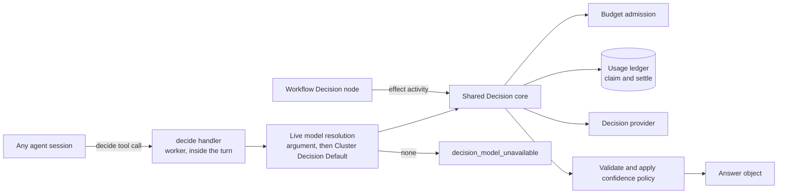

# Decision models as a tool for all agents (`decide`)

Status: **IMPLEMENTED — phases 0–1; phase 2 proposed** (approved design, 2026-11-21).

- Owner: Affan Dar. The owner approved the design and every recommendation in "Decisions" below.
- Design-evidence source pin: `microsoft/PilotSwarm` at `2c63e3082e130ce759a7fe7c975955d4d0b4dce7` (v0.8.14).
- Builds on: [`workflow-decision-node.md`](workflow-decision-node.md) (IMPLEMENTED).

## 1. Summary

PilotSwarm 0.8.14 added Decision models (Microsoft Decision 1.1). Today an agent can use one only through a Workflow
**Decision node**: an agent that needs one calibrated answer in the middle of a turn must write, save and start a
Workflow.

This design adds one built-in tool, **`decide`**, to the system tool layer, for every agent. The agent passes a
typed question (`choice`, `noul` or `score`) and optional context. The tool returns the same answer object as the
Decision node (outcome, confidence, probabilities), plus the model used and the token usage.

- The tool and the Decision node share **one execution core**.
- Model availability is checked **when the tool is called**, never written into a prompt.
- Every call is checked against the budget and recorded in the existing usage ledger.
- The answer is advice. It never grants authority.

Phase 0 fixes two gaps found when 0.8.14 rolled out.

## 2. Problems

| # | Problem | Impact |
|---|---|---|
| P1 | Agents cannot call a Decision model directly. | Agents guess at classifications, or build a one-node Workflow for one question. |
| P2 | The MCP and in-session `set_model_default` tools accept only scope `cluster` or `user`. | An administrator cannot set the Cluster Decision Default from MCP. |
| P3 | The Workflow guidance in the system message stated Decision availability from a worker cache. A warm session keeps its system message. | A session that started before the default was set kept saying Decision was unavailable. |

## 3. Goals and non-goals

Goals:

| ID | Goal |
|---|---|
| G1 | Any agent can ask a Decision model one typed question during its turn and get a calibrated answer. |
| G2 | The tool and the Decision node give the same answer for the same provider response (one code path). |
| G3 | Model availability and model choice are checked at call time, not when the prompt is built. |
| G4 | Every call is admitted against the budget before it runs and recorded in the existing ledger. |
| G5 | The tool never widens authority. Its answer is advice, never approval. |
| G6 | Fix P2 and P3. |

Non-goals: exactly-once delivery for a tool call (the Decision node stays the durable path); a Decision call without a
session; Decision models as chat models; a per-user or per-session Decision default; a general custom tool renderer.

## 4. Phase 0 — gap fixes (IMPLEMENTED)

### 4.1 `set_model_default`: `scope` and `purpose`

A model default has a `scope` (whose default: `cluster` or `user`) and a `purpose` (what it picks a model for: `chat`, the
default, or `decision`). Both `set_model_default` tools take the purposes from one SDK table,
`MODEL_DEFAULT_PURPOSES` (`packages/sdk/src/model-default-purposes.ts`): for each purpose, its model kind, whether a
reasoning effort and context tier apply, and its setter for each scope it has (a `user` setter is the user override).
Both tools write through `modelDefaultSetter(scope, purpose)`, which refuses a scope the purpose has no setter for. A later
purpose (a summarization or regen default) is one more entry and the setters it names.

| `scope` | `purpose` | Sets |
|---|---|---|
| `cluster` | `chat` (or omitted) | The cluster's ordinary-session default (administrators). |
| `user` | `chat` (or omitted) | The caller's own ordinary-session default. |
| `cluster` | `decision` | The Cluster Decision Default (administrators): an exact shared Decision model `provider:model`, no reasoning or context. |
| `user` | `decision` | Refused before any write: there is no user Decision default yet. |

- MCP `set_model_default` (`packages/app/mcp/src/tools/providers.ts`) sends `scope: cluster, purpose: decision` to the
  management client's existing `setModelDefault` scope `cluster_decision`, which enforces its rules. Storage, the
  management client, the HTTP API and the portal are unchanged.
- In-session `set_model_default` (`packages/sdk/src/provider-tools.ts`, the Token Manager tools) calls
  `setClusterDecisionDefault` for that pair. Before any write it applies the management client's rules, in its order
  and words, against the provider rows at the time of the call: an administrator; both a provider and a model, or
  neither to clear it; an existing shared provider; an exact `provider:model` Decision model that the provider's type
  declares; no reasoning effort or context tier; a credential that can serve it. A worker that has not loaded its
  provider-type catalog refuses to set one. The database checks the role, the class and the credential again when it
  saves. An unknown scope or purpose is refused before any write.
- `test/unit/provider-surface-parity.test.mjs` checks both schemas, the routing of each pair to its setter, and the
  refusals.

### 4.2 Static Decision line in the Workflow guidance

- The guidance (`packages/sdk/src/workflow/guidance.ts`) carries one static line: "Save flags and Start refuses
  Decision states without an eligible Cluster Decision Default." (Save stores the revision invalid with the reason;
  Start refuses to run it.) It never states availability or a default model, and
  it fits the guidance budget tests. A prompt built before this change keeps its old line until the session's prompt is
  rebuilt.
- The worker no longer passes a Decision capability to the session manager, so nothing can bake it into a prompt.
- Save and Start already read availability live from the CMS and refuse with an actionable message when no eligible
  Cluster Decision Default exists.

## 5. Phase 1 — the `decide` tool (IMPLEMENTED); phase 2 (proposed)

### 5.1 Architecture



| Component | Responsibility |
|---|---|
| Shared Decision core | Admission, provider pin check, ledger claim, one provider call, validation, confidence policy, ledger settle. Used by the node and the tool. |
| `decide` tool factory | Built per session by the session manager. Declares the tool, resolves the model live, calls the core, shapes the result. |
| Live model resolution | Reads the Cluster Decision Default and provider rows from the CMS at call time. It may cache for 5 s at most. |

### 5.2 Interface

Input:

```jsonc
{
  "question": { "type": "choice" | "noul" | "score", "instructions": "…", "criteria": … },
  "context": <any JSON>,            // optional, 64 KiB at most; sent to the provider as its state
  "minimum_probability": 0.0-1.0,   // optional; below it the outcome is "uncertain"
  "model": "provider:model",        // optional; a live Decision model on a shared provider
  "timeout_seconds": 1-120          // optional; default 30
}
```

The question follows the Decision node's rules exactly (the same validator): `choice` has two or more labelled
options, `noul` is a yes/no question with optional `true`/`false` descriptions, `score` has two or more ordered levels.
Reserved labels (`uncertain`, `scored`, runtime error codes) are refused.

Success:

```jsonc
{
  "ok": true,
  "decision": { "questionType": "choice", "outcome": "approve", "selection": "approve", "confidence": 0.87,
                "probabilities": { "approve": 0.87, "reject": 0.13 },
                "policy": { "minimumProbability": 0.7, "uncertain": false },
                "model": { "qualified": "azure-openai:ps-decision-1-1" } },
  "model_source": "explicit" | "cluster_decision_default",   // "agent" is reserved for the phase 2 agent setting
  "usage": { "inputTokens": 412, "outputTokens": 9 } | null,
  "latency_ms": 640
}
```

`decision` is the Decision node's output object, unchanged. `noul` adds `probability` (of yes) and
`probabilities: {yes, no}`; `score` adds `score` and `levels`, with outcome `scored`.

Failure: `{ "ok": false, "error": { "code", "reason", "message", "retryable", "action" } }`.

| Code | Meaning | Retry |
|---|---|---|
| `decision_model_unavailable` | No usable model. Reason `no_cluster_decision_default`, `cluster_decision_default_ineligible` or `model_not_eligible`. | No |
| `invalid_input` | The question, labels, context or limits are not valid. | No |
| `budget_exceeded` | A provider hold, limit or allowance was reached, or the per-turn cap. The session is not paused. | No |
| `forbidden` | The provider refused the credential. | No |
| `unavailable` | Throttling, a network error, a 5xx answer, or a replaced provider. | Yes |
| `timed_out` / `cancelled` | The deadline passed, or the turn was stopped. | Yes / No |
| `invalid_output` | The provider's answer failed validation. | Yes |
| `execution_failed` | Any other failure. | No |

Errors never carry a key, token, HTTP status or provider body.

### 5.3 Execution

| Topic | Design |
|---|---|
| Where it runs | In the worker, inside the turn, like every system tool handler. No new activity and no orchestration version change. |
| Idempotency | Ledger operation `decide:<session>:<tool call id>`, attempt 1, claimed before the provider call. One tool call makes at most one provider call and one ledger row. |
| Retry | None inside the tool. Each error says whether a second call is sensible. |
| Worker loss | A re-run turn may issue a new tool call id: at most once per tool call, not exactly once per turn. The Decision node stays the exactly-once path. |
| Admission | Budget admission before every call, fail closed. Over budget returns `budget_exceeded`; the session is not paused. |
| Ledger | `capability: "decision"`, purpose `Agent decide tool`, session, agent id, owner and charge class from admission. Unknown usage is NULL. |
| Telemetry | The inference span uses purpose `agent_decide_tool`. The transcript shows the normal tool events. |
| Limits | 20 calls per turn, 64 KiB context, 30 s default timeout, 120 s maximum. The turn's stop signal cancels the call. |
| Data | Only `question` and `context` leave the worker, and only to shared providers an administrator configured. The provider instance is pinned per call; a replaced provider fails closed. |
| Authority | The tool reads nothing and writes only the ledger. The description says the answer is advice. |

### 5.4 Which agents get the tool

| Agent kind | `decide` | Rule |
|---|---|---|
| Ordinary and root sessions | On | System tool layer. |
| Named agents with a `tools:` list | On | The list adds tools; system tools are always present. |
| System agents | On, charged as `system` | Budget-exempt at admission, but every call is ledgered. `regen-distiller` gets no system tools. |
| Sub-agents | On | A `tools` ceiling removes it unless the ceiling names `decide`. |
| Native tasks | Off | Platform tools stay closed for native tasks (phase 2 opt-in). |
| Workflow agent nodes | On, within the state's `tools:` | In a test run the call is intercepted and a fixture answers. |
| Workflow script states | Off | On the script denylist. Scripts use the Decision node. |

`decide` is a reserved tool name. A worker with no CMS provider store (no PostgreSQL catalog, as in some embedded and test setups) has no Decision models at all; `decide` is not declared there, as Workflow Decision nodes are unavailable there too.

### 5.5 Phase 1 implementation

| Part | Where |
|---|---|
| Shared core `executeDecisionCall` | `packages/sdk/src/decision-call.ts`; `runDecision` (`workflow/runtime.ts`) keeps its entry, attempt cap, run binding, liveness and its own refusal words, and calls the core. |
| Question validator | `validateDecisionQuestion` in `workflow/compiler.ts`: the compiler's own `compileDecisionQuestion`. |
| Tool | `packages/sdk/src/decision-tools.ts`: declaration and handler in one `defineTool`, argument checks, live resolution (`createDecisionCatalogReader`, at most 5 s), codes, retry hints and actions. |
| Session wiring | `SessionManager.setDecideToolHost` (the worker gives it the provider store, its provider-type catalog and the same provider factory as Decision nodes); the tool is added beside the feature tools for every session except service sessions, on any worker with a Decision host. |
| Reach | Service sessions excluded with the other system tools; `tools` ceilings and state `tools:` limits cut it; `decide` is in `SESSION_ATTACHED_TOOL_NAMES` (reserved, so native tasks cannot get it) and on the Workflow script control list. |
| Telemetry | Inference span purpose `agent_decide_tool`; ledger purpose `Agent decide tool`. |
| Stop and deadline | `ManagedSession` gives each turn an abort signal, passed to PilotSwarm tools as `invocation.turnSignal` and aborted by Stop, abort, a forced settle and the turn's end. `decide` combines it with the SDK's signal and bounds the whole call by `timeout_seconds`: a stop or deadline before the provider call returns `cancelled` or `timed_out` with no provider call (a call already claimed is settled with unknown usage). |
| Per-turn cap | Counted on the turn itself: the runTurn activity gives one count to every run it makes, so a recovery re-run on a new handle keeps it, and every new turn (including the first turn after a restart) starts at zero. A turn run again as a new activity (a retry, or after a worker loss) starts a new count, as it makes new tool calls. |
| Workflow node | `runDecision` keeps its liveness check from provider resolution to the end of the call (core hooks `onProviderReady` and `onCallEnd`), its refusal words and its settlement warning. |

Tests:

| Layer | File |
|---|---|
| Unit | `test/unit/decide-tool.test.mjs`: validator equals the compiler, every argument rule, resolution order, staleness (a tool built with no default answers once it is set), every error code and retry hint, the ledger key and settlement, the per-turn cap, the footprint, the live-shape fixtures, and byte-equal parity with `runDecision` for the same provider body. |
| Reach | `test/unit/decide-tool-reach.test.mjs`: ordinary, named, system and sub-agent sessions; service session and no host; ceilings and state limits; the per-turn cap across a turn; reserved, native-task, script and test-run rules. |
| PostgreSQL | `test/local/decide-tool.test.js`: admission, claim and settlement rows, one claim per tool call, unknown usage stored as NULL, a held provider refused without pausing the session, system charge class, a cleared default read live. |
| Live | `test/live/decide-tool.live.test.mjs` (`npm run test:live:decide`, not in default suites): `choice`, `noul` and `score` through the tool's handler against Microsoft Decision 1.1; with `PS_DECISION_LIVE_RECORD=1` it records `test/fixtures/decision-live/*.json`. `test/live/decide-tool-agent.live.test.js` (`npm run test:live:decide:agent`): a real worker turn on a real chat model calls the declared tool with the shared Decision provider and the Cluster Decision Default set through the management client, and one ledger row is checked. Both fail, naming each missing setting, when they are not configured. |

Live qualification (2026-11-21, Microsoft-Decision-1.1 version 1, GlobalStandard deployment `ps-decision-1-1`, the same
model as the CHK Cluster Decision Default): `choice` billing at 0.9998 in 391 ms (89 input and 1 output tokens); `noul`
answered with only `{type, noul}`, p = 0.9991, yes, in 210 ms; `score` 2.52 with an index-keyed legend and a
`confidence` field, in 190 ms. The tool parsed all three; the recorded bodies are the unit fixtures. The worker-backed
run passed the same day: the chat model called `decide`, Microsoft Decision 1.1 answered `billing`, and one ledger row
(purpose `Agent decide tool`, 80 input and 1 output tokens) was settled.

### 5.6 Delivery plan

| Phase | Scope | Exit criteria |
|---|---|---|
| **0 — Gap fixes** (IMPLEMENTED) | `set_model_default` `purpose: decision` on MCP and the agent tool. Static Decision line in the guidance. | An administrator sets the default over MCP. A prompt built after the change states nothing about Decision availability. |
| **1 — MVP** (IMPLEMENTED) | Shared core. `decide` for all system-layer sessions. Live resolution. Admission and ledger. Script denylist. Generic tool rendering. | Node/tool parity test passes. Live qualification of `choice`, `noul` and `score` against Microsoft Decision 1.1. |
| **2 — Reach and surfaces** (follow-up) | Agent `decisionModel` setting (only if a real agent needs it). Native-task opt-in. Decision section in `list_available_models`. One-line portal and TUI summary. Session-scoped HTTP and MCP `decide`. Review the ledger (system-session calls included) and tune the per-turn cap from it. | The same results on the portal, HTTP, MCP and the agent tool. Two weeks of ledger data with no budget surprise. |

## 6. Decisions (approved)

| # | Decision | Choice |
|---|---|---|
| 1 | Default reach | On for every system-layer session. A `tools` ceiling or a state's `tools:` removes it. Native tasks opt in later. |
| 2 | Where the call runs | Inside the turn (at most once per tool call). A durable activity stays a later option. |
| 3 | HTTP and MCP `decide` in the MVP | No; phase 2, session-scoped. |
| 4 | `model` override by any agent | Yes, limited to live Decision models on shared providers, charged to the session owner. |
| 5 | System agents on day one | Yes; their calls are ledgered as `system`, and the ledger is reviewed in phase 2. |
| 6 | Limits | 20 calls per turn; 64 KiB context. |
| 7 | Agent-level `decisionModel` | Phase 2, only if a real agent needs it. |

## 7. Alternatives considered

| Alternative | Why rejected |
|---|---|
| Agents start a one-node Workflow | Needs a saved definition and a new session per question. |
| A package or MCP server | Child agents cannot activate packages, so not "all agents"; it would bypass the shared ledger path. |
| A durable activity per call | Exactly once, but needs a new orchestration version and a control round trip for an advisory call of about one second. |
| Decision models as chat models | The two kinds were separated on purpose: different APIs, outputs and budgets. |
| Keep availability in the prompt and refresh it | Any cached claim can go stale (P3). A live check cannot. |
| Exempt `decide` from `tools` ceilings | Breaks the rule that a ceiling removes tools of every kind. |

## 8. Risks

| Risk | Mitigation |
|---|---|
| Agents call `decide` in loops | Admission on every call, 20 calls per turn, ledger rows by agent. To stop spend: a hold on the Decision provider refuses new user-charged calls (a limit refuses them only once it is reached); clearing the Cluster Decision Default stops new calls that name no `model`, after the tool's catalog cache (at most 5 s); only making every Decision model ineligible (the provider's credential or its `decisionModels` entry) also stops explicit-`model` calls and budget-exempt system sessions. No change cancels a request already sent. |
| An agent treats the answer as approval | The description says it is advice; approval stays with `ask_user` and Workflow approval states. |
| System sessions are budget-exempt | Their calls are ledgered as `system`; review the ledger in phase 2. |
| The tool and the node drift apart | One shared core and a parity test that requires byte-equal output. |
| Mock and live response shapes differ | A live qualification run records real responses as fixtures (Decision 1.1 answers `noul` with only `{type, noul}`). |
