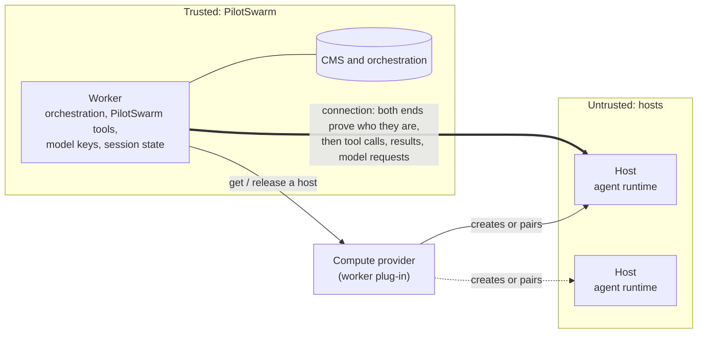
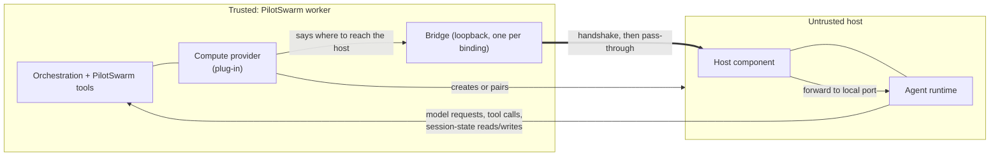

# Compute providers: run a session's agent somewhere other than the worker

**Status:** exploration on a feature branch, draft PR for discussion.

**Native-state integration:** the successor candidate removes remote
worker-backed SessionFs. Each logical session, including delegated children,
has a separate executor/native home. The common host imports/exports native
state under a verified supervisor barrier; the trusted worker owns archive/CAS
and committed completion. A controlled runtime restart is allowed if needed,
not required every turn. Real runtime/supervisor and integrated-head qualification
remain gates. See [the provider implementation guide](../developer/building/compute-providers.md).

The detailed narrative below records the original framework baseline. Its
worker-backed session files, tree-shared hosts/connections and timeout-based
recovery descriptions are historical, not compatibility modes in the native
candidate. The implementation guide specifies their replacements and gates.

**Built in the original framework:** shared compute targets and their names; the
provider interface and its connection contract, for providers whose hosts
are reachable at an address; the bridge; the handshake and the host
component; the remote turn and its trust boundary; the host's idle
shutdown; the skill folders and MCP servers a remote session gets; and
the deployment settings for a default target and for requiring compute.
Target management is built in the management client and the Web API.

**Deliberately not in this change,** designed in section 12 (Future work):
clear failure reasons that stop a turn at once; running providers as
registered services; a target's own capabilities and models; leases and
end-of-tree notices; personal targets; hosts that can only reach outwards;
and target management from the CLI, the portal and MCP.

**Date:** 2026-11-02, revision 6. Revision 1 restructured the proposal to
match `docs/proposals/session-workspaces.md`: a high-level design for a
human reader first, then numbered sections. Revision 2 records the built
behaviour after the parts were brought together. Revision 3 defers clear
failure reasons to a follow-up that needs no orchestration change.
Revision 4 moves provider services and target capabilities/host models
into Future work, so this change is only the provider seam, the connection
and the targets. Revision 5 records skills and MCP servers as built, and
brings the terms, the decisions and the implementation map in line with
what is on the branch. Revision 6 records that the worker-to-host connection
is not encrypted in this change, what a deployment must do about it (section
4.8) and how encryption will be added (section 12.8).

A session's agent runs on a host chosen for that session, not inside the
worker that serves the turn. The worker stays the trusted side: it keeps the
orchestration, the PilotSwarm tools, the model keys and the session's history.
The agent runtime runs on a separate host and is driven over a connection
whose two ends prove who they are. A **compute provider** supplies the hosts:
today it is a plug-in loaded into the worker, and running providers as
registered services outside the worker is future work (section 12). Nothing
in the design names a cloud, a platform, a network product or a kind of
kind of host; a provider can front a pool of hosts or a sandbox service.

## High-level design

**The problem.** Every session's agent runtime — the part that runs
model-chosen commands — runs as a child process of the worker that serves the
turn. So model-chosen code runs next to the worker's database access and its
credentials. And every session runs on the same kind of machine, whatever
isolation or tools it needs.

**The solution.** Keep the worker as the trusted side, and let the agent run
on a separate host chosen per session. A compute provider supplies hosts. The
worker drives the agent over a connection; everything the agent sends back is
checked by the worker.

**Two ways a host can become available**, and this change builds the first:

- **Deployment-time registration.** The deployment installs a provider in the
  worker, and an administrator registers a target that names it. The provider
  knows how to create or find its hosts, and answers every turn with an
  address the worker connects to. Everything in sections 4 and 5 is this
  model.
- **Runtime registration.** A host announces itself when it becomes
  available — by pairing with a one-time code, for example — rather than the
  deployment knowing where it is in advance. Hosts come and go, and such a
  host usually connects outwards rather than waiting to be dialled. This is
  future work; section 12 says which entries belong to it.



> **Rule:** an agent never runs where the CMS or orchestration state can be
> reached. Commands and results cross that line; credentials and database
> access never do.

The main ideas:

- **A compute target** is a registered place to run: shared (`shared/<label>`)
  or someone's own (`<owner>/<label>`). A session picks one when it is created
  and keeps it.
- **A compute provider** knows one kind of compute. It gets a host ready, says
  how to reach it, and decides what happens to the host when PilotSwarm is
  done with it.
- **One host per logical session.** Children may inherit target authority,
  but never the parent's executor, native home, process or database.
- **The connection is just a pipe.** Each provider has one way of being
  reached. PilotSwarm needs only a two-way, ordered, reliable connection and
  never learns what it is made of.
- **Both ends prove who they are** before anything else crosses, with one
  handshake PilotSwarm defines for every provider. The handshake does not
  encrypt the connection, so **the network between workers and hosts must be
  private** (section 4.5); encrypting it is future work (section 12.8).
- **The worker keeps what must be trusted:** orchestration, PilotSwarm tools,
  PilotSwarm's model keys and the session's history.

**One turn**

```text
On the worker that runs the turn:
1. Load the conversation (as today).
2. Re-check that the session's owner may still use its target.
3. Ask the provider for the tree's host.
4. Open the connection; worker and host prove who they are.
5. Start or resume the agent on the host. Its model requests come back to
   the worker, which adds PilotSwarm's real keys; its session files are
   written to the worker's folder for that session.
6. The model runs the turn. PilotSwarm tools run in the worker.

If step 2, 3 or 4 fails, the model is not called and the turn fails with
a reason. The agent never falls back to running on the worker.
```

**Registering compute**

| Who | Does what |
|---|---|
| Whoever runs the worker | Loads a compute provider into it (`computeProviders`, or `registerComputeProvider`). Running providers as registered services is future work (section 12). |
| An administrator | Registers a target (`shared/<label>`). |
| A user creating a session | Picks the target, then a model. |

**Who owns what**

| Owner | Owns |
|---|---|
| PilotSwarm core | Targets and who may use them. The turn steps above. The connection bridge and the handshake. Model-key handling and session state. It has no cloud, network-product or host-type code. |
| A compute provider | Getting, cleaning, reusing or discarding hosts. Its one way of being reached. Putting the handshake secret on its hosts. Any spare hosts kept ready for bursts. |
| The deployment | The network between workers and hosts. |

**What does not change**

- A session without a target runs exactly as today: same tools, same prompt,
  same steps. Only sessions that name a target see anything new.
- The original framework used an additive migration; its target registry is now migration 0088.

**Main choices**

| Chosen | Instead of | Why |
|---|---|---|
| Everything above the provider sees only a pipe | Core knowing the medium | The connection can change without the control plane changing. |
| One handshake defined by PilotSwarm | Each provider's own trust scheme | The worker checks every host the same way itself. |
| The provider decides a host's fate | PilotSwarm deleting hosts | Some hosts are never removed; others are cleaned and reused. Only the provider knows. |
| Names that include the owner | Free-form global names | Names never collide between people, and nobody can take a name administrators need. |

For details, see section 3 (the parts and who owns what), 4 (the PilotSwarm
design), 5 (the `process` test provider), 6 (walkthroughs), 9 (decisions
and open items), 11 (what is built) and 12 (future work).

## Contents

1. [Goal and scenarios](#1-goal-and-scenarios)
2. [Terms](#2-terms)
3. [Architecture and who owns what](#3-architecture-and-who-owns-what)
4. [PilotSwarm design](#4-pilotswarm-design)
5. [The `process` provider: the test provider](#5-the-process-provider-the-test-provider)
6. [Walkthroughs](#6-walkthroughs)
7. [Corner cases](#7-corner-cases)
8. [Test plan](#8-test-plan)
9. [Decisions, verified facts and open items](#9-decisions-verified-facts-and-open-items)
10. [Implementation map](#10-implementation-map)
11. [Delivery plan](#11-delivery-plan)
12. [Future work](#12-future-work)

## 1. Goal and scenarios

The one rule the whole design serves:

> **Invariant:** an agent runtime never runs in the same place as anything
> that can reach the CMS or the orchestration state. Commands and results may
> cross that line; database credentials and routes to the database never do.

| # | Scenario |
|---|---|
| S1 | A session runs its agent on a host that is not the worker, chosen when the session is created and kept for the life of the session tree. |
| S2 | A sub-agent runs on the same host as its parent. One host serves a whole session tree. |
| S3 | A session moves to another worker and keeps going. The next worker reaches the same host, or is given a fresh one, without losing the conversation. |
| S4 | An administrator registers compute everyone shares. |
| S5 | A target says what it offers. That shapes the targets a person is shown. (Future work, section 12.) |
| S6 | A new kind of compute is added without changing the worker. (Future work, section 12: today a provider is a plug-in loaded into the worker.) |
| S7 | When compute cannot be used, the person is told why, and a reason that retrying cannot fix stops the turn at once. |
| S8 | Existing sessions, with no target, run exactly as they do today. |

Not in scope for this work: creating hosts on demand (provisioning); a session
whose sub-agents span more than one target; isolating session-state files
between tenants beyond today's confinement.

Accepted, and stated here so nobody expects otherwise:

- The agent runtime is untrusted: it runs model-chosen code. Everything it
  sends back to the worker is checked in the worker.
- A worker can crash without telling a provider it is finished with a host, so
  a host must be able to end itself. The PilotSwarm component on it does that
  after a set time with no connection.
- Today a connection is trusted because of where it goes and the runtime's own
  token. The mutual handshake (section 4.5) is what makes
  each end prove itself.

## 2. Terms

Defined before use, in the order the rest of the document needs them.

| Term | Meaning |
|---|---|
| Worker | The trusted PilotSwarm process that serves a turn. It holds the orchestration, the PilotSwarm tools, the model keys and the session's history. |
| Agent runtime | The part that runs the agent loop and the model-chosen commands (such as a shell). Today it runs in the worker; this design lets it run on a host. Also "the runtime". |
| Compute type | A kind of place a runtime can run. |
| Compute provider | The code for one compute type, named by its `kind`. It gets a host ready and says how to reach it. |
| Compute target | A registered instance of a compute type, stored in the CMS. A session picks one. Named `shared/<label>`. |
| Host | The concrete place a session tree's runtime is bound to. Has an `id` and an `incarnation` that changes when it is replaced. |
| Host component | A small PilotSwarm program on the host. It answers the handshake, then forwards the connection to the runtime's local port. |
| Binding | One (target, session tree) pairing to a host. It carries a per-binding secret. |
| Idle shutdown | The host component ending itself after a set time with no connection, which is what frees a host nobody came back to. |
| Pipe | A two-way, ordered, reliable byte stream to one host's runtime. Everything above the provider sees only a pipe. |
| Transport | How a provider's hosts are reached. This change builds one: the host is reachable at an address, which the worker dials. A provider that opens the connection itself is future work (section 12). |
| Bridge | A loopback listener the worker runs, one per binding. It gives every remote runtime an address on this machine, so the handshake happens in one place whatever is behind it. |
| Handshake | One mutual proof PilotSwarm defines, run on every remote connection before any session traffic. Each end proves it holds the binding's secret. |
| Endpoint | What `connect` returns: `uri`, an address the worker dials. |
| Capabilities | What a provider says about the hosts it makes. Fixed in provider code. This change uses one: `files`, which says whether the host shares the worker's folders. |
| Placeholder credentials | Per-session, per-binding random stand-ins the runtime holds instead of real model keys. The worker swaps them for real keys on each request. |
| Native session state | Declared runtime files/databases beside the executor; captured through the common host under a verified barrier. |
| Session tree | A root session and all of its sub-agents. It runs on one target, fixed at the root; every turn of every session in it is routed to a worker that can drive a remote runtime. |
| CMS | The session catalog database: sessions, events, and the new `compute_targets` table. |

## 3. Architecture and who owns what



Every arrow is a call the design makes. A `direct` provider's host is reached
at an address the worker dials; a `pipe` provider's connection is opened by the
provider and joined through the bridge. Either way the host component answers
the handshake first, then forwards to the runtime. The runtime's model
requests and session-state access come back to the worker, which checks them.

PilotSwarm core has no cloud, network-product or host-type code. In the split
below, "the provider" is the code for one compute type, and "the deployment"
is everything the operator runs: the network between workers and hosts.

| Concern | Core supplies | The provider / deployment supplies | Where they meet |
|---|---|---|---|
| Adding a kind of compute | A provider interface and a registry the worker loads plug-ins into (**built**). Registering providers as services outside the worker is future work (section 12) | A provider object with a `kind` and capabilities | `computeProviders` / `registerComputeProvider` |
| Registering a place to run | The `compute_targets` table, owner-qualified names, create/update/enable/disable/delete, resolve (**built**) | A `config` object the provider understands (no secrets) | `cms_compute_target_*` procedures |
| Getting a host for a tree | `bind` once per (target, tree), `connect` every turn, with deadlines (**built**) | Readying a host and saying how to reach it | `bind(req)`, `connect(req)` |
| Reaching the host | A bridge per host on the worker's machine, in front of every remote runtime; PilotSwarm opens every connection itself (**built**) | An address the worker can reach | the endpoint `connect` returns |
| Proving each end | One mutual handshake on every remote connection; a host component that answers it (**built**) | Putting the per-binding secret on the host; running the host component in front of the runtime | the handshake frames |
| Model requests | Placeholder credentials in the runtime; a per-connection handler that swaps them for real keys and refuses anything else (**built**) | Nothing; the provider never sees a key | the request handler |
| Session-state files | Native host state, validated into trusted staging before archive/CAS | Separate from workspace/file-sharing capabilities | the common host/state service and qualified supervisor |
| Finishing with a host | `release` per leaving session, as a hint; the host component's idle shutdown as the backstop (**built**) | Running the runtime under the host component; deciding the host's fate | `release(req)`, the idle timeout |
| Failures | One shape for every compute error (`CODE: message`); a failure goes through the ordinary turn retry (**built**). Clear reasons that stop a turn at once are future work (section 12) | A code, a message and an optional retry hint | the `ComputeFailure` shape |
| Management surfaces | List, create, update, enable/disable and delete targets, in the management client and the Web API (**built**). The CLI, portal and MCP surfaces are future work (section 12) | Nothing | the management client and API |

How the two sides work together, end to end:

```text
Register
 1. [operator -> worker]  Load a compute provider into the worker, which
                      declares its kind and capabilities.
 2. [admin/user -> core]  Register a target of that kind.
Create and run
 3. [user -> core]    Create a session naming the target. Core records the
                      target's id.
 4. [core -> provider]  Each turn: re-check the owner may use the target; bind
                      (once per tree) and connect.
 5. [core <-> host]   Open the connection through the host's bridge; the
                      handshake proves both ends; then the runtime runs the turn
                      and its model requests come back to the worker.
Finish
 6. [core -> provider]  The session leaves a worker: release, as a hint. A host
                      nobody connects to ends itself. The provider keeps, cleans
                      or discards it.
```

## 4. PilotSwarm design

### 4.0 Which registration model this builds

**Deployment-time registration**, throughout. A provider is installed in the
worker by the deployment, an administrator registers a target naming its
kind, and the provider answers `bind` and `connect` with a host and an
address the worker opens a connection to. The deployment decides what hosts
exist and how they are made; a host is reached because the provider says
where it is.

**Runtime registration** is the other model, and nothing here builds it: a
host announces itself when it becomes available — pairing with a one-time
code, say — so the deployment does not know its address in advance, hosts
come and go, and such a host usually connects outwards instead of being
dialled. Section 12 groups the entries that would make up that model.

The two are not alternatives to choose between: runtime registration needs
the same target record, the same provider interface, the same bridge and the
same handshake, so it is an addition to what is here rather than a
replacement for it.

### 4.1 Targets and names

Migration 0088 adds `compute_targets`. An administrator registers a target;
every signed-in user can run a session on it. **(built)**

Every target is named `<owner>/<label>`, and the owner part is the reserved
word `shared`, as in `shared/build-pool`. PilotSwarm builds that part itself;
whoever registers a target supplies only the label. Labels are plain: letters,
numbers, dot, dash and underscore, at most 64 characters. Keeping the owner
part in the name now means a later change can add targets with another owner
without renaming anything. Personal compute targets will be supported in a
later change.

A target has a `name`, an `id` that is never reused, a `kind` (which provider
handles it), an optional `displayName`, `enabled`, and a `config` object that
PilotSwarm stores but never interprets. Only those who may manage a target see
its `config`. **`config` is not a place for secrets** — a hash such as a
pairing-code hash is allowed, a credential is not; providers get their
credentials from the deployment. All rules live in the `cms_compute_target_*`
procedures; the store only shapes rows and errors.

A session names its target at creation (`computeTarget`). The create
transaction checks the target exists and is enabled, and records the target's
id with the name. Before every turn the worker resolves the target by that id
and checks again that it is still there and still enabled. A deleted target
leaves its sessions blocked; a new target with the same name is a different
target and never takes them. When a name is looked up, a whole
`<owner>/<label>` is taken as it is, and a bare label is shorthand for the
shared target of that label.

### 4.2 The provider interface

A provider is the code for one compute type, loaded into the worker as a
plug-in. **(built)**

```ts
interface ComputeProvider {
  readonly kind: string;
  readonly capabilities: {
    files: "worker-local" | "shared-mount" | "provider-api" | "none";
  };
  validateTarget?(req): Promise<{ ok: true } | ComputeFailure>;           // before every bind
  bind(req): Promise<{ ok: true; host: ComputeHostRef } | ComputeFailure>; // once per (target, tree)
  connect(req): Promise<ComputeConnectResult>;                             // every turn
  release?(req): Promise<void>;                                            // once per leaving session
}
```

- Every call carries an `AbortSignal`, and the worker enforces a deadline
  (bind 5 minutes, connect 2 minutes, release 30 seconds). A provider that does
  not answer fails the call; it cannot hold a turn or a shutdown.
- `validateTarget` asks, for the tree's owner: may this principal use what the
  target's config points at? It runs before every bind.
- `bind` is idempotent per (target, session tree). `connect` runs before every
  turn, possibly on another worker, and returns how to reach the runtime and
  the session's folders as the host sees them.
- A host has an `id` and an `incarnation` that changes when the host is
  replaced. The worker keys its connection pool by address, host and
  incarnation, so a replaced host gets a fresh connection and the old one is
  stopped when no session uses it.
- An endpoint is `uri` (a runtime already listening, which the worker dials) or
  `pipe` (opened through the provider). By default the worker dials only
  loopback addresses: a provider that reaches a host elsewhere secures that
  path itself. A worker can accept other addresses only when its network
  secures them.
- The `process` provider (section 5) is the test provider the SDK uses to
  exercise this path; it is internal and never registered by default.
  Sessions without a target run as today. Applications add providers in the
  worker options (`computeProviders`) or at runtime
  (`registerComputeProvider`). Running a provider as a registered service,
  outside the worker, is future work (section 12).

### 4.3 Provider capabilities

A provider declares, in its own code, one thing about its hosts: how the
worker's file tools reach them. It is the same for every target of that kind
and never sent by a host. **(built)**

| Field | Meaning |
|---|---|
| `files` | How PilotSwarm tools in the worker reach the host's files: `worker-local`, `shared-mount`, `provider-api` or `none` |

That is the only one because it is the only one PilotSwarm acts on: artifact
file tools that name worker files are allowed for a remote session only when
the provider says the host shares those files with the worker. Descriptive
fields that nothing reads — which operating systems a provider's hosts run,
whether a host is an isolation boundary — were left out rather than carried
unused; a provider that needs to say more can say it where it is used.

**Not in this change.** A target saying what it offers — its own capabilities,
refreshed as the worker reaches it — and a target offering models of its own
are future work (section 12). Until then a target carries no advertisement,
and every session picks a model from PilotSwarm's own catalog.

### 4.4 The connection contract and the bridge

Every host is reached at an address. `connect` returns a `uri` endpoint and
PilotSwarm opens the connection itself, so no provider carries transport code
and a registered target never carries any either. **(built)**

A provider written against an earlier interface, where it could open the
connection in its own code, is refused where it is registered rather than
accepted and then never asked to open one.

Hosts that cannot be dialled — a host that can only reach outwards — are left
for later (section 12).

Everything above the provider sees only a pipe: a two-way byte stream to one
host's runtime. It does not know, and must never need to know, what the pipe is
made of.

**What the connection must guarantee** (the provider's side):

| | |
|---|---|
| Two-way | Bytes flow in both directions |
| Ordered and reliable | Nothing lost, reordered or duplicated |
| Interactive | Many round trips per turn, output arriving as it is produced |
| Visibly broken | A broken pipe closes or errors; it never goes quiet and leaves a turn waiting |
| Pointed at one host | It reaches that host's runtime and nothing else |
| Protected end to end | Private and tamper-proof whenever what it crosses cannot be trusted. PilotSwarm does not encrypt this connection and cannot check that anything else does; it is the provider's and the deployment's work. See section 4.5 and section 12 |

**What PilotSwarm guarantees** (the worker's side):

| | |
|---|---|
| One bridge per host | Each host of a session tree gets one bridge, on the worker's own machine, on a port the operating system picks and nothing outside the worker is told. The sessions of a tree share a host, so they share its bridge, its address and its pooled runtime connection — a bridge per session would open a second control connection into one runtime |
| Nothing unproven passes | Every pipe the bridge opens is handshaken (section 4.5) before it is joined to anything. A host that cannot prove itself never sees a byte of the turn |
| Local only | The bridge listens on this machine alone, so a bridged connection meets the loopback rule by construction |
| The token is required | The bridge serves whoever connects to it on this machine, so the runtime's own connection token is what makes reaching it worth nothing. A remote endpoint without a token is refused: a session that runs on the worker is model-chosen code on the same machine, and without a token it could drive another session's runtime |
| One pipe per connection | A pipe serves its own host's runtime only, never shared between connections |
| Reconnect or fail clearly | A broken connection is replaced by a fresh pipe. A pipe that cannot be opened, or that takes too long, fails the turn with a clear reason rather than hanging |
| Closed on release | The bridge and every pipe through it close when the session leaves the host and when the worker shuts down |

The runtime connection can only dial an address, so the bridge is the smallest
thing that turns a pipe into one: a loopback listener that asks for a fresh
pipe per connection, proves both ends, and joins the two. Every runtime that is
not the worker's own child process goes through it.

### 4.5 The handshake and the host component

The pipe says nothing about who is on it. So before any session traffic flows,
the worker and the host prove themselves to each other, with one handshake
PilotSwarm defines — the same for every provider and every kind of connection.
**(built)**

- **Per-binding secret.** The provider's `connect` returns a `bindingId` and a
  random `secret`, at least 32 bytes, fresh for every new binding. It is never
  logged, never stored in the CMS, and kept only in worker memory for the
  binding. Providers must never reuse it across trees. A remote endpoint that
  arrives without one cannot be used: the worker refuses it rather than
  connecting to a host it would have no way of recognizing.
- **The proof.** The worker sends a hello with the protocol version, the
  `bindingId` and a worker nonce. The host answers with a host nonce and a
  proof over both nonces and the `bindingId`. The worker verifies, answers with
  its own proof, and the host verifies. Then the stream is a plain pass-through
  to the runtime. Each side's proof is over a string that names which side made
  it, so neither can be replayed as the other. Frames are length-prefixed and
  size-bounded, with a deadline; comparisons are constant-time; the host
  remembers the worker nonces it has answered and refuses a repeat, so a
  recorded exchange is worthless. Any failure closes the connection, and the
  turn fails with a "handshake failed" reason (section 4.10).
- **The host component.** A small PilotSwarm program runs on the host, in front
  of the runtime. It answers the handshake, then forwards the stream to the
  runtime's local port, and reaches nothing else. It serves exactly one binding
  and refuses any other. It listens for the worker's side, so a host must be
  one the worker can reach at an address. It ships in the SDK as a function and
  as a command, and the `process` test provider runs it in front of its
  runtime, so the tests do the real handshake. A provider's `connect` therefore
  returns the host component's address, never the runtime's own port.
- **The runtime token still counts.** Inside the tunnel, the runtime's own
  connection token is still used. The handshake proves the two ends; the token
  still guards the runtime.

A machine that merely claims to be the host cannot take part.

**What the handshake does not do.** It proves who is at each end of the
connection. It does not protect what crosses it: after `ok` the stream is a
plain pass-through, with no key derived from the exchange and nothing bound to
the channel. A party that can sit in the middle of the connection and relay
the four frames can then read or change everything that follows — the
runtime's token, the prompts, the tool results. The host also answers a hello
before the worker has proved anything, which is what makes relaying them
possible at all. So the network between a worker and its hosts must be private
or otherwise protected; PilotSwarm does not encrypt it and cannot check that
anything else does. Encrypting it is designed in section 12.

The provider's whole part is to put the secret on the host and hand the same
secret to PilotSwarm; a reserved, ignored version field leaves room for
provider extras later (see section 9, open items), which would add to the
handshake and never replace it.

### 4.6 Every turn of a remote session

**(built)**

1. The worker reads the tree's compute target from the root session's record,
   re-checks it for the tree's owner, and picks the provider for its `kind`.
2. The session's folders are made ready as today (worker paths).
3. The compute provider binds the host (once per tree) and connects: an
   endpoint plus the host's folder paths.
4. The connection is opened through the host's bridge — a connection to the
   host's address — and the handshake proves both ends before anything of the
   turn crosses. The
   first connection of a binding is proved before a prompt or a model request
   is sent, so a host that cannot be reached or cannot be recognized fails the
   turn where compute failures are named.
5. The worker builds or reuses a runtime connection per endpoint. A remote
   connection gets no worker environment and no model keys; instead it gets:
   - a request handler: every model request comes back to the worker, which
     checks it against the session's grant and swaps placeholders for real
     keys;
   - a native state service: the runtime keeps real files beside the executor;
     the common host captures/restores them while PilotSwarm retains archive/CAS authority.
6. The session is created or resumed with the host's working directory. The
   model runs the turn; PilotSwarm tools run in the worker as external tools.

The trust boundary, concern by concern:

| Path | Rule |
|---|---|
| Model requests | The runtime holds per-session, per-binding placeholders, not keys. Each pooled connection has its own request handler, serving only its sessions. A request must go to the session's model origin and path prefix, by `GET` or `POST`; the worker swaps placeholders for real keys and sends it with redirects refused. Anything else is refused. |
| Native session state | Declared required roots/files/databases, bounded manifests and verified writer exclusion. Host input cannot supply worker protocol or completion metadata. Independent workspaces remain outside the archive. |
| Folders mounted on a host | A provider whose `files` capability says it mounts the session's folders must mount only that session's own folders, with access control on the file server, so a host can never reach another session's or another person's folders. PilotSwarm states the rule and cannot enforce it. |
| Worker files named by tools | Any tool that names a worker path from a remote session — the artifact file tools, and loading an agent or skill by path — may use only that session's own workspace folders, and only when the provider says the host shares them with the worker; otherwise none. For those sessions a path is resolved before it is checked, so a link inside a folder that points out of it is refused. A session that runs on the worker is unchanged. |
| Skill folders | The folders this session is authorized to see — the same selection a session on the worker gets — are copied to the host read-only and named by the host's paths. Every file is resolved before it is read and must stay inside the folder it was found in; the copy has a file count and a byte count a deployment sets. `load_skill` is a worker tool and is unchanged. |
| A package's MCP server | Runs on the host, started by the runtime out of the copied package folder, from the entry as it was written. It gets the environment the host gives it: never the worker's, and never a `${VAR}` resolved against the worker's. An entry that asks for a worker value, or names a path outside its own package folder, is unavailable with the reason. |
| A deployment's MCP server | Runs on the trusted side, started and configured exactly as it is today — same command, same environment, same headers, same credentials. The runtime reaches it as a remote server through the host component, and PilotSwarm forwards the traffic without reading it. The server's command, environment, headers and address never cross. |
| What a forwarded call carries | Only servers the deployment configured for that session, named by a ticket the worker minted. The caller's own credentials travel unchanged and the worker adds none of its own; it adds a statement of which session is calling and who owns it. Messages and calls are bounded. A deployment can keep any of its servers away from these sessions. |
| Repository MCP servers | Off, as they are for a session on the worker. |
| Runtime-authenticated models | A model that signs inside the runtime with a credential the worker holds is refused on a remote target. |

On every admitted turn the worker rebuilds the effective model provider options
and secret resolvers from the current selection. Only the opaque stand-ins may
remain stable on the same connection, so warm reuse and cold resume cannot
retain an old API key, project header or token callback. Removed stand-ins no
longer resolve. Provider request-option changes still rebind the SDK handle.

Before capture, the worker closes effect/callback admission and drains admitted
work. The common host then obtains a qualified native writer hold or stopped-runtime
boundary while the export service and environment remain alive. The barrier stays
held through capture, trusted validation, archive/CAS and idempotent completion.
Unknown work or failed capture cannot publish success or authorize replacement.
SDK detach, flush, idle and matching copies alone are not this barrier, and
session-end hooks are not invoked automatically after every turn.

### 4.7 Where a provider runs

Today a compute provider is a plug-in loaded into the worker: the application
passes it in the worker options, or registers it at runtime, and the registry
holds one provider per `kind`. A kind with no provider on this worker fails
the turn with a clear code rather than silently running locally. **(built)**

That is enough for the `process` test provider and for a deployment that
is happy to ship provider code in its workers. It is not enough for a provider
that needs rights on whatever it makes hosts out of, or for a third party's
provider: those should run as their own service, registered by an
administrator, and be reached through one generic connector so the worker
holds neither the code nor the rights. That is designed and was built on the
exploration branch, and is **future work** — see section 12.

### 4.8 Turning it on: a default target, and requiring compute

The rule this design serves — an agent never runs where the CMS and the
orchestration can be reached — holds for a session that has a compute target.
It does not hold for a session that has none, and nothing so far stopped a
deployment having both. Two settings close that, in two stages. Both are off
by default, so an existing deployment and local development are unchanged.
**(built)**

| Setting | What it does |
|---|---|
| A default compute target | A new root session that names no target is given this one, as `shared/<label>`. It is resolved and recorded at creation exactly as a named target is, so the per-turn re-check is unchanged, and sub-agents keep inheriting their tree's target. System sessions get it too. |
| Require compute | The worker refuses to run an agent runtime as its own child process. A session with no target, and no default, fails its turn with `COMPUTE_REQUIRED` before a runtime is started or a prompt moves. A target whose provider runs the runtime on the worker is refused the same way: what matters is where the agent ends up, not whether a target was named. |

Whether a session has a target is read from its own record, never from
anything the agent can set.

Default-target normalization happens before deciding whether creation config
must be stored, including system-session callers that omit that config entirely.
The target name and validated immutable ID are recorded together; creation is
refused if the catalog cannot persist that selection. An explicit or remembered
compute selection also refuses a turn when its catalog or creation-config reader
is missing, independently of `requireCompute`. A requested target without a
recorded tree selection is refused, not silently backfilled. Genuinely unselected
local sessions keep their existing behavior; these checks do not repair old
records automatically.

**Before a deployment turns this on: a private network.** The connection
between a worker and a host is not encrypted (section 4.5). Before any target
is registered, the deployment makes sure that:

- the hosts' addresses are reachable only on a network the deployment
  controls, never across one it does not;
- only the workers can reach the host component's port, for example with a
  network policy that admits the worker pods and nothing else, including
  other hosts;
- a provider whose hosts are anywhere else protects the path itself, or waits
  for section 12.8.

**Rolling deploys.** Workers that can drive a runtime on another host declare
a capability tag, `pilotswarm.compute.v1`, and the turns of a session in a
compute tree are routed only to those. Without it, a worker from before this
change would pick such a turn up and run the session's agent as its own child
process, beside the CMS, the orchestration and the model keys — which is the
one thing the design exists to prevent, and it would happen silently. Routing
fails closed: a turn like that is never scheduled untagged, because an
untagged turn is exactly the one an older worker would take.

**Every** turn of such a tree carries it, not only the root's. The tag is
taken from the target recorded for the tree's root, in the catalog, and
written into the orchestration's input when the orchestration starts —
never from a field a caller passed. That matters because the two cases
where nobody passes one are the common ones: a sub-agent is never given a
target of its own, and a root that was given the deployment's default has
it only in its catalog record. Reading the caller's field alone left
exactly those turns untagged.

**And the worker checks again.** Before it starts a runtime, the worker
asks what target this session's tree has. If the tree has one and what is
about to start is the worker's own child process — for any reason: the
catalog cannot resolve targets, the tag did not route, a path that was
missed — the turn fails with `COMPUTE_REQUIRED` instead. The tag keeps
those turns away from workers that cannot serve them; this makes sure a
worker that does serve them never quietly falls back.

**A new orchestration version carries this, not the tag alone.** The tag is
chosen inside the orchestration, so a worker running an *older build of the
orchestration itself* during a rolling deploy would not choose it, and would
then run the turn as its own child process. So compute is gated on the
orchestration version, the way session workspaces were gated on 1.0.80:
**1.0.82 is frozen and 1.0.83 is the latest**. Every new session starts on
1.0.83, and only an orchestration at 1.0.83 or later chooses the compute
routing tag.

An old worker does not register 1.0.83 at all, so during a rolling deploy —
or after a rollback to the previous build — it cannot run any step of a
compute session: those sessions wait for a worker that can, which is the
behaviour a session already has when no worker serves its tag. A session
already in flight on 1.0.82 keeps replaying on the frozen copy, which is
byte for byte what the previous build ran and has no compute branch in it.

The routing tag and the worker's own refusal to start a local runtime for a
session recorded as remote both stay, as the two layers behind the version
gate.
Whether to add a version is being decided separately from this change.

**The two stages.** With require-compute off, the deployment is in mixed mode:
some sessions run on hosts, some on the worker, and the gaps in section 12.10
apply. With it on, every session's agent runs where the CMS and the
orchestration cannot be reached, which is when the invariant actually holds.
Removing the worker-local path altogether — so there is no mode to be in — is
section 12.11.

**The worker's own model helpers.** A few things run a model over text
without being an agent: generating a session title, listing models, and
distilling a transcript when context is regenerated. They are not agents
and the require-compute policy leaves them alone — refusing them would
break titles and context regeneration for no gain in where agents run.

But they do read content, and for a remote session that content came from
an untrusted host, so an injection in it could try to make the helper do
something on the worker. So they are not merely expected to be tool-free:
they are **made** tool-free, for every session and every deployment, with
or without compute targets. Each one is created with no built-in tools,
no MCP servers, no skill folders, and a permission handler that refuses
whatever is asked for. None of them needs a tool to do its job, so there
is nothing to lose; what there is to gain is that no prompt in a
transcript can start a shell beside the CMS and the model keys. Anything
added later that runs a model over a session's content belongs in the
same shape (`permissions.ts`, `TOOL_FREE_HELPER_SESSION`).

### 4.9 Host lifecycle: idle shutdown and reuse

PilotSwarm says when it is finished with a host, and the host looks after
itself. **(built)**

- **Release.** `release` is called once per session that leaves a host:
  ended, moved (dehydrate), evicted, shutdown, or failed. Sessions of one tree
  share a host, so a host is free of PilotSwarm only once no session uses it.
  Release means PilotSwarm no longer needs the host for that session tree; it
  never means destroy.
- **Release is a hint.** It may never arrive. A worker can crash, a session can
  move, a network can go away. A provider must never wait for it to know a host
  is free.
- **Idle shutdown.** The host component ends itself after a set time with no
  connection at all — none proved, and none part-way through proving itself.
  Thirty minutes by default; the clock starts when the component does, so a
  host nobody ever reaches goes away too. That clock runs on the host, so it
  keeps running whatever happens on the worker's side, which is what makes it
  the backstop a hint cannot be. A warm session holds its connection open, so a
  host in use is never touched.
- **The runtime goes with the component.** A provider should run the runtime
  under the host component — as its child, for example — so that the
  component's exit ends the whole host rather than leaving a runtime behind
  with nothing in front of it. The `process` test provider does exactly this.
- **How long a host actually lives.** Three clocks decide it, and they are
  not the same clock. The worker keeps a session warm for its hold window
  (`dehydrateOnIdle`, 30 minutes by default) and then evicts it a little
  later; a session's host is let go when the session leaves its worker, and
  a session evicted on a worker lets go there too. A warm, busy session
  holds its connection open and the host's idle timer never starts. A warm
  but *quiet* session is a third case: a session with no skills and no MCP
  servers has no side channel, so nothing heartbeats, and its host can end
  itself after its idle timeout while the worker still believes it is
  there. The next turn then rebinds — correctly, provided the provider
  changes the incarnation (section 4.15). Set a target's idle timeout
  against the deployment's hold window and eviction, not independently of
  them: a wait or a cron interval longer than the two together gets a fresh
  host, a fresh copy, and none of the processes or files that lived outside
  the session's folders.
- **A session whose host has gone.** Nothing special happens: its next turn
  binds again and the provider gives it a host. The conversation is in the
  worker's own storage, so it carries on where it left off. What is lost is
  anything that lived only on the old host — see section 12.
- **The provider decides the host's fate.** Keep it, because some kinds are
  never taken away; clean it and hold it ready for the next workload; or
  discard it and make a fresh one, to keep spare capacity. Only the provider
  knows.
- **The reuse rule.** A host may take a new workload only with nothing left
  over from an earlier one — files, logins, running processes, secrets. The
  provider guarantees that, and PilotSwarm does its part by using a fresh
  handshake secret for every new binding on a host.

PilotSwarm records no host bindings of its own. Telling a provider exactly when
a tree is finished, rather than letting a timeout do it, is designed in section
12.

### 4.10 Failures

Every compute failure carries a `code`, a human `message`, and an optional
`retryAfterMs`. The worker builds every compute error it raises through one
helper, so the line a turn carries is always `CODE: message`. **(built)**

A compute failure then goes through the ordinary turn retry, like any failed
turn: three attempts over about 45 seconds, then the session shows the error.
That affects only sessions that use a compute target.

**Left out on purpose: clear reasons.** Separating failures that retrying
cannot fix from ones that may pass, and stopping the first kind at once with a
clear reason, was left out to keep this work small. See section 12.

### 4.11 APIs, events and errors

Compute targets are managed through the management client and the Web API,
the way model providers are. **(built)**

| Surface area | Operations |
|---|---|
| List and manage targets | List the targets; create (admin); update; enable/disable; delete |
| Create a session | The management client and the Web API accept `computeTarget` |
| Audit | Every mutation is audited the way provider mutations are |

Managing targets needs the fleet-admin right and lives under the admin path.
Managing targets from MCP and
the CLI, and choosing one in the portal and the TUI, are future work (section
12), as are checking a target on a worker and listing the models a target
offers itself. The API reference docs are updated alongside; this proposal is
not that reference.

### 4.12 Compatibility

The design is additive. A session without a target runs exactly as today: the
runtime runs in the worker, with the same tools, the same prompt and the same
steps — on 1.0.83 as it did on 1.0.82, because the only new branch in the
orchestration is the one a compute target opens. Migration 0088 only adds a
table and its procedures; it changes no existing row. There is no feature
flag: the new behaviour appears only for a session that names a target.

It does add an orchestration version. 1.0.82 is frozen in
`orchestration_1_0_82/`, replay-only and byte for byte what the previous
build ran, and 1.0.83 is the latest: what new sessions start on, and the
only version that chooses the compute routing tag. That is what makes a
rolling deploy safe — see 4.8 and corner case K13.

### 4.13 Skills and MCP servers on remote sessions

A session that runs on the worker is handed its skill folders as worker
paths and its MCP servers as worker commands, worker environments and
worker addresses. None of those mean anything on a compute host, and
several of them are exactly what must not go there. **(built)**

The rule that decides every case below is the one the whole design
serves, stated as a loan: **the worker lends nothing.** Its identity, its
secrets and its network never reach a host, and are never used on a
remote caller's behalf.

**The side channel.** Beside the runtime connection, the worker opens a
second connection to the same host component, proved by the same
handshake. A connection says in its hello what it is for — `runtime` or
`control` — and the purpose is signed into both proofs, so a connection
proved for one can never be used as the other. The side channel carries
length-prefixed frames: notices, and any number of independent byte
streams, so a file copy and several MCP conversations share one
connection without waiting for each other. A frame is bounded, a notice
is bounded, and one channel carries a bounded number of streams. One
channel per host, like the bridge, and only when a session on that host
actually has folders or servers.

**Skill folders are copied.** The worker walks the folders this session
is authorized to see — the same list the local path builds, with the same
visibility rules — and writes down a digest per file and a digest per
folder. It asks the host which digests it is missing, sends only those,
and asks for the folders to be laid out. The runtime is given the host's
paths. Because every file is named by its content, a folder that has not
changed costs a question and an answer; a folder that has changed is laid
out again, and a host that has been replaced has an empty store and gets
everything. A folder's digest is part of what decides whether the session
rebinds, so an edited skill is read as it now stands on the next turn.

A link that points out of a folder is left behind with the reason, not
followed. The one shape that is carried is a folder of links to folders,
which is how skills from several sources reach a runtime as one folder
today: each link's own folder becomes a folder in its own right, and
everything inside it must stay inside it.

A session's copy has a byte count and a file count, 64 MiB and 4,096 by
default and both settable by the deployment. Anything that does not fit,
is not there, or cannot be read is unavailable, the reason is recorded in
the session's events, and the turn goes on — the same as a local MCP
server that fails to start. If nothing can be delivered to the host at
all, the turn fails where every compute failure is named.

**A package's servers run on the host.** Code out of an agent package is
no more trusted than the model that asked for it, so it runs where that
model runs: the runtime starts it out of the copied package folder. It is
built from the entry **as it was written**, never from the entry the
worker resolved, because resolving is what puts worker values into it. A
`${VAR}` is therefore not quietly emptied — the server is unavailable,
and the reason names the field that asked. Paths are rewritten to the
copy; a path outside the package folder is a worker path, and that server
is unavailable too. Its environment is what its own entry states and
nothing else.

**A deployment's servers stay here.** The deployment's own code, with the
deployment's own credentials, keeps running on the trusted side, started
and configured exactly as it is today. The runtime is given, for each
one, something it can reach on its host: for a server that speaks over
its own input and output, a small PilotSwarm relay the runtime starts; for
one reached over HTTP, a local address on the host component. Both do the
same thing — hand what the runtime said to the worker down a stream of
the side channel, and hand back what comes the other way.

PilotSwarm forwards that traffic **without interpreting it**, so whatever
the runtime and the server support between them keeps working: tools,
resources, prompts, notifications, anything added later. Only HTTP itself
is understood, because an HTTP request has to be made to be forwarded at
all. Its rules on that path are few and all of them are about the loan:

- **Only servers that session was given.** Each one is named by an opaque
  ticket the worker minted for one session and one server; a ticket this
  worker did not mint, or minted for a session that has let go of the
  host, reaches nothing. A session keeps the same ticket for a server for
  as long as it is on that host, so a warm runtime keeps working.
- **Only what the deployment configured, plus what the caller sent.** The
  server is started, or called, exactly as it is for a session on the
  worker: the same command, the same environment, the same headers, the
  same address. The worker adds nothing of its own on top of that — no
  worker identity, no worker credential. Where the caller sends a header
  of its own it goes through as it arrived; where the deployment
  configured a header of the same name, the deployment's wins, because a
  header the deployment set for that server is the deployment's decision
  and not a caller's to replace.
- **Only where the deployment pointed it.** The configured address pins
  both the host and the path. What the runtime asks for is joined under
  that path and checked first: it must begin with a single `/`, carry no
  fragment, no `.` or `..` step and no encoded separator or dot, and the
  result must still be the configured origin and still inside the
  configured path. Anything else is refused with a reason, and so is a
  method the worker does not forward.
- **A statement of who is calling.** The worker attaches the session, its
  tree, its owner and its target — as headers for a server reached over
  HTTP, as environment for one the worker starts — so the server can make
  its own checks and keep its own record. It is attached last, so nothing
  from the host can be passed off as it. It is **not signed**: it is
  trustworthy only because it arrives over a connection only the worker
  can make, so a server that reads it must be reachable from the worker
  and nowhere else. Signing it is future work (section 12.14).
- **Only while the session is authorized.** The whole set of servers a
  session may reach is reconciled at every turn, including when the set
  is empty. A ticket for a server the session is no longer authorized
  for — a selection removed, an allowlist narrowed, a deployment that has
  set the server away from remote sessions — is revoked, and whatever was
  open under it is ended with it.
- **Bounded.** One conversation has a byte ceiling in each direction; one
  HTTP call has a deadline for being answered and for the gap between
  bytes (the server's own setting when it has one), so a server that
  streams for a long time still works; request bodies are carried as they
  arrive rather than collected; and how many servers one host may have
  started, how fast, and how many bytes they may hold at once are all
  capped per host.
- **The older event-stream transport is refused.** That transport
  announces, inside the stream, the address the runtime must post to. The
  worker forwards the stream without reading it, so that announcement
  would arrive naming somewhere the runtime cannot reach — and reading
  the stream to rewrite it would put PilotSwarm in the middle of an MCP
  conversation, which is what this deliberately does not do. Such a
  server is unavailable with that reason.

**Repository MCP servers stay off**, exactly as they are for a session on
the worker.

#### What a deployment should know

A server offered to these sessions is reachable by model-chosen code
running on an untrusted host. **A server offered to remote sessions should
act as the caller.** The worker passes the caller's own credentials
through and vouches for which session and owner is calling; a server that
decides what it will do from those is safe to offer.

A server that instead uses its own standing credentials gives **every**
remote agent whatever those credentials can reach. That is a choice a
deployment is allowed to make, and PilotSwarm neither prevents it nor
pretends it is contained. Where it is not wanted, keep the server away
from these sessions:

```json
{
    "internal-db": {
        "type": "stdio", "command": "node", "args": ["/app/plugin/mcp/db.mjs"],
        "tools": ["*"],
        "remote": false
    }
}
```

`remote` is a deployment-catalog field, like `default` and
`allowedAgents`: a package `.mcp.json` may not carry it, it is stripped
before any configuration reaches a runtime, and servers are available by
default. Available by default is deliberate: a deployment's servers
already run on the trusted side for a session on the worker, with the
deployment's own configuration, and a remote session reaches the same
server the same way. `remote: false` is how a deployment says one of them
is not for agents it does not trust. A server kept away this way is unavailable with that reason in
the session's events, and the rest of the session's map is unaffected.

#### What this does not do

- **A host is one trust domain.** The sessions of a tree share a host, and
  a session's relay configuration is readable by anything on that host. A
  sibling session on the same host can therefore use another sibling's
  ticket. Sessions of one tree are not isolated from each other by this
  design; the host is.
- **A package's server must bring what it needs.** It runs out of the
  copy, so its dependencies have to be in the package folder or already on
  the host. Nothing is installed on a host.
- **The copy is a copy.** A runtime that writes into it is writing to a
  read-only folder on its own host; nothing is written back.
- **The connection is not encrypted.** The side channel crosses the same
  network as the runtime stream and carries the same requirement
  (section 4.5, and section 12).

### 4.14 Orthogonality with existing features

A session that runs its agent somewhere else is still a PilotSwarm session:
its orchestration, its tools, its state and its model keys are where they
have always been. What changes is that three things stopped being true at
once — the runtime is no longer the worker's own child process, it can
outlive the worker, and it is no longer trusted code.

This is what that does to the features a session already has. **Changed
here** means this change made it behave correctly for a remote session;
**works differently** means it is correct but not what a reader would
assume; **not yet** means the feature is unavailable to a remote session
and future work says what it would take.

| Feature | Remote session | What a reader should know |
|---|---|---|
| Stop and Steer, abort, permission prompts, `ask_user`, PilotSwarm tools, tool refresh, reasoning effort, context tiers, title generation | works | All of it already goes through the runtime connection, so the bridge carries it unchanged. |
| Durable sub-agents, nesting, messaging, `complete_agent`, `cancel_agent` | works | A child runs on its tree's host, so one host runs the whole tree. Capacity is the tree's, not the session's. |
| Inline artifacts, `fromArtifact`, metadata, links, `show_artifact`, image prompt attachments | works | None of these name a filesystem path; images cross as bytes on the runtime connection. |
| Facts, transcript, checkpoints, dehydrate and hydrate, regeneration | profile qualification required | Native state is exported into trusted worker staging and recovered from the accepted archive. Required files and databases must be qualified. |
| Background shells and the busy guards | changed here | The task list is taken at the runtime's word and stopped only by asking the runtime; the worker never inspects or signals a process id a host reported. A stop the host will not confirm leaves the session busy. |
| PilotSwarm's protocol files | changed here | `.ps-*` names remain trusted-worker metadata and do not enter the imported native payload. Host-authored control files are refused. |
| Moving between workers | changed here | The worker a session leaves lets go of the host, so two workers never drive one runtime. A provider counts its users per (worker, session). |
| A connection that breaks | changed here | The bridge tells the worker when the last connection to a host has gone and the clients reaching it are dropped, so the next turn connects afresh. Keepalive stops a half-open pipe looking healthy. |
| Session events | changed here | An event a remote runtime sends under a type PilotSwarm emits is recorded under `unverified.<type>` and nothing acts on it. Bind, connect and host replacement are recorded. |
| Models | changed here | GitHub Copilot models are refused at creation and at a model switch, left out of the list a remote session is offered, and reported at worker start when a default target meets a GitHub Copilot system model. |
| Workspace paths: `get_session_workspace`, `set_session_workspace`, path loads, artifact file modes | changed here | Paths the agent sees are paths on its host; a path it names is translated back before any file is read. Attached on the worker and available on the host are reported separately. |
| An extra folder added mid-turn | changed here | Nothing puts it on the host during the turn, so the session is told it arrives next turn rather than being given a path that is not there. |
| A deployment's own worker-module tools | changed here | A tool is told the agent runs elsewhere and which worker folders, if any, that session may name. Confining a path is the tool's to do; PilotSwarm's own tools already do it. |
| Waits, cron, the hold window, eviction | works differently | A host lives while any worker keeps a live connection to it, and ends itself after its idle timeout once nothing is connected. A wait or interval longer than the hold window and the worker's eviction together gets a fresh host, a fresh copy, and none of the processes or files outside the session's folders. `wait_on_worker` pins the worker, not the host. |
| Native tasks | works differently | The forbidden-tool and model rules are enforced through hooks the runtime chooses to call, so on a remote host they are advice, not a fence. This costs correctness only: the parent could call those tools itself. |
| Usage and budgets | works differently | Admission is decided on the worker; what was spent is what the host reported. The worker sees every model response and does not yet meter from it (12.16). |
| Regeneration's distiller | works differently | It is a service session under the tree root, so it runs on the tree's host, with no tools and a permission handler that refuses everything. Its model must not be a GitHub Copilot one. |
| System and management agents with a default target | works differently | Each system tree holds its own host for as long as it lives, and cron keeps it warm. Their principal is null, so a provider that refuses a null principal blocks every system session. |
| Model transport | works differently | Model requests come back through the worker over the runtime connection. A provider or wire format the runtime would drive over a WebSocket is refused; `wireApi: responses` has not been exercised remotely. |
| Portal Workspace tab, canvas files and declared commands, portal git | works differently | These use the portal's own storage and executables, as they always have. With a host that shares the session's folders they describe the same bytes; with one that does not they describe the worker's copy, and a change made there never reaches the host. Nothing in this change alters them (12.10). |
| Rolling deploys and rollbacks | changed here | Compute lives in orchestration version 1.0.83; 1.0.82 is frozen. An old worker does not register 1.0.83, so it cannot run a step of a compute session — those sessions wait for a worker that can. The routing tag and the worker's refusal to run a remote session's agent locally stay as the layers behind it. |
| A worker crash or shutdown mid-turn | works differently | The host and the commands it is running survive. The turn is redelivered and replayed into the same host, so a side-effecting command can run twice or alongside itself. Fencing is 12.6. |
| Host-local state: scratch files, processes, the runtime's logs | not yet | None of it is in a snapshot, none of it is rolled back by a reset or a lineage jump, and nothing collects the runtime's logs from the host. A replaced host loses all of it with no notice to the session (12.7, 12.17). |
| Artifact file modes on a host that shares no folders | not yet | `fromFile` and `toFile` are refused with the reason, and the session's instructions say so. Moving bytes over the side channel is 12.16. |
| The SQL tools and SQLite-backed todos | profile qualification required | Declare required databases and qualify backup/closure plus restored integrity/logical data. Synthetic database bytes or WAL filenames are not proof. |

### 4.15 What a provider must guarantee

The provider interface says this in its own words; this is the same list in
one place, because every entry is something a provider that gets it wrong
breaks for a session rather than for itself.

- **A fresh incarnation whenever the runtime restarts.** The worker uses
  `(id, incarnation)` to decide whether it is still talking to the same
  host. A provider that restarts a runtime and reports the same
  incarnation leaves the session reaching a runtime that has lost its
  conversation, until the worker evicts it.
- **A connection token that is stable for an incarnation.** The pooled
  client is keyed on the address, the token and the incarnation. A
  provider that mints a new token on every `connect` makes every turn a
  cold resume and retires the client each time.
- **One host, more than one worker.** `bind` and `release` are per
  (worker, session). A session moving between workers is held by both for
  a moment, and sub-agents of one tree run on whichever worker takes their
  turn. A provider that counts its users by session id alone will have one
  worker's release take a host away from another that is still using it.
- **Room for the tree.** Each worker holding a session of the tree uses a
  connection for the runtime and, when the session has skills or MCP
  servers, one for the side channel. The host component's limit
  (`--max-connections`, 16 by default) must be set for the widest tree the
  target is meant to serve; a host that is full answers
  `COMPUTE_HOST_AT_CAPACITY`.
- **A host's environment is the provider's to set.** The worker sends no
  environment and no GitHub token. Proxy settings, CA bundles, telemetry
  variables and anything a runtime needs to reach the network are the
  provider's, not inherited from the worker.
- **A clean host for a new workload.** No files, logins, processes or
  secrets from an earlier one.
- **A private path to the host.** The address a provider returns is reachable
  from the workers over a network the deployment controls, and the host
  component's port is reachable from the workers only. PilotSwarm does not
  encrypt the connection (section 4.5) and cannot check the path; a provider
  that cannot promise this is not ready to be used until section 12.8 exists.
- **`release` is a hint.** It may never arrive — a worker can crash, a
  network can go away. The host component's idle shutdown is what actually
  frees a host nobody came back to.

### 4.16 When a Stop arrives during preparation

A turn of a remote session is registered for turn control only after the
runtime is ready, and getting ready means a bind (up to 5 minutes), a
connect (2 minutes) and, when the session has skills or servers, a copy (3
minutes). A Stop sent in that window is held and applied when preparation
finishes; it does not cancel the provider call. Letting a held Stop cancel
preparation is 12.18.

## 5. The `process` provider: the test provider

`createProcessComputeProvider()` (kind `process`) runs each session tree's
runtime as a separate local process on the worker's machine and returns its
loopback address and a fresh connection token. **(built)**

It is the **test provider**: it exists so the remote path can be exercised on
a laptop and in CI, and as the smallest readable example of a provider. It is
internal to the SDK — not exported from the package, not registered by
default — and it is not a sandbox. A deployment that wants compute brings a
provider of its own.

It exercises exactly the remote path a real provider uses. The runtime gets a
scrubbed environment — its own home, a `PATH`, the connection token, nothing
from the worker — and leads its own process group, so stopping it stops the
commands it started. It starts the host component (section 4.5) in front of
its runtime, so tests run the real handshake.

A local test drives it through real workers and PostgreSQL and checks:

| Check | Result |
|---|---|
| A turn on a `process` target runs a shell inside the separate runtime | the command sees the runtime's home, and none of the worker's variables |
| The runtime holds only placeholders | every model request still carries the real key; no placeholder reaches the model |
| Session state | native beside the executor; verified capture into worker-owned archive/CAS staging |
| A new worker with a new runtime | resumes the session from that folder; the next request carries the earlier turn |
| Stop | the worker's shutdown releases the host; no runtime process is left |
| A sub-agent | runs in its tree's runtime, though its own config names no target |
| Refusals | an unknown target is refused at create; an unknown kind fails the turn; an address that is not local fails the turn and releases the host |

What the runs showed, carried here so later work does not relearn it:

- The supervisor establishes the actual native home before runtime create/resume.
  State roots are declared and qualified, not mapped into virtual worker file RPC.
- The runtime keeps a private local store in its home. It is not needed to
  resume: a new runtime with an empty home resumed the session. The `process`
  provider keeps that home private and removes it with the host.
- A refusal at bind or connect is retried like any failed turn today. Stopping
  at once on an unknown or disabled target needs the clear-failures work
  (section 12).

## 6. Walkthroughs

Two generic shapes, to show the one design covers them. Each arrow is a call
from section 3 or 4.

### 6.1 A shared pool

An administrator registers `shared/build-pool`. Its hosts sit in a pool the
provider owns, each reachable at an address the worker can dial.

```text
Create:   the worker loads the pool's provider; an admin registers
          shared/build-pool.
Turn:
 1. core re-checks the owner may use the target, binds a host from the pool,
    and connects. The host is reachable, so connect returns a uri endpoint.
 2. core dials the address; the host component answers the handshake; the
    runtime runs the turn.
 3. a sub-agent of the same tree reuses the same host.
Finish:   the tree ends and core releases the host; the provider cleans it and
          returns it to the pool, with nothing left over. A host nobody came
          back to is ended by its component's idle shutdown.
```

### 6.2 A sandbox service

A sandbox provider creates a fresh sandbox per tree, each reachable at an
address the worker can dial.

```text
Create:   the worker loads the sandbox provider; an admin registers a target
          of its kind.
Turn:
 1. core binds; the provider creates a sandbox, starts the host component in
    front of its runtime, and connect returns that component's address and a
    per-binding secret.
 2. core runs a bridge on loopback and connects to the address; the host
    component answers the handshake; the runtime runs the turn.
 3. the session runs on a model from PilotSwarm's own catalog; the runtime
    holds placeholders and every model request comes back to the worker.
Finish:   the tree ends and core releases the host; the provider discards the
          sandbox and, to keep a buffer, may start a fresh one. A sandbox
          nobody came back to is ended by the host component's idle shutdown.
```

## 7. Corner cases

| # | Case | Handling |
|---|---|---|
| K1 | A worker crashes mid-turn | The turn is redelivered and replayed. Nothing connects to the host meanwhile, so its component's idle shutdown ends it if the tree never comes back. |
| K2 | A session moves to another worker | Reconcile prior authority/writers first, then import the exact accepted archive into a verified native scope. Uncertain retirement never authorizes replacement. |
| K3 | A host is replaced | Its `incarnation` changes, so the worker builds a fresh connection and stops the old one once no session uses it. |
| K4 | A target is deleted while sessions reference it | Those sessions are blocked with a clear reason. A new target with the same name is a different id and never takes them. |

| K6 | The connection breaks mid-turn | A fresh pipe replaces it. A pipe that cannot be opened, or is too slow, fails the turn with a clear reason rather than hanging. |
| K7 | A session tree ends while not loaded anywhere | No `release` is sent, because no worker has it. Nothing connects to the host, so its component's idle shutdown ends it. |
| K8 | The handshake fails (wrong secret, a replayed nonce, an oversized frame, a timeout) | The connection closes and the turn fails with a "handshake failed" reason, including when the connection that carries the turn is the one that fails; the model is never called. The handshake proves who each end is, not that the stream between them is private — see 4.5. |
| K9 | A target names a kind this worker has no provider for | The turn fails with that reason, naming the kind. |
| K10 | A remote runtime asks for a model it was not granted, or a different destination | The request handler refuses it; no placeholder is resolved and nothing is sent. |
| K11 | A host shares no files with the worker | Artifact file tools that name worker files are refused for that session; only `worker-local` or `shared-mount` hosts allow them. |
| K12 | A reused host carries state from before | Not allowed: the provider must hand over a clean host, and PilotSwarm uses a fresh secret per binding. |
| K13 | A worker too old to drive remote runtimes | Compute lives in orchestration version 1.0.83, which an old worker does not register, so it can run no step of a compute session during a rolling deploy or after a rollback — such a session waits for a worker that can, as any session does when no worker serves its tag. A session in flight on 1.0.82 keeps replaying on the frozen copy, which has no compute branch. Behind that: the turns of a session with a target carry the compute routing tag, and a worker that somehow reaches one refuses to start a runtime of its own whatever route got it there. |
| K14 | The worker crashes or shuts down mid-turn | The host and the shells it is running survive the worker. The model request fails because the request handler went with the worker, but commands already started keep running until the host's idle shutdown. The turn is redelivered, reaches the same host with a provider that keeps it, and replays the prompt in the same folder — so a side-effecting command can run a second time, or alongside the first. Ending the previous runtime session on the first connect from a new worker is section 12.6. |
| K15 | A host is full | A tree wide enough to spread over many workers can reach the host component's connection limit while every worker is behaving correctly. The host answers `COMPUTE_HOST_AT_CAPACITY` and the limit is configurable (`--max-connections`); see 4.15. |

## 8. Test plan

Levels:

| Level | What runs |
|---|---|
| U | Unit tests, no runtime |
| L | Local integration: real workers and PostgreSQL, the `process` provider, a scripted model |
| Q | Qualification against a real provider and a real host (later) |

Every test must be able to fail. Break the rule on purpose once and see the
test turn red; the specs say which break proves which rule. Tests run on Linux
and Windows, so nothing may assume a path separator or a shell.

| Area | Level | Checks |
|---|---|---|
| Targets and names (**built**) | U, L | Owner-qualified names; a bare label resolves to the shared target; a deleted target blocks its sessions; a reused name is a new target; admin-only registration enforced in SQL |
| Provider interface and the connection (**built**) | U | A provider that opens its own connections is refused where it is registered; deadlines enforced |
| Remote turn and trust boundary (**built**) | L | A turn runs in a separate runtime with none of the worker's environment; every model request carries the real key while the runtime holds only placeholders; a request to any other destination is refused; session state round-trips and resumes on a new worker |
| The bridge (**built**) | U, L | A full turn through the bridge; one bridge per binding on loopback; a broken pipe reconnects or fails clearly; concurrent turns of one tree share one bridge; a remote endpoint with no connection token is refused |
| The handshake and host component (**built**) | U, L | Success; wrong secret either side; a replayed nonce; a truncated or oversized frame; a timeout; constant-time compare; the host component forwards to the runtime; a wrong secret fails the turn with no model request |
| Host lifecycle (**built**) | U, L | A component with no connection ends itself; an open connection keeps it alive and the clock starts again when that connection ends; the `process` provider's runtime goes with its component, and a returning session gets a fresh host |
| Failures (**built**) | U | Every compute error is `CODE: message` with its code and retry hint, and is never prefixed twice |
| Management surfaces (**built**) | U, L | List, create, update, enable/disable and delete across the management client and the Web API; every mutation audited; surface-parity tests updated |
| Turning it on (**built**) | U, L | A default target is recorded at creation and sub-agents still inherit; requiring compute fails a session with nowhere to run before any runtime starts, and leaves a deployment that has not turned it on unchanged; a session with a compute target is routed only to workers that declare the compute tag |
| The side channel (**built**) | U | Frames are whole however the bytes arrive; an oversized frame ends the channel; a stream number from the wrong half is refused; the stream count is bounded; a closed connection closes every stream with its reason; a connection proved for one purpose cannot be used as the other |
| The copies (**built**) | U | A folder is carried whole and recognised again unchanged; only changed files are sent; a folder of links to folders is carried and a link out of a folder is not; the byte and file limits refuse with the reason; a manifest cannot make the host write outside its store; a file is kept only under the digest its own bytes have; nothing that crosses carries a worker path |
| Where servers run (**built**) | U | A package's server is rebuilt for the host out of the copy, with only what its entry states; one asking for a worker value, or naming a path outside its package folder, is unavailable with the reason; a deployment's server becomes a ticket and its command, environment, headers and address never cross; a deployment can keep a server away; `default`, `allowedAgents` and `remote` never reach a runtime; nested custom-agent maps are transformed too |
| Forwarding (**built**) | U | A ticket this worker did not mint reaches nothing, and a session's tickets go when it leaves the host; a session keeps one ticket per server so a warm runtime keeps working; the caller's own credentials pass through unchanged, the configuration fills in what the caller did not send, and the worker's statement cannot be forged from the host; a conversation past its ceiling is cut off |
| Processes on a host (**built**) | U | A remote session's shell whose reported id is a live worker process is never signalled, and the stop that could not be proved is recorded; an ordinary session still kills its own; a reported id that exists nowhere on the worker still counts as running; a host that will not answer leaves the session busy |
| Trusted protocol metadata | U | Host payloads reject `.ps-*`; the worker reconstructs marker/result/receipt after validation. A held native barrier, not text-RPC fencing, excludes runtime writers. |
| Moving between workers (**built**) | L | A compute session's worker lets go when the session moves, with reason `moved`, and holds nothing afterwards; the next worker resumes the same conversation; one worker's release does not take a host from another worker still holding it, and the host goes when the last one lets go |
| A host that dies (**built**) | U, L | The bridge tells the worker when the last connection to a host has gone, and not when one of two closes or when the worker closes the bridge itself; keepalive is set on the worker's side of the pipe; killing a host under a warm session gives the next turn a fresh host with the conversation whole |
| What the worker takes from a host (**built**) | U | An event under a type PilotSwarm emits is recorded as `unverified.<type>` and only for a remote session; the runtime's own events are untouched; the compute lifecycle events are the worker's |
| Paths on both sides (**built**) | U | A path translates in each direction inside the session's folders and nowhere else; folders pair by position and an unplaced one is left out; `get_session_workspace` reports host paths and reports attachment apart from availability; a session on the worker is unchanged; a worker-side tool is told where the agent runs and which folders it may name; the session's instructions say where its shell is |
| Parity, end to end (**built**) | L | One remote turn reads a file out of a copied skill folder at a host path, calls a tool on a deployment server that ran in the worker's own process with its configured value (which never appears anywhere the host can see), and calls a tool on a package server that ran on the host out of the copy with none of the worker's environment; a second turn copies nothing again; an edited skill is read as it now stands; a server kept away is absent and the session's events say why |

## 9. Decisions, verified facts and open items

**Decided (2026-11-01)**

| Decision | Instead of |
|---|---|
| The runtime runs on a host, never where the CMS or orchestration can be reached | Running the runtime next to the worker's credentials |
| One isolated host per logical session, including each child | Implicit parent/child sharing of the native home/process/database |
| Every host is reached at an address; the worker opens the connection | A provider carrying transport code of its own |
| Everything above the provider sees only a pipe | Core knowing the medium |
| One mutual handshake PilotSwarm defines for every connection, answered by a host component | Each provider inventing its own trust scheme |
| A per-binding secret, fresh for every binding, never stored in the CMS | A per-host or per-target secret |
| The provider decides a host's fate; PilotSwarm only says when a session has finished with a host, and the host component's idle shutdown is the backstop. Leases and end-of-tree notices are future work (section 12) | PilotSwarm deleting hosts; release meaning destroy |
| A host is reusable only with nothing left over | Trusting a host to be clean |
| Owner-qualified names (`shared/<label>`); sessions reference a permanent id | Free-form global names |
| Target `config` holds no secrets; providers get credentials from the deployment | A secret reference in the config |
| Clear failure reasons, provider services, target capabilities/host models, leases, personal targets, and CLI/portal/MCP target management left out of this change and designed in section 12 | One large change carrying all of it |
| A deployment may name a target for sessions that choose none, and may refuse to run any agent on the worker. Both are off by default | Every deployment having to name a target on every session |
| A remote session's skill folders are copied read-only to its host, named by content; a package's MCP server runs on the host out of that copy; a deployment's MCP server stays on the trusted side and is reached through the host component | Mounting the worker's file system on a host, or sending the deployment's own configuration to one |
| The connection between worker and host is not encrypted in this change; the network between them must be private, and encrypting it is designed in section 12.8 (decided 2026-11-02) | Encrypting it now, before any provider needs to cross a network the deployment does not control |

**Verified on the branch (with the `process` provider, real workers and PostgreSQL)**

| Check | Result |
|---|---|
| A turn runs in a separate runtime with none of the worker's environment | Holds |
| Placeholders in the runtime, real keys only in the worker; other destinations refused | Holds |
| Native state/archive round-trip | Common-host component fixtures pass; real runtime/supervisor qualification remains required. |
| A sub-agent runs in its tree's runtime | Holds |
| A full turn through the bridge, over a proved connection | Holds |
| A remote session's skill folders copied to its host, and its MCP servers reachable from it | Holds |
| Owner-qualified names, shorthand resolution, and the deleted/reused-name rules | Hold |

**Unverified (designed and wired, not proven)**

| Item | Why |
|---|---|
| A turn surviving a worker crash | Depends on whether the runtime keeps a turn when its connection drops and on resume reattaching. |
| Native state under compaction, large files, or another OS | Must be qualified for the declared profile; no universal guarantee is inferred. |

**Open items**

| Item | State |
|---|---|
| Provider extras | A provider may want to add stronger evidence about a host (additive to the handshake, never replacing it), or to verify PilotSwarm itself in turn. Not decided, not built; a reserved handshake field leaves room. |
| Demand hints | Telling a provider how much demand there is per target, so it can size spare capacity. Deferred; the design leaves room. |
| A secret reference for a provider that needs per-user credentials | Deferred (secrets option A for now: none in the config). |
| A tree spanning more than one target | An open question; today a tree runs on exactly one. |
| Personal compute targets | A later change (section 12). |
| Target management from the CLI, the portal and MCP | A later change (section 12); the management client and Web API are built. |

| Portal and TUI views for compute | Future work (section 12). |
| Provisioning (creating hosts on demand) | Out of scope; a compute provisioner can come later. |
| Native SQL state on remote sessions | Controlled real-WAL/backup checks exist; qualify the actual runtime/supervisor profile separately. |
| Which skill folders a remote session's copy covers | Exactly the list a session on the worker is given this turn, built by the same code: for a base-V2 session the owner-filtered folders, otherwise the deployment's own. The copy widens nothing; if that selection should be narrower for a remote session, it is a change to the selection and applies to both. |
| The sessions of one tree on one host | Not separated from each other; the host is the boundary (section 12.12). |
| What a package's MCP server needs to run | It runs out of the read-only copy, so its dependencies must be in the package folder or already on the host; nothing is installed on a host (section 12.13). |

## 10. Implementation map

Paths are under `packages/sdk/src` unless noted. Every row exists on the
branch; section 12 lists what was deliberately left out.

| File / area | Change | State |
|---|---|---|
| `compute.ts` | Provider interface, registry, target names, endpoint-to-connection, the rules a remote endpoint must meet | built |
| `compute-bridge.ts` | The loopback bridge, one per host, in front of every remote runtime, and the registry that keeps one per host and closes it when its last session lets go | built |
| `migrations/compute-targets-0088.ts`, `0088_diff.md` | `compute_targets` and its procedures; existing main migrations remain unchanged | built |
| `compute-target-store.ts`, `cms.ts` | The target store; the create-time check | built |
| `types.ts`, `client.ts` | `computeTarget` on the session config | built |
| `compute-runtime.ts` | Placeholder credentials and current-attempt model request handling | built |
| `compute-native-state.ts` / common host/control | Native import/export, manifests, supervisor barrier and trusted staging | candidate, qualification gates apply |
| `compute-process.ts` | The `process` test provider, internal to the package | built |
| `copilot-client.ts`, `session-manager.ts` | The remote connection and turn wiring | built |
| `compute-handshake.ts`, `compute-host.ts`, `compute-host-cli.ts` | The handshake, the host component, and the command that runs it on a host | built |
| `compute-failures.ts` | The one shape every compute error the worker raises takes | built |
| `compute-channel.ts` | The framed side channel beside the runtime connection: notices and many independent byte streams, all bounded | built |
| `compute-assets.ts` | The read-only copies: walking a folder, the digests, the limits, path confinement, and the host's store | built |
| `compute-control.ts` | The worker's end of the side channel: sending the copies, and forwarding MCP traffic to the servers that stay here | built |
| `compute-host-services.ts` | The host's end: laying the copies out, the relay the runtime starts, and the local address for a server reached over HTTP | built |
| `compute-mcp.ts` | Which servers run where, and what a remote runtime's map looks like | built |
| `mcp-loader.ts`, `worker.ts` | The entry as it was written kept beside the resolved one, where each catalog entry came from, and the `remote` field | built |
| `management-client.ts`, `web/*`, `api/*` | Listing, creating, updating, enabling and deleting targets, for an administrator. The CLI, portal and MCP surfaces are future work (section 12) | built |
| `activity-routing.ts`, `client.ts`, `system-agents.ts` | The routing tag every turn of a compute tree carries, taken from the target recorded for the tree's root | built |
| `permissions.ts`, `session-proxy.ts`, `regen-worker.ts` | The worker's own model helpers, with no tools, no servers and no skills | built |

## 11. Delivery plan

| Stage | Scope | State |
|---|---|---|
| Core | Targets and names; the provider interface and the connection; the remote turn and trust boundary; the bridge; the `process` test provider | **built** |
| The handshake | The mutual handshake and the host component, run for real by the `process` provider | **built** |
| Host lifecycle | `release` as a hint, and the host component's idle shutdown as the backstop | **built** |
| Management surfaces | Targets across the management client and the Web API; audit; API reference docs | **built** |
| Clear failures | Permanent vs temporary; stop the turn at once on a permanent one, from the turn activity, with no orchestration change | **future work** (section 12) |
| Provider services | Running providers as registered services outside the worker, reached through one generic connector | **future work** (section 12) |
| Capabilities and a target's own models | What a target says it offers, the check that records it, and models a host serves itself | **future work** (section 12) |
| The remaining surfaces | Managing targets from MCP and the CLI, and choosing one in the portal and the TUI | **future work** (section 12) |
| Leases and end-of-tree notices | Telling a provider exactly when a host is free, instead of after a timeout | **future work** (section 12) |
| Later | Provider extras; demand hints; secret references; deployment provisioning; multi-target trees | **later** |

What is built is proved end to end on a laptop and in CI through the `process`
provider: loaded into the worker, reached through the bridge, with the real
handshake answered by the real host component, and a host ending itself when
no session came back to it. What a real deployment still needs is a provider of
its own. The later items are
known and deferred, not forgotten.

## 12. Future work

Pieces of this design were taken out of the change so it stays easy to
review. Each was built and exercised first, so none of this is speculative:
**the built code is on the exploration branch history of PR 244.** The
requirements under each entry are what review found in that code, written as
what a future build must satisfy.

### 12.1 Clear failure reasons

**Value.** A person whose compute target was deleted, disabled or taken away
from them waits about 45 seconds for three identical retries before being told
something that retrying was never going to fix.

**What it adds.** Each compute failure carries whether it is permanent or
temporary. The worker's turn activity stops a permanent one at once with its
reason, and keeps retrying a temporary one (a host offline, no capacity) as it
does today. It is done inside the turn activity, which already has a "do not
retry" result, so it needs no orchestration change and no new orchestration
version.

**Requirements when it is built.**

- Whether a failure is permanent comes from a structured field that only
  worker code sets — never from parsing a message a remote runtime can
  influence, which would let a host force a permanent stop or hide an
  authentication refusal.
- The table of reasons is fixed for a runtime version, or pinned by a test:
  an orchestration replay must not branch on a table that changed under it.
- A provider's own failure code and its permanent flag survive every hop to
  the turn; nothing rewrites a provider code to a generic one or drops the
  flag on the way.
- A refusal to authenticate maps to a permanent reason, not a temporary one.

### 12.2 Running providers as registered services

**Value.** Administrators add compute providers without changing or trusting
worker code. The rights needed to create hosts — on a platform, a pool or a
fleet of machines — stay out of the worker, which holds the sessions and the
model keys. A third party's provider runs in its own service rather than
inside PilotSwarm. And because one service owns its hosts, it is the natural
place to keep spare ones ready for bursts, and to reach hosts that can only
connect out.

**What it adds.** A table of provider services an administrator registers: where
each one is, and the identity a worker must see from it. One generic connector
in the worker forwards every provider call — `describe`, `validate`, `bind`,
`connect`, `release`, `renew`, `done` — over a versioned HTTPS/JSON protocol,
so a new kind of compute needs no new worker code. What a service serves is
never typed in by hand: its kinds and capabilities are what it said
about itself when asked. A service whose hosts cannot be reached answers
`connect` with a URL the worker opens as a WebSocket and treats as a pipe. The
credential a worker presents comes from a deployment hook at call time, so
nothing secret is stored. A helper serves any in-process provider as a service,
so the `process` provider can be run as a registered one in tests.

**Requirements when it is built.**

- A WebSocket connection checks the service's registered certificate before
  any credential is sent, exactly as the HTTPS calls do, and refuses a
  mismatch. The registered server name is enforced too when both are
  registered.
- A connection URL a service returns must belong to the same origin as its
  registration, and must be `wss:` unless it is on this machine. Credentials
  are never sent to an address outside the registered connection policy.
- The WebSocket honours backpressure in both directions, and buffers partial
  frames without quadratic cost. A malformed frame closes the connection
  rather than becoming runtime bytes.
- A worker that has not finished reading the register yet treats a kind it
  does not know as temporarily unavailable, not permanently unknown, and does
  not swap a working adapter for a refusing stand-in because one description
  failed. Compute turns are admitted only after the registry is loaded, or
  behind temporary stand-ins.
- A stand-in for an unreachable service refuses the end-of-session notice
  rather than letting the sweep record it as delivered, so a notice is never
  silently lost while a service is down.
- A service's own failure code and its permanent flag cross the protocol
  unchanged (see 12.1).
- Two services may not own the same kind: a conflict is refused before the
  registry is published, and ownership is stable across reloads rather than
  depending on which one was read last.
- A connection callback uses the provider, target and host of the current
  binding, not the ones captured when the bridge was first made, so a
  re-registered service is actually used.
- A connection ticket belongs to one connection: finishing one session must
  not invalidate a sibling's live connection to the same host.
- Administrators get management, Web and MCP surfaces for the register, with
  the same audit every other mutation has — or the documentation says plainly
  that registration is SDK-only. `update` can clear an identity field it is
  allowed to clear, and a fingerprint is accepted in the forms people paste.
- Registration refuses a service with no identity to check, as it does today.

### 12.3 Capabilities, and a target's own models

> Part of **runtime registration** (section 4.0) where it covers a target
> somebody registers for themselves: a target of one's own is how a host a
> person brought becomes usable, and 12.5 and 12.21 are the other two
> pieces.

**Value.** A person is shown the targets and models that will actually work,
rather than guessing. And providers whose hosts also offer models of their own
become usable: a session can run on a model the host serves with the host's
own model access, with none of PilotSwarm's credentials involved.

**What it adds.** A target advertises what it offers — its operating system,
facts the provider wants shown, and the models its host serves itself. The
worker records it from a check at registration (bind, connect, ask the
runtime, release) and refreshes it, throttled, as it reaches the host; a host
that cannot answer leaves the previous answer standing. The provider declares
in its own code whether its hosts can have model access of their own, and may
describe a host. A model a target offers is named `@<target>:<model>`, which
cannot collide with a `provider:model` name. A session on one of those models
gets a connection with no request handler and no credentials, and the refusal
that keeps runtime-authenticated models off remote targets does not apply to
it, because the host signs for itself. Only a target belonging to one person
may offer models. Management, Web and MCP gain "check a target" and "list a
target's models".

**Requirements when it is built.**

- An advertisement is untrusted input: only well-formed fields are kept, every
  string is bounded, the whole is capped, and the rules are enforced in the
  worker and again in SQL. Strings shown to other users are printable only —
  no control, bidirectional or markup characters — and output that carries
  them marks them as coming from a host.
- Only a target belonging to one person may offer models, enforced where the
  advertisement is stored and again before a turn runs.
- A check on a target that cannot offer models still proves the runtime
  answers, not only that the host component completes the handshake: a host
  whose runtime is dead or incompatible must not pass. Model enumeration is
  the only part that depends on the target's class.
- A check sends the end-of-session notice for the host it borrowed, its wait
  is aligned with the bind deadline, its orchestration is versioned and its
  records are cleaned up, and it is rate-limited.
- A turn whose chosen model the target no longer offers fails with a reason
  that says to choose another.
- A connection that carries a host's own model calls never carries
  PilotSwarm's credentials, and is never the same pooled connection as one
  that does.

### 12.4 Managing targets from MCP and the CLI, and choosing one in the portal and TUI

**Value.** A person who works through MCP, the command line, the portal or the
TUI can see which compute targets exist and pick one, instead of being able to
do it only through the management client or a raw API call. Agents that create
sessions through MCP can place a session on a target.

**What it adds.** MCP tools that list and manage targets and a `compute_target`
option on MCP session creation; the same target operations on the CLI's direct
transport; and a place in the portal and the TUI to see the targets available
and choose one when creating a session. No new API: every one of these is a
caller of operations that already exist.

**Requirements when it is built.**

- Every surface goes through the management client or the Web API, never a
  database handle of its own, and the surface-parity tests cover it the way
  they cover model providers.
- A target the caller cannot use looks the same as one that does not exist.
- Session creation on every surface takes a target name in the same form, and
  a name the caller cannot use is refused at creation, not at the first turn.

### 12.5 Runtime registration: hosts that cannot be dialed directly

> **Runtime registration.** This entry, 12.3's per-person targets and 12.21's
> pairing make up the second registration model (section 4.0): a host
> announces itself when it becomes available instead of the deployment
> knowing where it is in advance. Each is useful on its own, and together
> they are that model.

**Value.** Reach hosts that can only connect out — a person's own machine, or
a service with no inbound address — without the provider shipping networking
code into the worker. Today every host must be reachable at an address, which
leaves those places out.

**What it adds.** One transport per provider, declared in provider code and
fixed for every host it makes: either `direct`, which is what this change
built, or a pipe the provider opens itself through the worker's bridge. The
bridge, the handshake and everything above them stay exactly as they are — the
only difference is who supplies the code that opens one connection. The host
component gains a mode that connects out and plays the host's part on that
connection.

**Requirements when it is built.**

- The pipe contract holds whoever opens it: two-way, ordered and reliable,
  quick enough for a conversation, visibly broken when it breaks rather than
  going quiet, reaching only that host's runtime, and protected whenever what
  it crosses cannot be trusted.
- A pipe URL is tied to the service it was registered against and never
  carries a credential in the clear off the machine.
- Backpressure is honoured in both directions, so a slow reader cannot make
  the worker buffer without limit.
- A host component that connects out reconnects after a connection ends and
  keeps a spare outward connection ready, because the bridge asks for a fresh
  pipe per connection and a check connection must not consume the only one.
- That component exits with a non-zero status when its handshake is refused,
  instead of ending quietly as a success.

### 12.6 Leases and end-of-tree notices

**Value.** A provider that keeps spare hosts ready learns exactly when a host
is free, instead of waiting out the idle timeout. Today a host nobody came back
to is ended by its own component after half an hour, which is correct but slow:
capacity sits idle, and a provider cannot tell "finished with" from "quiet".

**What it adds.** A lease the worker renews while it uses a host, so renewals
that stop mean nobody is using it — which covers a worker that crashed as well
as one that let go properly. And one notice when a session tree is finished,
sent even if no worker has the tree loaded, so a provider hears about hosts no
`release` would ever cover.

**Requirements when it is built.**

- "Ended" is decided from a session that really finished, never from a state
  the session publishes while it is still alive and still accepting prompts.
  A failed turn is not an ended tree, and telling a provider otherwise would
  recycle a host a live tree still needs.
- A tree that is bound again after a notice starts a new binding, rather than
  reusing a row that has been closed.
- Exactly one notice per tree, and it is never lost: a worker that dies
  mid-notice leaves it to be retried, and a provider that cannot be reached
  does not count as told.
- Holders are tracked per worker, so one worker letting go does not clear a
  lease another worker still holds. (The release half of this is built: a
  session that leaves a worker lets go of its host there, and a provider
  counts its users per (worker, session). What is left is the fence.)
- A fence per (tree, worker): on the first connect after the worker
  changed, the previous worker's runtime session — or the whole process
  group it started — is ended on the host, so a turn replayed after a
  worker crash cannot run a side-effecting command alongside the one
  already running there (corner case K14). `bind` already carries
  `workerNodeId`, which is what a fence would be keyed on.
- Closed records are pruned, and a binding of a kind no worker serves does not
  retry for ever.

### 12.7 Long waits and host-local state

**Value.** A session that comes back after a long gap behaves predictably, and
a person knows what survives the wait.

**What it adds.** Today a host whose component timed out is simply replaced at
the next turn. The conversation resumes from the worker's saved history, so the
turn itself is unaffected. What is lost is anything that lived only on the old
host: files outside the session's folders, and background processes started
there. Making those survive — or saying plainly in the session that they did
not — is not built.

### 12.8 Encrypting the connection between worker and host

**Left out on purpose.** This change does not encrypt the connection, to keep
its most security-sensitive code small and reviewable. The first providers run
hosts on a network the deployment controls (section 4.8 says what that
requires), where the handshake's proof of who is at each end is enough.

**When it becomes required.** With the first provider whose traffic leaves a
network the deployment controls. That is usually a host that cannot be dialed
directly or that registers itself, so this work fits with sections 12.5 and
12.21.

**Value.** The connection between a worker and a host stops needing a network
that is already private. Today the handshake proves who is at each end and
nothing more, so a party that can sit in the middle of that connection can
read and change the runtime's token, the prompts and the tool results. A
deployment whose workers and hosts are not on a network it controls has no
safe way to use this.

**What it adds.** One of two designs. Either makes relaying the exchange
useless.

| Design | How | Trade-off |
|---|---|---|
| Standard TLS | The provider gives the host component a certificate; the worker connects with TLS and checks it, and the handshake runs inside the TLS connection, bound to it | Standard, well-understood protection; every provider must issue and rotate certificates |
| Encryption keyed from the handshake | A session key derived from the handshake (HKDF over the secret, the binding id and both nonces), and the stream framed under an AEAD from then on | No certificates; a protocol of PilotSwarm's own that needs careful review |

The handshake already carries a version, so either can be added later without
breaking hosts that run this change: a worker and a host agree on a version or
refuse each other.

**Requirements when it is built.**

- The handshake version goes up, and a worker and a host that disagree refuse
  each other rather than falling back to an unprotected stream.
- The order of the frames changes so the host does not sign anything before
  the worker has proved itself, which is the opening a relay uses.
- The contract that leaves no bytes behind between the handshake and whatever
  takes the stream over is re-proved through the new frame layer; today the
  reader puts back what it read past the last frame, and an AEAD layer must
  not lose or duplicate those bytes.
- A test with a party in the middle: it relays the exchange and is then unable
  to read or change a byte of what follows.

### 12.9 File-based tools on remote sessions

**Value.** The rule that a remote session reaches only its own folders stays
true as features are added, rather than being re-established tool by tool.

**What it qualifies.** Native SQL state, consistent backup/closure and cold
restoration; and every worker feature that takes a path, so each one
either goes through the same per-session roots or is refused for a remote
session, the way the artifact tools and loading by path already are.

**Requirements when it is built.**

- One place decides which worker folders a session may name, and every tool
  that takes a path asks it. A second copy of the rule will drift from the
  first.
- A session that runs on the worker keeps today's behaviour exactly; the
  narrowing is for sessions whose agent is elsewhere.

### 12.10 Canvas and workspace for remote sessions

This change hardens the boundary between an agent and the database: the agent
runs where the CMS and the orchestration cannot be reached. These are the
known gaps left around it, accepted for now and written down rather than
implied.

**What is still true today.**

- A canvas command an agent declared runs in the trusted portal process. The
  programs it may run are allow-listed and there is no shell, but a repository
  inside the session's folders can carry settings that make one of them start
  another program there.
- A person's folder and the shared folder are reachable by more than one
  session. An agent on a host can write a file that another session later
  reads as instructions — including a session that runs on the worker, which
  is what mixed mode means while some sessions have a compute target and some
  do not.
- A provider that mounts the session's folders on a host must mount only that
  session's own folders, with access control on the file server. PilotSwarm
  states the rule and cannot enforce it.
- Traffic between a worker and a host is not encrypted (section 12.8), so the
  network between them must be private.

**Where this goes.**

- The trusted side handles an agent's files only as data: it never executes
  them and never treats them as its own configuration.
- Anything that runs on an agent's behalf runs on that session's own host,
  over the connection the handshake has already proved — canvas commands and
  the Workspace tab's git operations included.
- Mounts are per session.
- Agents get read-only access to the shared folder.

### 12.11 Every session runs on a compute target

**Value.** There is no mixed mode left to reason about. Today a deployment can
require compute (section 4.7), which is what makes the invariant hold, but
the worker-local path still exists behind it, and every gap in section 12.10
is a gap only because some sessions may run on the worker.

**What it adds.** Running an agent as the worker's own child process is
removed. Every session has a compute target — the one it named or the
deployment's default — so the trusted side never runs model-chosen code at
all.

**Requirements when it is built.**

- A deployment has a target to give every session before the worker-local
  path goes, or it cannot start a session at all.
- Local development has a way to run without one, or a target that is cheap
  enough to be the default there.
- The helpers that run a model over text without an agent (titles, model
  listing, distillation) either move with it or are shown to need no agent.

### 12.12 Separating the sessions of a tree on one host

**Value.** A session's grants stop being reachable by its siblings.

**What it adds.** The sessions of a tree share a host, and a session's relay
configuration is readable by anything on that host, so one sibling can use
another's forwarding ticket (section 4.13). Today the host is the boundary and
the sessions inside it are not separated from each other.

**Requirements when it is built.**

- Either a host per session, which costs a host per sub-agent, or a way for
  the host component to tell which session a connection came from that does
  not depend on a value written into a file the session can read.
- Whatever is chosen must survive a warm session: a runtime holds the
  configuration it was given until it is rebound.

### 12.13 Installing what a package's MCP server needs

**Value.** A package server with dependencies works on a host without the
package having to carry them.

**What it adds.** A package's MCP server runs out of the read-only copy, so
anything it imports must already be in the package folder or on the host.
Nothing is installed on a host, by design — an installer on an untrusted host
is a way to run code nobody reviewed.

**Requirements when it is built.**

- Whatever resolves dependencies runs on the host, from a manifest the package
  declared, and never reaches the worker's network or registry credentials.
- A failure is the server being unavailable with a reason, not a failed turn.

### 12.14 Signing the worker's statement of who is calling

**Value.** A deployment's MCP server can decide what it will do from the
calling session and owner without having to be unreachable from anywhere
else.

**What it adds.** Today the worker attaches the session, its tree, its
owner and its target to every forwarded call, and a server may read them.
They are plain: nothing in them proves the worker wrote them. That is
sound only while the server is reachable from the worker and from nowhere
else, because then nothing else can present them. A server that is also
reachable from somewhere an agent can get to must not decide anything
from them.

**Requirements when it is built.**

- The statement carries a proof bound to the ticket, the session and a
  time, so a server can tell the worker wrote it and cannot replay it.
- A server can check it without holding a secret of the worker's, or with
  one the deployment places alongside the server's own configuration.
- The unsigned form keeps working, so a deployment that does not check it
  is not broken by the change.
- The documentation stops telling a deployment that reachability is what
  makes the statement trustworthy.

### 12.15 The older event-stream MCP transport for remote sessions

**Value.** A deployment MCP server that speaks only the older event-stream
transport can be offered to a session whose agent runs elsewhere.

**What it adds.** That transport announces, inside the stream, the address
the runtime must post to. The worker forwards the stream without reading
it, so the announcement reaches the runtime naming the trusted side's own
address, or a path outside the one its ticket stands for, and the
conversation cannot go on. Such a server is refused today, with that
reason.

**Requirements when it is built.**

- Whatever rewrites the announcement produces a ticket-scoped address on
  the host, inside the origin and path the server was configured with.
- It reads only what it must to find the announcement, and the rest of the
  conversation stays unread.
- A stream it cannot make sense of leaves the server unavailable with a
  reason, never a half-working one.

### 12.16 Moving artifact bytes, and metering from the responses

**Value.** Two things the worker already handles for every other session
work for a remote one too: the byte channel every agent is told to use, and
an honest account of what a turn spent.

**What it adds.** `write_artifact({fromFile})` and `read_artifact({toFile})`
are the one byte channel the base prompt tells every agent to use, and on a
host that shares no folders with the worker they are refused. The side
channel already carries files in one direction for the skill copies; a
bounded, session-scoped transfer in both would give those modes back.

Usage is the second half. Admission is decided on the worker, but what a
turn is recorded as having spent is whatever the host's `assistant.usage`
events said, and the grant is looked up by the session id the runtime
supplies — so a runtime can under-report its own spend, or bill a sibling
session of the same owner. The worker sees every model response in its own
request handler, which is where the count could be taken instead.

**Requirements when it is built.**

- A transfer is scoped to one session's artifacts and bounded in bytes and
  files, like the copies are, and a host cannot name a worker path through
  it.
- Metering comes from the responses the worker handled, and a runtime's own
  usage events are observability rather than the account.
- The session a request is billed to is the one the worker granted, not the
  one the request says it is.

### 12.17 Collecting a host's logs

**Value.** When a remote turn goes wrong, the runtime's own diagnostics are
on the host and nothing brings them back; the existing log views read the
deployment's side and show nothing of it.

**What it adds.** A bounded, redacted read of the runtime's logs for one
binding, over the side channel, so the same views can show them.

**Requirements when it is built.**

- Scoped to one binding and bounded in bytes, like every other side-channel
  call.
- Redacted on the host, so a log line cannot carry a credential back.
- A host that does not serve it leaves the view empty with a reason, never
  a view that looks complete.

### 12.18 Letting a held Stop cancel preparation

**Value.** A Stop sent while a turn is getting its host ready — a bind, a
connect and a copy, up to ten minutes between them — is held until
preparation finishes (section 4.16). A person who has asked a session to
stop watches it carry on getting ready.

**What it adds.** Registering the turn for control before preparation, so a
Stop arriving in that window cancels the provider call through its deadline
signal and settles the turn.

**Requirements when it is built.**

- Cancelling preparation releases whatever it had already taken, so a
  cancelled bind does not leave a host nobody will release.
- A Stop that arrives after preparation finished behaves exactly as it does
  today.

### 12.19 Showing where a session is running

**Value.** Nothing in the portal or the TUI says which target a session
runs on or which host it is bound to, and the working directory a session
view shows is a path on the host with nothing saying so.

**What it adds.** The target and host on the session view, and a working
directory labelled as the host's.

**Requirements when it is built.**

- A host identifier is shown as an opaque name; nothing of a provider's
  private handle is exposed.
- A session with no target reads exactly as it does today.

### 12.20 The Workspace tab, canvas commands and git on the host

**Value.** The portal's Workspace tab, the canvas's declared commands and
the portal's git runner all use the portal's own storage and executables.
For a session whose host shares the same folders that describes the same
bytes; for one whose host does not, it describes the worker's copy, and a
change made there never reaches the host (section 4.14, and 12.10 for the
execution-isolation half).

**What it adds.** Routing those operations to the session's host over the
side channel, so what the tab shows and what a command changes are the
files the agent is working in.

**Requirements when it is built.**

- Every operation is scoped to the session's own folders on the host and
  bounded like the other side-channel calls.
- A host that does not serve them leaves the tab explicitly unavailable for
  that session, rather than quietly showing another tree.
- Change notices carry where they came from, so a session is never told its
  files changed when the change was made somewhere it cannot see.

### 12.21 Runtime registration: pairing a host that offers itself

> **Runtime registration.** With 12.5 (a host that connects outwards) and
> 12.3's per-person targets, this is the second registration model of
> section 4.0.

**Value.** A host can be offered to a deployment by whoever runs it, without
an administrator knowing in advance that it exists or where it is. That is
what makes a host somebody brings — their own machine, a short-lived one
somebody started for an afternoon — usable at all, and it is the half of the
problem that installing a provider in the worker does not solve.

**What it adds.** A way for a host to announce itself and be accepted: the
deployment issues a one-time code, the host presents it once over a
connection it opens, and what comes back is a target record and a binding
secret of the shape everything above already uses. A host that stops
announcing itself stops being offered, so hosts coming and going is the
ordinary case rather than a failure.

**Requirements when it is built.**

- A code is good for one host and one acceptance, expires on its own, and is
  never a credential the host keeps: what the host keeps afterwards is a
  binding secret like any other.
- Who may issue a code, and whose sessions the resulting target may serve,
  are decided on the trusted side; a host never says what it is allowed to
  run.
- A host that announces itself again after a restart is a new incarnation,
  so a session bound to the old one rebinds rather than silently continuing
  (section 4.15).
- Everything else is unchanged: the same target record, the same provider
  interface, the same bridge, the same handshake. A host registered this way
  is as untrusted as one a provider created, and nothing about what the
  worker takes from it differs.
