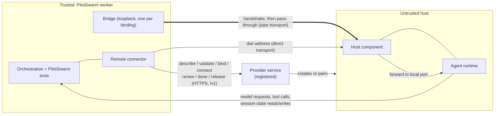

# Compute providers: run a session's agent somewhere other than the worker

**Status:** exploration on a feature branch, draft PR for discussion. The
whole of the design below is built on the branch: targets and names, the
provider interface, capabilities and host models, the transport contract and
the bridge, the handshake and the host component, provider services and their
registration, leases and the end-of-session notice, and the management
surfaces. Clear failure reasons were left out on purpose to keep the work
small (section 4.9). What is deliberately left for later is listed in section
11. **Date:** 2026-11-02, revision 3. Revision 1 restructured the proposal to
match `docs/proposals/session-workspaces.md`: a high-level design for a human
reader first, then numbered sections. Revision 2 records the built behaviour
after the parts were brought together. Revision 3 defers clear failure
reasons to a follow-up that needs no orchestration change.

A session's agent runs on a host chosen for that session, not inside the
worker that serves the turn. The worker stays the trusted side: it keeps the
orchestration, the PilotSwarm tools, the model keys and the session's history.
The agent runtime runs on a separate host and is driven over a connection
whose two ends prove who they are. A **compute provider**, registered by an
administrator, supplies the hosts. Nothing in the design names a cloud, a
platform, a network product or a kind of machine; a provider can front a
shared pool, a managed sandbox service, or a user's own machine.

## High-level design

**The problem.** Every session's agent runtime — the part that runs
model-chosen commands — runs as a child process of the worker that serves the
turn. So model-chosen code runs next to the worker's database access and its
credentials. And every session runs on the same kind of machine, whatever
isolation or tools it needs.

**The solution.** Keep the worker as the trusted side, and let the agent run
on a separate host chosen per session. A compute provider, registered by an
administrator, supplies hosts. The worker drives the agent over a connection;
everything the agent sends back is checked by the worker.


> **Rule:** an agent never runs where the CMS or orchestration state can be
> reached. Commands and results cross that line; credentials and database
> access never do.

The main ideas:

- **A compute target** is a registered place to run: shared (`shared/<label>`)
  or someone's own (`<owner>/<label>`). A session picks one when it is created
  and keeps it.
- **A compute provider** knows one kind of compute. It gets a host ready, says
  how to reach it, and decides what happens to the host when PilotSwarm is
  done with it.
- **One host per session tree.** A parent session and its sub-agents share a
  host.
- **The connection is just a pipe.** Each provider has one way of being
  reached. PilotSwarm needs only a two-way, ordered, reliable connection and
  never learns what it is made of.
- **Both ends prove who they are** before anything else crosses, with one
  handshake PilotSwarm defines for every provider.
- **Targets say what they offer,** for example models of their own. That
  shapes the choices when a session is created. It never grants access.
- **The worker keeps what must be trusted:** orchestration, PilotSwarm tools,
  PilotSwarm's model keys and the session's history.

**One turn**

```text
On the worker that runs the turn:
1. Load the conversation (as today).
2. Re-check that the session's owner may still use its target.
3. Ask the provider for the tree's host. Keep a lease on it while in use.
4. Open the connection; worker and host prove who they are.
5. Start or resume the agent on the host. Its model requests come back to
   the worker, which adds PilotSwarm's real keys; its session files are
   written to the worker's folder for that session.
6. The model runs the turn. PilotSwarm tools run in the worker.

If step 2, 3 or 4 fails, the model is not called and the turn fails with
a reason. The agent never falls back to running on the worker.
```

**Registering compute**

| Who | Does what |
|---|---|
| An administrator | Registers a provider service. PilotSwarm and the provider learn to recognize each other. The provider declares its way of being reached and what it can do. |
| An administrator | Registers a shared target (`shared/<label>`). |
| A user | Registers a target of their own (`<owner>/<label>`). Only these may offer models of their own. |
| PilotSwarm | Checks a new target once and records what it offers; refreshes that later. |
| A user creating a session | Picks the target, then a model from that target's list. |

**Who owns what**

| Owner | Owns |
|---|---|
| PilotSwarm core | Targets and who may use them. The turn steps above. The connection bridge and the handshake. Model-key handling and session state. It has no cloud, network-product or host-type code. |
| A compute provider | Getting, cleaning, reusing or discarding hosts. Its one way of being reached. Putting the handshake secret on its hosts. Any spare hosts kept ready for bursts. |
| The deployment | Running the provider services, and the network between workers and hosts. |

**What does not change**

- A session without a target runs exactly as today: same tools, same prompt,
  same steps. Only sessions that name a target see anything new.
- No orchestration change. Migration 0084 is new and additive.

**Main choices**

| Chosen | Instead of | Why |
|---|---|---|
| Providers run as services outside the worker | Provider code inside every worker | The worker never holds the rights to create hosts. One service can keep a shared pool of spare hosts. |
| A provider-opened pipe | Fixed transports built into PilotSwarm | Any medium works without PilotSwarm knowing it. |
| One handshake defined by PilotSwarm | Each provider's own trust scheme | The worker checks every host the same way itself. |
| The provider decides a host's fate | PilotSwarm deleting hosts | Some hosts are never removed; others are cleaned and reused. Only the provider knows. |
| Names that include the owner | Free-form global names | Names never collide between people, and nobody can take a name administrators need. |

For details, see section 3 (the parts and who owns what), 4 (the PilotSwarm
design), 5 (the reference `process` provider), 6 (walkthroughs), 9 (decisions
and open items) and 11 (what is built and what is left for later).

## Contents

1. [Goal and scenarios](#1-goal-and-scenarios)
2. [Terms](#2-terms)
3. [Architecture and who owns what](#3-architecture-and-who-owns-what)
4. [PilotSwarm design](#4-pilotswarm-design)
5. [The `process` provider as the reference](#5-the-process-provider-as-the-reference)
6. [Walkthroughs](#6-walkthroughs)
7. [Corner cases](#7-corner-cases)
8. [Test plan](#8-test-plan)
9. [Decisions, verified facts and open items](#9-decisions-verified-facts-and-open-items)
10. [Implementation map](#10-implementation-map)
11. [Delivery plan](#11-delivery-plan)

## 1. Goal and scenarios

The one rule the whole design serves:

> **Invariant:** an agent runtime never runs in the same place (process,
> container, machine) as anything that can reach the CMS or the orchestration
> state. Commands and results may cross that line; database credentials and
> routes to the database never do.

| # | Scenario |
|---|---|
| S1 | A session runs its agent on a host that is not the worker, chosen when the session is created and kept for the life of the session tree. |
| S2 | A sub-agent runs on the same host as its parent. One host serves a whole session tree. |
| S3 | A session moves to another worker and keeps going. The next worker reaches the same host, or is given a fresh one, without losing the conversation. |
| S4 | An administrator registers compute everyone shares. A user registers compute of their own. |
| S5 | A target says what it offers — for example models of its own. That shapes the targets and models a person is shown. |
| S6 | A new kind of compute is added by registering a provider service, with no new code in the worker. |
| S7 | When compute cannot be used, the person is told why, and a reason that retrying cannot fix stops the turn at once. |
| S8 | Existing sessions, with no target, run exactly as they do today. |

Not in scope for this work: creating hosts on demand (provisioning); a session
whose sub-agents span more than one target; isolating session-state files
between tenants beyond today's confinement; high availability of a provider
service.

Accepted, and stated here so nobody expects otherwise:

- The agent runtime is untrusted: it runs model-chosen code. Everything it
  sends back to the worker is checked in the worker.
- A target's own description of itself (its advertisement) is untrusted. It
  decides what options a person is shown; it never decides what anyone may do.
- A worker can crash without telling a provider it is finished with a host, so
  every provider still needs its own expiry. PilotSwarm's lease and done
  notice reduce the cases, not remove them.
- Today a connection is trusted because of where it goes and the runtime's own
  token. The mutual handshake (section 4.5) is what makes
  each end prove itself.

## 2. Terms

Defined before use, in the order the rest of the document needs them.

| Term | Meaning |
|---|---|
| Worker | The trusted PilotSwarm process that serves a turn. It holds the orchestration, the PilotSwarm tools, the model keys and the session's history. |
| Agent runtime | The part that runs the agent loop and the model-chosen commands (such as a shell). Today it runs in the worker; this design lets it run on a host. Also "the runtime". |
| Compute type | A kind of place a runtime can run. |
| Compute provider | The code for one compute type, named by its `kind`. It gets a host ready and says how to reach it. |
| Provider service | A compute provider that runs as its own service, outside the worker, registered by an administrator. The worker reaches it over HTTPS. |
| Remote connector | The one built-in provider in the worker that forwards each provider call to a registered provider service. The worker needs no per-type code. |
| Compute target | A registered instance of a compute type, stored in the CMS. A session picks one. Named `<owner>/<label>`. |
| Host | The concrete place a session tree's runtime is bound to. Has an `id` and an `incarnation` that changes when it is replaced. |
| Host component | A small PilotSwarm program on the host. It answers the handshake, then forwards the connection to the runtime's local port. |
| Binding | One (target, session tree) pairing to a host. It carries a per-binding secret and a lease. |
| Lease | A short-lived claim the worker renews while it uses a host. Renewals stop when the worker stops using the host (or crashes). |
| Done notice | A one-time message to the provider that a session tree is finished with a host, sent even when the tree ended while not loaded anywhere. |
| Pipe | A two-way, ordered, reliable byte stream to one host's runtime. Everything above the provider sees only a pipe. |
| Transport | How a provider's pipe is made: `direct` (the host is reachable at an address) or `pipe` (the provider opens the connection itself). Exactly one per provider. |
| Bridge | A loopback listener the worker runs, one per binding. It turns a provider-opened pipe into an address the runtime connection can dial. |
| Handshake | One mutual proof PilotSwarm defines, run on every remote connection before any session traffic. Each end proves it holds the binding's secret. |
| Endpoint | What `connect` returns: `uri` (an address the worker dials) or `pipe` (open the connection through the provider). |
| Advertisement | A target's own description of what it offers (its capabilities), stored with the time it was last heard, bounded, and used only to shape options. |
| Capabilities | What a target or provider offers. Provider capabilities are fixed in code; target capabilities are advertised and refreshed. |
| Host models | Models a target serves with its own model access. They appear under `@<target>:<model>` names. Only a personal target may offer them. |
| Probe | A check at registration — bind, connect, ask the runtime, release — that validates a target and records what it offers. |
| Placeholder credentials | Per-session, per-binding random stand-ins the runtime holds instead of real model keys. The worker swaps them for real keys on each request. |
| SessionFs | The session-state file surface the runtime reads and writes. It is confined to the worker's folder for that session. |
| Session tree | A root session and all of its sub-agents. It runs on one target, fixed at the root. |
| CMS | The session catalog database: sessions, events, and the new `compute_targets` table. |

## 3. Architecture and who owns what



Every arrow is a call the design makes. A `direct` provider's host is reached
at an address the worker dials; a `pipe` provider's connection is opened by the
provider and joined through the bridge. Either way the host component answers
the handshake first, then forwards to the runtime. The runtime's model
requests and session-state access come back to the worker, which checks them.

PilotSwarm core has no cloud, network-product or host-type code. In the split
below, "the provider" is the code for one compute type (often a registered
service), and "the deployment" is everything the operator runs: the provider
services and the network between workers and hosts.

| Concern | Core supplies | The provider / deployment supplies | Where they meet |
|---|---|---|---|
| Registering a kind of compute | A table of trusted provider services and the identity to expect from each (**built**) | A running service that answers `/v1` and declares its kind, transport and capabilities | `describe`, recorded at registration |
| Registering a place to run | The `compute_targets` table, owner-qualified names, create/update/enable/disable/delete, resolve (**built**) | A `config` object the provider understands (no secrets) | `cms_compute_target_*` procedures |
| Checking a target once | A probe: bind, connect, ask the runtime, release; stores the advertisement (**built**) | Answering the probe honestly | `describeHost` / the runtime's model list |
| Getting a host for a tree | `bind` once per (target, tree), `connect` every turn, with deadlines (**built**) | Readying a host and saying how to reach it | `bind(req)`, `connect(req)` |
| Reaching the host | A bridge per host on the worker's machine, in front of every remote runtime: PilotSwarm's own connection for a `direct` provider, the provider's for a `pipe` one; the generic connector to a registered service (**built**) | `direct`: a reachable address. `pipe`: `openConnection(host, signal)` | the endpoint `connect` returns |
| Proving each end | One mutual handshake on every remote connection; a host component that answers it (**built**) | Putting the per-binding secret on the host; running the host component in front of the runtime | the handshake frames |
| Model requests | Placeholder credentials in the runtime; a per-connection handler that swaps them for real keys and refuses anything else (**built**) | Nothing; the provider never sees a key | the request handler |
| Session-state files | SessionFs confined to the worker's session folder (**built**) | `files` capability says whether the host shares the worker's files | the SessionFs provider |
| Keeping a host in use | A lease the worker renews on a timer (**built**) | An optional `renew`; the provider's own expiry as a backstop | `renew(req)` |
| Finishing with a host | `release` per leaving session; a done notice when the tree ends, even unloaded (**built**) | An optional `done`; deciding the host's fate | `release(req)`, `done(req)` |
| Failures | One shape for every compute error (`CODE: message`); a failure goes through the ordinary turn retry (**built**). Clear reasons that stop a turn at once are deferred (section 4.9) | A code, a message and an optional retry hint | the `ComputeFailure` shape |
| Management surfaces | List, create, update, enable/disable, delete, list a target's models, and a worker-run probe, across the client, Web API and MCP (**built**) | Nothing | the management client and API |

How the two sides work together, end to end:

```text
Register
 1. [admin -> core]   Register a provider service: where it is and the identity
                      to expect from it. Core calls describe and records the
                      kinds, transport and capabilities it declares.
 2. [admin/user -> core]  Register a target of that kind. Core checks it once
                      (bind, connect, handshake, ask the runtime, release) and
                      stores what it offers.
Create and run
 3. [user -> core]    Create a session naming the target; pick a model from
                      its list. Core records the target's id.
 4. [core -> provider]  Each turn: re-check the owner may use the target; bind
                      (once per tree) and connect; keep a lease while in use.
 5. [core <-> host]   Open the connection through the host's bridge; the
                      handshake proves both ends; then the runtime runs the turn
                      and its model requests come back to the worker.
Finish
 6. [core -> provider]  The session leaves a worker: release. The tree ends: a
                      done notice, even if it ended unloaded. The provider keeps,
                      cleans or discards the host.
```

## 4. PilotSwarm design

### 4.1 Targets and names

Migration 0084 adds `compute_targets`, with the same ownership rules model
providers use. **(built)**

| Class | Registered by | Visible to |
|---|---|---|
| `shared` | An administrator | Every signed-in user |
| `personal` | A user, for themselves | Only that user (administrators included) |

Every target is named `<owner>/<label>`:

- For a target of someone's own, the owner part is their sign-in address, for
  example `alice@example.com/gpu-sandbox`.
- For a target an administrator registers for everyone, the owner part is the
  reserved word `shared`, as in `shared/build-pool`.

So two people can both have a target called `sandbox` without colliding,
nobody can take a name administrators need, and nobody can name a target after
someone else. PilotSwarm builds the owner part itself from whoever is signed
in; whoever registers a target supplies only the label — which lets a provider
suggest one from something it already knows is unique, such as a machine's own
name. Labels are plain: letters, numbers, dot, dash and underscore, at most 64
characters. A registrant with no sign-in address on record is refused rather
than given an invented owner part.

A target has a `name`, an `id` that is never reused, a `kind` (which provider
handles it), an optional `displayName`, `enabled`, and a `config` object that
PilotSwarm stores but never interprets. Only those who may manage a target see
its `config`. **`config` is not a place for secrets** — a hash such as a
pairing-code hash is allowed, a credential is not; providers get their
credentials from the deployment. All rules live in the `cms_compute_target_*`
procedures; the store only shapes rows and errors.

A session names its target at creation (`computeTarget`). The create
transaction checks the target is shared or the owner's own, and enabled, and
records the target's id with the name. System sessions may use shared targets
only. Before every turn the worker resolves the target by that id and checks
again that the tree's owner may use it. A deleted target leaves its sessions
blocked; a new target with the same name is a different target and never takes
them. When a name is looked up, a whole `<owner>/<label>` is taken as it is,
and a bare label is shorthand for the caller's own target, falling back to the
shared target of that label.

### 4.2 The provider interface

A provider is the code for one compute type. **(built; `renew` and `done` being
built)**

```ts
interface ComputeProvider {
  readonly kind: string;
  readonly capabilities: {
    os: string[];                     // platform names the runtime can run on
    sandboxed: boolean;
    files: "worker-local" | "shared-mount" | "provider-api" | "none";
    offersModels?: boolean;           // can its hosts have model access of their own?
  };
  readonly transport?: "direct" | "pipe";                                  // default: direct
  openConnection?(req): Promise<Duplex>;                                   // pipe providers only
  validateTarget?(req): Promise<{ ok: true } | ComputeFailure>;           // before every bind
  bind(req): Promise<{ ok: true; host: ComputeHostRef } | ComputeFailure>; // once per (target, tree)
  connect(req): Promise<ComputeConnectResult>;                             // every turn
  describeHost?(req): Promise<ComputeAdvertisement>;                       // what the host offers
  renew?(req): Promise<...>;                                               // keep a lease alive
  done?(req): Promise<...>;                                                // the tree is finished
  release?(req): Promise<void>;                                            // once per leaving session
}
```

- Every call carries an `AbortSignal`, and the worker enforces a deadline
  (bind 5 minutes, connect 2 minutes, release 30 seconds). A provider that does
  not answer fails the call; it cannot hold a turn or a shutdown.
- `validateTarget` asks, for the tree's owner: may this principal use what the
  target's config points at? It runs before every bind.
- `bind` is idempotent per (target, session tree). `connect` runs before every
  turn, possibly on another worker, and returns how to reach the runtime and
  the session's folders as the host sees them.
- A host has an `id` and an `incarnation` that changes when the host is
  replaced. The worker keys its connection pool by address, host and
  incarnation, so a replaced host gets a fresh connection and the old one is
  stopped when no session uses it.
- An endpoint is `uri` (a runtime already listening, which the worker dials) or
  `pipe` (opened through the provider). By default the worker dials only
  loopback addresses: a provider that reaches a host elsewhere secures that
  path itself. A worker can accept other addresses only when its network
  secures them.
- The built-in provider that runs each tree's runtime in a separate local
  process (the `process` provider, section 5) is always available. Sessions
  without a target run as today. Applications add providers in the worker
  options or at runtime.

### 4.3 Capabilities and host models

A target advertises what it offers, and that shapes the choices a person is
given: which targets to run a session on, and which models are available once
one is chosen. The target is chosen first, the model after it. **(built)**

| Kind | Where it comes from | Changes |
|---|---|---|
| Provider capabilities | Fixed in provider code; the same for every target of that kind | Only when the provider changes |
| Target capabilities | Advertised by the target itself, stored with the time it was last heard | Refreshed whenever the worker reaches the host |

**Advertised capabilities never authorize anything.** They come from a host,
which is untrusted. They decide what is shown; what anyone may do is decided
where it always was — in SQL for who may use a target, and in the worker for
what a session may reach. The worker keeps only well-formed fields, bounds each
one, and caps the whole advertisement (16 KiB), in the worker and again in the
database.

**Models a target offers itself.** A target may advertise models its host
serves with its own model access. They appear beside PilotSwarm's catalog
models under `@<target>:<model>` names, which cannot collide with a
`provider:model` name because a provider name never starts with `@`. Two things
follow from where such a model runs:

- The host makes the call. Nothing of PilotSwarm's goes to it: no credentials,
  no provider config, and no request routed back through the worker. A session
  on one of these models gets a connection of its own with no request handler,
  kept apart from any connection that carries credentials.
- PilotSwarm's budgets and credentials do not cover it. It is the host's own
  model access being spent.

**Only a personal target may offer models** — a target belonging to one
person, used by that person. A shared target never does, however it advertises
itself. That rule is enforced when the advertisement is stored, and again in
the worker before a turn runs.

**Filling the list.** A probe validates a target and records what it offers.
Every later connection refreshes the answer, throttled and bounded, and never
allowed to fail a turn, so a host that cannot answer leaves the previous answer
standing. A turn whose chosen model the target no longer offers fails with a
clear reason and says to choose another.

### 4.4 The transport contract and the bridge

Each provider has exactly one way of being reached, declared in its own code. A
host never chooses, and a registered target never carries transport code. **(built)**

| `transport` | What the provider does |
|---|---|
| `direct` (default) | Its hosts are reachable at an address. `connect` returns a `uri` endpoint, and PilotSwarm opens the pipe itself with a plain connection to that address. The provider writes no transport code. |
| `pipe` | The provider opens the connection itself, in `openConnection(host, signal)`. `connect` returns a `pipe` endpoint: the host's folders and whatever opaque details opening the connection needs — never an address. |

The two differ only in **who supplies the code that opens a pipe**. Everything
after that is one path: a `direct` provider's address is opened by a built-in
pipe, and from there a reachable host and a host behind a provider's own
connection are treated identically. That is what lets the handshake in section
4.5 be the same everywhere, with nothing to opt out of.

A `pipe` provider must have `openConnection`; a `direct` provider must not. The
registry refuses anything else, so a provider whose declaration and code
disagree never reaches a turn.

Everything above the provider sees only a pipe: a two-way byte stream to one
host's runtime. It does not know, and must never need to know, what the pipe is
made of.

**What the pipe must guarantee** (the provider's side):

| | |
|---|---|
| Two-way | Bytes flow in both directions |
| Ordered and reliable | Nothing lost, reordered or duplicated |
| Interactive | Many round trips per turn, output arriving as it is produced |
| Visibly broken | A broken pipe closes or errors; it never goes quiet and leaves a turn waiting |
| Pointed at one host | It reaches that host's runtime and nothing else |
| Protected end to end | Private and tamper-proof whenever what it crosses cannot be trusted. The worker cannot check this; it is the provider's work |

**What PilotSwarm guarantees** (the worker's side):

| | |
|---|---|
| One bridge per host | Each host gets one bridge, on the worker's own machine, on a port the operating system picks and nothing outside the worker is told. The sessions of a tree share a host, so they share its bridge, its address and its pooled runtime connection — a bridge per session would open a second control connection into one runtime |
| Nothing unproven passes | Every pipe the bridge opens is handshaken (section 4.5) before it is joined to anything. A host that cannot prove itself never sees a byte of the turn |
| Local only | The bridge listens on this machine alone, so a bridged connection meets the loopback rule by construction |
| The token still counts | The runtime's own connection token still travels inside the pipe and is still checked at the far end. Reaching the bridge grants nothing |
| One pipe per connection | A pipe serves its own host's runtime only, never shared between connections |
| Reconnect or fail clearly | A broken connection is replaced by a fresh pipe. A pipe that cannot be opened, or that takes too long, fails the turn with a clear reason rather than hanging |
| Closed on release | The bridge and every pipe through it close when the session leaves the host and when the worker shuts down |

The runtime connection can only dial an address, so the bridge is the smallest
thing that turns a pipe into one: a loopback listener that asks for a fresh
pipe per connection, proves both ends, and joins the two. Every runtime that is
not the worker's own child process goes through it. Reusable transport code —
anything that knows how a particular kind of connection is built — belongs in a
package of its own, outside this core. None is built yet; only the seam is here.

One connection kind is built in, because the protocol in section 4.7 needs it:
a service whose hosts are not reachable answers `connect` with a URL, and the
worker opens an ordinary WebSocket to it with the same credentials and the same
pinned identity as every other call, and treats it as a pipe. The far end is a
standard endpoint; nothing about it names a product.

### 4.5 The handshake and the host component

The pipe says nothing about who is on it. So before any session traffic flows,
the worker and the host prove themselves to each other, with one handshake
PilotSwarm defines — the same for every provider and every kind of connection.
**(built)**

- **Per-binding secret.** The provider's `connect` returns a `bindingId` and a
  random `secret`, at least 32 bytes, fresh for every new binding. It is never
  logged, never stored in the CMS, and kept only in worker memory for the
  binding. Providers must never reuse it across trees. A remote endpoint that
  arrives without one cannot be used: the worker refuses it rather than
  connecting to a host it would have no way of recognizing.
- **The proof.** The worker sends a hello with the protocol version, the
  `bindingId` and a worker nonce. The host answers with a host nonce and a
  proof over both nonces and the `bindingId`. The worker verifies, answers with
  its own proof, and the host verifies. Then the stream is a plain pass-through
  to the runtime. Each side's proof is over a string that names which side made
  it, so neither can be replayed as the other. Frames are length-prefixed and
  size-bounded, with a deadline; comparisons are constant-time; the host
  remembers the worker nonces it has answered and refuses a repeat, so a
  recorded exchange is worthless. Any failure closes the connection, and the
  turn fails with a "handshake failed" reason (section 4.9).
- **The host component.** A small PilotSwarm program runs on the host, in front
  of the runtime. It answers the handshake, then forwards the stream to the
  runtime's local port, and reaches nothing else. It serves exactly one binding
  and refuses any other. It either listens for the worker's side or dials out,
  for a host that can only reach outwards. It ships in the SDK as a function and
  as a command, and the reference `process` provider runs it in front of its
  runtime, so the tests do the real handshake. A `direct` provider's `connect`
  therefore returns the host component's address, never the runtime's own port.
- **The runtime token still counts.** Inside the tunnel, the runtime's own
  connection token is still used. The handshake proves the two ends; the token
  still guards the runtime.

A machine that merely claims to be the host cannot take part, and neither can
anything sitting in the middle of the connection. The provider's whole part is
to put the secret on the host and hand the same secret to PilotSwarm; a
reserved, ignored version field leaves room for provider extras later (see
section 9, open items), which would add to the handshake and never replace it.

### 4.6 Every turn of a remote session

**(built)**

1. The worker reads the tree's compute target from the root session's record,
   re-checks it for the tree's owner, and picks the provider for its `kind`.
2. The session's folders are made ready as today (worker paths).
3. The compute provider binds the host (once per tree) and connects: an
   endpoint plus the host's folder paths.
4. The connection is opened through the host's bridge — a built-in pipe to the
   address for `direct`, the provider's own `openConnection` for `pipe` — and
   the handshake proves both ends before anything of the turn crosses. The
   first connection of a binding is proved before a prompt or a model request
   is sent, so a host that cannot be reached or cannot be recognized fails the
   turn where compute failures are named.
5. The worker builds or reuses a runtime connection per endpoint. A remote
   connection gets no worker environment and no model keys; instead it gets:
   - a request handler: every model request comes back to the worker, which
     checks it against the session's grant and swaps placeholders for real
     keys;
   - a SessionFs provider: session-state files live in the worker's own session
     folder, so dehydrate and hydrate are unchanged.
6. The session is created or resumed with the host's working directory. The
   model runs the turn; PilotSwarm tools run in the worker as external tools.

The trust boundary, concern by concern:

| Path | Rule |
|---|---|
| Model requests | The runtime holds per-session, per-binding placeholders, not keys. Each pooled connection has its own request handler, serving only its sessions. A request must go to the session's model origin and path prefix, by `GET` or `POST`; the worker swaps placeholders for real keys and sends it with redirects refused. Anything else is refused. |
| Session state (SessionFs) | Confined to the worker's folder for that session. Only the virtual root, the runtime's own session-state form and relative paths are accepted; no link inside is followed; one write carries at most 64 MiB. |
| Worker files named by tools | Artifact file tools from a remote session may use only that session's workspace folders, and only when the provider says the host shares them with the worker; otherwise none. |
| Skills and MCP servers | Not sent to a remote runtime: their configs are worker-local. |
| Runtime-authenticated models | A model that signs inside the runtime with a credential the worker holds is refused on a remote target. The exception is a model the target offers itself on a personal target, where the host signs for itself and the worker sends nothing. |

### 4.7 Provider services and registration

A provider that really makes hosts runs as its own service, outside the worker.
**(built)**

- An administrator registers each provider service in advance: its base
  address (`https:`; `http:` only on loopback, for tests) and the identity to
  expect from it (a non-secret TLS server name and/or a certificate
  fingerprint). PilotSwarm deals only with services it was told about.
- The worker reaches any service through one generic **remote connector** built
  in once, so the worker never holds the rights to create or manage hosts, and
  a new compute type needs no new worker code. The protocol is HTTPS and JSON
  on a versioned path (`/v1`): `describe`, `validate`, `bind`, `connect`,
  `release`, `renew`, `done`, `describeHost`. Every request carries a deadline
  and the worker's identity; answers use the `ComputeFailure` shape. What a
  service serves is never registered by hand: its kinds, transport,
  capabilities and protocol version are what it said about itself when asked,
  recorded with the time it said it.
- **Both ends recognize each other.** The worker authenticates to the service
  with credentials from a deployment hook (nothing secret is stored in the
  CMS), and checks the service's identity against what the administrator
  registered, refusing otherwise. The service verifies the credential the
  deployment's hook supplies. A `pipe` service's connection is opened to the
  URL its `connect` returned, with the same credentials and the same pinned
  identity. The credential is minted per service and per call, so it can be
  short-lived; the registration holds only the non-secret identity.
- Workers load the registered services at start and refresh them periodically,
  the way model providers are refreshed, so a service an administrator has just
  registered serves without a restart. A service that is unreachable, or whose
  identity does not match, leaves its kinds failing with that reason rather
  than looking as though no provider exists — which is why the register keeps
  the kinds a service last said it served. A provider built into the worker
  always wins a kind over a registered service.
- A provider service never reads PilotSwarm's database. Because it owns the
  hosts, it is also the natural place to keep spare ones ready for bursts;
  demand hints from PilotSwarm are left for later (section 9).
- A helper exposes any in-process provider as a service over HTTPS, so the
  reference `process` provider can be run as a registered service end to end in
  tests.

Providers built into the worker stay, for tests and for simple cases.

### 4.8 Host lifecycle: leases, done, reuse

PilotSwarm reports how it uses hosts, and nothing more. **(built)**

- **Lease.** The worker holds a lease on a host while it uses one and keeps
  renewing it on a timer (by default renew every 60 s on a 3-minute lease),
  calling the provider's optional `renew`. If the renewals stop — because a
  worker crashed or was taken away, say — the host is no longer in use. A lease
  always outlasts more than one renewal, so a single late renewal never reads
  as an absent worker.
- **Release.** `release` is called once per session that leaves a host:
  ended, moved (dehydrate), evicted, shutdown, or failed. Sessions of one tree
  share a host, so a host is free of PilotSwarm only once no session uses it.
  Release means PilotSwarm no longer needs the host for that session tree; it
  never means destroy.
- **Done notice.** A periodic sweep on workers finds bindings whose session
  tree has ended, failed, was cancelled or was deleted — including trees that
  ended while not loaded in any worker, and trees whose record is gone
  altogether — and sends the provider a one-time `done`. Rows are claimed one
  worker at a time and stamped with the attempt, so two workers never take the
  same binding and a worker that dies mid-notice leaves it to be retried
  rather than lost. It is idempotent.
- **The provider decides the host's fate.** Keep it, because some kinds are
  never taken away; clean it and hold it ready for the next workload; or
  discard it and make a fresh one, to keep spare capacity. Only the provider
  knows.
- **The reuse rule.** A host may take a new workload only with nothing left
  over from an earlier one — files, logins, running processes, secrets. The
  provider guarantees that, and PilotSwarm does its part by using a fresh
  handshake secret for every new binding on a host.

The bindings table records, per binding, the tree, target, provider kind, an
opaque provider-private host reference, the binding id, the worker, and the
lease, release and done timestamps. It never holds secrets.

### 4.9 Failures

Every compute failure carries a `code`, a human `message`, and an optional
`retryAfterMs`. The worker builds every compute error it raises through one
helper, so the line a turn carries is always `CODE: message`. **(built)**

A compute failure then goes through the ordinary turn retry, like any failed
turn: three attempts over about 45 seconds, then the session shows the error.
That affects only sessions that use a compute target.

**Deferred on purpose: clear reasons.** Separating failures that retrying
cannot fix (a target removed, disabled or no longer available to its owner, a
handshake that fails) from ones that may pass (a host offline, no capacity), and
stopping the first kind at once with a clear reason, was left out to keep this
work small. The follow-up does it inside the worker's turn activity, which
already has a "do not retry" result, so it needs no orchestration change.

### 4.10 APIs, events and errors

Compute targets are exposed through every management surface the layering rule
requires, the way model providers are, so a person manages targets from the
client, the Web API and MCP alike. **(built)**

| Surface area | Operations |
|---|---|
| List and manage targets | List the viewer's targets; create shared (admin) or personal (owner); update; enable/disable; delete; list a target's model options |
| Check a target | A worker runs the probe (the management client cannot bind hosts itself) and returns the recorded advertisement |
| Create a session | Every surface accepts `computeTarget` (a full `<owner>/<label>` or `shared/<label>`, or the documented shorthand) |
| Audit | Every mutation is audited the way provider mutations are |

Admin operations live under the admin path and need the fleet-admin right; a
user's own operations live under the self path. Provider-service registration
surfaces come with the connector work, not here. Portal and TUI views for
compute are out of scope for this work; that divergence is noted. The API
reference docs are updated alongside; this proposal is not that reference.

### 4.11 Compatibility

The design is additive. A session without a target runs exactly as today: the
runtime runs in the worker, with the same tools, the same prompt and the same
steps. Migration 0084 only adds a table and its procedures; it changes no
existing row. It adds no orchestration version. There is no feature flag: the new
behaviour appears only for a session that names a target.

## 5. The `process` provider as the reference

`createProcessComputeProvider()` (kind `process`) runs each session tree's
runtime as a separate local process on the worker's machine and returns its
loopback address and a fresh connection token. **(built)** It is not a sandbox.
It exercises exactly the remote path a real provider uses, so the plumbing can
be built and tested on a laptop or in CI. The runtime gets a scrubbed
environment — its own home, a `PATH`, the connection token, nothing from the
worker — and leads its own process group, so stopping it stops the commands it
started. When the host component and handshake land (section 4.5), the
`process` provider starts the component in front of its runtime, so tests run
the real handshake.

A local test drives it through real workers and PostgreSQL and checks:

| Check | Result |
|---|---|
| A turn on a `process` target runs a shell inside the separate runtime | the command sees the runtime's home, and none of the worker's variables |
| The runtime holds only placeholders | every model request still carries the real key; no placeholder reaches the model |
| Session state | written through SessionFs into the worker's own session folder |
| A new worker with a new runtime | resumes the session from that folder; the next request carries the earlier turn |
| Stop | the worker's shutdown releases the host; no runtime process is left |
| A sub-agent | runs in its tree's runtime, though its own config names no target |
| Refusals | an unknown target is refused at create; an unknown kind fails the turn; an address that is not local fails the turn and releases the host |

What the runs showed, carried here so later work does not relearn it:

- The runtime writes session files under the SessionFs root, and also names
  some by its own home. The worker's SessionFs maps both to the session folder.
- The runtime keeps a private local store in its home. It is not needed to
  resume: a new runtime with an empty home resumed the session. The `process`
  provider keeps that home private and removes it with the host.
- A refusal at bind or connect is retried like any failed turn today. Stopping
  at once on an unknown or disabled target needs the clear-failures work
  (section 4.9).

## 6. Walkthroughs

Three generic shapes, to show the one design covers them all. Each arrow is a
call from section 3 or 4.

### 6.1 A shared pool (direct transport)

An administrator registers `shared/build-pool`. Its hosts sit in a pool the
provider owns, each reachable at an address the worker can dial.

```text
Create:   admin registers the provider service and shared/build-pool;
          core probes the pool once and records what it offers.      (probe: built;
                                                                      service)
Turn:
 1. core re-checks the owner may use the target, binds a host from the pool,
    and connects. The host is reachable, so connect returns a uri endpoint.
 2. core dials the address; the host component answers the handshake; the
    runtime runs the turn. core holds a lease and renews it.
 3. a sub-agent of the same tree reuses the same host.
Finish:   the tree ends; core sends a done notice; the provider cleans the host
          and returns it to the pool, with nothing left over.
```

### 6.2 A sandbox service (pipe transport)

A provider service creates a fresh sandbox per tree. The sandbox is not
directly reachable; the service opens the connection itself.

```text
Create:   admin registers the sandbox provider service.
Turn:
 1. core binds; the service creates a sandbox and returns an opaque host
    reference. connect returns a pipe endpoint and a per-binding secret.
 2. core runs a bridge on loopback and asks the service to openConnection; the
    service joins the bridge to the sandbox. The host component answers the
    handshake over the pipe; the runtime runs the turn.
 3. core keeps a lease; the service keeps the sandbox while the lease holds.
Finish:   the tree ends; done notice; the service discards the sandbox and, to
          keep a buffer, may start a fresh one.
```

### 6.3 A user's own machine that connects out (pipe transport)

A user registers a machine of their own, `alice@example.com/desktop`. The
machine sits behind a firewall and cannot be dialed; it connects out to the
provider service, which bridges the connection in.

```text
Create:   the user registers the target; the provider proposes the label from
          the machine's own name. core probes it once.               (probe: built)
Turn:
 1. core binds and connects; because the machine dials out, connect returns a
    pipe endpoint. The target is personal, so it may offer the machine's own
    models under @alice@example.com/desktop:<model> names.
 2. core runs a bridge and openConnection pairs it with the machine's outbound
    link; the host component answers the handshake; the runtime runs the turn.
 3. a turn on one of the machine's own models gets a connection with no request
    handler and no credentials: the machine signs for itself, and PilotSwarm's
    budgets do not apply.
Finish:   the user stops using the target; release; the machine is the user's,
          so the provider leaves it alone.
```

## 7. Corner cases

| # | Case | Handling |
|---|---|---|
| K1 | A worker crashes mid-turn | The turn is redelivered and replayed. The lease stops being renewed, so the provider sees the host fall idle; the provider's own expiry is the backstop. |
| K2 | A session moves to another worker | The next worker connects again — to the same host, or a fresh one the provider gives it — and resumes from the session folder. SessionFs lives in the worker's own storage, so hydrate is unchanged. |
| K3 | A host is replaced | Its `incarnation` changes, so the worker builds a fresh connection and stops the old one once no session uses it. |
| K4 | A target is deleted while sessions reference it | Those sessions are blocked with a clear reason. A new target with the same name is a different id and never takes them. |
| K5 | A chosen model is withdrawn from a target | The turn fails with a clear reason and says to choose another; the previous advertisement stands if the host cannot answer a refresh. |
| K6 | The connection breaks mid-turn | A fresh pipe replaces it. A pipe that cannot be opened, or is too slow, fails the turn with a clear reason rather than hanging. |
| K7 | A session tree ends while not loaded anywhere | The done-notice sweep finds the binding and sends exactly one `done`, even when the tree's record is gone altogether. |
| K8 | The handshake fails (wrong secret, a party in the middle, a replayed nonce, an oversized frame, a timeout) | The connection closes and the turn fails with a "handshake failed" reason; the model is never called. |
| K9 | A provider service is unreachable or its identity does not match | Its targets fail with that reason, naming the service. |
| K10 | A remote runtime asks for a model it was not granted, or a different destination | The request handler refuses it; no placeholder is resolved and nothing is sent. |
| K11 | A host shares no files with the worker | Artifact file tools that name worker files are refused for that session; only `worker-local` or `shared-mount` hosts allow them. |
| K12 | A reused host carries state from before | Not allowed: the provider must hand over a clean host, and PilotSwarm uses a fresh secret per binding. |
| K13 | A worker too old to drive remote runtimes | It should carry a capability tag so it never runs a remote session locally. (**open, section 9**) |

## 8. Test plan

Levels:

| Level | What runs |
|---|---|
| U | Unit tests, no runtime |
| L | Local integration: real workers and PostgreSQL, the `process` provider, a scripted model |
| Q | Qualification against a real provider service and a real host (later) |

Every test must be able to fail. Break the rule on purpose once and see the
test turn red; the specs say which break proves which rule. Tests run on Linux
and Windows, so nothing may assume a path separator or a shell.

| Area | Level | Checks |
|---|---|---|
| Targets and names (**built**) | U, L | Owner-qualified names; a bare label resolves to own then shared; a deleted target blocks its sessions; a reused name is a new target; admin-only registration enforced in SQL |
| Provider interface and transport (**built**) | U | `direct` vs `pipe` validated; a declaration that disagrees with the code is refused; deadlines enforced |
| Capabilities and host models (**built**) | U, L | Advertisement shaped, bounded and capped; only a personal target may offer models; a withdrawn model fails the turn clearly; a host-model turn uses a connection with no credentials |
| Remote turn and trust boundary (**built**) | L | A turn runs in a separate runtime with none of the worker's environment; every model request carries the real key while the runtime holds only placeholders; a request to any other destination is refused; session state round-trips and resumes on a new worker |
| The bridge (**built**) | U, L | A full turn through a provider-opened pipe; one bridge per binding on loopback; a broken pipe reconnects or fails clearly |
| The handshake and host component (**built**) | U, L | Success; wrong secret either side; a replayed nonce; a truncated or oversized frame; a timeout; constant-time compare; the host component forwards to the runtime; a wrong secret fails the turn with no model request |
| Provider services and registration (**built**) | U, L | The remote connector maps each call; a mismatched identity is refused; the `process` provider served as a registered service runs a full turn end to end |
| Leases and done notices (**built**) | U, L | The lease timer math; a lease renewed and recorded; a tree that ends while unloaded gets exactly one done notice |
| Failures (**built**) | U | Every compute error is `CODE: message` with its code and retry hint, and is never prefixed twice |
| Management surfaces (**built**) | U, L | List, create, update, enable/disable, delete, list models, and the worker-run probe across the client, Web API and MCP; every mutation audited; surface-parity tests updated |

## 9. Decisions, verified facts and open items

**Decided (2026-11-01)**

| Decision | Instead of |
|---|---|
| The runtime runs on a host, never where the CMS or orchestration can be reached | Running the runtime next to the worker's credentials |
| One host per session tree, fixed at the root session | A session picking compute per turn, or sub-agents on different hosts |
| Providers run as registered services outside the worker, reached through one generic connector | Provider code inside every worker |
| Admins pre-register each provider service as the trust anchor | The worker trusting any service it can reach |
| One transport per provider: `direct` or `pipe` | A provider mixing transports, or PilotSwarm choosing |
| Everything above the provider sees only a pipe | Core knowing the medium |
| One mutual handshake PilotSwarm defines for every connection, answered by a host component | Each provider inventing its own trust scheme |
| A per-binding secret, fresh for every binding, never stored in the CMS | A per-host or per-target secret |
| The provider decides a host's fate; PilotSwarm only reports use (a lease) and finish (a done notice) | PilotSwarm deleting hosts; release meaning destroy |
| A host is reusable only with nothing left over | Trusting a host to be clean |
| Owner-qualified names (`<owner>/<label>`, `shared/<label>`); sessions reference a permanent id | Free-form global names |
| Targets advertise capabilities (untrusted, for options only); target chosen before model | Capabilities granting access; model chosen first |
| Only a personal target may offer its own models, under `@<target>:<model>` names | Any target offering models |
| Target `config` holds no secrets; providers get credentials from the deployment | A secret reference in the config |
| Clear failure reasons deferred to a follow-up, built in the turn activity without an orchestration change | A new orchestration version in this work |

**Verified on the branch (with the `process` provider, real workers and PostgreSQL)**

| Check | Result |
|---|---|
| A turn runs in a separate runtime with none of the worker's environment | Holds |
| Placeholders in the runtime, real keys only in the worker; other destinations refused | Holds |
| Session state round-trips through SessionFs and resumes on a new worker | Holds |
| A sub-agent runs in its tree's runtime | Holds |
| A full turn through a provider-opened pipe and the bridge | Holds |
| Owner-qualified names, shorthand resolution, and the deleted/reused-name rules | Hold |

**Unverified (designed and wired, not proven)**

| Item | Why |
|---|---|
| A turn on a model a target offers itself | The names, rules, advertisement, refusal-on-withdrawal and credential-free connection are built and tested, but no turn has run against a host that really has its own model access. Treat as designed, not proven. |
| A turn surviving a worker crash | Depends on whether the runtime keeps a turn when its connection drops and on resume reattaching. |
| SessionFs under compaction, large files, or a non-Linux runtime | Checked for ordinary turns, dehydrate and resume only. |

**Open items**

| Item | State |
|---|---|
| Provider extras | A provider may want to add stronger evidence about a host (additive to the handshake, never replacing it), or to verify PilotSwarm itself in turn. Not decided, not built; a reserved handshake field leaves room. |
| Demand hints | Telling a provider service how much demand there is per target, so it can size spare capacity. Deferred; the design leaves room. |
| A secret reference for a provider that needs per-user credentials | Deferred (secrets option A for now: none in the config). |
| A tree spanning more than one target | An open question; today a tree runs on exactly one. |
| A routing capability tag so older workers never run remote sessions locally | To do. |
| Portal and TUI views for compute | Out of scope for this work; noted as a divergence from the other surfaces. |
| Provisioning (creating hosts on demand) | Out of scope; a compute provisioner can come later. |
| SessionFs quotas (total size and file count per session), and SQL tools on remote sessions | To do. |

## 10. Implementation map

Paths are under `packages/sdk/src` unless noted. Every row exists on the
branch; section 11 lists what was deliberately left out.

| File / area | Change | State |
|---|---|---|
| `compute.ts` | Provider interface, registry, the always-available local/process provider, endpoint-to-connection, transport rules, advertisement shaping, `@target:model` names | built |
| `compute-bridge.ts` | The loopback bridge, one per host, in front of every remote runtime, plus the built-in pipe that opens a plain connection to an address | built |
| `migrations/compute-targets-0084.ts`, `0084_diff.md` | `compute_targets` and its procedures (extended in place; never edit 0083 or older) | built |
| `compute-target-store.ts`, `cms.ts` | The target store; the create-time check | built |
| `types.ts`, `client.ts` | `computeTarget` on the session config | built |
| `compute-runtime.ts` | Placeholder credentials, the request handler, worker-backed SessionFs | built |
| `compute-process.ts` | The `process` provider | built |
| `copilot-client.ts`, `session-manager.ts` | The remote connection and turn wiring; probe, advertisement refresh, host-model turns | built |
| `management-client.ts` | A target's model options (direct client today) | built |
| `compute-handshake.ts`, `compute-host.ts`, `compute-host-cli.ts` | The handshake, the host component, and the command that runs it on a host | built |
| `compute-service.ts`, `compute-websocket.ts`, `compute-service-store.ts` | The provider-service protocol and the generic connector; the WebSocket pipe; the registration and binding stores | built |
| `compute-failures.ts` | The one shape every compute error the worker raises takes | built |
| `compute-target-probe.ts`, `management-client.ts`, `web/*`, `api/*`, `packages/app/mcp/*` | The management surfaces and the worker-run probe, as its own durable orchestration | built |

## 11. Delivery plan

| Stage | Scope | State |
|---|---|---|
| Core | Targets and names; the provider interface and transport; capabilities and host models; the remote turn and trust boundary; the bridge; the `process` reference provider | **built** |
| Provider services | The remote connector, the `/v1` protocol, registration and mutual identity, the in-process-as-service helper | **built** |
| The handshake | The mutual handshake and the host component, run for real by the `process` provider | **built** |
| Host lifecycle | Leases and renewals; the done notice for trees that end while unloaded | **built** |
| Clear failures | Permanent vs temporary; stop the turn at once on a permanent one, from the turn activity, with no orchestration change | **next** (left out to keep this work small) |
| Management surfaces | Targets and the probe across the client, Web API and MCP; audit; API reference docs | **built** |
| Later | Provider extras; demand hints; a secret reference; portal and TUI views; provisioning; multi-target trees; SessionFs quotas and remote SQL tools | **later** |

The whole of this is built and proved end to end on a laptop and in CI through
the `process` provider: run as a registered provider service over the `/v1`
protocol, reached through the bridge, with the real handshake answered by the
real host component, a lease renewed and recorded, an end-of-session notice for
and a tree that ended while nothing held it. What a real deployment still
needs is a provider service of its own; nothing in the worker has to change for
one. The later items are known and deferred, not forgotten.
