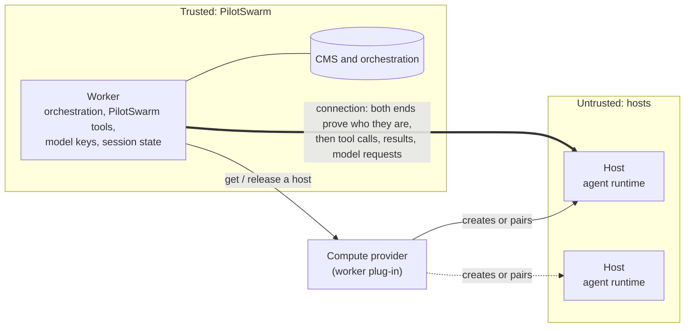
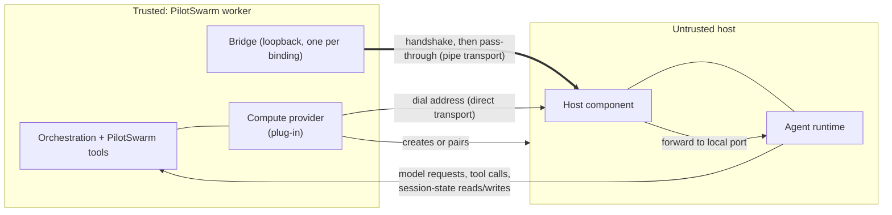

# Compute providers: run a session's agent somewhere other than the worker

**Status:** exploration on a feature branch, draft PR for discussion. Built
on the branch: targets and names, the provider interface and its transport
contract, the bridge, the handshake and the host component, the remote turn
and its trust boundary, leases and the end-of-session notice, and the
management surfaces. Three pieces of the design were taken out of this change
to keep it easy to review — clear failure reasons, running providers as
registered services, and a target's own capabilities and models. They are
designed in section 12 (Future work) and the code for them is on the
exploration branch history of this PR. **Date:** 2026-11-02, revision 4.
Revision 1 restructured the proposal to match
`docs/proposals/session-workspaces.md`: a high-level design for a human
reader first, then numbered sections. Revision 2 records the built behaviour
after the parts were brought together. Revision 3 defers clear failure
reasons to a follow-up that needs no orchestration change. Revision 4 moves
provider services and target capabilities/host models into Future work, so
this change is only the provider seam, the connection and the targets.

A session's agent runs on a host chosen for that session, not inside the
worker that serves the turn. The worker stays the trusted side: it keeps the
orchestration, the PilotSwarm tools, the model keys and the session's history.
The agent runtime runs on a separate host and is driven over a connection
whose two ends prove who they are. A **compute provider** supplies the hosts:
today it is a plug-in loaded into the worker, and running providers as
registered services outside the worker is future work (section 12). Nothing
in the design names a cloud, a platform, a network product or a kind of
machine; a provider can front a shared pool, a managed sandbox service, or a
user's own machine.

## High-level design

**The problem.** Every session's agent runtime — the part that runs
model-chosen commands — runs as a child process of the worker that serves the
turn. So model-chosen code runs next to the worker's database access and its
credentials. And every session runs on the same kind of machine, whatever
isolation or tools it needs.

**The solution.** Keep the worker as the trusted side, and let the agent run
on a separate host chosen per session. A compute provider supplies hosts. The
worker drives the agent over a connection; everything the agent sends back is
checked by the worker.



> **Rule:** an agent never runs where the CMS or orchestration state can be
> reached. Commands and results cross that line; credentials and database
> access never do.

The main ideas:

- **A compute target** is a registered place to run: shared (`shared/<label>`)
  or someone's own (`<owner>/<label>`). A session picks one when it is created
  and keeps it.
- **A compute provider** knows one kind of compute. It gets a host ready, says
  how to reach it, and decides what happens to the host when PilotSwarm is
  done with it.
- **One host per session tree.** A parent session and its sub-agents share a
  host.
- **The connection is just a pipe.** Each provider has one way of being
  reached. PilotSwarm needs only a two-way, ordered, reliable connection and
  never learns what it is made of.
- **Both ends prove who they are** before anything else crosses, with one
  handshake PilotSwarm defines for every provider.
- **The worker keeps what must be trusted:** orchestration, PilotSwarm tools,
  PilotSwarm's model keys and the session's history.

**One turn**

```text
On the worker that runs the turn:
1. Load the conversation (as today).
2. Re-check that the session's owner may still use its target.
3. Ask the provider for the tree's host. Keep a lease on it while in use.
4. Open the connection; worker and host prove who they are.
5. Start or resume the agent on the host. Its model requests come back to
   the worker, which adds PilotSwarm's real keys; its session files are
   written to the worker's folder for that session.
6. The model runs the turn. PilotSwarm tools run in the worker.

If step 2, 3 or 4 fails, the model is not called and the turn fails with
a reason. The agent never falls back to running on the worker.
```

**Registering compute**

| Who | Does what |
|---|---|
| Whoever runs the worker | Loads a compute provider into it (`computeProviders`, or `registerComputeProvider`). Running providers as registered services is future work (section 12). |
| An administrator | Registers a target (`shared/<label>`). |
| A user creating a session | Picks the target, then a model. |

**Who owns what**

| Owner | Owns |
|---|---|
| PilotSwarm core | Targets and who may use them. The turn steps above. The connection bridge and the handshake. Model-key handling and session state. It has no cloud, network-product or host-type code. |
| A compute provider | Getting, cleaning, reusing or discarding hosts. Its one way of being reached. Putting the handshake secret on its hosts. Any spare hosts kept ready for bursts. |
| The deployment | The network between workers and hosts. |

**What does not change**

- A session without a target runs exactly as today: same tools, same prompt,
  same steps. Only sessions that name a target see anything new.
- No orchestration change. Migration 0084 is new and additive.

**Main choices**

| Chosen | Instead of | Why |
|---|---|---|
| A provider-opened pipe | Fixed transports built into PilotSwarm | Any medium works without PilotSwarm knowing it. |
| One handshake defined by PilotSwarm | Each provider's own trust scheme | The worker checks every host the same way itself. |
| The provider decides a host's fate | PilotSwarm deleting hosts | Some hosts are never removed; others are cleaned and reused. Only the provider knows. |
| Names that include the owner | Free-form global names | Names never collide between people, and nobody can take a name administrators need. |

For details, see section 3 (the parts and who owns what), 4 (the PilotSwarm
design), 5 (the `process` test provider), 6 (walkthroughs), 9 (decisions
and open items), 11 (what is built) and 12 (future work).

## Contents

1. [Goal and scenarios](#1-goal-and-scenarios)
2. [Terms](#2-terms)
3. [Architecture and who owns what](#3-architecture-and-who-owns-what)
4. [PilotSwarm design](#4-pilotswarm-design)
5. [The `process` provider: the test provider](#5-the-process-provider-the-test-provider)
6. [Walkthroughs](#6-walkthroughs)
7. [Corner cases](#7-corner-cases)
8. [Test plan](#8-test-plan)
9. [Decisions, verified facts and open items](#9-decisions-verified-facts-and-open-items)
10. [Implementation map](#10-implementation-map)
11. [Delivery plan](#11-delivery-plan)
12. [Future work](#12-future-work)

## 1. Goal and scenarios

The one rule the whole design serves:

> **Invariant:** an agent runtime never runs in the same place as anything
> that can reach the CMS or the orchestration state. Commands and results may
> cross that line; database credentials and routes to the database never do.

| # | Scenario |
|---|---|
| S1 | A session runs its agent on a host that is not the worker, chosen when the session is created and kept for the life of the session tree. |
| S2 | A sub-agent runs on the same host as its parent. One host serves a whole session tree. |
| S3 | A session moves to another worker and keeps going. The next worker reaches the same host, or is given a fresh one, without losing the conversation. |
| S4 | An administrator registers compute everyone shares. |
| S5 | A target says what it offers. That shapes the targets a person is shown. (Future work, section 12.) |
| S6 | A new kind of compute is added without changing the worker. (Future work, section 12: today a provider is a plug-in loaded into the worker.) |
| S7 | When compute cannot be used, the person is told why, and a reason that retrying cannot fix stops the turn at once. |
| S8 | Existing sessions, with no target, run exactly as they do today. |

Not in scope for this work: creating hosts on demand (provisioning); a session
whose sub-agents span more than one target; isolating session-state files
between tenants beyond today's confinement.

Accepted, and stated here so nobody expects otherwise:

- The agent runtime is untrusted: it runs model-chosen code. Everything it
  sends back to the worker is checked in the worker.
- A worker can crash without telling a provider it is finished with a host, so
  every provider still needs its own expiry. PilotSwarm's lease and done
  notice reduce the cases, not remove them.
- Today a connection is trusted because of where it goes and the runtime's own
  token. The mutual handshake (section 4.5) is what makes
  each end prove itself.

## 2. Terms

Defined before use, in the order the rest of the document needs them.

| Term | Meaning |
|---|---|
| Worker | The trusted PilotSwarm process that serves a turn. It holds the orchestration, the PilotSwarm tools, the model keys and the session's history. |
| Agent runtime | The part that runs the agent loop and the model-chosen commands (such as a shell). Today it runs in the worker; this design lets it run on a host. Also "the runtime". |
| Compute type | A kind of place a runtime can run. |
| Compute provider | The code for one compute type, named by its `kind`. It gets a host ready and says how to reach it. |
| Compute target | A registered instance of a compute type, stored in the CMS. A session picks one. Named `shared/<label>`. |
| Host | The concrete place a session tree's runtime is bound to. Has an `id` and an `incarnation` that changes when it is replaced. |
| Host component | A small PilotSwarm program on the host. It answers the handshake, then forwards the connection to the runtime's local port. |
| Binding | One (target, session tree) pairing to a host. It carries a per-binding secret and a lease. |
| Lease | A short-lived claim the worker renews while it uses a host. Renewals stop when the worker stops using the host (or crashes). |
| Done notice | A one-time message to the provider that a session tree is finished with a host, sent even when the tree ended while not loaded anywhere. |
| Pipe | A two-way, ordered, reliable byte stream to one host's runtime. Everything above the provider sees only a pipe. |
| Transport | How a provider's pipe is made: `direct` (the host is reachable at an address) or `pipe` (the provider opens the connection itself). Exactly one per provider. |
| Bridge | A loopback listener the worker runs, one per binding. It turns a provider-opened pipe into an address the runtime connection can dial. |
| Handshake | One mutual proof PilotSwarm defines, run on every remote connection before any session traffic. Each end proves it holds the binding's secret. |
| Endpoint | What `connect` returns: `uri` (an address the worker dials) or `pipe` (open the connection through the provider). |
| Capabilities | What a provider says about the hosts it makes. Fixed in provider code. |
| Placeholder credentials | Per-session, per-binding random stand-ins the runtime holds instead of real model keys. The worker swaps them for real keys on each request. |
| SessionFs | The session-state file surface the runtime reads and writes. It is confined to the worker's folder for that session. |
| Session tree | A root session and all of its sub-agents. It runs on one target, fixed at the root. |
| CMS | The session catalog database: sessions, events, and the new `compute_targets` table. |

## 3. Architecture and who owns what



Every arrow is a call the design makes. A `direct` provider's host is reached
at an address the worker dials; a `pipe` provider's connection is opened by the
provider and joined through the bridge. Either way the host component answers
the handshake first, then forwards to the runtime. The runtime's model
requests and session-state access come back to the worker, which checks them.

PilotSwarm core has no cloud, network-product or host-type code. In the split
below, "the provider" is the code for one compute type, and "the deployment"
is everything the operator runs: the network between workers and hosts.

| Concern | Core supplies | The provider / deployment supplies | Where they meet |
|---|---|---|---|
| Adding a kind of compute | A provider interface and a registry the worker loads plug-ins into (**built**). Registering providers as services outside the worker is future work (section 12) | A provider object with a `kind`, a transport and capabilities | `computeProviders` / `registerComputeProvider` |
| Registering a place to run | The `compute_targets` table, owner-qualified names, create/update/enable/disable/delete, resolve (**built**) | A `config` object the provider understands (no secrets) | `cms_compute_target_*` procedures |
| Getting a host for a tree | `bind` once per (target, tree), `connect` every turn, with deadlines (**built**) | Readying a host and saying how to reach it | `bind(req)`, `connect(req)` |
| Reaching the host | A bridge per host on the worker's machine, in front of every remote runtime: PilotSwarm's own connection for a `direct` provider, the provider's for a `pipe` one (**built**) | `direct`: a reachable address. `pipe`: `openConnection(host, signal)` | the endpoint `connect` returns |
| Proving each end | One mutual handshake on every remote connection; a host component that answers it (**built**) | Putting the per-binding secret on the host; running the host component in front of the runtime | the handshake frames |
| Model requests | Placeholder credentials in the runtime; a per-connection handler that swaps them for real keys and refuses anything else (**built**) | Nothing; the provider never sees a key | the request handler |
| Session-state files | SessionFs confined to the worker's session folder (**built**) | `files` capability says whether the host shares the worker's files | the SessionFs provider |
| Keeping a host in use | A lease the worker renews on a timer (**built**) | An optional `renew`; the provider's own expiry as a backstop | `renew(req)` |
| Finishing with a host | `release` per leaving session; a done notice when the tree ends, even unloaded (**built**) | An optional `done`; deciding the host's fate | `release(req)`, `done(req)` |
| Failures | One shape for every compute error (`CODE: message`); a failure goes through the ordinary turn retry (**built**). Clear reasons that stop a turn at once are future work (section 12) | A code, a message and an optional retry hint | the `ComputeFailure` shape |
| Management surfaces | List, create, update, enable/disable and delete targets, across the client, Web API and MCP (**built**) | Nothing | the management client and API |

How the two sides work together, end to end:

```text
Register
 1. [operator -> worker]  Load a compute provider into the worker, which
                      declares its kind, transport and capabilities.
 2. [admin/user -> core]  Register a target of that kind.
Create and run
 3. [user -> core]    Create a session naming the target. Core records the
                      target's id.
 4. [core -> provider]  Each turn: re-check the owner may use the target; bind
                      (once per tree) and connect; keep a lease while in use.
 5. [core <-> host]   Open the connection through the host's bridge; the
                      handshake proves both ends; then the runtime runs the turn
                      and its model requests come back to the worker.
Finish
 6. [core -> provider]  The session leaves a worker: release. The tree ends: a
                      done notice, even if it ended unloaded. The provider keeps,
                      cleans or discards the host.
```

## 4. PilotSwarm design

### 4.1 Targets and names

Migration 0084 adds `compute_targets`. An administrator registers a target;
every signed-in user can run a session on it. **(built)**

Every target is named `<owner>/<label>`, and the owner part is the reserved
word `shared`, as in `shared/build-pool`. PilotSwarm builds that part itself;
whoever registers a target supplies only the label. Labels are plain: letters,
numbers, dot, dash and underscore, at most 64 characters. Keeping the owner
part in the name now means a later change can add targets with another owner
without renaming anything. Personal compute targets will be supported in a
later change.

A target has a `name`, an `id` that is never reused, a `kind` (which provider
handles it), an optional `displayName`, `enabled`, and a `config` object that
PilotSwarm stores but never interprets. Only those who may manage a target see
its `config`. **`config` is not a place for secrets** — a hash such as a
pairing-code hash is allowed, a credential is not; providers get their
credentials from the deployment. All rules live in the `cms_compute_target_*`
procedures; the store only shapes rows and errors.

A session names its target at creation (`computeTarget`). The create
transaction checks the target exists and is enabled, and records the target's
id with the name. Before every turn the worker resolves the target by that id
and checks again that it is still there and still enabled. A deleted target
leaves its sessions blocked; a new target with the same name is a different
target and never takes them. When a name is looked up, a whole
`<owner>/<label>` is taken as it is, and a bare label is shorthand for the
shared target of that label.

### 4.2 The provider interface

A provider is the code for one compute type, loaded into the worker as a
plug-in. **(built)**

```ts
interface ComputeProvider {
  readonly kind: string;
  readonly capabilities: {
    files: "worker-local" | "shared-mount" | "provider-api" | "none";
  };
  readonly transport?: "direct" | "pipe";                                  // default: direct
  openConnection?(req): Promise<Duplex>;                                   // pipe providers only
  validateTarget?(req): Promise<{ ok: true } | ComputeFailure>;           // before every bind
  bind(req): Promise<{ ok: true; host: ComputeHostRef } | ComputeFailure>; // once per (target, tree)
  connect(req): Promise<ComputeConnectResult>;                             // every turn
  renew?(req): Promise<...>;                                               // keep a lease alive
  done?(req): Promise<...>;                                                // the tree is finished
  release?(req): Promise<void>;                                            // once per leaving session
}
```

- Every call carries an `AbortSignal`, and the worker enforces a deadline
  (bind 5 minutes, connect 2 minutes, release 30 seconds). A provider that does
  not answer fails the call; it cannot hold a turn or a shutdown.
- `validateTarget` asks, for the tree's owner: may this principal use what the
  target's config points at? It runs before every bind.
- `bind` is idempotent per (target, session tree). `connect` runs before every
  turn, possibly on another worker, and returns how to reach the runtime and
  the session's folders as the host sees them.
- A host has an `id` and an `incarnation` that changes when the host is
  replaced. The worker keys its connection pool by address, host and
  incarnation, so a replaced host gets a fresh connection and the old one is
  stopped when no session uses it.
- An endpoint is `uri` (a runtime already listening, which the worker dials) or
  `pipe` (opened through the provider). By default the worker dials only
  loopback addresses: a provider that reaches a host elsewhere secures that
  path itself. A worker can accept other addresses only when its network
  secures them.
- The `process` provider (section 5) is the test provider the SDK uses to
  exercise this path; it is internal and never registered by default.
  Sessions without a target run as today. Applications add providers in the
  worker options (`computeProviders`) or at runtime
  (`registerComputeProvider`). Running a provider as a registered service,
  outside the worker, is future work (section 12).

### 4.3 Provider capabilities

A provider declares, in its own code, one thing about its hosts: how the
worker's file tools reach them. It is the same for every target of that kind
and never sent by a host. **(built)**

| Field | Meaning |
|---|---|
| `files` | How PilotSwarm tools in the worker reach the host's files: `worker-local`, `shared-mount`, `provider-api` or `none` |

That is the only one because it is the only one PilotSwarm acts on: artifact
file tools that name worker files are allowed for a remote session only when
the provider says the host shares those files with the worker. Descriptive
fields that nothing reads — which operating systems a provider's hosts run,
whether a host is an isolation boundary — were left out rather than carried
unused; a provider that needs to say more can say it where it is used.

**Not in this change.** A target saying what it offers — its own capabilities,
refreshed as the worker reaches it — and a target offering models of its own
are future work (section 12). Until then a target carries no advertisement,
and every session picks a model from PilotSwarm's own catalog.

### 4.4 The transport contract and the bridge

Each provider has exactly one way of being reached, declared in its own code. A
host never chooses, and a registered target never carries transport code. **(built)**

| `transport` | What the provider does |
|---|---|
| `direct` (default) | Its hosts are reachable at an address. `connect` returns a `uri` endpoint, and PilotSwarm opens the pipe itself with a plain connection to that address. The provider writes no transport code. |
| `pipe` | The provider opens the connection itself, in `openConnection(host, signal)`. `connect` returns a `pipe` endpoint: the host's folders and whatever opaque details opening the connection needs — never an address. |

The two differ only in **who supplies the code that opens a pipe**. Everything
after that is one path: a `direct` provider's address is opened by a built-in
pipe, and from there a reachable host and a host behind a provider's own
connection are treated identically. That is what lets the handshake in section
4.5 be the same everywhere, with nothing to opt out of.

A `pipe` provider must have `openConnection`; a `direct` provider must not. The
registry refuses anything else, so a provider whose declaration and code
disagree never reaches a turn.

Everything above the provider sees only a pipe: a two-way byte stream to one
host's runtime. It does not know, and must never need to know, what the pipe is
made of.

**What the pipe must guarantee** (the provider's side):

| | |
|---|---|
| Two-way | Bytes flow in both directions |
| Ordered and reliable | Nothing lost, reordered or duplicated |
| Interactive | Many round trips per turn, output arriving as it is produced |
| Visibly broken | A broken pipe closes or errors; it never goes quiet and leaves a turn waiting |
| Pointed at one host | It reaches that host's runtime and nothing else |
| Protected end to end | Private and tamper-proof whenever what it crosses cannot be trusted. The worker cannot check this; it is the provider's work |

**What PilotSwarm guarantees** (the worker's side):

| | |
|---|---|
| One bridge per host | Each host gets one bridge, on the worker's own machine, on a port the operating system picks and nothing outside the worker is told. The sessions of a tree share a host, so they share its bridge, its address and its pooled runtime connection — a bridge per session would open a second control connection into one runtime |
| Nothing unproven passes | Every pipe the bridge opens is handshaken (section 4.5) before it is joined to anything. A host that cannot prove itself never sees a byte of the turn |
| Local only | The bridge listens on this machine alone, so a bridged connection meets the loopback rule by construction |
| The token still counts | The runtime's own connection token still travels inside the pipe and is still checked at the far end. Reaching the bridge grants nothing |
| One pipe per connection | A pipe serves its own host's runtime only, never shared between connections |
| Reconnect or fail clearly | A broken connection is replaced by a fresh pipe. A pipe that cannot be opened, or that takes too long, fails the turn with a clear reason rather than hanging |
| Closed on release | The bridge and every pipe through it close when the session leaves the host and when the worker shuts down |

The runtime connection can only dial an address, so the bridge is the smallest
thing that turns a pipe into one: a loopback listener that asks for a fresh
pipe per connection, proves both ends, and joins the two. Every runtime that is
not the worker's own child process goes through it. Reusable transport code —
anything that knows how a particular kind of connection is built — belongs in a
package of its own, outside this core. None is built yet; only the seam is here.

### 4.5 The handshake and the host component

The pipe says nothing about who is on it. So before any session traffic flows,
the worker and the host prove themselves to each other, with one handshake
PilotSwarm defines — the same for every provider and every kind of connection.
**(built)**

- **Per-binding secret.** The provider's `connect` returns a `bindingId` and a
  random `secret`, at least 32 bytes, fresh for every new binding. It is never
  logged, never stored in the CMS, and kept only in worker memory for the
  binding. Providers must never reuse it across trees. A remote endpoint that
  arrives without one cannot be used: the worker refuses it rather than
  connecting to a host it would have no way of recognizing.
- **The proof.** The worker sends a hello with the protocol version, the
  `bindingId` and a worker nonce. The host answers with a host nonce and a
  proof over both nonces and the `bindingId`. The worker verifies, answers with
  its own proof, and the host verifies. Then the stream is a plain pass-through
  to the runtime. Each side's proof is over a string that names which side made
  it, so neither can be replayed as the other. Frames are length-prefixed and
  size-bounded, with a deadline; comparisons are constant-time; the host
  remembers the worker nonces it has answered and refuses a repeat, so a
  recorded exchange is worthless. Any failure closes the connection, and the
  turn fails with a "handshake failed" reason (section 4.9).
- **The host component.** A small PilotSwarm program runs on the host, in front
  of the runtime. It answers the handshake, then forwards the stream to the
  runtime's local port, and reaches nothing else. It serves exactly one binding
  and refuses any other. It either listens for the worker's side or dials out,
  for a host that can only reach outwards. It ships in the SDK as a function and
  as a command, and the `process` test provider runs it in front of its
  runtime, so the tests do the real handshake. A `direct` provider's `connect`
  therefore returns the host component's address, never the runtime's own port.
- **The runtime token still counts.** Inside the tunnel, the runtime's own
  connection token is still used. The handshake proves the two ends; the token
  still guards the runtime.

A machine that merely claims to be the host cannot take part. The handshake
proves who each end is; it does not protect the stream, so a connection that
crosses something untrusted must be made private by the provider (section
4.4). The provider's whole part is to put the secret on the host and hand the
same secret to PilotSwarm; a reserved, ignored version field leaves room for
provider extras later (see section 9, open items), which would add to the
handshake and never replace it.

### 4.6 Every turn of a remote session

**(built)**

1. The worker reads the tree's compute target from the root session's record,
   re-checks it for the tree's owner, and picks the provider for its `kind`.
2. The session's folders are made ready as today (worker paths).
3. The compute provider binds the host (once per tree) and connects: an
   endpoint plus the host's folder paths.
4. The connection is opened through the host's bridge — a built-in pipe to the
   address for `direct`, the provider's own `openConnection` for `pipe` — and
   the handshake proves both ends before anything of the turn crosses. The
   first connection of a binding is proved before a prompt or a model request
   is sent, so a host that cannot be reached or cannot be recognized fails the
   turn where compute failures are named.
5. The worker builds or reuses a runtime connection per endpoint. A remote
   connection gets no worker environment and no model keys; instead it gets:
   - a request handler: every model request comes back to the worker, which
     checks it against the session's grant and swaps placeholders for real
     keys;
   - a SessionFs provider: session-state files live in the worker's own session
     folder, so dehydrate and hydrate are unchanged.
6. The session is created or resumed with the host's working directory. The
   model runs the turn; PilotSwarm tools run in the worker as external tools.

The trust boundary, concern by concern:

| Path | Rule |
|---|---|
| Model requests | The runtime holds per-session, per-binding placeholders, not keys. Each pooled connection has its own request handler, serving only its sessions. A request must go to the session's model origin and path prefix, by `GET` or `POST`; the worker swaps placeholders for real keys and sends it with redirects refused. Anything else is refused. |
| Session state (SessionFs) | Confined to the worker's folder for that session. Only the virtual root, the runtime's own session-state form and relative paths are accepted; no link inside is followed; one write carries at most 64 MiB. |
| Worker files named by tools | Artifact file tools from a remote session may use only that session's workspace folders, and only when the provider says the host shares them with the worker; otherwise none. |
| Skills and MCP servers | Not sent to a remote runtime: their configs are worker-local. |
| Runtime-authenticated models | A model that signs inside the runtime with a credential the worker holds is refused on a remote target. |

### 4.7 Where a provider runs

Today a compute provider is a plug-in loaded into the worker: the application
passes it in the worker options, or registers it at runtime, and the registry
holds one provider per `kind`. A kind with no provider on this worker fails
the turn with a clear code rather than silently running locally. **(built)**

That is enough for the `process` test provider and for a deployment that
is happy to ship provider code in its workers. It is not enough for a provider
that needs rights on whatever it makes hosts out of, or for a third party's
provider: those should run as their own service, registered by an
administrator, and be reached through one generic connector so the worker
holds neither the code nor the rights. That is designed and was built on the
exploration branch, and is **future work** — see section 12.

### 4.8 Host lifecycle: leases, done, reuse

PilotSwarm reports how it uses hosts, and nothing more. **(built)**

- **Lease.** The worker holds a lease on a host while it uses one and keeps
  renewing it on a timer (by default renew every 60 s on a 3-minute lease),
  calling the provider's optional `renew`. If the renewals stop — because a
  worker crashed or was taken away, say — the host is no longer in use. A lease
  always outlasts more than one renewal, so a single late renewal never reads
  as an absent worker.
- **Release.** `release` is called once per session that leaves a host:
  ended, moved (dehydrate), evicted, shutdown, or failed. Sessions of one tree
  share a host, so a host is free of PilotSwarm only once no session uses it.
  Release means PilotSwarm no longer needs the host for that session tree; it
  never means destroy.
- **Done notice.** A periodic sweep on workers finds bindings whose session
  tree has ended, failed, was cancelled or was deleted — including trees that
  ended while not loaded in any worker, and trees whose record is gone
  altogether — and sends the provider a one-time `done`. Rows are claimed one
  worker at a time and stamped with the attempt, so two workers never take the
  same binding and a worker that dies mid-notice leaves it to be retried
  rather than lost. It is idempotent.
- **The provider decides the host's fate.** Keep it, because some kinds are
  never taken away; clean it and hold it ready for the next workload; or
  discard it and make a fresh one, to keep spare capacity. Only the provider
  knows.
- **The reuse rule.** A host may take a new workload only with nothing left
  over from an earlier one — files, logins, running processes, secrets. The
  provider guarantees that, and PilotSwarm does its part by using a fresh
  handshake secret for every new binding on a host.

The bindings table records, per binding, the tree, target, provider kind, an
opaque provider-private host reference, the binding id, the worker, and the
lease, release and done timestamps. It never holds secrets.

### 4.9 Failures

Every compute failure carries a `code`, a human `message`, and an optional
`retryAfterMs`. The worker builds every compute error it raises through one
helper, so the line a turn carries is always `CODE: message`. **(built)**

A compute failure then goes through the ordinary turn retry, like any failed
turn: three attempts over about 45 seconds, then the session shows the error.
That affects only sessions that use a compute target.

**Left out on purpose: clear reasons.** Separating failures that retrying
cannot fix from ones that may pass, and stopping the first kind at once with a
clear reason, was left out to keep this work small. See section 12.

### 4.10 APIs, events and errors

Compute targets are managed through the management client and the Web API,
the way model providers are. **(built)**

| Surface area | Operations |
|---|---|
| List and manage targets | List the targets; create (admin); update; enable/disable; delete |
| Create a session | The management client and the Web API accept `computeTarget` |
| Audit | Every mutation is audited the way provider mutations are |

Managing targets needs the fleet-admin right and lives under the admin path.
Managing targets from MCP and
the CLI, and choosing one in the portal and the TUI, are future work (section
12), as are checking a target on a worker and listing the models a target
offers itself. The API reference docs are updated alongside; this proposal is
not that reference.

### 4.11 Compatibility

The design is additive. A session without a target runs exactly as today: the
runtime runs in the worker, with the same tools, the same prompt and the same
steps. Migration 0084 only adds a table and its procedures; it changes no
existing row. It adds no orchestration version. There is no feature flag: the new
behaviour appears only for a session that names a target.

## 5. The `process` provider: the test provider

`createProcessComputeProvider()` (kind `process`) runs each session tree's
runtime as a separate local process on the worker's machine and returns its
loopback address and a fresh connection token. **(built)**

It is the **test provider**: it exists so the remote path can be exercised on
a laptop and in CI, and as the smallest readable example of a provider. It is
internal to the SDK — not exported from the package, not registered by
default — and it is not a sandbox. A deployment that wants compute brings a
provider of its own.

It exercises exactly the remote path a real provider uses. The runtime gets a
scrubbed environment — its own home, a `PATH`, the connection token, nothing
from the worker — and leads its own process group, so stopping it stops the
commands it started. It starts the host component (section 4.5) in front of
its runtime, so tests run the real handshake.

A local test drives it through real workers and PostgreSQL and checks:

| Check | Result |
|---|---|
| A turn on a `process` target runs a shell inside the separate runtime | the command sees the runtime's home, and none of the worker's variables |
| The runtime holds only placeholders | every model request still carries the real key; no placeholder reaches the model |
| Session state | written through SessionFs into the worker's own session folder |
| A new worker with a new runtime | resumes the session from that folder; the next request carries the earlier turn |
| Stop | the worker's shutdown releases the host; no runtime process is left |
| A sub-agent | runs in its tree's runtime, though its own config names no target |
| Refusals | an unknown target is refused at create; an unknown kind fails the turn; an address that is not local fails the turn and releases the host |

What the runs showed, carried here so later work does not relearn it:

- The runtime writes session files under the SessionFs root, and also names
  some by its own home. The worker's SessionFs maps both to the session folder.
- The runtime keeps a private local store in its home. It is not needed to
  resume: a new runtime with an empty home resumed the session. The `process`
  provider keeps that home private and removes it with the host.
- A refusal at bind or connect is retried like any failed turn today. Stopping
  at once on an unknown or disabled target needs the clear-failures work
  (section 12).

## 6. Walkthroughs

Three generic shapes, to show the one design covers them all. Each arrow is a
call from section 3 or 4.

### 6.1 A shared pool (direct transport)

An administrator registers `shared/build-pool`. Its hosts sit in a pool the
provider owns, each reachable at an address the worker can dial.

```text
Create:   the worker loads the pool's provider; an admin registers
          shared/build-pool.
Turn:
 1. core re-checks the owner may use the target, binds a host from the pool,
    and connects. The host is reachable, so connect returns a uri endpoint.
 2. core dials the address; the host component answers the handshake; the
    runtime runs the turn. core holds a lease and renews it.
 3. a sub-agent of the same tree reuses the same host.
Finish:   the tree ends; core sends a done notice; the provider cleans the host
          and returns it to the pool, with nothing left over.
```

### 6.2 A sandbox service (pipe transport)

A sandbox provider creates a fresh sandbox per tree. The sandbox is not
directly reachable; the provider opens the connection itself.

```text
Create:   the worker loads the sandbox provider; an admin registers a target
          of its kind.
Turn:
 1. core binds; the provider creates a sandbox and returns an opaque host
    reference. connect returns a pipe endpoint and a per-binding secret.
 2. core runs a bridge on loopback and asks the provider to openConnection;
    the provider joins the bridge to the sandbox. The host component answers
    the handshake over the pipe; the runtime runs the turn.
 3. core keeps a lease; the provider keeps the sandbox while the lease holds.
Finish:   the tree ends; done notice; the provider discards the sandbox and, to
          keep a buffer, may start a fresh one.
```

### 6.3 A host that connects out (pipe transport)

An administrator registers `shared/field-hosts`. Its hosts sit behind a
firewall and cannot be dialed; each connects out to the provider, which
bridges the connection in.

```text
Create:   the worker loads the provider; an admin registers
          shared/field-hosts.
Turn:
 1. core binds and connects; because the host dials out, connect returns a
    pipe endpoint.
 2. core runs a bridge and openConnection pairs it with the host's outbound
    link; the host component answers the handshake; the runtime runs the turn.
 3. the session runs on a model from PilotSwarm's own catalog; the runtime
    holds placeholders and every model request comes back to the worker.
Finish:   the tree ends; done notice; the provider decides the host's fate.
```

## 7. Corner cases

| # | Case | Handling |
|---|---|---|
| K1 | A worker crashes mid-turn | The turn is redelivered and replayed. The lease stops being renewed, so the provider sees the host fall idle; the provider's own expiry is the backstop. |
| K2 | A session moves to another worker | The next worker connects again — to the same host, or a fresh one the provider gives it — and resumes from the session folder. SessionFs lives in the worker's own storage, so hydrate is unchanged. |
| K3 | A host is replaced | Its `incarnation` changes, so the worker builds a fresh connection and stops the old one once no session uses it. |
| K4 | A target is deleted while sessions reference it | Those sessions are blocked with a clear reason. A new target with the same name is a different id and never takes them. |

| K6 | The connection breaks mid-turn | A fresh pipe replaces it. A pipe that cannot be opened, or is too slow, fails the turn with a clear reason rather than hanging. |
| K7 | A session tree ends while not loaded anywhere | The done-notice sweep finds the binding and sends exactly one `done`, even when the tree's record is gone altogether. |
| K8 | The handshake fails (wrong secret, a replayed nonce, an oversized frame, a timeout) | The connection closes and the turn fails with a "handshake failed" reason; the model is never called. |
| K9 | A target names a kind this worker has no provider for | The turn fails with that reason, naming the kind. |
| K10 | A remote runtime asks for a model it was not granted, or a different destination | The request handler refuses it; no placeholder is resolved and nothing is sent. |
| K11 | A host shares no files with the worker | Artifact file tools that name worker files are refused for that session; only `worker-local` or `shared-mount` hosts allow them. |
| K12 | A reused host carries state from before | Not allowed: the provider must hand over a clean host, and PilotSwarm uses a fresh secret per binding. |
| K13 | A worker too old to drive remote runtimes | It should carry a capability tag so it never runs a remote session locally. (**open, section 9**) |

## 8. Test plan

Levels:

| Level | What runs |
|---|---|
| U | Unit tests, no runtime |
| L | Local integration: real workers and PostgreSQL, the `process` provider, a scripted model |
| Q | Qualification against a real provider and a real host (later) |

Every test must be able to fail. Break the rule on purpose once and see the
test turn red; the specs say which break proves which rule. Tests run on Linux
and Windows, so nothing may assume a path separator or a shell.

| Area | Level | Checks |
|---|---|---|
| Targets and names (**built**) | U, L | Owner-qualified names; a bare label resolves to the shared target; a deleted target blocks its sessions; a reused name is a new target; admin-only registration enforced in SQL |
| Provider interface and transport (**built**) | U | `direct` vs `pipe` validated; a declaration that disagrees with the code is refused; deadlines enforced |
| Remote turn and trust boundary (**built**) | L | A turn runs in a separate runtime with none of the worker's environment; every model request carries the real key while the runtime holds only placeholders; a request to any other destination is refused; session state round-trips and resumes on a new worker |
| The bridge (**built**) | U, L | A full turn through a provider-opened pipe; one bridge per binding on loopback; a broken pipe reconnects or fails clearly |
| The handshake and host component (**built**) | U, L | Success; wrong secret either side; a replayed nonce; a truncated or oversized frame; a timeout; constant-time compare; the host component forwards to the runtime; a wrong secret fails the turn with no model request |
| Leases and done notices (**built**) | U, L | The lease timer math; a lease renewed and recorded; a tree that ends while unloaded gets exactly one done notice |
| Failures (**built**) | U | Every compute error is `CODE: message` with its code and retry hint, and is never prefixed twice |
| Management surfaces (**built**) | U, L | List, create, update, enable/disable and delete across the management client and the Web API; every mutation audited; surface-parity tests updated |

## 9. Decisions, verified facts and open items

**Decided (2026-11-01)**

| Decision | Instead of |
|---|---|
| The runtime runs on a host, never where the CMS or orchestration can be reached | Running the runtime next to the worker's credentials |
| One host per session tree, fixed at the root session | A session picking compute per turn, or sub-agents on different hosts |
| One transport per provider: `direct` or `pipe` | A provider mixing transports, or PilotSwarm choosing |
| Everything above the provider sees only a pipe | Core knowing the medium |
| One mutual handshake PilotSwarm defines for every connection, answered by a host component | Each provider inventing its own trust scheme |
| A per-binding secret, fresh for every binding, never stored in the CMS | A per-host or per-target secret |
| The provider decides a host's fate; PilotSwarm only reports use (a lease) and finish (a done notice) | PilotSwarm deleting hosts; release meaning destroy |
| A host is reusable only with nothing left over | Trusting a host to be clean |
| Owner-qualified names (`shared/<label>`); sessions reference a permanent id | Free-form global names |
| Target `config` holds no secrets; providers get credentials from the deployment | A secret reference in the config |
| Clear failure reasons, provider services and target capabilities/host models left out of this change and designed in section 12 | One large change carrying all of it |

**Verified on the branch (with the `process` provider, real workers and PostgreSQL)**

| Check | Result |
|---|---|
| A turn runs in a separate runtime with none of the worker's environment | Holds |
| Placeholders in the runtime, real keys only in the worker; other destinations refused | Holds |
| Session state round-trips through SessionFs and resumes on a new worker | Holds |
| A sub-agent runs in its tree's runtime | Holds |
| A full turn through a provider-opened pipe and the bridge | Holds |
| Owner-qualified names, shorthand resolution, and the deleted/reused-name rules | Hold |

**Unverified (designed and wired, not proven)**

| Item | Why |
|---|---|
| A turn surviving a worker crash | Depends on whether the runtime keeps a turn when its connection drops and on resume reattaching. |
| SessionFs under compaction, large files, or a non-Linux runtime | Checked for ordinary turns, dehydrate and resume only. |

**Open items**

| Item | State |
|---|---|
| Provider extras | A provider may want to add stronger evidence about a host (additive to the handshake, never replacing it), or to verify PilotSwarm itself in turn. Not decided, not built; a reserved handshake field leaves room. |
| Demand hints | Telling a provider how much demand there is per target, so it can size spare capacity. Deferred; the design leaves room. |
| A secret reference for a provider that needs per-user credentials | Deferred (secrets option A for now: none in the config). |
| A tree spanning more than one target | An open question; today a tree runs on exactly one. |
| Personal compute targets | A later change. |
| A routing capability tag so older workers never run remote sessions locally | To do. |
| Portal and TUI views for compute | Future work (section 12). |
| Provisioning (creating hosts on demand) | Out of scope; a compute provisioner can come later. |
| SessionFs quotas (total size and file count per session), and SQL tools on remote sessions | To do. |

## 10. Implementation map

Paths are under `packages/sdk/src` unless noted. Every row exists on the
branch; section 12 lists what was deliberately left out.

| File / area | Change | State |
|---|---|---|
| `compute.ts` | Provider interface, registry, the always-available local provider, endpoint-to-connection, transport rules | built |
| `compute-bridge.ts` | The loopback bridge, one per host, in front of every remote runtime, plus the built-in pipe that opens a plain connection to an address | built |
| `migrations/compute-targets-0084.ts`, `0084_diff.md` | `compute_targets`, `compute_bindings` and their procedures (extended in place; never edit 0083 or older) | built |
| `compute-target-store.ts`, `compute-binding-store.ts`, `cms.ts` | The target and binding stores; the create-time check | built |
| `types.ts`, `client.ts` | `computeTarget` on the session config | built |
| `compute-runtime.ts` | Placeholder credentials, the request handler, worker-backed SessionFs | built |
| `compute-process.ts` | The `process` test provider, internal to the package | built |
| `copilot-client.ts`, `session-manager.ts` | The remote connection and turn wiring | built |
| `compute-handshake.ts`, `compute-host.ts`, `compute-host-cli.ts` | The handshake, the host component, and the command that runs it on a host | built |
| `compute-failures.ts` | The one shape every compute error the worker raises takes | built |
| `management-client.ts`, `web/*`, `api/*`, `packages/app/mcp/*` | The target-management surfaces | built |

## 11. Delivery plan

| Stage | Scope | State |
|---|---|---|
| Core | Targets and names; the provider interface and transport; the remote turn and trust boundary; the bridge; the `process` test provider | **built** |
| The handshake | The mutual handshake and the host component, run for real by the `process` provider | **built** |
| Host lifecycle | Leases and renewals; the done notice for trees that end while unloaded | **built** |
| Management surfaces | Targets across the management client and the Web API; audit; API reference docs | **built** |
| Clear failures | Permanent vs temporary; stop the turn at once on a permanent one, from the turn activity, with no orchestration change | **future work** (section 12) |
| Provider services | Running providers as registered services outside the worker, reached through one generic connector | **future work** (section 12) |
| Capabilities and a target's own models | What a target says it offers, the check that records it, and models a host serves itself | **future work** (section 12) |
| The remaining surfaces | Managing targets from MCP and the CLI, and choosing one in the portal and the TUI | **future work** (section 12) |
| Later | Provider extras; demand hints; a secret reference; portal and TUI views; provisioning; multi-target trees; SessionFs quotas and remote SQL tools | **later** |

What is built is proved end to end on a laptop and in CI through the `process`
provider: loaded into the worker, reached through the bridge, with the real
handshake answered by the real host component, a lease renewed and recorded,
and an end-of-session notice for a tree that ended while nothing held it. What
a real deployment still needs is a provider of its own. The later items are
known and deferred, not forgotten.

## 12. Future work

Three pieces of this design were taken out of the change so it stays easy to
review. Each was built and exercised first, so none of this is speculative:
**the built code is on the exploration branch history of PR 244.** The
requirements under each entry are what review found in that code, written as
what a future build must satisfy.

### 12.1 Clear failure reasons

**Value.** A person whose compute target was deleted, disabled or taken away
from them waits about 45 seconds for three identical retries before being told
something that retrying was never going to fix.

**What it adds.** Each compute failure carries whether it is permanent or
temporary. The worker's turn activity stops a permanent one at once with its
reason, and keeps retrying a temporary one (a host offline, no capacity) as it
does today. It is done inside the turn activity, which already has a "do not
retry" result, so it needs no orchestration change and no new orchestration
version.

**Requirements when it is built.**

- Whether a failure is permanent comes from a structured field that only
  worker code sets — never from parsing a message a remote runtime can
  influence, which would let a host force a permanent stop or hide an
  authentication refusal.
- The table of reasons is fixed for a runtime version, or pinned by a test:
  an orchestration replay must not branch on a table that changed under it.
- A provider's own failure code and its permanent flag survive every hop to
  the turn; nothing rewrites a provider code to a generic one or drops the
  flag on the way.
- A refusal to authenticate maps to a permanent reason, not a temporary one.

### 12.2 Running providers as registered services

**Value.** Administrators add compute providers without changing or trusting
worker code. The rights needed to create hosts — on a platform, a pool or a
fleet of machines — stay out of the worker, which holds the sessions and the
model keys. A third party's provider runs in its own service rather than
inside PilotSwarm. And because one service owns its hosts, it is the natural
place to keep spare ones ready for bursts, and to reach hosts that can only
connect out.

**What it adds.** A table of provider services an administrator registers: where
each one is, and the identity a worker must see from it. One generic connector
in the worker forwards every provider call — `describe`, `validate`, `bind`,
`connect`, `release`, `renew`, `done` — over a versioned HTTPS/JSON protocol,
so a new kind of compute needs no new worker code. What a service serves is
never typed in by hand: its kinds, transport and capabilities are what it said
about itself when asked. A service whose hosts cannot be reached answers
`connect` with a URL the worker opens as a WebSocket and treats as a pipe. The
credential a worker presents comes from a deployment hook at call time, so
nothing secret is stored. A helper serves any in-process provider as a service,
so the `process` provider can be run as a registered one in tests.

**Requirements when it is built.**

- A WebSocket connection checks the service's registered certificate before
  any credential is sent, exactly as the HTTPS calls do, and refuses a
  mismatch. The registered server name is enforced too when both are
  registered.
- A connection URL a service returns must belong to the same origin as its
  registration, and must be `wss:` unless it is on this machine. Credentials
  are never sent to an address outside the registered connection policy.
- The WebSocket honours backpressure in both directions, and buffers partial
  frames without quadratic cost. A malformed frame closes the connection
  rather than becoming runtime bytes.
- A worker that has not finished reading the register yet treats a kind it
  does not know as temporarily unavailable, not permanently unknown, and does
  not swap a working adapter for a refusing stand-in because one description
  failed. Compute turns are admitted only after the registry is loaded, or
  behind temporary stand-ins.
- A stand-in for an unreachable service refuses the end-of-session notice
  rather than letting the sweep record it as delivered, so a notice is never
  silently lost while a service is down.
- A service's own failure code and its permanent flag cross the protocol
  unchanged (see 12.1).
- Two services may not own the same kind: a conflict is refused before the
  registry is published, and ownership is stable across reloads rather than
  depending on which one was read last.
- A connection callback uses the provider, target and host of the current
  binding, not the ones captured when the bridge was first made, so a
  re-registered service is actually used.
- A connection ticket belongs to one connection: finishing one session must
  not invalidate a sibling's live connection to the same host.
- Administrators get management, Web and MCP surfaces for the register, with
  the same audit every other mutation has — or the documentation says plainly
  that registration is SDK-only. `update` can clear an identity field it is
  allowed to clear, and a fingerprint is accepted in the forms people paste.
- Registration refuses a service with no identity to check, as it does today.

### 12.3 Capabilities, and a target's own models

**Value.** A person is shown the targets and models that will actually work,
rather than guessing. And providers whose hosts also offer models of their own
become usable: a session can run on a model the host serves with the host's
own model access, with none of PilotSwarm's credentials involved.

**What it adds.** A target advertises what it offers — its operating system,
facts the provider wants shown, and the models its host serves itself. The
worker records it from a check at registration (bind, connect, ask the
runtime, release) and refreshes it, throttled, as it reaches the host; a host
that cannot answer leaves the previous answer standing. The provider declares
in its own code whether its hosts can have model access of their own, and may
describe a host. A model a target offers is named `@<target>:<model>`, which
cannot collide with a `provider:model` name. A session on one of those models
gets a connection with no request handler and no credentials, and the refusal
that keeps runtime-authenticated models off remote targets does not apply to
it, because the host signs for itself. Only a target belonging to one person
may offer models. Management, Web and MCP gain "check a target" and "list a
target's models".

**Requirements when it is built.**

- An advertisement is untrusted input: only well-formed fields are kept, every
  string is bounded, the whole is capped, and the rules are enforced in the
  worker and again in SQL. Strings shown to other users are printable only —
  no control, bidirectional or markup characters — and output that carries
  them marks them as coming from a host.
- Only a target belonging to one person may offer models, enforced where the
  advertisement is stored and again before a turn runs.
- A check on a target that cannot offer models still proves the runtime
  answers, not only that the host component completes the handshake: a host
  whose runtime is dead or incompatible must not pass. Model enumeration is
  the only part that depends on the target's class.
- A check sends the end-of-session notice for the host it borrowed, its wait
  is aligned with the bind deadline, its orchestration is versioned and its
  records are cleaned up, and it is rate-limited.
- A turn whose chosen model the target no longer offers fails with a reason
  that says to choose another.
- A connection that carries a host's own model calls never carries
  PilotSwarm's credentials, and is never the same pooled connection as one
  that does.

### 12.4 Managing targets from MCP and the CLI, and choosing one in the portal and TUI

**Value.** A person who works through MCP, the command line, the portal or the
TUI can see which compute targets exist and pick one, instead of being able to
do it only through the management client or a raw API call. Agents that create
sessions through MCP can place a session on a target.

**What it adds.** MCP tools that list and manage targets and a `compute_target`
option on MCP session creation; the same target operations on the CLI's direct
transport; and a place in the portal and the TUI to see the targets available
and choose one when creating a session. No new API: every one of these is a
caller of operations that already exist.

**Requirements when it is built.**

- Every surface goes through the management client or the Web API, never a
  database handle of its own, and the surface-parity tests cover it the way
  they cover model providers.
- A target the caller cannot use looks the same as one that does not exist.
- Session creation on every surface takes a target name in the same form, and
  a name the caller cannot use is refused at creation, not at the first turn.
