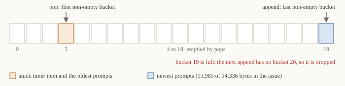
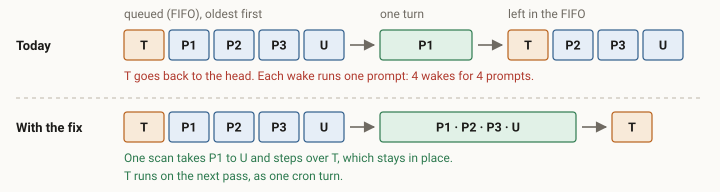
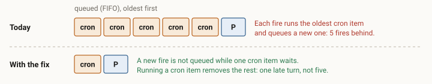
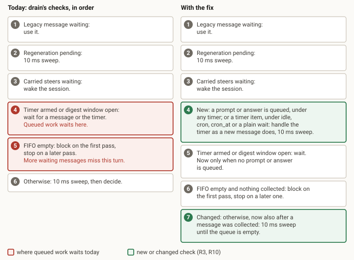
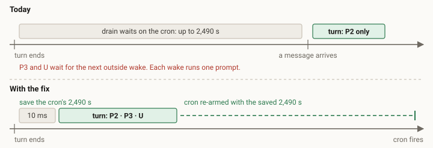
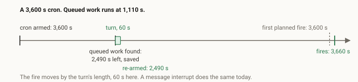
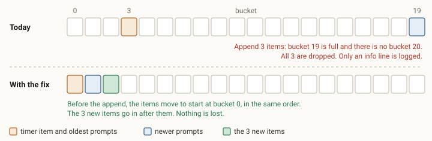
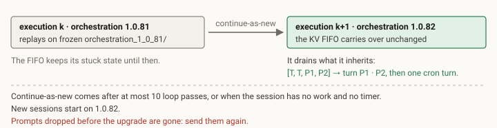

# Queued prompts stall and drop behind a timer item

In a busy session, queued prompts wait for the next timer, run one per wake, and are dropped when the last FIFO bucket fills. This spec fixes all of it in one new orchestration version.

Approved design · revision 2 · 19 October 2026 · Grounded in PilotSwarm `main @ a44357e2` (orchestration 1.0.81) · Fixes issue \#192

- **User prompts first**: Queued user prompts never wait for a timer. They run right after the previous turn, in order.
- **One turn per backlog**: Every queued prompt merges into one turn. There is no size limit.
- **Nothing lost silently**: A full last bucket compacts. A truly full queue raises an event with the lost ids.

## 01 · In one minute

1. **Defect A.** After each turn a timer is armed, and `drain` waits on it before it checks the FIFO.
2. **Defect B.** A timer item at the FIFO head stops prompt batching, so each wake runs one prompt.
3. **Defect C.** Appends never wrap. When bucket 19 is full, the rest of the append is dropped.
4. **Defect D, new in revision 2.** With an empty FIFO, `drain` stops after one message. Prompts from other sessions then run one per turn.
5. **Fix.** User prompts never wait for a timer and run in the order received. One turn takes the whole backlog, schedules keep their time, and nothing is dropped silently. Sections 05 to 09 show each change.

> **Status.** Approved on 19 October 2026, with R10 in this change. Implementation follows this design.

## 02 · Problem

*The session FIFO is 20 KV buckets of 14 KB each. It holds prompts, answers and timer items: records that a cron, wait or idle timer fired.*

| Defect | Where | What goes wrong |
|---|---|---|
| A | queue.ts:315 | While a timer is armed, `drain` waits on it. Prompts already in the FIFO wait for the next message, timer fire or digest window. |
| B | queue.ts:806-812 | `decide` runs the oldest prompt, meets the timer item at the head, puts it back and stops merging. |
| C | queue.ts:92-115 | Appends go after the last non-empty bucket. When bucket 19 is full, the rest of the append is dropped. |
| D | queue.ts:352-353 | With the FIFO empty, `drain` stops after the first message. Session messages and `message_agent` prompts carry no client message ids. They get no pre-dispatch sweep, so each runs alone. |

> **Where defect D comes from.** It was found while drawing drain's checks for revision 2. It comes from reading the code. The first failing test will confirm it before any fix.

| Wake | FIFO when decide runs | Turn runs |
|---|---|---|
| U arrives | [timer, P1, P2, P3, U] | P1 |
| The owner sends ping 1 | [timer, P2, P3, U, ping1] | P2 |
| The owner sends ping 2 | [timer, P3, U, ping1, ping2] | P3 |

*Example: a coordinator with a 3,600 s cron and 5 sub-agents. P1 to P3 are sub-agent messages. U is the owner's prompt.*

Each wake runs one prompt, oldest first, so U waits more than 10 minutes. Hours later, an append of 3 items at bucket 19 is dropped. The only trace is an info line that says the items "may rely on carry-forward". Nothing carries them.



*Illustration of defect C. Pops take the first non-empty bucket and appends the last one, so the write position moves toward bucket 19.*

## 03 · Requirements

*Each requirement has a check that a test can run.*

| # | Requirement | Check |
|---|---|---|
| R1 | `decide` merges every queued prompt after the dispatched one into the same turn. It steps over timer items and leaves them in place. | `[timer, P1, P2]`: one turn with P1 and P2. The FIFO is left as `[timer]`. |
| R2 | Merging stops at an answer, a kickoff mismatch or a carried-steers wake. Looking ahead moves or reorders no item. Prompts keep the order they arrived in. | `[P1, answer, P2]`: P1 runs alone. The FIFO is left as `[answer, P2]`. |
| R3 | Queued prompts and answers never wait for a timer. When the FIFO holds one, the loop runs it at once, whatever timer is armed. A queued timer item also runs at once when the armed timer is idle, cron, cron_at or a plain wait. | Cron armed for 3,600 s and FIFO `[P]`: drain races 10 ms, not 3,600 s. Agent wait armed and FIFO `[P]`: P runs on the next pass. |
| R4 | Each armed timer is handled as a new message handles it today. A cron or wait keeps its remaining time, and a cron_at keeps its next fire. Idle is armed again after the turn, and an agent wait ends. The turn asks a budget or workspace gate again. New: input-grace also ends early, and the question stays open. A digest window keeps its deadline. A due timer becomes a timer item. | The saved remaining time equals the timer's remaining time. A refused gate holds the prompt and shows it as queued. |
| R5 | The FIFO holds at most one timer item of each kind (type, and gate for waits). Running one removes the others of that kind. | Two queued cron items: one cron turn. |
| R6 | An append never drops an item while the FIFO has room. When the last bucket is full, the items move to start at bucket 0, in order. | Write position at bucket 19 (13,985 bytes used), buckets 0 to 18 empty, append 3: all 3 are queued, in order. |
| R7 | One turn takes every queued prompt: there is no size limit (decision 2). The FIFO itself holds at most about 280 KB. | 100 K characters queued: one turn, order kept. |
| R8 | If all 20 buckets are full, the items that do not fit are reported. The report is an error trace and a `session.fifo_overflow` event with their client message ids. Their ids are not marked as seen, so a resend runs. The "carry-forward" text goes. | Full FIFO: the event lists the lost ids, and a resend with the same id runs. |
| R9 | Ships as a new orchestration version. A 1.0.81 session moves at its next continue-as-new and drains the FIFO it has, stale timer items included. | Upgrade with FIFO `[timer, timer, P1, P2]`: it drains in two turns. |
| R10 | After `drain` collects a message, it keeps collecting with 10 ms sweeps until the durable queue is empty. The existing cap of 50 messages per pass stays. Prompts that arrive during one turn then run together in the next turn, with or without client message ids. | Three prompts without client message ids arrive during a turn, FIFO empty: the next turn runs all three. |

## 04 · Design

*All changes are in `packages/sdk/src/orchestration/`, plus one new orchestration version. Sections 05 to 09 show each change.*

| Where | Change | Covers |
|---|---|---|
| decide (queue.ts) | Replace "pop the head, put it back" with a read-only scan from the dispatched prompt. Collect the following prompts, step over timer items, and stop at a stop condition. Then remove only the collected items. `prependToFifo` is no longer needed. | R1 R2 R7 |
| decide, timer case | When `decide` runs a timer item, it also removes queued timer items of the same kind. | R5 |
| drain, new branch (queue.ts) | A new branch before the timer branch runs queued work at once. It handles the armed timer as a new message does. The pseudo-code is below. | R3 R4 |
| drain, later passes (queue.ts) | After a pass collects a message, take the 10 ms sweep instead of stopping. Stop when a sweep finds no message. | R10 |
| appendToFifo (queue.ts) | When the next bucket would pass bucket 19, re-pack all items from bucket 0 and continue. Return the items that still do not fit. | R6 R8 |
| stash callers (queue.ts) | Become generators that record the overflow event and mark only stored ids as seen. They also skip duplicate timer items. | R5 R8 |
| Versioning | Freeze 1.0.81 as `orchestration_1_0_81/`, register it, raise the latest version, and update `orchestration-version-upgrade.test.js`. | R9 |
| Docs | `docs/architecture/orchestration/design.md`, sections 4 and 5. | - |

**drain changes (pseudo-code)**

```text
new branch, before the timer race (R3, R4):
  if the FIFO or this pass holds a prompt or an answer,
     or a timer item while activeTimer is idle, cron, cron_at or an ungated wait:
      if activeTimer is due: stash it as a timer item
      else: handle activeTimer as a new message does today
            (save cron and wait time, keep the cron_at fire, end idle,
             agent waits and input-grace, leave gates to the turn)
      take the 10 ms sweep
  a digest window keeps its own deadline

changed, at the blocking branch (R10):
  if nothing is in the FIFO but this pass collected a message:
      take the 10 ms sweep instead of stopping
```

> **Why a new version.** The change alters yields and KV writes. Replay of an in-flight 1.0.81 session must keep using the frozen 1.0.81 code.

## 05 · One turn takes the whole backlog

*Covers R1, R2, R5 and R7. `decide` scans forward from the prompt it runs, instead of popping the head and putting it back.*



*R1: the issue's FIFO and one wake. T is the stuck timer item. U is the owner's prompt.*

| Item the scan meets | Today | With the fix |
|---|---|---|
| Prompt | Merged. | Merged. No size limit (decision 2). |
| Timer item | Merging stops. The item goes back to the head. | Stepped over. It stays in place. |
| Answer, or another item kind | Merging stops. The item goes back to the head. | Merging stops. Nothing moves. |
| Kickoff next to a person's prompt | Merging stops (rule from 1.0.70). | Merging stops. Nothing moves. |
| Carried-steers wake | Merging stops. | Merging stops. Nothing moves. |
| Cancelled prompt | Dropped and recorded. | Dropped and recorded. |

*R2: what the scan does with each item after the dispatched prompt.*



*R5: the second coordinator in the issue carries 5 old cron items. The fix keeps one.*

## 06 · Queued work runs at once

*Covers R3 and R10. User prompts never wait: `drain` checks for queued work before it waits on a timer, and it keeps collecting after the first message.*



*drain's checks, top to bottom. The first check that matches decides what drain does on that pass.*



*The issue's coordinator after a turn. The cron has 2,490 s left. P2, P3 and U are queued.*

## 07 · Every schedule keeps its time

*Covers R4. Running queued work early neither loses nor resets a schedule.*

| Armed timer | Today, with a prompt queued | With the fix |
|---|---|---|
| cron | Waits for the rest of the interval: 2,490 s in the issue. | Ends early. The remaining time is saved and re-armed after the turn. |
| cron_at | Waits until the wall-clock fire. | Ends early. The next fire is kept. If it passes during the turn, it fires after the turn. |
| wait | Waits for the rest of the wait. | Ends early. The remaining time is resumed after the turn. |
| idle (top-level, 1,800 s) | Waits up to 30 minutes. | Ends early. Idle is armed again after the turn. |
| wait_for_agents (polls every 30 s) | Waits up to 30 s, until the next poll. | Ends, as when a new message arrives. The agent can wait again (decision 3). |
| input-grace (30 s after ask_user) | Waits up to 30 s. | New: ends early. The question stays open. |
| Budget or workspace gate | Waits until the gate's timer fires. | The turn asks the gate again. If it refuses, the prompt is held and shown as queued, as today. |
| Child-digest window | Waits until the window closes: 30 to 300 s. | Keeps its deadline. Queued work runs now. |
| Timer already due | Fires into the FIFO. | Stashed as a timer item. Runs in order. |

*For each timer, the fix does what a new message does today. Only the input-grace row is new.*



*R4 with numbers: a cron keeps its remaining time, the same rule a new message follows today.*

## 08 · Nothing is dropped silently

*Covers R6 and R8.*



*R6: illustration of the issue's case. Bucket 19 held 13,985 of 14,336 bytes when a 3-item append came.*

1. **All 20 buckets full.** About 280 KB of queued items (20 × 14 KB). Compaction cannot make room.
2. **Store what fits.** Items are stored in order until the space runs out.
3. **Report the rest.** An error trace and a `session.fifo_overflow` event list their client message ids.
4. **Accept a resend.** Their ids are not marked as seen, so a resend with the same id runs.

## 09 · Rollout to live sessions

*Covers R9.*



*A live 1.0.81 session moves to the new version at its next continue-as-new.*

## 10 · Test plan

*Unit and harness tests run without a database or a model. The full suite and the deployed check need a dev workspace.*

| Layer | Test | Covers |
|---|---|---|
| Unit: `orchestration-fifo-order.test.mjs` | `[timer, P1, P2]` merge. `[P1, answer, P2]` stop. Kickoff order (existing). No size limit: 100 K characters run in one turn. Two cron items give one turn. Compaction at bucket 19. A full FIFO reports and keeps ids unseen. Repair the test at line 111, which cannot fail today. | R1 R2 R5 R6 R7 R8 |
| Orchestration harness: `test/local` (vitest, mocked session) | For each armed timer, FIFO `[P]` runs P on the next pass. The timer is handled as a new message handles it. Cron and wait time are saved and re-armed. Agent waits and input-grace end. Gates are asked again. A due timer is stashed. Three prompts without client message ids that arrive during a turn run in one turn. | R1 R3 R4 R10 |
| Upgrade: `orchestration-version-upgrade.test.js` | A 1.0.81 input with FIFO `[timer, timer, P1, P2]` drains on the new version. | R9 |
| Full suite | The final head against a `main` baseline in the same workspace. | all |
| Deployed | A real model turn on the deployed build. A cron session with a sub-agent that sends messages. A user prompt sent during `wait_for_agents`. | R1 R3 R10 |
| Browser and UX | None: no UI change. | - |

## 11 · Out of scope

- Showing `session.fifo_overflow` in the portal or the TUI. This is a follow-up issue.
- Recovering prompts already dropped in live sessions. They must be sent again.
- FIFO capacity, the child-digest window lengths, and the kickoff ordering rule from 1.0.70.

## 12 · Decisions

*All decisions are made.*

| # | Question | Decision |
|---|---|---|
| 1 | Version number. PR 180 also takes 1.0.82. | Build as 1.0.82. PR 180 is open and not merged. If it merges later, it renumbers. |
| 2 | Merge limit for one turn. | No limit (R7). |
| 3 | Queued prompts while `wait_for_agents` runs. | They run at once. User prompts go right after the previous turn, in the order received (R3, R4). |
| 4 | R10, new in revision 2: fix defect D in this change, or in a separate issue? | In this change. |

*Decided in review on 19 October 2026: 1 to 3 in comments on revision 1, 4 at approval of revision 2.*

---

- Source: microsoft/PilotSwarm issue 192 and main @ a44357e. Line numbers are at that commit.
- Proposal, not implemented. The analysis comes from reading the code; nothing was run.
- The diagrams are illustrations drawn from the code, not measurements.
- Revision 1 had three open decisions; review settled them (section 12). Revision 2 added defect D and R10.
