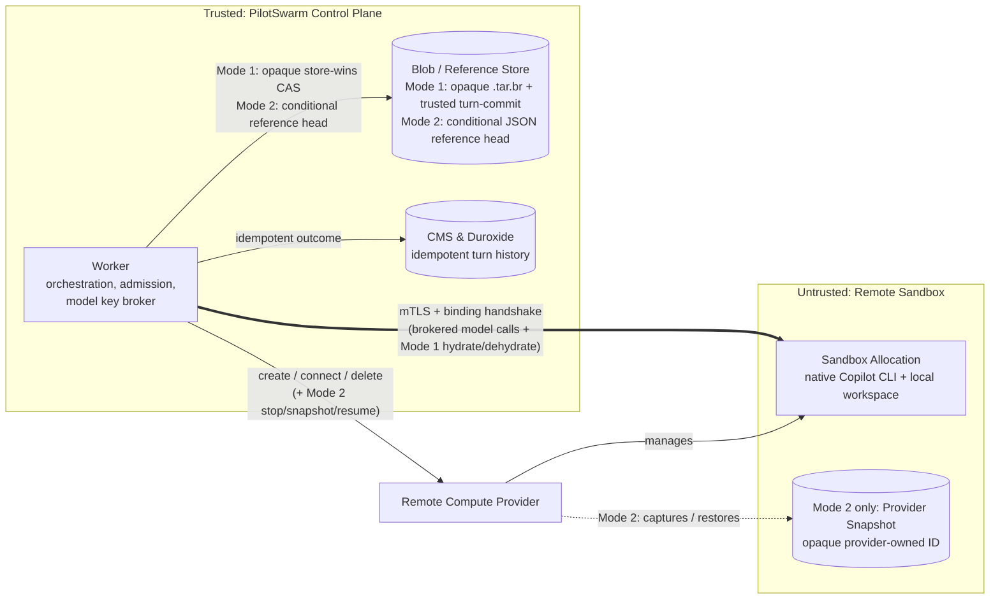
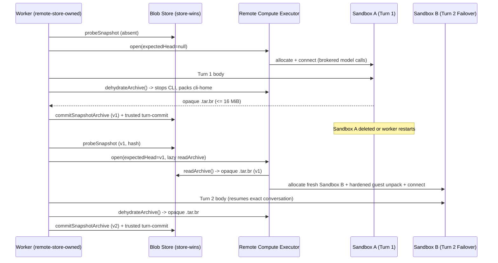

# Remote-Compute State Modes: Store-Owned and Snapshot-Owned Sandboxes

**Status:** Proposal and draft PR for discussion (November 25, 2026 — Revision 4).

Companion to [`docs/proposals/compute-contract-foundation.md`](./compute-contract-foundation.md) and [`docs/proposals/snapshot-store-wins.md`](./snapshot-store-wins.md). This proposal is provider-neutral: it defines the PilotSwarm contract for any separated remote compute provider.

---

## 1. What This Covers

This proposal defines how PilotSwarm persists session state when the **trusted worker** (orchestration, CMS, facts, artifacts, and model API keys) is separated from an **untrusted remote sandbox** (Copilot CLI, shell, and file tools).

PilotSwarm supports **two explicit state modes** on top of one shared remote-compute foundation:
- **Mode 1 (`statePolicy: "store-owned"`, universal default):** PilotSwarm's blob store and CMS own authoritative session state under `store-wins`. The remote sandbox is a disposable warm cache.
- **Mode 2 (`statePolicy: "managed"`, opt-in full-disk tier):** A snapshot-capable compute provider owns full sandbox state (conversation files and workspace disk) inside provider snapshots, while PilotSwarm stores an accepted conditional snapshot reference.

Default local-worker sessions are unchanged. User-supplied static hosts are outside the scope of this proposal.

---

## 2. Shared Foundation (Both Modes)

Both modes enforce the same trust boundary and transport model:

1. **Worker stays trusted:** The worker owns Duroxide orchestration, CMS history, execution admission, and all model API keys. Neither model keys nor control-plane credentials enter the sandbox, its snapshots, or its session archives.
2. **Sandbox runs untrusted tools:** The sandbox runs only the native Copilot CLI and agent tools behind mutual TLS and a per-binding cryptographic handshake. Model requests flow back over the authenticated channel to the worker's model broker.
3. **Explicit mode choice per target:** Each compute target declares either `statePolicy: "store-owned"` or `statePolicy: "managed"`. A session never silently falls back from Mode 2 to Mode 1 on error.

---

## 3. Side-by-Side Comparison

| Dimension | Mode 1: `store-owned` (Universal Default) | Mode 2: `managed` (Opt-In Full-Disk Tier) |
|---|---|---|
| **Authoritative state** | Blob storage (opaque `.tar.br`) + CMS under `store-wins` | Provider snapshot + conditional JSON reference head in store |
| **Role of the sandbox** | Disposable warm cache (reuse, pause, or replace freely) | State authority (provider snapshots back durability) |
| **What crosses back to worker** | Bounded `cli-home` archive (`<= 16 MiB` opaque bytes; **never extracted on worker**) | Small JSON reference record (`~2 KiB`; opaque snapshot ID only) |
| **Worker crash or sandbox loss** | **Self-healing immediately:** any worker allocates a fresh sandbox and hydrates from Blob | **Gated on Phase 2:** requires qualified provider retention and stale-executor fencing |
| **Provider requirements** | Minimal: create, exec/connect, delete (works on any container, VM, or sandbox service) | Strict: immutable snapshots surviving resume/idle/delete, documented TTL, and snapshot GC |
| **Workspace & installed tools** | Ephemeral on replacement (pair with durable session workspaces or artifacts) | Preserved automatically inside the provider snapshot |
| **Transcript epoch** | Works at epoch `0` and epoch `>= 1` | Requires `transcriptEpoch: 1` (without regeneration metadata) |
| **Control-plane complexity** | Low: reuses `store-wins` (`If-Match` ETag + `turnKey` idempotency, no turn cap) | High: write-ahead CAS phases, bounded 32-turn ledger, owner tokens, `restoreQualification` gate |

---

## 4. Mode 1 Design: Store-Owned Remote Compute (`statePolicy: "store-owned"`)

Mode 1 extends PilotSwarm's `store-wins` durability model to separated remote compute providers while preserving a strict untrusted-guest boundary.

### 4.1 Worker & Executor Contract

A worker opts in via `remoteStoreOwnedTargets` (targets declaring `config.statePolicy = "store-owned"` and optional lower `storeOwned.maxArchiveBytes`) and `remoteStoreOwnedExecutor`.

| Method / Property | Contract |
|---|---|
| `executor.open(request)` | Receives `{ sessionId, epoch, target, turnKey, workerNodeId, requestHandler, expectedHead, readArchive, signal }` and returns a `RemoteStoreOwnedLease`. `expectedHead` is `{ version, contentHash }` (or `null` on turn 1). `readArchive()` is lazy so a warm sandbox matching `expectedHead` skips downloading Blob bytes. |
| `lease.client` | Started Copilot CLI client connected over the authenticated channel with worker-side model brokerage (`requestHandler`). Worker-local `skillDirectories` are omitted on remote targets; registered skills remain loadable via worker-side `load_skill`. |
| `lease.hostId`, `reusedWarm`, `hydratedVersion` | Identifies which remote sandbox ran the turn, whether a warm cache hit avoided hydration, and which stored version the sandbox started from (`null` only on a brand-new session with no stored head). |
| `lease.dehydrateArchive(request)` | Quiesces and stops the guest CLI, packs only `cli-home/session-state/<sessionId>`, and returns `{ archiveBytes, codec, rawSizeBytes }` as opaque bytes. |
| `lease.acknowledgeCommit(head)` | Optional hook called after `store-wins` commit succeeds so the executor can tag its warm cache entry with the accepted `{ version, contentHash }`. |
| `lease.invalidateWarmCache(reason)` | Called on any `412` conflict, turn error, or uncommitted exit so a diverged sandbox is never mistaken for the stored head. |
| `lease.close()` | Always called in `finally` to release the per-turn connection (without destroying a healthy warm sandbox). |

### 4.2 Two-Object Store Model & Untrusted-Archive Boundary

`VersionedSnapshotStore` (both `SessionBlobStore` and `FilesystemSessionStore`) adds three opaque-archive operations:

1. **`commitSnapshotArchive(sessionId, { baseVersion, turnKey, archiveBytes, codec, rawSizeBytes, turnCommit }, epoch)`:**
   - Rejects empty or oversized `archiveBytes` (`REMOTE_SNAPSHOT_ARCHIVE_MAX_BYTES = 16 MiB` default, configurable lower per target).
   - Computes SHA-256 `contentHash` over the opaque bytes on the worker—**the worker never untars, lists, or parses guest archive bytes on the worker filesystem**.
   - Performs the standard `store-wins` conditional Put (`If-Match` / `If-None-Match` ETag on Blob, `cas.lock` on FS) writing `psver`, `psturnkey`, `pssha`, `pscodec`, and `psraw`.
   - Stores the optional `turnCommit` (`{ turnKey, result }`, capped at `64 KiB`; oversized `events` are stripped before omission) in a **separate worker-owned trusted record** (`<session>[.e<epoch>].turn-commit.json`), never inside the untrusted guest archive.
2. **`readSnapshotArchive(sessionId, epoch)`:** Streams opaque archive bytes (enforcing the cap and verifying hash) directly to the executor without writing or extracting them on the worker.
3. **`readTrustedTurnCommit(sessionId, epoch)`:** Reads the worker-owned trusted turn-commit record so idempotent `turnKey` retries answer directly with **zero sandbox contact** and **zero archive parsing**.

**Guest-side archive hardening (runs strictly inside the untrusted sandbox):**
- **Pack:** Walks only `<sessionStateRoot>/<sessionId>` with `lstat`, excludes `.ps-snapshot-version*`, `.ps-turn-inprogress*`, and `inuse.*.lock`, refuses symlinks and hard links, skips sockets/FIFOs/devices, and enforces entry (`<= 2,000`), expanded (`<= 64 MiB`), and compressed (`<= 16 MiB`) limits.
- **Unpack:** Bounds decompression with `maxOutputLength` (anti-bomb defense), validates every tar header in code (path strictly under `<sessionId>/`, no `..`, no leading `/`, no NUL, no backslash, no drive prefix, no symlinks/hardlinks/devices/FIFOs, no duplicate paths), writes into a private `0700` staging directory, and atomically swaps into place.

### 4.3 Turn Lifecycle & Failure Rules (Mode 1)

| Scenario | Required Behavior |
|---|---|
| **Warm cache hit** | Sandbox is running and its cached `(version, contentHash)` matches `probeSnapshot`. Executor skips `readArchive()` and hydration and runs Turn `N+1` immediately. |
| **Worker restart or sandbox loss** | New worker has no warm cache entry, allocates a fresh sandbox, hydrates `cli-home` from Blob, and resumes the exact conversation. |
| **Idempotent `turnKey` retry** | `probeSnapshot` matches `turnKey`; worker returns the result from the worker-owned trusted turn-commit record with zero sandbox contact. |
| **`412` `store-wins` conflict** | Another writer advanced Blob between probe and commit. Worker calls `invalidateWarmCache("snapshot-conflict")`, emits `session.snapshot_unpublished`, and returns cleanly without bricking; the next turn rehydrates whatever won. |
| **Crash between archive commit and turn-commit write** | Retry of the same `turnKey` sees the head committed without a trusted turn record and fails closed (`STORE_OWNED_RESULT_UNAVAILABLE`) instead of double-running the turn. |
| **Oversized or invalid guest archive** | Rejected before any Blob write; warm cache is invalidated. |

**Conversation state vs. workspace files:** Mode 1 guarantees durable conversation memory via Blob storage. Arbitrary workspace files on the sandbox disk are best-effort warm cache unless paired with PilotSwarm's durable session workspaces, git clones, or artifacts.

---

## 5. Mode 2 Design: Snapshot-Owned Managed Sandboxes (`statePolicy: "managed"`)

Mode 2 lets a snapshot-capable compute provider own both CLI conversation files and full sandbox disk/workspace state inside provider snapshots, while the trusted control plane stores only an accepted JSON reference head (`~2 KiB`).

- **Epoch 1 & write-ahead CAS:** Managed sessions initialize at `transcriptEpoch: 1` (without emitting regeneration metadata) and commit bounded pre-effect phases (`acquiring`, `dispatched`, `capturing`, `publishing`) in a 4 KiB lifecycle facet (`sdk.managed-state`) before every external side effect.
- **Quiesce, capture, and conditional publish:** At turn end, the worker stops model/tool admission, closes the runtime transport cleanly before asking the provider to stop and snapshot, validates the proposal (`managed.experimental.*`, `restoreQualification: "unproven"` in Phase 1), and publishes one conditional reference head bound to `turnKey` and a process-local owner capability digest.
- **Fail-closed safety:** Any post-send store error is `unknown` (never assumed unwritten, never deleting the snapshot). Dispatched turn failures transition to `diverged` and hold rather than replaying. Phase 1 enforces a non-evicting 32-turn ledger and keeps automatic cross-sandbox failover disabled until provider snapshot retention (TTL, post-resume/auto-suspend durability, post-delete survival, and GC API) and physical stale-executor retirement are independently proven.

---

## 6. What We Know

1. **Separated execution with worker-only model keys works:** Both modes run the native Copilot CLI inside an untrusted remote sandbox while keeping model API keys, orchestration, and CMS strictly on the worker.
2. **Provider snapshot retention cannot be assumed:** A provider's `stop` snapshot ID can restore while the source stays stopped, yet return `404 SnapshotNotFound` after the source resumes and idle-suspends. Separating checkpoint acceptance from restore qualification (`restoreQualification: "unproven"`) is mandatory until a provider guarantees immutable snapshots across resume, idle, and deletion.
3. **Runtime quiesce before state capture is required:** Closing the runtime transport and stopping the guest CLI before snapshotting (Mode 2) or packing `cli-home` (Mode 1) prevents stale connections and ensures files flush cleanly.
4. **Prototype verification:** Both modes compile cleanly and pass isolated SDK unit tests (opaque `store-wins` archive CAS, cross-sandbox failover, warm-cache reuse, 412 conflict handling, and Mode 2 managed state machine). **Both modes are also proven live** against a real remote sandbox provider with worker-only model keys:
   - **Mode 1 (`store-owned`):** Live cross-sandbox failover passed—Turn 1 ran in Sandbox A, dehydrated an opaque brotli archive (~23 KiB) to Blob Storage in ~2 s (0 local files on worker), Sandbox A was deleted (`404`), and Turn 2 allocated brand-new Sandbox B, hydrated from Blob in ~2 s before CLI start, and recalled Turn 1's exact conversation token purely from Blob-hydrated state.
   - **Mode 2 (`managed`):** Live two-turn same-sandbox continuity passed—Turn 1 wrote a file and committed snapshot reference v1 (`restoreQualification: "unproven"`), and Turn 2 rebound cleanly on the resumed sandbox, read back the exact file, and committed reference v2.

---

## 7. Direction & Decisions Made

1. **Mode 1 (`store-owned`) is the universal default for separated compute:** It delivers immediate worker-restart and cross-sandbox failover across any compute provider without waiting on provider-specific snapshot guarantees.
2. **Mode 2 (`managed`) is the opt-in full-disk tier:** Kept behind explicit opt-in (`statePolicy: "managed"`, `restoreQualification: "unproven"`) for providers whose snapshot immutability, TTL, and cleanup APIs are verified.
3. **Strict untrusted-guest boundary in both modes:** The worker never extracts guest archives in Mode 1 and never injects model keys or control-plane credentials in either mode. External tool side effects (database writes, API calls, emails) are never rolled back by snapshots or archives.

---

## 8. Open Questions & Next Steps

| # | Owner | Question / Decision |
|---|---|---|
| 1 | **PilotSwarm maintainers** | Confirm adopting the two-mode contract (`store-owned` default + `managed` opt-in) as the target architecture for separated compute providers. |
| 2 | **PilotSwarm maintainers** | Confirm `16 MiB` compressed as the default `cli-home` archive cap for Mode 1 (and `64 KiB` for the worker-owned trusted turn-commit record), keeping larger workspace files in session workspaces and artifacts. |
| 3 | **Snapshot-provider teams** | Clarify Mode 2 snapshot guarantees: retention TTL, behavior across source resume and idle auto-suspend, post-delete survival, and snapshot garbage-collection APIs. |
| 4 | **PilotSwarm maintainers** | Decide whether Mode 2's 32-turn ledger cap should be lifted with a store-level turn journal before graduating Mode 2 out of experimental opt-in. |
| 5 | **Implementation (next)** | Run full-suite PR qualification and code review for Mode 1 (`store-owned`) and Mode 2 Phase 1 (`managed`) before moving out of draft. |
