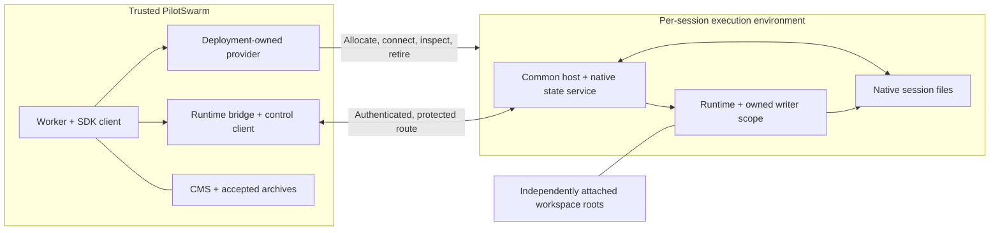

# Remote execution: compute framework, native state and recovery

**Status: technical companion to the [sandboxing overview](sandboxing.md).**
The branch contains an integrated native-core implementation and additive schema
changes. This companion keeps implemented contracts, the named controlled
Windows profile and remaining provider/feature qualification distinct; it does
not declare the entire design released or deployed.

Tracks [microsoft/PilotSwarm#261](https://github.com/microsoft/PilotSwarm/issues/261).
It updates the detailed remote-design proposal from
[microsoft/PilotSwarm#253](https://github.com/microsoft/PilotSwarm/pull/253) and
incorporates the compute framework from
[microsoft/PilotSwarm#244](https://github.com/microsoft/PilotSwarm/pull/244),
reviewed at `b0b500626190ba98079f1f45296f49840b4d39eb`.
Read this file for current technical detail, not the older candidate's API and
limitations as a second specification.

The [implementation guide](../developer/building/compute-providers.md) maps public
contracts and reproducible checks. Current-main integration retains its MOTD
migrations 0084-0087; target registration is 0088 and native execution/completion
is 0089. Frozen orchestration 1.0.83 remains registered; native work uses 1.0.84.
The implemented recovery authority is archive-backed. Provider-held checkpoint
custody and environment pause/resume remain future work.

For the main integration questions, see [feature behavior](#11-first-release-feature-behavior),
[package delivery](#static-and-published-package-delivery) and
[connectivity](#does-this-require-a-relay).

## 1. Goal and deliberate changes

Keep the trusted PilotSwarm worker, SDK client, orchestration, backend access and
authorized application callbacks outside the agent's execution environment.
Run the runtime, native tools and native session files inside it. Attachment to
that runtime never enrolls it as a trusted worker or grants backend authority.

Keep Andrew's targets and authorization, worker-loaded providers, host component,
connection bridge, handshake, path mapping, skill/MCP delivery and supported model
brokerage. Adapt the implemented prototype's native state, current-attempt guard
and committed-completion recovery into that framework.

Three differences from the earlier proposals are intentional:

- **Per-session allocation:** one isolated environment per logical session,
  including delegated subagents. A root's target authorization can be inherited;
  its executor, native home, process and database are not shared with children.
- **Native-only remote state:** remove worker-backed SessionFs rather than keep
  an alternative mode. Ordinary unselected local behavior and unrelated workspace,
  asset and artifact functionality remain.
- **Verified capture:** retained capture at "local parity" is not sufficient.
  Every accepted checkpoint needs a qualified consistency boundary. A controlled
  restart is allowed if needed; neither always-warm nor always-restart is required.

This is one provider-neutral core integration, not a parallel public
`executionBinding` placement system. Cloud-specific integration stays in the
deployment repository and consumes public SDK contracts.

## 2. Targets, registration and placement policy

A **target** is an administratively registered place/profile to run, not the
physical environment or its current controller. A **provider** implements one
compute kind and is installed by trusted deployment code through `computeProviders`
or `registerComputeProvider`. Core must not acquire its cloud SDK or credentials.

Retain the framework's shared-target registry, immutable IDs, enabled state and
provider-owned non-secret configuration. A name such as `shared/build-pool` is
resolved to an ID at creation; deleting and recreating that name must not transfer
old sessions to a different target. Persist defaults as well as explicitly supplied
targets, including system-session callers.

Before each turn, revalidate the recorded target and the applicable principal's
authority. Service/system sessions need an explicit policy too; a missing user
principal is not permission to borrow deployment-wide authority.

The deployment policies have different meanings:

- **No selected target or policy:** ordinary local execution stays unchanged.
- **Default target (`defaultComputeTarget`):** roots that omit one receive and
  persist it; children inherit target policy, not physical allocation.
- **Require compute (`requireCompute`):** refuse worker-local agent execution.
  A named target alone is not enough if its implementation would still run the
  agent beside the worker.

Explicit or remembered remote selection must fail closed if the provider, catalog
authority, compatible host or required native capability is unavailable. Never
silently convert it to a local SDK launch.

The reviewed framework manages targets through the management client and Web API.
Personal targets, host pairing/runtime registration, separate provider services
and target management in every UI are not prerequisites of this integration.
Do not confuse deployment-time registration with "the host must already exist":
`bind` can create it dynamically.

## 3. Connection and trust boundaries

The provider presents a reachable host endpoint through a protected route. The
worker owns the runtime bridge and common protocol. The SDK connection and host
control/state channel are distinct logical services; management REST alone is
not the interactive runtime channel.

Retain the mutual handshake and the runtime connection token. The control and
runtime purposes must not be interchangeable, and an endpoint without the required
binding authentication is refused. Host/runtime incarnations identify replacement;
a reconnect is not evidence that the old attempt was retired.

The framework defaults to loopback endpoints. Allowing a non-loopback address is
a deployment decision, not a way to make that network secure.

The reviewed handshake authenticates but does not encrypt the subsequent traffic.
Require a private or otherwise protected route supplied by the deployment; do not
expose an unencrypted runtime/control endpoint over an untrusted network. A
provider can arrange connectivity without making a particular tunnel product a
core dependency. Outbound-only host registration is separate future work.

### Does this require a relay?

No particular relay service is required by PilotSwarm core. A deployment needs a
protected route carrying both runtime and host control/state traffic. A reachable
private TCP endpoint or a suitable platform-provided byte tunnel can supply it;
otherwise the provider needs an approved tunnel of its own.

The current common opener dials TCP despite its `uri` label. A deployment-owned
local bridge can adapt a genuinely compatible WebSocket byte tunnel to a
loopback endpoint without provisioning a new Azure Relay resource. An arbitrary
WebSocket application protocol is not necessarily such a tunnel, and a buffered
shell-command API cannot replace the ongoing bidirectional connection. Establish
the route's app authorization, byte/stream semantics and limits rather than infer
compatibility from its URL or the existence of management HTTPS.

The common host runs inside the execution boundary. Its files, events and
responses remain untrusted. A guest-reported boolean, successful RPC, signal
delivery, parent-PID exit or expired heartbeat cannot establish current authority
or all-writer termination. Never signal a worker-local process using a PID returned
by the remote host.

## 4. Public responsibilities and execution identity

Keep the existing provider lifecycle where it fits:

- `bind`: idempotently acquire this target/session allocation.
- `connect`: describe how the current worker reaches its identified host and
  authorized resources.
- `release`: release interest, not prove termination or delete an environment.

Extend the public contract for trusted inspection/retirement of an exact recorded
execution scope, including an explicit unknown result. The common host's public
bootstrap/supervision contract prepares native state, controls the runtime writer
scope, holds a checkpoint barrier and serves bounded import/export. Providers do
not implement their own archive format or publish accepted state.

Distinguish these identities:

| Identity | Meaning |
|---|---|
| Target ID | Registered placement and authorization |
| Session and transcript epoch | Logical state lineage and reset boundary |
| Host incarnation and runtime generation | Physical allocation and runtime replacement |
| Durable turn and activity attempt | Work being performed versus one execution of it |
| Controller incarnation | The worker/controller claiming current admission |

These are not interchangeable with transport credentials. Root-session identity
remains useful lineage but must not key shared allocation.

Adapt the prototype guard into common compute management backed by shared durable
authority, not a process-local counter. Capture the attempt in tool, permission,
hook, model/MCP and state-transfer callbacks. Refresh retained handles without
giving obsolete handlers access to the next attempt.

SDK attachment alone is not cryptographic per-turn attribution. Qualified warm
reuse must also account for delayed runtime messages and pending wire work;
replacing a callback cannot bless an old request as new.

Admission is serialized against replacement and release and stays held through
awaited work, including archive CAS. Detached continuations must re-enter current
authority. If a worker disappears with an admitted operation unresolved, its
timeout does not authorize clearing the operation and starting a conflicting one.

Reconciliation must inspect the exact generation and outcome. Observing that an
archive is absent once does not prove that an old publisher cannot still commit.
Expose unknown/retirement/publication status through trusted management surfaces;
an unexplained indefinite hold is not a complete operational recovery design.

## 5. Native state and independently attached resources

Bootstrap the actual native home before starting the remote runtime. Worker-side
SDK `baseDirectory` does not relocate an already-running URI runtime. Create/resume
must use the accepted state and runtime paths, not accidentally read the worker's
live filesystem.

The state profile declares compatible versions, required paths/files/databases,
excluded resource roots and transfer limits. Include the required conversation,
compaction, metadata, native tool/database and nested/binary state. Classify
runtime-global databases explicitly; do not assume a per-session directory is
complete, silently discard required state or archive an entire credential-bearing
home.

The worker's session directory becomes trusted staging/cache, not the remote
runtime's live filesystem. Import into clean host staging, validate, then place
the accepted state before runtime startup. Do not merge unknown retained files
into the accepted tree or call an empty reconstruction recovery.

The host implements bounded native import/export. The worker validates canonical
paths, types, duplicates, required entries, count/byte limits and digests. Reject
escapes, links/hardlinks and unsupported special files. Worker protocol markers,
results and completion metadata remain outside the imported native payload; a
host cannot manufacture them to acquire authority.

Repository/build roots remain independently attached and outside the session
archive. Preserve their declared partial-edit/retry behavior: restoring
conversation state does not restore an immutable workspace version. A fresh clone
is not equivalent to recovering dirty files and local commits.

Keep Andrew's worker/host path mapping and actual-root checks. A translated path
is not a mount. Required unavailable roots must block native work; optional
unavailable roots must be reported honestly. Dynamic attachment changes take
effect at the supported next connection/turn boundary.

File-based artifacts must use the authorized runtime filesystem and a real bounded
transfer route when files are not shared. A state-export capability is not proof
that arbitrary workspace paths or portal file/git operations work remotely.

## 6. Capture, runtime lifetime and replacement

There are three lifetimes: the environment, the common host/state service and the
runtime writer scope. Keep export access alive while relevant writers are held
or stopped. Deleting the environment before export is not a checkpoint protocol.

The normal sequence is:

1. Reconcile accepted state/current authority, import if needed, and start/resume.
2. Run with current callbacks, model configuration and resource authorization.
3. Close new effect/execution admission and drain admitted work.
4. Persist required state and establish a qualified, identity-bound no-writer
   boundary.
5. Export under that boundary, validate and atomically replace trusted staging.
6. Publish accepted state/result through archive CAS while authority remains pinned.
7. Finalize completion idempotently, then reopen or retire as permitted.

Prefer a qualified held barrier where supported. Permit a controlled runtime
restart when necessary without requiring a new environment. The barrier must
cover relevant native tool/helper/MCP writers, not merely the runtime's main PID.
Platform/supervisor enforcement and observations must support that claim.

SDK idle/disconnect, task preflight, a flush and two matching copies are not
complete barrier proofs. `session.rpc.shutdown` has session-end semantics and is
not a blanket per-turn save operation. Preserve lifecycle-hook fidelity; do not
choose always-restart or mandatory-warm by implication.

For SQLite, qualify actual backup/closure and restore semantics at the declared
boundary. Check restored schema, logical rows/BLOBs and integrity, including
committed WAL-backed data and failed/truncated captures. Synthetic database bytes
or matching sidecar names prove neither database consistency nor state completeness.

Retire or permanently fence conflicting old execution before replacement. If
termination, capture or publication remains unknown, retain an observable hold
and reconcile it; do not commit partial state or infer safety from a budget expiry.
Provider cleanup must also handle missing release calls, lost create/delete
responses, expiry and orphans. None of this mandates deleting a healthy environment
after every turn.

## 7. Models, skills, MCP and callbacks

Keep the worker's credentials and environment out of the host. A supported model
profile deliberately uses worker brokerage, a qualified platform identity or
suitably scoped runtime credentials; a provider label alone proves no scope.

For the retained worker-broker path, send opaque stand-ins and resolve them to the
current admitted provider on the trusted side. Refresh keys, credential-bearing
headers, token callbacks and provider options across create/resume/rebind and
retained turns. Stable placeholders must not retain old authority. Reconfigure
the SDK when changed options require it, not just the forwarding resolver.

The reviewed compute profile refuses native GitHub Copilot models; native state
does not automatically enable that authentication or qualify Responses/WebSocket
and other transports. Keep actual supported profiles explicit. Budget admission
and original settlement identity remain trusted-side decisions; idempotent
accounting does not itself verify all host-reported usage.

### Static and published package delivery

Static deployment sources and published agent packages have different loading
paths, then converge on worker-side composition and selected runtime assets.
Installing the PilotSwarm SDK/common host is deployment bootstrap, not the
agent-package publication lifecycle.

**Static deployment path**

1. The deployment supplies plugin directories, inline agents/skills/MCP and
   registered callbacks, alongside the installed SDK/runtime prerequisites.
2. The worker loads system/default layers and configured plugins, parses their
   namespaces and resolves the session's allowed agents and capability exports.
   Static sources have a deployment identity, not an agent-package semver.
3. Instructions and tool declarations are composed on the worker. Selected skill
   directories and package-origin directories needed by authorized package MCP
   are delivered through digest-based common-host staging and given runtime paths.
4. Native tools/package MCP execute in the environment. Registered worker
   callbacks and deployment services remain on the trusted side. Static
   definition changes use the normal deployment reload/startup path; copying
   current skill bytes is separately content-addressed.

**Published agent-package path**

1. Publication validates the bundle and its declared agents, skills, MCP/support
   files and optional worker module. Scope/owner, name, immutable semver and
   canonical tar digest identify its content; conflicting bytes for the same
   version are refused.
2. An opted-in worker observes registry changes and installs enabled ACTIVE
   package versions into its version/content-qualified cache. Installation can
   include other owners' enabled packages; it is not session authorization.
   Authorized inspection of a historical version also does not imply that
   version is installed for runtime use.
3. The worker imports an optional worker module as trusted executable code before
   per-session selection. Import/collision failures quarantine that package.
   Owner/package/revision provenance is retained for selection.
4. Session resolution selects the exact visible source and exports under
   owner/shared policy. A stale revision-bearing source reference is refused,
   not silently upgraded to a different capability grant.
5. Selected instructions/declarations and runtime assets follow the same
   composition and host-copy path as static sources. Package MCP configuration
   comes from raw package-owned entries with runtime paths; it may not borrow
   resolved worker environment values or worker-only paths.
6. Version/registry changes refresh installation and module identity; asset
   digests trigger redelivery/rebind as appropriate. Old installed directories
   may remain for warm MCP references. A recovered native archive is not
   automatically a lock on every package/dependency version.

**Dependencies and trust**

Agent-package installation validates/extracts files, and asset staging copies
bytes. Neither runs npm/pip dependency restore. Worker-module imports need
vendored or otherwise resolvable dependencies; package MCP needs its dependencies
bundled or supplied in the executor image/bootstrap. Executables such as Node,
Python and Git, the common host/runtime and qualified supervisor must actually be
present in the selected environment.

Worker modules are not sandboxed by remote runtime placement. Loading them is a
deployment/package-trust decision, distinct from session visibility. Copying a
package directory can also carry module source as inert bytes; it does not move
its trusted handler execution into the sandbox or scrub secrets from package
contents. Do not bundle worker credentials as package data.

Copies do not write back to worker source. Package MCP processes use
package-owned configuration without worker substitutions. Keep publication,
session selection, asset delivery and image/bootstrap prerequisites explicit.

### Trusted service and callback boundaries

Deployment MCP services stay on the trusted side. The host reaches only the
session's offered services through scoped, revocable tickets. A ticket authorizes
a server connection, not each tool call in an opaque tunnel. The destination or
a trusted enforcement layer must authorize the actual caller/resource/operation;
offering a broadly privileged service can otherwise lend its entire authority.

Treat native events as untrusted observations, not worker-origin control,
completion or accounting records. Existing application callback policy remains
necessary alongside current-attempt admission. Worker-imported packages remain
trusted code, not something this boundary sandboxes.

Transcript-only worker model helpers remain tool-free, without native tools,
MCP, skills or permissive permission handlers. Untrusted transcript content must
not turn a title or regeneration helper into execution beside the backend.

## 8. Committed outcome and completion repair

Preserve the prototype's useful completion-receipt design: trusted code captures
the original validated model/charge identity and settlement coordinate, writes
bounded completion metadata with the accepted result, then finalizes CMS only
after archive acceptance.

If publication wins but completion is interrupted, recovery adopts the winning
result and receipt without model/tool replay or a new provider admission.
A racing same-turn loser cannot settle its own receipt. A different superseding
turn is not a successful commit for this one.

The catalog transaction deduplicates completion, event/metrics and original
settlement together; failure rolls it all back. Bind validation/deduplication to
the session/lifetime/epoch and durable turn so replay cannot charge a different
identity or recompute a new ledger offset. Final keys, procedure names and
migration IDs belong in the reviewed implementation.

Snapshot acceptance and CMS completion are not one distributed transaction;
the receipt is the repair bridge. Arbitrary external effects still need their
own idempotency/reconciliation policy.

New native commits missing required valid outcome metadata fail explicitly,
not by rerunning known committed work. Keep old local/legacy archives readable
without promising recovery information they never stored. Preserve Stop's discard
semantics and cancellation/error distinctions, including idempotent accounting
for incurred work.

## 9. Compatibility, rollout and operational scope

Target selection is not sufficient rollout protection. Retain the framework's
versioned orchestration, capability routing and runtime-side refusal of unintended
local execution. New native behavior needs compatible worker/host capabilities
and frozen old histories; do not edit replayed handlers or treat a routing tag
alone as a stale-worker fence.

The reviewed branch already uses a versioned compute rollout. Assign actual next
handler/migration IDs after reconciling current main; do not copy old proposal
numbers. Additive CMS migrations can run during normal initialization even when
remote execution is not selected. Remote placement being opt-in does not make
every schema or shared lifecycle change opt-in.

Before disabling or changing a provider, drain/reconcile live attempts and preserve
accepted state/outcomes. Disabling a setting, closing a socket or release hints do
not prove safe rollback. Unknown-state diagnostics/reconciliation must remain
available to the operator.

Core remains service-neutral. The deployment owns provisioning, platform identity,
private/protected networking, actual storage access, expiry/orphan cleanup and
concrete supervision qualification. It can implement those outside PilotSwarm
using public SDK exports and the common host; no private subpath imports or core
fork should be required.

## 10. Acceptance and evidence

Carry the prototype's existing transfer, callback, retirement, same-turn race and
completion scenarios into the common compute modules rather than start from zero.
Its old local-parity warm copying, checkpoint-contained workspace and model-secret
delivery are not requirements to preserve.

The integrated candidate must demonstrate:

- Public-package-only external provider/bootstrap consumption and the complete
  common prepare/import/barrier/export/CAS/completion/restore path.
- Real pinned-runtime state locations, capture consistency, lifecycle-hook fidelity
  and cold resume; actual SQLite backup/restore correctness where supported.
- Real owned-database authority/completion tests, concurrent attempts, rollback
  and original-identity settlement, alongside precise limits on what they prove.
- Stale callback/publication refusal, uncertain retirement/publication holds,
  corrupt/partial transfer rejection and compatibility with legacy/local behavior.
- Separate child allocations with inherited targets, independent workspace edits,
  asset/MCP delivery and current model configuration without credential leakage.
- Exact-integrated-head build/typecheck, version/replay, privacy and required CI.

An owned loopback fixture with fake supervision/authority proves its software
contract, not physical containment or an actual runtime barrier. A targeted
database concurrency test is not a complete killed-worker/network-partition
campaign. Core acceptance and a real deployment's qualification remain distinct.

Provider-native snapshot custody, process-memory continuation, general shared
user/team environments, personal-target pairing and broader UI/transport support
are separate work, not implied by this proposal.

## 11. First-release feature behavior

This describes the proposed first remote profile and the preserved platform
paths, not a released or Agency-qualified feature matrix. Existing service-side
behavior is separate from physical storage/runtime qualification and from correct
per-user resource authorization.

| Feature | First-profile behavior and location | Limits and recovery |
|---|---|---|
| Canvas documents, rendering and KV | Trusted callbacks and backend artifacts/CMS/KV; rendering remains a browser/application path. | Rendering does not require the private executor filesystem. Records persist independently; session and Canvas KV access rules still apply. |
| Portal Workspace files | Existing service-side filesystem operations on configured portal-visible roots. | No general private-executor file browser/editor. Claim parity only for genuinely shared, authorized roots; a portal-local copy is not synchronized by agent recovery. |
| Canvas declared commands | Existing manifest-declared, allowlisted portal-side runner. | Not automatically redirected agent shell commands. Require qualified roots/runners; do not offer them as commands on an inaccessible private executor. |
| Portal Git | Existing portal Git runner against approved visible repos. | Separate from native Git inside the executor. No generic remote Git backend; repo state is not rolled back with the agent checkpoint. |
| Inline/store-side artifacts | Trusted handlers and ArtifactStore; inline bytes, metadata and store copies stay service-backed. | Retention is independent. Reads/copies naming another session need resource authorization beyond current-attempt admission. |
| File-based artifacts | Admitted common-host binary transfer under the declared session `files` directory, plus existing approved shared-path routes. | Not arbitrary access to every host-only repo path. Broader attached paths need a supported transfer/shared-storage route; published artifacts persist in their backend. |
| Workspaces, repos and shared folders | Core selection/path mapping plus actual provider mount or deliberate materialization. Native tools execute against those bytes. | Reattach the intended roots; partial edits may remain. Configuration revisions are not immutable content checkpoints or storage ACLs. |
| PilotSwarm facts and knowledge memory | Trusted callbacks and configured FactStore, with existing namespace, lineage and privileged-role rules. | Shared facts remain shared; private reads need the relevant grants. Backend writes are not undone by restoring agent files. |
| Knowledge graphs | Optional GraphStore and trusted graph tools with existing lineage/role behavior. | Shared graph write/delete policy is intentionally broader than an owner-private store. Do not infer per-user isolation from worker placement. |
| Copilot native memory/global databases | Only the native files/databases explicitly covered by the selected profile. | Qualify enabled features and required global state; a per-session tree alone is not blanket memory/database continuity. |
| Durable delegated children | Separate logical sessions, environments/native homes and recovery, with inherited target policy. | Actual provider/runtime delegation still needs qualification; a child is not an in-process task captured with its parent. |
| SDK-native same-process task subtasks | Explicitly unavailable in the first remote profile; durable delegation is the separate-allocation path. | This is a feature exclusion, not merely missing deployment evidence. Ordinary unselected local behavior remains. |
| Timers, waits and cron | Durable scheduling remains orchestration-side. Wakeups enter normal fresh execution admission. | Queued work survives independently of the executor. Affinity or a timer does not guarantee continuing native processes or require environment pause/resume. |
| Platform tools, permissions and hooks | Trusted handlers stay worker-side; runtime native tools and package MCP execute inside the environment. | Refresh guarded callbacks per attempt; resource/operation authorization remains additional. Real hook/barrier fidelity still needs qualification. |
| Logical session collaboration/read-write sharing | Existing CMS/web visibility, targeted shares and Canvas policies. | Sharing a conversation does not grant every mounted root/process capability. Deployment enforcement and data-policy review remain necessary. |
| One sandbox shared by multiple logical sessions/users/teams | Outside the selected v1 allocation model. | Sharing a target label or repo does not authorize sharing executor/process/database identity. |

Portal file/command/Git support is a deployment/profile condition, not a claim
that core automatically detects every stale or inaccessible copy. Until actual
root visibility and runner behavior are qualified, present those surfaces as
unavailable for private executor roots.

Service-backed Canvas, artifacts, facts/graphs and sharing retain their existing
resource policies. Those policies can include intentional shared access and
deployment-selected enforcement modes; keeping code or data on the worker is
not proof of tenant isolation. The parallel privacy/threat-model effort must
cover those paths and trusted package-module loading.

Environment pause/resume remains later provider work. It is not the v1 runtime
writer/checkpoint barrier and is not required for timers, hydration or this PR.

## Reading the source proposals

Andrew's design supplies important framework context: targets/registration and
policy (sections 4.0-4.2, 4.7-4.8), bridge/handshake (4.4-4.5), rollout (4.12),
skills/MCP and feature interactions (4.13-4.15). Those mechanisms are summarized
here so reading all of its future-work catalogue is not a prerequisite.

Our proposed deltas are explicit: per-logical-session rather than tree-shared
allocation, native rather than worker-backed SessionFs state, and current-owner/
capture/completion recovery as required core behavior. Do not carry forward
Andrew's tree-sharing/deferred-fencing assumptions or the earlier prototype's
local-parity capture as this contract merely because their reusable mechanisms
are retained.
