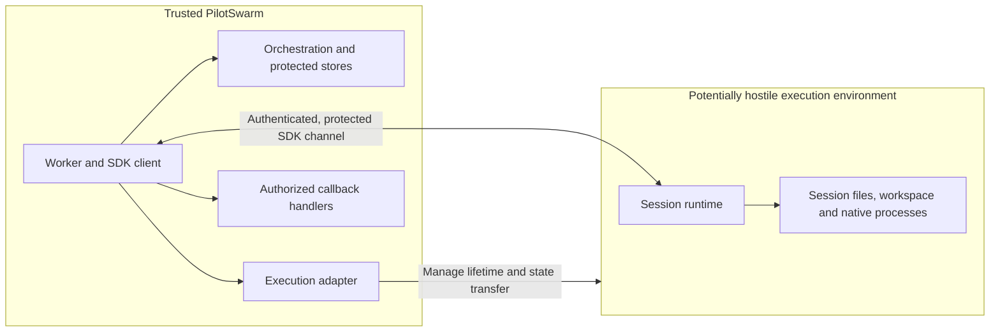

# Isolating agent runtime execution from the trusted worker

**Status:** Proposal for review. This docs-only change includes no runtime
changes, database migration or deployment.

Tracks [microsoft/PilotSwarm#249](https://github.com/microsoft/PilotSwarm/issues/249).

## Problem and goal

Agent-controlled execution may need native tools, repository content and a
writable workspace. If it shares the trusted worker's environment, a compromised
agent may also reach credentials, mounted data or identity endpoints intended
for the service.

The goal is to prevent agent execution from acquiring PilotSwarm's backend
authority to access another user's data or initiate work on their behalf.
PilotSwarm remains the durable logical host, responsible for orchestration,
recovery and policy. Only the agent's execution environment moves.

This is a boundary between agent execution and PilotSwarm, not a claim that
every agent action or external tool target becomes safe.

External-resource containment, a complete privacy/capability framework,
transparent warm takeover, exactly-once external effects and stronger warm
writer holds are not initial guarantees.

## Trust boundary

Keep the worker outside the execution environment. Put the session's runtime,
session files and workspace inside it, treating that side as potentially hostile.

An **execution adapter** is the trusted integration code that the service
operator configures to create or attach to a runtime environment, transfer
session state, check ownership and stop the environment. The environment might
be a container, VM or another isolation boundary.

A **model provider** is different: it is the model endpoint and authentication
configuration. The execution adapter does not have to be the model provider.

| Trusted PilotSwarm side | Isolated execution side |
|---|---|
| Worker and Copilot SDK client | Copilot runtime driven by the outside SDK |
| Orchestration, protected stores and backend credentials | Per-session runtime state and workspace |
| Session composition and approved worker packages | Native tools and their processes |
| Authorized platform callback handlers | Only the capabilities deliberately provided to the session |
| Execution adapter's environment-management access | No trusted-worker enrollment or backend access from attachment alone |

Running the entire worker in another environment would leave its service
authority beside the agent. Moving only individual tools would leave the
runtime beside that authority. The proposed boundary moves the runtime and
workspace, while retaining trusted SDK driving, composition and callbacks outside.

Worker-imported packages and application callbacks remain trusted host code.
This feature does not sandbox those packages or authorize every callback they
expose. Native tools need not call a host permission handler; their containment,
including platform-supplied identity, must be established by the adapter.

## Required behavior

Local execution remains the default. Remote execution is optional, configured
on the worker, and not tied to a particular cloud service. It uses the existing
client API and Copilot SDK.
The following is the proposed contract; implementation choices are separated
in the final section.

### Exclusive execution authority

Session state and execution authority must remain isolated. Only the current
executor generation may invoke guarded privileged callbacks or publish state.
Generation admission must use shared, persistent authority and remain valid
across worker restarts and competing acquisition. A process-local counter,
SDK resume, worker affinity or timeout alone is insufficient.

Admission must be serialized against replacement and release, and ownership
must not move while an admitted operation is still running. Authenticated SDK
attachment is separate from this authority: it does not enroll a trusted worker
or authorize a user.

Retirement or replacement requires stopping the old runtime and all session-owned
writers, including detached or reparented processes, and verifying termination
before cold export or starting a replacement. Runtime/bridge process-group exit
alone is insufficient. A replacement uses fresh binding authentication.

### Authorized outside callbacks

Outside tool, permission, hook and worker-brokered model callbacks require current
generation admission and authorization for the caller, session, resource and
operation. Existing owner/resource policy remains in force; SDK permission
approval does not grant backend authority.

Each turn uses fresh guards. Captured obsolete handlers and callbacks between
turns are refused; warm reuse refreshes handlers and model-forwarding context
without reopening expired guards. Close callback admission and drain admitted
work before capturing and committing the turn. These guards are not a
cryptographic turn identity or proof that every delayed wire message can be
attributed to an earlier turn.

Local transcript-only helpers must remain text-only, without native tools or
permission approval derived from transcript content.

### Deliberate model authentication

The runtime still needs to authenticate to a model after it moves. This is a
necessary integration requirement, not the feature's purpose or a redesign of
all PilotSwarm authentication.

A supported configuration may use an execution platform's broker, a trusted
worker-side broker, or credentials scoped to the session's user and model use
inside the runtime. A suitably scoped model credential inside does not by itself
defeat separation from PilotSwarm's backend authority, but the runtime can read
it. Actual issuer permissions, not the session's provider label, determine scope.

The integration must establish the model caller's identity and platform-supplied
authority. Do not deliver deployment-wide backend credentials, assume a
platform-injected identity is suitably limited, or silently fall back to broader
credentials. Platform-managed authentication must withhold real worker model
credentials and credential-bearing headers on create, resume and rebind;
restore must not reintroduce unintended credentials. Platform-brokered requests
need not pass through the worker. A universal worker-side broker is not required.

### Runtime lifetime and complete state

Support retaining a healthy runtime across completed turns and restoring its
state when it is retired or replaced. Remote placement must not inherently
require a fresh environment after every turn. Session-to-environment mapping
and product retention defaults remain decisions for review.

The durable unit is the complete per-session tree and contained workspace:
events, compaction checkpoints, research and runtime database files/sidecars
when present. Preserve the existing infinite-session profile and `workspace.yaml`
layout validation. An events-only archive is insufficient; unsafe or partial
archives must be rejected rather than weakening readiness checks.

The two lifecycle paths are:

| Path | Required behavior |
|---|---|
| **Retain** | After completed SDK `session.idle`, flush pending events, check for nonterminal or unknown background work, and capture at local completed-turn persistence semantics. Keep the healthy runtime attached. |
| **Retire or replace** | After the verified termination barrier, export complete state, validate it and publish through the existing versioned snapshot CAS. Release ownership only after settled state and outcome publication. |

Retained capture is **local parity**, not an atomic snapshot, fsync promise or
writer hold; untracked writers can still race the copy. Background work,
failed preflight or capture uncertainty selects verified cold stop-and-copy.
Discard partial capture and export afresh after the barrier. A successful cold
fallback can still commit the settled turn; an empty or partial capture must
never become success.

Retirement does not silently advance the durable head. A replacement restores
the last committed version, not an incidental adapter capture.

### Durable completion and uncertain outcomes

Progress events and SDK idle are observations, not proof of durable completion.
Final remote writeback follows snapshot commit. Recovery from a crash between
snapshot commit and completion must use the winning turn's saved result and
accounting metadata, when valid completion metadata exists, without rerunning
the model/tools, selecting a new model provider or duplicating accounting.

If termination, ownership or publication is unproven, retain authority and do not
start a replacement on a timeout. A client timeout, missing abort acknowledgement,
shutdown budget or watchdog budget is not termination proof. Unknown-owner
recovery deliberately favors avoiding concurrent owners over automatic takeover.

Already-admitted external effects require application idempotency or
reconciliation. Cancellation is not rollback, and this proposal does not provide
one transaction across snapshots, CMS and external services. Recovery still needs
current authority; saved completion metadata cannot authorize an uncertain takeover.

## Proposed integration

The candidate worker option is `PilotSwarmWorkerOptions.executionBinding`,
supplied by the service in trusted startup code. It contains integration
functions, not prompt-controlled or serialized session settings. Core must not
acquire cloud dependencies or assume platform endpoints or identity.

| Area | Execution adapter responsibility | PilotSwarm responsibility |
|---|---|---|
| `acquire` | Admit one owned generation; refuse an uncertain prior owner | Supply session, transcript epoch, durable turn identity and fresh attempt identity |
| SDK connection and paths | Supply protected, authenticated attachment and explicit runtime path conventions | Drive the existing SDK; never treat runtime paths as worker-local paths |
| `runCurrent` | Serialize admission against replacement/release and pin the generation through the awaited operation | Guard privileged callbacks and store publication; close obsolete guards |
| Import/export and skill staging | Transfer the complete tree and stage trusted skills repeatably without accumulating copies | Reconcile committed state, validate layout and use snapshot CAS |
| Stop, inspect and release | Verify that the matching generation has no session-owned writers | Require the barrier before cold export and settled publication before release |
| Optional warm capture | Establish retained-runtime health and capture a complete local-parity tree, or request cold fallback | Own SDK save/task preflight and per-turn handler refresh |
| File transfer | Enforce actual filesystem confinement, including symlink safety | Route artifact file arguments through runtime paths and temporary worker staging |

No raw SDK RPC mirror or second session driver is introduced.

### Proposed completion receipt

The snapshot can commit successfully before CMS records the turn's final outcome.
To repair that gap without repeating execution, the proposed approach saves an
optional completion/accounting receipt with the snapshot and records its
idempotent application in the catalog.

The catalog transaction atomically records the turn's deduplication entry,
completion metrics/event and original model-provider settlement. Duplicate keys
for the same turn index do nothing; reuse for another index is refused. A failed
transaction leaves no completion record. A same-turn snapshot winner supplies
the winning result and receipt. This is not atomic commit of the snapshot and
catalog together.

The schema shape is in the implementation section below. Its retention and
validation policy are part of this design review.

## Compatibility and rollout

Existing local completion callers and default snapshot serialization remain
unchanged. Legacy snapshots without receipts retain their previous recovery
behavior.

**The proposed additive catalog migration runs on normal initialization even
when remote execution is disabled.** Its number is assigned in the implementation
PR. Keeping remote placement opt-in does not make the schema change opt-in.

All eligible workers must use the intended binding policy. An unbound worker
does not check the adapter's ownership record, so mixed bound/unbound execution
cannot be treated as isolation. Before disabling or changing remote placement,
drain and verify retirement, reconcile held ownership, and preserve committed
state and receipts. Disabling a binding while its generations remain live is
not a safe rollback.

Unsupported configurations must be explicitly refused, not silently run on the
worker or with weaker authority.

## Acceptance criteria

The implementation must demonstrate the following observable outcomes:

| Scenario | Expected outcome |
|---|---|
| No binding configured | Ordinary local behavior remains unchanged. |
| Queued turns with healthy retention | A real worker runs successive queued turns on the retained runtime, with authorized outside callbacks and isolated session state. |
| Retirement and fresh-worker handoff | After verified termination, a fresh executor on a replacement worker continues from committed conversation, compaction, workspace and database/binary state. Required layout validation still applies. |
| Background writers, preflight failure or uncertain warm capture | Verified cold fallback discards partial capture and preserves complete state. If the barrier or publication cannot be verified, authority remains held and no replacement starts. |
| Obsolete generation or callback | Guarded privileged callbacks and state publication are refused, including captured old handlers and between-turn callbacks. |
| Crash after snapshot commit or competing same-turn commit | With valid receipt metadata, the winning result is recovered without model/tool replay or duplicate completion/settlement; existing control cursors and error/stop semantics are preserved. |
| Supported model authentication | At least one deliberately authorized configuration works across create, resume and restore, without unintended credential fallback or platform-supplied PilotSwarm backend authority. |
| Unsupported combination or unsafe archive | The operation is refused explicitly; no local fallback or empty/partial success is published. |

Core tests may use owned isolated fixtures and fake transports/authority to prove
control flow. They do not prove an adapter's cross-worker ownership enforcement
or hostile-process containment. Concrete-adapter evidence must identify its
source/runtime/state profile and limits; a successful prototype is not production
isolation or capacity qualification.

This docs-only proposal records the contract for
[microsoft/PilotSwarm#249](https://github.com/microsoft/PilotSwarm/issues/249).
Implementation and prerequisite fixes are reviewed separately. Platform
selection, cloud provisioning, package publication and deployment are not part
of this proposal PR.

## Remaining questions and review points

- **Sharing and shutdown:** which sessions, if any, may share an execution
  environment? When should a runtime stay running, and when should it be stopped?
- **Accounts and permissions:** which model-access setups do we support first?
  Whose account is used, and what permissions come from the execution environment
  or from calls back to PilotSwarm?
- **Records used after a crash:** should per-turn completion records be kept
  until the session is deleted? What checks are needed before trusting the
  worker's saved result and accounting data during recovery?
- **Safe recovery after a failure:** what should an operator check or repair
  before allowing a replacement, so the previous runtime or its processes
  cannot keep writing?
- **Ready to merge versus ready to deploy:** what must be resolved before
  merging the PilotSwarm implementation? What additional checks are needed
  before enabling it on a particular platform or deployment?

## Initial implementation and limitations

An implementation exists locally; it is not merged or released. The following
describes that candidate, not additional product requirements.

### Placement and lifecycle

The implementation uses session-scoped bindings and defaults to cold release.
Same-worker warm retention is separately opt-in. Neither setting settles product
retention defaults or requires recreation after every turn. Safe shared-runtime
operation is not established.

In the cold path, core reconciles and imports committed state, attaches through
the SDK, runs the turn, drains callbacks, detaches, and requires the adapter's
termination barrier before export. Validation, snapshot CAS and completion
precede release.

The warm path keeps its SDK session attached; save/task preflight and adapter
live capture replace cold detach/stop/export. It still validates, commits the
snapshot and completes the turn, but retains ownership. SDK save/task preflight
uses the existing handles rather than a second runtime connection.

Runtime-global cross-session indexes are outside the current per-session
snapshot profile. Their required continuity must be evaluated for supported
workloads rather than inferred from a matching per-session manifest.

The candidate rejects runtime MCP, native delegation, worker-identity bearer
callbacks, remote WebSocket forwarding and worker-mounted workspace-integration
combinations. The binding owns its checkpoint-contained workspace.

### Model-authentication gap

Current SDK create/resume configuration can include the selected API key or
GitHub Copilot token. The implementation does not yet make an explicit choice
between platform-managed and runtime-supplied authentication.

OpenAI/Azure Chat Completions requests can be forwarded through the worker,
but this does not remove secrets from session configuration. Native GitHub
Copilot and Anthropic clients are not wired through that forwarder; this is a
limitation of the current integration, not proof that other brokered paths are
impossible.

These profiles still need qualification against the model-authentication
contract. Broad shared model credentials inside the runtime are not qualified
by the candidate. Feature delivery needs one supported configuration, not a
universal broker or every model provider.

### Proposed catalog shape

| Proposed addition | Purpose |
|---|---|
| Optional snapshot `writeback` receipt | Preserve original completion/accounting data for same-turn recovery |
| `execution_turn_completions` | Record `(session_id, turn_key)` with turn index and completion time, referencing the session with cascading deletion |
| `cms_complete_execution_turn_writeback(turn_key, turn_json, charge_json?)` | Atomically deduplicate completion metrics/event and original model-provider settlement |

This metadata is additive. The compatibility and migration effects are stated
above; the implementation PR assigns the migration number.
