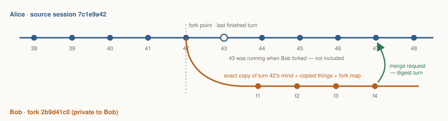
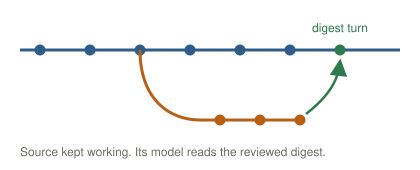
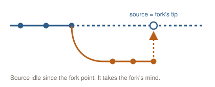
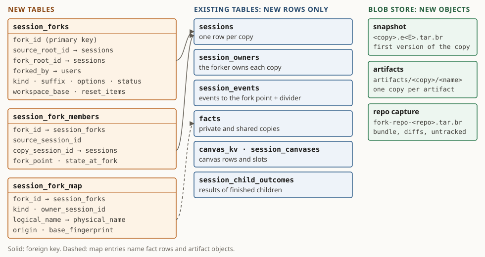

# Session forking and merge-back

Share a session. People watch it live, and anyone who can watch can fork it: they get a session with the *exact same context*, their own clean copies of everything it owns, and a model that knows it is a fork. Later, the fork proposes its results back and you decide what goes in.

Approved design · draft 3.5 · 18 October 2026 · **P0** forking · **P1** merging · Grounded in PilotSwarm `main @ 1352a78f` · Builds on issue \#24

- **Watch means fork**: Anyone who can watch a session can fork it and gets the exact same context, from the last finished turn.
- **Sub-agents: the forker's choice**: Not forked by default. **Fork them too** copies each one, best effort. The owner can fork one sub-agent into the same tree.
- **Clean copies**: Private facts and artifacts keep their names. Shared facts get `_sess_<hash>`. Repos are re-cloned with every change.
- **Tools do the mapping**: Fact, artifact, sub-agent and canvas tools translate names. The model never reads the map.

## 01 · In one minute

1. **Watching means forking.** Anyone who can watch a session can fork it. The fork is a new top-level session that the forker owns. It starts private. The owner can also fork one sub-agent: the copy joins the same parent, and the parent is told.
2. **Exact context.** The fork's model resumes from the source's last finished turn. PilotSwarm unpacks the saved snapshot into a scratch folder and calls the Copilot CLI's own fork there (09b).
3. **Sub-agents are not forked by default.** The fork starts as one session, without the source's sub-agents and their facts and files. **Fork them too** copies each sub-agent after its parent, at its own last finished turn. That is best effort, so the base prompt says which choice was made.
4. **Clear rules for collateral.** Private facts and artifacts are copied with the same names. Shared facts are copied and renamed with `_sess_<hash>`. A git repo gets a new clone at the same commit, with all tracked and untracked changes. Other attached folders are attached again. External resources are not touched.
5. **The tools use the map, not the model.** In a fork, the fact, artifact, sub-agent and canvas tools translate names. Inherited names reach the fork's copies, and the fork's writes to shared space get the suffix. The knowledge graph is read live; a fork cannot write it in P0. A session that is not a fork skips all of this with one flag check.
6. **The prompt says what tools cannot enforce:** this session is a fork of session XYZ, whether its sub-agents were forked, and that external resources and locks belong to the source. Ask the source session or the user before touching one.
7. **P1 merge-back reads the map.** Each map entry is something the fork created, changed or deleted, with its value at the fork point. A merge request is the list of changed entries, checked against the source's current values.

## 02 · The scenario

*Alice shares an incident investigation. Bob watches, forks it to test another theory, and sends his result back.*



*Diagram*

- **Shares the session** (Alice): Alice shares “Incident 4521 — failover RCA” with Bob and Carol. They can watch it, so they can fork it.
- **Watch it live** (Bob, Carol): They see the transcript, canvases and artifacts as the session works. Alice's session is unchanged.
- **Forks at turn 42** (Bob): Alice's turn 43 is still running. Bob forks now, so the fork starts from turn 42, the last finished turn. He could also wait for turn 43 to end.
- **Builds Bob's copy** (PilotSwarm): Bob keeps the default: sub-agents not forked. The fork orchestration copies the session with its facts and artifacts, re-clones the repo with its uncommitted changes, and writes the private map. The 2 sub-agents stay with Alice.
- **Tries another theory** (Bob): “What if the DNS TTL caused the failover?” The model knows it is a fork of 7c1e9a42. Its tools read and write the fork's copies. It asks Alice's session before it touches her pull request.
- **Proposes a merge** (Bob): One findings digest, two fact changes, one artifact and the repo changes go to Alice for review.
- **Accepts what helps** (Alice): She accepts 4 of 5 items. Her session reads the digest at its next turn and continues with the new finding.

## U1 · Where Fork lives

*Two doors, both in places the portal already has: a toolbar button beside Copy link, and the watcher's read-only notice, which becomes the way to continue.*

> **How these sketches were made**
>
> Each sketch was drawn on the portal's own DOM and CSS (App 0.8.3), changed only where fork needs it. The review used interactive mocks and screenshots of today's build; this file keeps the description of each. The numbers ①②③ name the new parts. Nothing here is built.

> **UI sketch: Bob's view of Alice's session with a Fork button and a Fork action in the read-only notice**
>
> **Bob watches Alice's session** (he has read access). ① **Fork** in the session toolbar, beside Copy link, with the toolbar's usual tooltip. Everyone who can view the session gets it, the owner included; Manage stays owner-only. On a sub-agent, only the owner gets it (U7). ② The read-only notice offers **Fork…**: forking is how a watcher continues the work.

- **Session toolbar** (Recommended): Pin, Move to group, Manage, Copy link, **Fork**, Terminate. Same icon button and tooltip as its neighbours.
- **Read-only notice** (Recommended): Today it is a dead end. With Fork it is the next step for a watcher.
- **Sub-agent toolbar** (Recommended): The same button on a sub-agent of your own session. The copy joins the same parent (U7). Other people's sub-agents do not show it.
- **TUI** (Later): Not in P0: forking ships in the portal and the API first. The TUI shows forks as ordinary sessions until it gets its own design.
- **Row menu** (Dropped): The portal has no row menu today, so Fork does not add one.
- **Fork from an earlier reply** (Later): The CLI's fork can cut the conversation at an earlier event (`toEventId`). Facts and files cannot go back to that point, so P0 forks at the latest reply.

## U2 · The fork dialog

*Built from Manage session's parts: the same frame, section labels, rows, buttons and footer bar. One new section says what the fork copies.*

> **UI sketch: The Fork session dialog over Bob's view**
>
> ① **Start from:** the latest reply now, or when a running turn ends (disabled here: nothing is running). ② **Model:** model, reasoning effort and context window, chosen with the same three steps as New session. ③ **Sub-agents:** not forked by default; **Fork them too** copies each one after this session, best effort. Shown only when the session has sub-agents. ④ **What gets copied**, in the Access tab's row style, with what stays behind. ⑤ The footer bar and button that Manage session uses for Apply. After Fork, the footer shows progress until the CLI's fork returns; then the fork opens.

> **UI sketch: Bob's phone: the read-only notice with Fork**
>
> **On a phone.** ① The notice shortens and keeps Fork. The rest of the screen is today's build, unchanged.

> **UI sketch: The fork dialog on a phone**
>
> The same dialog fills the phone like Manage session does today. Only the dialog is new.

- **Name:** prefilled “&lt;source title> (fork)”; Bob typed his own here.
- **Start from:** the latest reply. If a turn is running: fork now from the last finished reply, or wait for the turn to end.
- **Model, reasoning and context window:** the source's by default. Change… runs the same three steps as New session: model, reasoning effort, context window. The picker offers only models the forker can use.
- **A smaller window:** if the chosen window is smaller than the inherited context, the dialog says so and offers to regenerate the fork's context first. With that choice, the regeneration runs before any queued message.
- **Sub-agents:** **Not forked** (default): the fork starts as one session, and the source's sub-agents keep their facts and files. **Fork them too**: each sub-agent is copied after this session, at its own last finished turn, best effort. The choice goes into the fork's base prompt.
- **Workspace:** a row in What gets copied. The forker's own folders; repo clones are cloned again at the same commit with every change. The source's folders are not shared.
- **After Fork:** the dialog shows progress while the conversation is copied (09b), then opens the fork. The rest of the copy runs in the fork (U3).
- **Cost:** the first message re-reads the inherited context; the footer says how much.

## U3 · While the fork is built

*The fork opens when its conversation is copied: the snapshot download plus one CLI start. The rest of the copy runs behind it. Bob can type at once: the message waits in the session's queue and runs when the copy is done.*

> **UI sketch: Bob's new fork, open while it is being copied**
>
> ① The fork's row appears when the CLI's fork returns its id. It is owned by Bob and has a fork mark before its title, where the canvas mark goes today. ② The live-activity line that shows a running turn today reports the rest of the copy. ③ The composer is open; a message typed now runs when the copy is done.

> **Why typing early works**
>
> The fork session starts as soon as its conversation is copied and waits for the rest. Sessions already queue messages durably, so an early message waits in that queue. If a later step fails, the same line says which one and offers to fork without it (for example, without the repo). If the forker chose to regenerate the context first (U2), that regeneration is the last step: queued messages run after it.

## U4 · Inside the fork

*A fork is an ordinary session with three marks of where it came from, each drawn with something the portal already has.*

> **UI sketch: Bob's fork after his first message, with the fork divider, the Fork card and the session details**
>
> ① A rule line marks the fork point, drawn like today's context-regeneration divider. ② A **Fork** card shows exactly what the model was told. ③ Session details gain **Fork of**. Bob kept the default, so the fork has no sub-agents, and the card says that log analyst stays with Alice. With **Fork them too**, its copy would sit under the fork, idle until someone messages it.

- **Same facts for people and the model** (Recommended): The Fork card is the notice the model gets with Bob's first message: owner, what was copied, whether sub-agents were forked, what stays the source's.
- **No Paused state** (Recommended): With **Fork them too**, copies keep the state they had at the fork point: idle, completed or waiting for an answer. Nothing runs on its own, so there is nothing to unpause: the fork's agent re-tasks what it needs, one message from Bob covers any number of sub-agents.
- **Authors kept** (Recommended): Alice's prompts read “Alice Anderson:”, Bob's read “You:”. No new styling: the portal does this for shared sessions today.
- **Fold inherited history** (Idea): One click folds everything above the divider into one line.

## U5 · Fork details in the Stats tab

*No new tab. The inspector's Stats tab (session view) is the session overview, so the fork details go in its identity rows. The Fork and Forks tabs are dropped, and merge stays out of diagnostics. Below: a fork by another person, a fork of your own session, and the source.*

> **UI sketch: The Stats tab in Bob's fork, with Fork of, Source, At and Children rows**
>
> **Bob forks Alice's session.** ① Four rows after Updated: **Fork of** (the source title), **Source** (its id and owner), **At** (the fork point) and **Children** (the sub-agent choice: not forked here). Every other line is the portal's own Stats output, rendered with its selector code.

> **UI sketch: The Stats tab in Alice's fork of her own session, on another model**
>
> **Alice forks her own session.** ① The same four rows; Source says **you**. She picked another model with high reasoning and **Fork them too**, so Model differs from the source and Children says forked, best effort.

> **UI sketch: The Stats tab in Alice's source session, with a Forks row**
>
> **The source (Alice).** ① One row: **Forks**, with the count and the forkers, her own fork first. Only the owner and admins see it.

> **Agent Smith reads the map with its diagnostic tools**
>
> The map is a catalog table, not facts, so fact tools cannot change it. `read_session_info` gains a `fork` block: lineage and fork point. A new `read_session_fork_map` returns the entries and what changed since the fork. See 13.

| Item | Fork of another person's session | Fork of your own session |
|---|---|---|
| **Owner** | the forker | you, as for the source |
| **Visibility** | private | private, also when the source is shared: Bob does not see Alice's fork |
| **Model** | chosen in the fork dialog | chosen in the fork dialog: here another model |
| **Home folder** | the forker's own home folder | the same home folder as the source: both sessions see the same files |
| **Sub-agents** | not forked by default, or Fork them too | the same. To copy one sub-agent inside your tree, fork that sub-agent (U7) |
| **Repo** | a new clone | a new clone; the source's clone does not change |
| **Shared facts** | renamed copies | renamed copies, because the source can still be running |
| **External resources** | the fork asks the source session, and its owner answers (U6) | the fork asks you directly: you own both sessions |
| **Stats rows** | Source: `<id>` · `<owner>` | Source: `<id>` · you |
| **Merge (P1)** | the source owner reviews | you review your own request |

*Forking your own session uses the same rules. These items look different.*

## U6 · What the source owner sees

*Alice keeps working as usual. A fork shows up in her session details and her Stats tab, and when it wants to touch something of hers, she is asked.*

> **UI sketch: Alice's session: a Question card about a fork's request, and the Forks field in session details**
>
> ① A fork's request about something this session created reaches **Alice**, as the Question card the portal already uses for ask_user; she answers in the composer, whose label reads “answer”. ② Session details gain **Forks**.

> **Finding from the test environment**
>
> Today a cross-owner session request reaches only the target session's agent, which treats it as advisory. For forks that is the wrong person: a request to restart a server the source created needs the source's owner. Proposal: in a session that has forks, the base prompt says to pass such requests to the owner with ask_user. The agent never decides them itself.

- **Requests go to the owner** (Recommended): Uses ask_user and the Question card. Nothing new in the UI; one prompt rule in sessions with forks.
- **No pings for a fork** (Recommended): Forking does not notify Alice. Session details and the Stats tab are enough. Merge requests do notify her.
- **Allow for this fork** (Idea): Remember Alice's answer for the same resource, so the fork does not ask twice.

## U7 · Fork a sub-agent (owner only)

*The owner can fork one sub-agent of their own session. The copy joins the same parent, next to the original, and the parent is told. It is for more work in the same tree, so it shares the tree's shared facts, folders and repo. Other people fork the top-level session instead.*

> **UI sketch: Alice forks her sub-agent log analyst**
>
> **Alice forks her sub-agent “log analyst”.** The same Fork button and dialog. ① **Joins:** where the copy goes, and that its parent is told. ② **What gets copied:** its conversation, facts and files. Shared facts, folders and the repo stay shared with the tree. ③ Fork.

> **UI sketch: Alice's session with the original sub-agent, its copy, and the update in the parent**
>
> **After the fork.** ① The copy sits under the same parent, next to the original, with the fork mark. ② The parent gets one update, shown as today's sub-agent updates are. Its agent can message the copy at once.

| Item | Fork of a top-level session | Sub-agent fork |
|---|---|---|
| **Who can do it** | anyone who can watch the session | the owner only: not sharers, not admins |
| **Where the copy goes** | a new top-level session, private | a new sub-agent of the same parent, next to the original; shared like the rest of the tree |
| **Who is told** | nobody; the source's Stats tab lists its forks | the parent, with one sub-agent update |
| **Its own sub-agents** | not forked by default, or Fork them too | the same choice |
| **Private facts, artifacts, canvases** | copied with the same names | copied with the same names |
| **Shared facts** | copied and renamed with `_sess_<h>` | shared with the tree, as for any sub-agent; not renamed |
| **Repo and folders** | a new clone; folders re-attached | the tree's clone and folders, as for any sub-agent |
| **Merge (P1)** | a merge request to the source owner | none: the parent reads its results as it reads any sub-agent's |

*A fork of a top-level session and a sub-agent fork use the same copy steps (09b). These items differ.*

**What the parent gets (example)**

```text
[SUB-AGENT FORKED] The user forked your sub-agent "log analyst" (b3e54429)
at its last finished turn, 01:09:38. The copy is "log analyst (fork)" (6a0d93f4):
idle, with the same context, and now one of your sub-agents. It acts only on a
message from you or the user. The original is not changed.
```

> **When the API refuses it**
>
> The forker does not own the tree. The parent is completed, cancelled or deleted. The parent runs an orchestration version that cannot add a sub-agent. The sub-agent is a system agent. The portal does not show Fork on other people's sub-agents.

## U8 · Merge back (P1)

*P1, sketch only: the fork proposes, the source owner reviews and applies. Where Propose merge lives is decided in P1, outside diagnostics.*

> **UI sketch: The Propose merge dialog in Bob's fork**
>
> **Fork side.** ① A summary for Alice's agent, drafted from the fork. ② The changed items from the map; untick what stays in the fork. ③ An item both sides changed is flagged for her choice.

> **UI sketch: Alice reviews the merge request in a list-and-details dialog**
>
> **Source side.** The list dialog Switch model uses: ① items by kind; ② for the selected item, the version at the fork, hers now and his; ③ Apply settles the chosen items, and the summary reaches her agent as one message.

> **How a merge reaches Alice (sketch)**
>
> Not an agent-to-agent message. Propose merge stores a merge request, a record that Alice reviews in the portal. When she applies it, her session gets one message: the summary and the applied items, as quoted data. The fork's agent can draft a request; people send and apply it.

## U9 · More ideas

*Other uses of forks. The TUI is out of scope for now: forking ships in the web UX and the API first.*

- **Another model** (Recommended): Pick model, reasoning and context window in the fork dialog (U2), as for New session. Then compare answers on the same context.
- **Scratch fork** (Idea): A throwaway fork, deleted after 7 days unless kept. Nothing to merge.
- **Fork and compare** (Idea): Open the source and the fork side by side in a Master of Agents dashboard.

> **TUI: later**
>
> P0 adds no TUI keys, dialogs or panes. The TUI shows a fork as an ordinary session with its title; the Fork action, the dialog and the Stats rows come later, with their own design.

## 03 · What a fork copies

*A session has six layers. Forking treats each one differently. It copies the mind exactly and the story to the fork point. It copies or renames the things and leaves the outside world alone. It switches off the machinery and gives the forker their own access.*

| Layer | What it is | Fork rule | Action |
|---|---|---|---|
| **Mind** | The model's context: the Copilot session state behind every answer. | Copied exactly from the last finished turn. Only internal ids change. | Copy |
| **Story** | The transcript people read in the portal and the TUI. | Copied up to the fork point, then a “Forked from …” divider. | Copy |
| **Things** | Facts, artifacts, canvases, sub-agents, repos, folders and the knowledge graph. | Private facts and artifacts copied. Shared facts renamed. Canvases copied. Sub-agents not forked unless the forker chooses **Fork them too**. Repos re-cloned. Folders re-attached. The graph is read live. | Copy + Rename + Re-clone + Re-attach + Read only |
| **Outside world** | Pull requests, remote branches, cloud resources, tickets, locks. | Not touched. The prompt says they belong to the source. | Untouched |
| **Machinery** | Schedules, timers, queued messages, settings. | Anything that acts on its own is off. Settings carry over, re-checked for the forker. | Reset + Carry |
| **Access** | Owner, shares, budgets, credentials. | The forker owns the fork. It starts private and uses the forker's credentials. | Not copied + Never |

| Action | Meaning |
|---|---|
| Copy | Copied into the fork under the same name. Only the session it belongs to changes. |
| Rename | Copied under a new name ending in `_sess_<hash>`. The tools translate the old name. |
| Re-clone | A new clone for the fork, at the same commit, with the same changes. |
| Re-attach | The same folder, attached to the fork as well. Shared with the source. |
| Untouched | Not copied and not renamed. The prompt says it belongs to the source. |
| Read only | Shared with everyone and read live. A fork cannot write it in P0. |
| Reset | Off in the fork, so nothing runs twice. |
| Carry | Settings carried into the fork, re-checked for the forker. |
| Not copied | The fork starts its own. |
| Never | Never leaves its owner. |

## 04 · Collateral rules, item by item

*Example: Alice's session `7c1e9a42`, forked by Bob into `2b9d41c0`, suffix `_sess_8f3a91c2`. This is the agreed P0 scope. Shared keys are renamed and copied. Private keys and artifacts are copied with their names. Sub-agents are not forked unless chosen. Repos are re-cloned with every change, folders are re-attached, and external resources are untouched.*

| Collateral | Stored today as | Action | In the fork | Phase |
|---|---|---|---|---|
| **Mind and story** | | | | |
| Model context: transcript journal, compaction checkpoints, plan, files, research, SQL todos | `snapshot blob 7c1e9a42.e2.tar.br (epoch 2)` | Copy | 2b9d41c0.e2.tar.br, the copy's first version, made by the CLI's own fork in a scratch folder (09b): the same conversation under a new session id. `session.db` (SQL todos) follows the CLI (16) | `P0a` |
| Transcript that people see | `catalog events of 7c1e9a42` | Copy | copied up to the fork point, then a “Forked from …” divider | `P0a` |
| **Facts, artifacts, canvases, graph** | | | | |
| Private session facts | `session:7c1e9a42:<key>` | Copy | session:2b9d41c0:&lt;key>: same key | `P0a` |
| Shared facts last written by a session the fork copies | `shared:team/rca-notes` | Rename | shared:team/rca-notes_sess_8f3a91c2, copied at fork time | `P0b` |
| Any other shared fact | `shared:ops/oncall` | Rename | read from the original until the fork writes it; the first write makes ops/oncall_sess_8f3a91c2 | `P0b` |
| Artifacts | `artifact://7c1e9a42/timeline.md` | Copy | artifact://2b9d41c0/timeline.md: the same name in the fork's store; old links get the fork's session | `P0a` |
| Canvases: slot documents and the canvas store | `session_canvases, canvas_kv (per session and slot)` | Copy | same slots, document names, keys, writers and revisions, so compare-and-swap from the history still works. Rows under the app's shared prefixes stay shared. Not copied: requests still suggested, queued or working; other people's `ui/<id>` rows; public view links. The write policy resets to owner-only. | `P0a` |
| Knowledge graph | `one shared graph; a node's key is its kind and name` | Read only | read live, as the source reads it. A fork cannot write it in P0: a namespace rename cannot isolate a node (10). P1: the fork keeps graph changes and merge applies them. | `P0a` |
| Package and tool selections | `per session` | Copy | copied, then re-checked for the forker | `P0a` |
| **Sub-agents** | | | | |
| Sub-agents (default) | `own sessions; parent = 7c1e9a42` | Not copied | not forked: they stay with the source, with their private facts, artifacts and canvases. Their ids in the history give a clear error, and the prompt says so | `P0a` |
| Sub-agents, with Fork them too | `the same` | Copy | copied after the parent, each at its own last finished turn, in the state it had then (idle, completed, or waiting for an answer). Best effort: a result or task in transit between parent and sub-agent can be on one side only; the prompt says so. No Paused state: nothing runs until it gets a message | `P0b` |
| One sub-agent, forked by its owner | `own session; parent = 7c1e9a42` | Copy | a new sub-agent of the same parent, which is told (U7) | `P0b` |
| **Workspaces** | | | | |
| Repo clone | `/ws/git/sessions/7c1e9a42/pilotswarm` | Re-clone | /ws/git/sessions/2b9d41c0/pilotswarm: same branch and commit, plus local commits and staged, unstaged and untracked changes | `P0b` |
| Other attached folders | `for example shared/rca` | Re-attach | the same folders, shared with the source; checked against the forker's access | `P0b` |
| Home and shared default folders | `attached by the deployment` | Re-attach | automatic: the forker's own home and the deployment's shared folder | `P0a` |
| **Outside world** | | | | |
| Pull requests, remote branches, cloud resources, databases, tickets, sent email | `outside PilotSwarm` | Untouched | not copied or renamed; the prompt says they belong to the source | `P0a` |
| Locks, leases and claims the source holds | `facts, services, external systems` | Untouched | still held by the source; the fork must ask before it acts | `P0a` |
| Published canvas apps | `apps/<name>` | Untouched | shared by design | `P0a` |
| **Machinery** | | | | |
| Schedules (cron, cron_at), armed timers, queued and held messages, pending steers | `orchestration state` | Reset | off; the notice lists them so the agent can re-arm one on purpose | `P0a` |
| An open question to the user (ask_user) | `orchestration state` | Carry | carried: the forker can answer it differently | `P0a` |
| Model, effort, context tier, agent (pinned version), prompt layers, tools | `orchestration config` | Carry | carried; re-resolved for the forker, with a model fallback if needed | `P0a` |
| **Access** | | | | |
| Owner, sharing, group placement | `catalog` | Not copied | the forker owns the fork; it starts private | `P0a` |
| Tokens, cost and metrics | `catalog` | Not copied | start at zero; the dialog shows the inherited context size | `P0a` |
| Credentials: personal model keys, relay bindings, secret-store values | `provider store, vault` | Never | the forker's own credentials only | `P0a` |

## 05 · Names: copy or rename

*Copied items keep their names; only shared facts are renamed. They get one suffix for the whole fork: `_sess_<h>`, where `h` is the first 8 hex characters of SHA-256 of the fork id. The model never types the suffix: the tools add it and remove it.*

| Where | Rule | Before | After |
|---|---|---|---|
| **Shared fact key** | suffix on the last segment | `team/rca-notes` | `team/rca-notes_sess_8f3a91c2` |
| **Artifact** | unchanged; old links get the fork's session | `artifact://7c1e9a42/timeline.md` | `artifact://2b9d41c0/timeline.md` |
| **Artifact, merge clash (P1)** | suffix before the extension, only on a clash | `timeline.md` | `timeline_sess_8f3a91c2.md` |
| **Canvas slot document** | unchanged: the slot needs the name | `canvas.html` | `canvas.html` |
| **Fork of a fork** | replace the old suffix, never stack | `rca-notes_sess_8f3a91c2` | `rca-notes_sess_d17e0b55` |

> **Retry-safe ids**
>
> The fork id comes from (forker, source, request key), so a retried request finds the same fork. Each copy's session id is the one the CLI's fork returns. It is recorded before the copy is saved (09b).

> **Logical and physical names**
>
> The model uses the names from its history (logical). The stores hold the suffixed names (physical). The tools translate both ways. Results show the logical name and carry the physical one, so links still work for people.

> **Collisions**
>
> If a renamed name already exists, add `_2`, `_3`. The map records the final name; nobody guesses.

> **Prefix queries keep working**
>
> The suffix goes on the last segment of a key, so `team/*` still finds `team/rca-notes_sess_8f3a91c2`.

## 06 · The fork map

*A private table that only the platform writes. It holds the fork's facts and artifacts. It has three jobs: resolve shared-fact names, isolate the fork's writes, and record what changed for merge-back.*

- **Resolve**: A fork reference to a shared fact goes to the fork's copy. Artifact links, sub-agent and session ids resolve through the fork's member list (14): the name stays, the session changes.
- **Isolate**: Everything the fork writes to shared space gets the suffix, so the source and everyone else keep the originals. A delete only hides the item in the fork.
- **Record**: Each entry keeps the item's fingerprint at the fork point: etag or SHA-256. In P1, a merge request is the entries that changed.

| Call | Private fact | Shared fact | Artifact | Graph |
|---|---|---|---|---|
| **Read a name** | the fork's copy | the fork's copy if one exists, else the original (live) | the fork's copy | the live graph, as the source reads it |
| **Write** | the fork's own key, same name | key_sess_&lt;h>; the map gets an entry on the first write | the same name in the fork's own store; the map gets an entry | refused in P0 |
| **Delete** | the fork's key | hidden in the fork (a tombstone entry); the original is untouched | the fork's copy | refused in P0 |
| **List and search** | as today | originals and fork copies merged; copies win; hidden items left out | the fork's store | the live graph |
| **Names in results** | as stored | logical name, physical name in a field | the fork's link, so people can open it | as stored |

*How each call behaves in a fork. In a session that is not a fork, nothing changes.*

| Kind | What the model uses | Where it lives | How it got there | Base at fork point |
|---|---|---|---|---|
| private fact | `rca/root-cause` | `session:2b9d41c0:rca/root-cause` | copied at fork | `etag 3` |
| shared fact | `team/rca-notes` | `team/rca-notes_sess_8f3a91c2` | copied at fork | `etag 7` |
| shared fact | `team/dns-theory` | `team/dns-theory_sess_8f3a91c2` | new in fork | `—` |
| shared fact | `ops/oncall` | `(hidden in fork)` | deleted in fork | `etag 12` |
| artifact | `artifact://7c1e9a42/timeline.md` | `artifact://2b9d41c0/timeline.md` | copied at fork | `sha256 3f2a…` |

*Example entries for Bob's fork `2b9d41c0`. Copied sub-agents are in the member list; the repo and the turned-off schedules are in the fork record (14).*

| Collateral | Call in the fork | What the tool does | Result |
|---|---|---|---|
| **Private fact** | `read_facts(key_pattern: "rca/root-cause")` | The session scope is the fork's own: `session:2b9d41c0:rca/root-cause`, copied at the fork. | The source's value at the fork point. |
| **Private fact** | `store_fact(key: "rca/dns-ttl", …)` | Writes `session:2b9d41c0:rca/dns-ttl`; a map entry records it as new. | Only the fork sees it. |
| **Shared fact, copied** | `read_facts(key_pattern: "team/rca-notes", scope: "shared")` | Map: `team/rca-notes` → `team/rca-notes_sess_8f3a91c2`. | The fork's copy, shown as `team/rca-notes`. |
| **Shared fact, not copied** | `read_facts(key_pattern: "ops/oncall", scope: "shared")` | No entry, so it reads the original. | The live value, with later edits by others. |
| **Shared fact, first write** | `store_fact(key: "ops/oncall", shared: true, …)` | Creates `ops/oncall_sess_8f3a91c2` and an entry with base etag 12. | Everyone else still sees the original. |
| **Shared fact, delete** | `delete_fact(key: "team/old-theory", shared: true)` | Adds a tombstone entry. | Hidden in the fork only. |
| **Shared facts, list or search** | `read_facts(key_pattern: "team/%", scope: "shared") · facts_search(…)` | Merges originals and copies. A copy replaces its original; tombstones are left out. | Logical names; the physical name is in a field. |
| **Artifact, inherited link** | `read_artifact(sessionId: "7c1e9a42", filename: "timeline.md")` | Member list: `7c1e9a42` → `2b9d41c0`; the name stays. | The fork's copy: `artifacts/2b9d41c0/timeline.md`. |
| **Artifact, new** | `write_artifact(filename: "dns-check.md", …)` | Writes to the fork's own store; a map entry records it as new. | `artifact://2b9d41c0/dns-check.md` |
| **Sub-agent, not forked (default)** | `message_agent(agent_id: "c41f0a77", …)` | No member row for `c41f0a77`. | Error: “Not forked: this sub-agent belongs to the source session.” |
| **Sub-agent, Fork them too** | `message_agent(agent_id: "c41f0a77", …)` | Member list: `c41f0a77` → copy `5e72b9d3`. | The copy acts. The source's sub-agent is not touched. |
| **Sub-agent's fact, not forked** | `read_facts(key_pattern: "logs/%")` | The fork's tree holds only the fork. | Nothing: the source sub-agent's private facts were not copied. |
| **Sub-agent's file, not forked** | `read_artifact(sessionId: "c41f0a77", filename: "log-summary.md")` | Not translated, not copied. | The source's live file, read only, if the forker can watch the source (16). |
| **Canvas store** | `canvas_kv(op: "get", key: "app/t/t-1")` | The fork's canvas store: same keys and revisions, copied at the fork. | The value at the fork point. |
| **Canvas store, shared prefix** | `canvas_kv(op: "put", key: "app/draft/c1", …)` | The app's rules apply: anyone with write access to the fork may edit rows under its shared prefixes. | Written in the fork's copy only. |
| **Canvas of a tree member (Fork them too)** | `canvas_kv(session_id: "7c1e9a42", …) from a sub-agent copy` | Member list: `7c1e9a42` → `2b9d41c0`. | The fork root's canvas. |
| **Graph, read** | `graph_search_nodes(nameLike: "failover")` | Not translated. | The live shared graph. |
| **Graph, write** | `graph_upsert_node(…)` | Refused: "Graph writes are not available in a fork (P0)." | Nothing changes. P1 keeps these as pending changes. |
| **Repo** | `bash: git -C /ws/git/sessions/7c1e9a42/pilotswarm status` | Not translated: this path is the source's clone. | The fork layer says: use `/ws/git/sessions/2b9d41c0/pilotswarm`. |
| **Shared folder** | `bash: echo … >> /ws/shared/rca/notes.md` | Not translated: the same folder, re-attached. | The source sees the change. |
| **Source session** | `send_session_message(session_id: "7c1e9a42", …)` | Not translated. | Reaches the source: this is how a fork asks. |

*Access examples: Bob's fork `2b9d41c0` of Alice's session `7c1e9a42`, suffix `_sess_8f3a91c2`. One row per collateral type and call.*

> **Not in the map: the repo, folders and schedules**
>
> The tools do not translate bash or file paths, so the repo has no map entry. Its fork-point record (branch, commit, change fingerprint, new path) is in the fork record (14). Four things use it: the first-turn notice, the Stats tab, the P1 change base and cleanup.

> **An inherited path is the source's clone**
>
> In the reference deployment, every session can list `/ws/git/sessions/`. So a bash command with a path from the history changes the source's clone. The fork layer gives the new path; a provider can also mount only the tree's own clones.

> **Who reads and writes it**
>
> Only the platform writes the map: the fork orchestration (copies) and the tool layer (first writes, deletes). The tool layer, the fork's owner and admins (through the API), Agent Smith (`read_session_fork_map`, 13) and P1 merging read it. It is not a fact, so no tool can change it, and the model never needs to read it. `get_fork_info` answers “where did I come from” when asked.

## 07 · Telling the model it is a fork

*Tools do the mapping, so the prompt stays short: it says where the fork came from and what tools cannot enforce. A session that is not a fork sees none of this and pays nothing.*

**1 · Fork layer — in the system prompt of every session in a fork tree**

```text
[FORK] This session is a fork of session 7c1e9a42 ("Incident 4521 — failover RCA",
owner Alice), made by Bob on 2026-10-17 at 16:40 UTC from turn 42. Your history up
to that turn is inherited.

Your fact, artifact, canvas and sub-agent tools send names from that history to
this fork's own copies, and keep everything you write inside the fork. You do not
need to look anything up. You can read the knowledge graph, but you cannot write it.
File paths in your history can point to the source's folders: use the paths in the
fork notice.

External resources named in your history belong to the source session: pull
requests, remote branches, cloud resources, databases, tickets, sent email, and
every lock, lease or claim. You do not own them. Before you change, delete or lock
one, get explicit approval from the source session (send_session_message to
7c1e9a42) or from the user.

Sub-agents: not forked. The sub-agents in your history belong to the source
session. You cannot message or check them, and their facts and files were not
copied. Spawn new sub-agents if you need them.
```

It is part of the composed system prompt, so it survives compaction and regeneration. The platform adds it from the fork record; the model never has to work out that it is a fork.

**1b · The sub-agent lines, by choice**

```text
With Fork them too, in place of "Sub-agents: not forked":
Sub-agents: forked, best effort. Each one was copied after this session, at
its own last finished turn, so it can be out of step with you. A result it
sent after your fork point is not in your history. Work you gave it after
that point is not in its history. Check a sub-agent's state before you rely
on it.

In each sub-agent copy:
You were copied at your last finished turn; anything you had started after it
stayed in the source. Do not resume earlier work on your own. Act only on a
new message from your parent session or the user.

In a sub-agent fork (U7), in place of the first paragraph:
[FORK] This session is a copy of sub-agent b3e54429 ("log analyst"), made by
its owner Alice at its last finished turn, 01:09:38. You are a new sub-agent of
the same parent, 1467388e. The original still exists and keeps its facts and
files; yours are copies. Shared facts, folders and the repo are shared with the
whole tree, as for any sub-agent: check before you change one the original uses.
```

**2 · First-turn notice — sent once, with the forker's first message (example)**

```text
[FORK NOTICE]
You now run as Bob's fork 2b9d41c0.
• Owner: Bob. Tools and models run as Bob.
• Repo: your own clone at /ws/git/sessions/2b9d41c0/pilotswarm, at the same
  commit and with the same changes as the source at turn 42.
• Turn 43 was running when you were forked. Files may include part of it.
• Shared with the source: the folder /ws/shared/rca.
• Sub-agents: not forked. "log analyst" and "dns checker" stay with the source,
  with their facts and files.
• Schedules from the source are off: "poll incident status" every 15 min.
• Not available to Bob: MCP server "pager-ops".
```

- **3 · The tools translate.** Facts (`read_facts`, `store_fact`, `delete_fact`, `facts_search`, `facts_similar`, `bulk_store_facts`, and `invocation.facts` in extension tools), artifacts (`read_artifact`, `write_artifact`, `list_artifacts`, `show_artifact`) and the canvas tools (`canvas_kv`, `read_canvas`, `draw_canvas`, `update_canvas` with `session_id`) follow the rules in 06. Graph tools read the live graph; graph writes are refused in a fork (P0).
- `check_agents`, `message_agent`, `read_agent_events`, `complete_agent` and `cancel_agent` reach the copy of an original sub-agent id. If sub-agents were not forked, an original id gets a clear error.
- `send_session_message` to the source is **not** translated: it is how the fork asks the source.
- Not translated: bash, file paths, MCP servers, web calls. The notice gives the new paths.
- Not a fork: one flag check per call, no lookup, no extra tool call.

> **Why the tools and not the prompt**
>
> A model can forget an instruction; a tool cannot. The tools also cover sub-agents and extension tools, and cost no tool calls. They keep every write inside the fork by construction, which merge-back needs.

> **Why the history text is not rewritten**
>
> Rewriting ids in the history would break the exact context. Some history blocks are opaque (encrypted reasoning, signed thinking) and cannot be edited. The CLI's own fork changes only structural ids: the session start record, the workspace manifest and checkpoint paths (09b).

> **The CLI's own fork makes the copy**
>
> PilotSwarm calls the CLI's `sessions.fork` on a copy of the saved snapshot, in a scratch folder (09b). The CLI owns its file format, so a CLI upgrade brings its own fork.

## 08 · Who can fork

*Anyone who can watch a session can fork it. There is no separate fork permission.*

| Role on the source | Watch live | Send messages | Fork | Fork one sub-agent | Apply merges into it |
|---|---|---|---|---|---|
| **Owner** | ✓ | ✓ | ✓ | ✓ | ✓ |
| **Admin** | ✓ | ✓ | audited | — | audited |
| **Edit (write share)** | ✓ | ✓ | ✓ | — | optional |
| **Watch (read share)** | ✓ | — | ✓ | — | — |
| **Everyone else** | — | — | — | — | — |

*Whoever forks owns the fork, can share it, and can propose merges from it. Owners can fork their own sessions; U5 lists what differs. Only the owner can fork one sub-agent: the copy joins the same parent (U7). System and service sessions cannot be forked.*

> **What a watcher gets by forking**
>
> Today a watcher sees the transcript, artifacts and canvases. A fork also gets the full model context, including history the transcript no longer shows and full tool inputs and outputs. It also gets private session facts and the repo's uncommitted changes, and the sub-agents' minds if the forker chooses Fork them too. The share dialog says so: “People you share with can fork this session and get a full copy of its context, private facts and repo changes.”

> **Repos and folders still check the forker**
>
> The workspace provider decides whether the forker may have a clone of the repo and may attach each folder. If not, the fork goes without it and the notice says so.

> **Never copied**
>
> Credentials, personal model keys, relay bindings, secret-store values, and the source owner's home folder.

## 09 · How a fork is made

*Yes, it needs a durable orchestration: a fork is one or more copies that must survive crashes and retries. A dedicated `session-fork` orchestration builds it, with one sub-orchestration per copied session. 09b has the core copy steps.*

1. **Check**: The forker can watch the source. The source is a user session (not a system or service session), has a finished turn whose end is recorded in the transcript, and is not regenerating. What it copies is within the size budget. The forker can use a model. For a sub-agent fork: the forker owns the tree, and the parent is live and can add a sub-agent. A turn that finished before forking was available has no recorded end, so the fork point is never guessed: the session can be forked after it finishes one more turn, and the dialog says so.
2. **Pin the fork point**: For each session it copies: the last finished turn's snapshot version, content hash and transcript position. By default that is one session. With Fork them too, each sub-agent is pinned after its parent, so the pins are not one moment in time. If a turn is running: fork now (default) or wait for it to end.
3. **Name**: The fork id comes from (forker, source, request key), and the `_sess_<h>` suffix from the fork id. Each copy's session id comes from the CLI's fork (09b).
4. **Copy each session**: One sub-orchestration per copied session, parents first, children in parallel. Each runs the core copy with the CLI's fork in a scratch folder (09b). Then it writes the catalog row with its parent, the transcript and divider, private facts, artifacts and canvases.
5. **Copy shared facts**: Shared facts last written by a copied session, renamed. A sub-agent fork copies none: it shares the tree's.
6. **Re-clone the repo**: Capture the source clone, carry it in one artifact, restore it into a new clone for the fork tree, and check the fingerprint (table below). Attach the other folders again for the forker. A sub-agent fork uses the tree's clone.
7. **Write the map**: Every copied, renamed and new fact and artifact, with its fingerprint at the fork point. The repo base goes in the fork record.
8. **Start**: The root waits for the forker's first message. Every copy starts in the state it had at its last finished turn: idle, completed, or waiting for an answer. Nothing runs on its own: in-flight turns, timers and schedules are not carried, and the fork layer tells sub-agent copies to wait for instructions. Turn counters and settings carry over, so agent start-up does not run again. A sub-agent fork also sends the parent an `add_sub_agent` command: the parent adds the copy to its sub-agent list, with the original's contract, and gets one update (U7).
9. **Announce**: A divider in the fork. In the source, a note only its owner sees: “Bob forked this at turn 42.”

> **Why a durable orchestration**
>
> One copy or a tree of copies, each taking seconds to minutes. Retries that must not duplicate anything: the fork id is derived, and each copy's id is recorded before its snapshot is saved. An optional wait for a running turn, on a durable timer. One progress status for the dialog. Cleanup when it fails. A plain API call would leave half-made forks after a crash.

> **It never touches the source**
>
> It reads the source's saved snapshots and never sends the source a command, so it works while the source is busy, asleep or finished. A sub-agent fork sends one command, to the parent, to add the copy; the original sub-agent is only read.

> **Failure and deletion**
>
> Every copy carries the fork id. A failed fork is marked failed and its copies are removed; a retry resumes at the first unfinished step. Deleting a fork deletes its sessions and the suffixed shared facts its map lists. It never touches an original.

| Part | Capture from the source clone | Restore into the fork's clone |
|---|---|---|
| **Position** | branch, HEAD commit, upstream | new clone from the mirror; check out the same branch at the same commit |
| **Local commits** | `git bundle` of commits no remote has | fetch from the bundle |
| **Staged changes** | `git diff --cached --binary` | `git apply --index` |
| **Unstaged changes** | `git diff --binary` | `git apply` |
| **Untracked files** | every file `git ls-files --others --exclude-standard` lists; ignored files are not copied | unpacked in place |
| **Stash** | `refs/stash` in the bundle | restored |
| **Check** | fingerprint of all of the above | must match, or the fork fails loudly |

*Re-cloning a repo. The capture travels as one artifact, `fork-repo-<repo>.tar.br`, in the fork's store; a provider that holds both clones may copy on its side instead.*

> **Provider contract**
>
> Workspace providers get two optional calls, `captureFolder` and `restoreFolder`. The reference repo service implements them; its idle cleanup already records branch, commit, uncommitted changes and commits no remote has. With a provider that lacks them, the fork has no repo and the notice says so.

## 09b · The core copy: the CLI's own fork, in a scratch folder

*Each copied session goes through the same eight steps. PilotSwarm does not copy the conversation itself. It unpacks the saved snapshot into a scratch folder and calls the Copilot CLI's own fork there. The CLI keeps owning its file format.*

1. **Pin**: Read the source's latest saved snapshot: epoch, version and SHA-256. That is its last finished turn. Record the transcript position and the turn counter.
2. **Unpack into a scratch folder**: Download that snapshot version, check its SHA-256 and unpack it into `<scratch>/session-state/<source id>/`. The source's live folder and its worker are not touched, so the source keeps running.
3. **Start a scratch CLI**: A Copilot client from `copilot-client.ts` with `COPILOT_HOME` set to the scratch folder, so it sees only the source's copy. It is the CLI version the workers run. It uses the forker's credential and makes no model call.
4. **Fork**: `client.rpc.sessions.fork({ sessionId: <source id> })`. The CLI writes the copy next to the source's copy and returns the new session id. It also notes the fork in the source copy's events; that copy is deleted with the scratch folder.
5. **Record the id**: The CLI chooses the id. The member row gets it, with status `forked`, before anything is saved.
6. **Save**: Pack the copy's folder and save it as the copy's first snapshot: version 1, same epoch. Stop the scratch client and delete the scratch folder.
7. **Catalog**: The session row with the CLI's id, and the transcript up to the pin plus a divider. Then facts, artifacts and canvases by the collateral rules (04). The member row becomes `copied`.
8. **First turn**: The normal turn start finds version 1 in the store and no local folder. It loads the copy and calls `resumeSession` with the copy's id. The model gets the fork notice with the first message.

| Part | The CLI's fork | PilotSwarm around it |
|---|---|---|
| **New session id** | chosen by the CLI | recorded in the member row before the save |
| **Source** | the saved events of the source's copy | the pinned snapshot, unpacked into the scratch folder |
| **`session.start`, `checkpointPath`, `workspace.yaml`** | rewritten for the new id | not touched |
| **Events, plan, files, research, checkpoints** | copied | packed as the copy's first snapshot |
| **`session.db` (the `sql` tool's database)** | not copied by the JavaScript path; the native path is checked in P0 | follows the CLI (16) |
| **Fork note in the source's events** | written into the source's copy | deleted with the scratch folder: the real source is never written |
| **Cut at an earlier event** | `toEventId` | not used in P0: the pinned snapshot already ends at the last finished turn |

*Who does what. From Copilot SDK 1.0.13 and CLI 1.0.83.*

> **Decision: the CLI's own fork**
>
> Settled in review on 18 October 2026. PilotSwarm calls the CLI's fork, even if that needs a scratch folder. An own id rewrite was considered and dropped. The CLI's fork is an experimental API, so the SDK and the CLI stay pinned together, as they are today.

> **Two code paths in the CLI**
>
> The CLI forks its own disk folders in native code and custom session filesystems in JavaScript (`forkSessionWithSessionFs`). Both use the same messages. The scratch folder takes the native path. This spec read the JavaScript path; a P0 spike records what the native path copies.

> **Retries**
>
> A crash before the save leaves only the scratch folder. A retry that finds status `forked` deletes that copy's snapshot, if one was saved, and forks again. No session row points to the old id yet, so nothing else changes.

> **Contract test**
>
> On every Copilot SDK or CLI upgrade, a test forks a saved snapshot in a scratch folder and resumes the copy in a worker. It checks what PilotSwarm relies on: `workspace.yaml` with the new id, the events and the checkpoints.

> **Cost**
>
> One scratch CLI start per copied session; with the default, one. The time is the snapshot download plus one CLI start; P0 measures it. The fork opens when this step is done (U3).

## 10 · Hard problems, and how this handles them

**The mind and the files are captured at slightly different moments**

The mind is the last finished turn. The repo and shared facts are captured when the fork runs. If a turn is running, files may include part of it; the notice says so, and the dialog offers to wait for the turn to end. Facts keep no history, so a true point-in-time copy would need new versioning.

**What the tools cannot translate**

Bash commands, file paths written in prose, MCP servers and web calls. The first-turn notice gives the new repo path and the shared folders; the prompt covers external resources. Everything that goes through PilotSwarm's fact, artifact, canvas and agent tools is translated. In the reference deployment every session can list other sessions' clones, so the fork layer names the new path.

**Which shared facts belong to the source?**

A shared fact records the session that last wrote it. Shared facts last written by a session the fork copies are copied at fork time. Any other shared key is copied the first time the fork writes it.

**The knowledge graph**

A node's key is its kind and name, across all namespaces. The namespace is only a property, and an upsert with a new namespace moves the node. So a renamed namespace cannot isolate a fork. P0: a fork reads the live graph and cannot write it. P1: the fork keeps its graph writes as pending changes, shows them in its own reads, and merge applies them.

**External resources and locks**

Not copied, renamed or tracked. The prompt says they belong to the source. Before the fork changes, deletes or locks one, it must get approval from the source session or the user. A lock the source holds stays the source's. The fork can always reach the source with send_session_message.

**Privacy: watching now means forking**

A watcher who forks gets the full model context, private session facts and the repo's uncommitted changes. The share dialog says so. Repos and folders still go through the provider's check for the forker. Credentials and the source owner's home folder are never copied. System and service sessions cannot be forked.

**Cost**

The fork's first turn re-reads the whole inherited context at full price (no warm prompt cache). The fork dialog shows the inherited size. For a degraded source, regenerate first, then fork.

**Sub-agents**

Not forked by default: the fork is one session. The source's sub-agents and their facts and files stay with the source, and the base prompt says so. **Fork them too** copies each sub-agent after its parent, at its own last finished turn. That is best effort: the parent and a sub-agent are pinned at different moments, so a result or task in transit can be on one side only. The base prompt says this too. Copies have no Paused state: each is idle, completed or waiting for an answer, and nothing runs until it gets a message.

**Forking one sub-agent**

Only the owner can, because the copy joins the owner's own tree. It becomes a sub-agent of the same parent, with the original's context. The parent's orchestration adds it to its sub-agent list and gets one update, so check_agents and message_agent work at once. Shared facts, folders and the repo stay shared with the tree, as for any sub-agent.

**Lineage is not parentage**

The fork is a new top-level session. A child would share facts with the source both ways and sit under it in the list. It would also share the source's group and repo clone, and be cancelled with it. Lineage gets its own table. A sub-agent fork is the exception on purpose: it is the owner's own work, so it joins the tree.

**Deleting a fork**

Its sessions go, and with them their private facts, artifacts and canvases. The map lists the suffixed shared facts, which are deleted too. The repo clone is released. Originals are never touched.

## 11 · Merge requests

*The fork proposes, the source owner decides. The map is the merge ledger: every entry is something the fork created, changed or deleted, with its value at the fork point. Each item is compared three ways: at the fork point, in the fork now, and in the source now. A sub-agent fork has no merge request: its parent reads its results as it reads any sub-agent's.*

| Item | What it carries | How the change is found | Where it goes |
|---|---|---|---|
| **Context digest** | What the fork learned: findings, decisions, evidence, open questions, dead ends. | A fresh-context distiller reads the fork's transcript after the fork point. The forker edits it. | A digest turn in the source. |
| **Private facts** | Facts added, changed or deleted in the fork. | Fingerprint at the fork point vs now. | The same keys in the source. |
| **Shared facts** | `k_sess_<h>` entries: copied, new or hidden in the fork. | The original's etag at the fork point vs now. | Written back to `k` (or deleted); a conflict if `k` changed meanwhile; or kept side by side. |
| **Artifacts** | Copies, with the same names in the fork's store, and new files. | SHA-256 vs base. | Back as `x` when the source's `x` is unchanged; on a clash, kept side by side as `x_sess_<h>`. |
| **Graph** | P1 only: the fork's pending graph changes (nodes, edges, evidence). | Kept in the fork as a change list; nothing reaches the shared graph before merge. | Applied to the shared graph; a node that changed since the fork is reviewed. |
| **Repo** | Commits and working-tree changes since the captured base. | Git, from the base commit and the captured diffs. | A pull request from the fork's branch, or a patch applied in the source clone. |
| **Sub-agent results** | Output of sub-agents the fork ran: copies (Fork them too) or new ones. | Their transcripts after the fork point. | Attached to the digest. |
| **Note** | A message to the source owner. | Written by the forker. | Shown in the review. |

| Item | Fork point | Fork now | Source now | State |
|---|---|---|---|---|
| `Fact rca/root-cause` | Health-probe timeout triggered failover | DNS TTL of 300 s delayed client cutover (evidence: timeline.md) | Health-probe timeout triggered failover | clean |
| `Shared fact team/rca-notes` | v3 | v5 (as team/rca-notes_sess_8f3a91c2) | v4 | conflict |

*Illustration of the review page — merge request 3, Bob's fork `2b9d41c0` → “Incident 4521 — failover RCA”, fork point turn 42, source now at turn 47. Per item: **Accept** · **Reject** · **Edit** · **Keep both** (`_merged_<h>`).*

> **Applying**
>
> The source owner or an admin applies; the owner can also allow Edit sharers, in session settings. Each item applies once, keyed by merge request and item, and only if the source still matches what the reviewer saw. Each applied item leaves a record in the source: fork, author, approver, fork point.

> **Reverse map**
>
> The map runs backwards: copy ids become source ids, and `_sess_8f3a91c2` names return to their originals. After a merge the base moves forward, so the next merge request carries only new changes.

> **Trust**
>
> Merge content is text from another user and another model. It is shown and delivered as quoted data, never as instructions. The reviewer sees exactly what will be applied. No credentials travel, and sizes are capped.

## 12 · Merging the context back into the source's model

*Facts and files merge like data. The model's context cannot: two conversations cannot be interleaved. Three ways work, one does not.*



*A · Digest turn — the default*



*B · Fast-forward — lossless*

- **Digest turn**: *Default — the source moved on after the fork point.* At its next turn boundary the source runs a merge turn that must call read_merge. Its own model fetches the accepted digest and the list of applied items with their source-side names. It arrives as tool output — data with provenance, not user instructions. The transcript shows “Merged from Bob's fork — 4 items”.
- **Fast-forward**: *The source did not move: no new finished turns, items unchanged.* The source adopts the fork's mind wholesale: the fork's snapshot is copied back with ids rewritten fork → source, the fork's transcript after the fork point is appended, and things are applied by the reverse map. Exact and lossless, like git fast-forward.
- **Regenerate with the merge**: *Both sides moved a lot, or the source context is degraded.* Run the source's existing regeneration (epoch rebirth) with the accepted digest as the hand-off. The new epoch carries both lines of work.
- **Never splice transcripts**: *Not an option.* Interleaving the fork's events into the source breaks tool-call pairs, compaction checkpoints, signed reasoning blocks and cause-and-effect.

- **Pull from source**: The fork asks for a digest of what the source did since the fork point — the same mechanism in reverse.
- **Many forks, one source**: Merge requests apply one at a time against the source's merge revision; later ones are re-checked.
- **Agent fork–join**: An agent forks itself to try several approaches; each fork proposes a merge and the parent picks. The reserved `fork_session` tool name fits this.
- **Merge as a pull request**: For repos, a branch item opens a real PR from `x_sess_<h>` into `x` instead of copying files.

## 13 · API and product surfaces

*Repository rule: the management client gets each operation first, then the Web API, MCP, CLI and portal, with the same behavior everywhere. The TUI comes later (decided in review, 18 October 2026).*

| Management client | Returns | Web API | MCP | Access |
|---|---|---|---|---|
| `forkSession(sourceId, { requestKey, title?, model?, reasoningEffort?, contextTier?, regenerateFirst?, subAgents?: "none" \| "fork", whenTurnRunning: "now" \| "wait" })` | { forkId, status } | `POST /sessions/:id/forks` | `fork_session` | session:read on a top-level source; owner only on a sub-agent |
| `getFork(forkId)` | status, progress, and the fork's session id once the CLI's fork returns; the dialog waits on it | `GET /forks/:forkId` | `get_fork` | the forker, admin |
| `getForkInfo(sessionId)` | lineage, fork point, sub-agent choice, progress; the Stats tab and session details use it | `GET /sessions/:id/fork` | `get_fork_info (also an agent tool in forks)` | session:read |
| `listForks(sessionId)` | forks of a session: who, when, turn | `GET /sessions/:id/forks` | `list_forks` | owner: all; others: their own |
| `getForkMap(forkSessionId)` | the private map | `GET /sessions/:id/fork-map` | `get_fork_map` | fork owner, admin; Agent Smith through read_session_fork_map |
| `WorkspaceProvider.captureFolder? · restoreFolder?` | capture payload · restored folder | `—` | `—` | SDK provider contract |

*P0. `forkSession` on a sub-agent id makes a sub-agent fork (U7). The CLI's fork picks the copy's session id, so `forkSession` returns the fork id, and `getFork` gives the session id when it is known.*

| Operation | Returns | Web API | Who |
|---|---|---|---|
| `proposeMerge(forkSessionId, { title, itemIds? })` | draft merge request | `POST /sessions/:id/merge-requests` | fork owner |
| `getMergeRequest(id) · listMergeRequests(sessionId)` | items, diffs, state | `GET …/merge-requests` | fork owner, source owner |
| `reviewMergeItems(id, decisions[])` | accept · reject · edit · keep both | `POST …/merge-requests/:id/review` | source owner |
| `applyMergeRequest(id, { mode: "digest" \| "fast-forward" \| "regenerate", expectedRevision })` | apply receipts | `POST …/merge-requests/:id/apply` | source owner |
| `propose_merge (agent tool, fork side) · read_merge (agent tool, source side)` | draft only · digest in the merge turn | `—` | agents |

*P1*

| Tool | Change | Returns |
|---|---|---|
| `read_session_info` | gains a `fork` block | role (fork root, copy or source), fork id, source session and title, forker, fork point, status; for a source, the number of forks |
| `read_session_fork_map` | new, in the manager bundle, paged | entries: kind, logical and physical name, origin, base fingerprint, and changed since the fork (yes or no) |

*Diagnostic tools for Agent Smith (agent-manager) and the tuner. Owner-scoped by the viewer spine, like every inspect tool; management client first, then the tool.*

- **Fork button**: In the session toolbar beside Copy link, and in the read-only notice, for anyone who can watch. On a sub-agent, for its owner only. Opens the fork dialog.
- **Fork dialog**: Fork point and what happens if a turn is running. Model, reasoning effort and context window, as for New session. Sub-agents: not forked, or Fork them too. Inherited context size and what is copied.
- **Fork details**: Fork of, Source, At and Children rows in the Stats tab, and Fork of in session details. The source shows Forks to its owner.
- **Merge review page**: Three-way item cards, conflict badges, and one Apply action with a mode choice.
- **TUI later**: P0 has no TUI surface; this is an agreed exception to TUI and portal parity. The TUI lists forks as ordinary sessions.

## 14 · Data model

*Three new tables. Existing tables get new rows but no new columns. Copies are ordinary rows, so every existing read and delete path works on them.*



*What a fork adds to the stores. Nothing is written to the source's rows; a sub-agent fork also sends its parent one update.*

| Column | Type | Meaning |
|---|---|---|
| `fork_id` | `TEXT, primary key` | Derived from (forker, source root, request key), so a retry finds the same fork. |
| `source_root_id` | `TEXT → sessions` | The forked session: a top-level session, or the sub-agent of a sub-agent fork. |
| `fork_root_id` | `TEXT → sessions, unique; empty until the CLI's fork returns` | The copy of the forked session: what the forker sees. For a sub-agent fork, a new sub-agent of the same parent. |
| `forked_by` | `BIGINT → users` | The forker. Owns every copy. |
| `kind` | `TEXT` | `top_level` or `sub_agent` (U7). |
| `request_key` | `TEXT` | The client's idempotency key. |
| `suffix` | `TEXT` | `_sess_<h>`, from the fork id. Empty for a sub-agent fork: it renames nothing. |
| `options` | `JSONB` | Title, model, reasoning effort, context tier, whether to regenerate the context first, sub-agents (`none` or `fork`), and what to do if a turn is running. |
| `status` | `TEXT` | building · ready · failed · deleting · deleted |
| `progress` | `JSONB` | Current step, done and total per step, last error. The dialog and the fork row read it. |
| `workspace_base` | `JSONB` | Per repo: source path, fork path, branch, commit, change fingerprint, capture artifact. |
| `reset_items` | `JSONB` | Schedules, timers and queued messages that were turned off. The notice lists them. |
| `created_at · ready_at · deleted_at` | `TIMESTAMPTZ` |   |

*New table `session_forks`: one row per fork. Indexes: `source_root_id` (forks of a session), `forked_by`. Unique: (`forked_by`, `source_root_id`, `request_key`).*

| Column | Type | Meaning |
|---|---|---|
| `fork_id` | `TEXT → session_forks` |   |
| `source_session_id` | `TEXT` | The original session. |
| `copy_session_id` | `TEXT → sessions` | Its copy: the id the CLI's fork returned, recorded before the copy is saved. Agent and canvas tools translate sub-agent ids with this pair. |
| `depth` | `SMALLINT` | 0 for the root. |
| `fork_point` | `JSONB` | Epoch, snapshot version, content hash, turn key, last event seq, iteration. |
| `state_at_fork` | `TEXT` | idle · completed · input_required. The copy starts in this state. |
| `status` | `TEXT` | pending · forked · copied · failed. `forked`: the CLI's id is recorded and the snapshot is not saved yet. |

*New table `session_fork_members`: one row per copied session, root included. With the default, that is one row. Primary key (`fork_id`, `source_session_id`). Unique `copy_session_id` once set, so “is this session a fork?” is one index lookup.*

| Column | Type | Meaning |
|---|---|---|
| `fork_id` | `TEXT → session_forks` |   |
| `kind` | `TEXT` | private_fact · shared_fact · artifact |
| `owner_session_id` | `TEXT` | The session in the source tree that held the item. Empty for a shared fact. |
| `logical_name` | `TEXT` | The name the model uses: `team/rca-notes`, `timeline.md`. |
| `physical_name` | `TEXT` | Where it lives: `team/rca-notes_sess_8f3a91c2`. For a private fact or an artifact, the same name in the copy. Empty for a tombstone. |
| `origin` | `TEXT` | copied · first_write · new · tombstone |
| `base_fingerprint` | `TEXT` | Etag or SHA-256 at the fork point. Empty for a new item. |
| `created_at · updated_at` | `TIMESTAMPTZ` |   |

*New table `session_fork_map`: the fork's facts and artifacts, with the shared-fact renames for the tools and every item's base for P1. Primary key (`fork_id`, `kind`, `owner_session_id`, `logical_name`). Index (`fork_id`, `kind`, `physical_name`) for the reverse map in P1. Only the platform writes it.*

> **Why a member table**
>
> It answers three questions for each session in the fork tree. Which copy is this original? Sub-agent ids, artifact links, canvas `session_id` and `read_facts` with `session_id` resolve through it. Where did this copy start? With Fork them too, each sub-agent forks at its own last finished turn. Is this copy built? Per-session status lets a retry resume at the first unfinished copy.

> **How a lookup finds the right map row**
>
> Each tool asks for one kind, so names never mix. Only shared-fact calls need a lookup: they ask for `shared_fact`. Artifacts and private facts keep their names: the member list gives the copy's session, and their rows only keep the base fingerprint for P1. The primary key includes the kind, so a fact and a file with the same name are separate rows.

> **What does not change**
>
> No new columns in `sessions`, `facts`, `canvas_kv` or any other existing table. No change to the graph store or the artifact layout. A session that is not a fork has no member row, so the tools skip all fork logic.

## 14b · Rows a fork adds, and the code that writes them

*The fork orchestration writes all of these through stored procedures. The source's rows are only read.*

| Table | What the fork writes |
|---|---|
| `sessions` | One row per copy: a new `session_id`. In a fork of a top-level session, the root has no parent and copies of sub-agents point to their copied parent. `root_session_id` is the fork root, and visibility is private. In a sub-agent fork, the copy's parent and root are the original's. Agent, title and `creation_config` come from the source and the dialog. |
| `session_owners` | The forker owns every copy. |
| `session_events` | The source's events up to the fork point, copied to the copy with new `seq` values, then one `session.forked` event: the divider. A sub-agent fork also leads to one update in the parent, written by the parent's own turn. |
| `facts` | Private facts: new rows `session:<copy>:<key>`. Shared facts: `shared:<key>_sess_<h>`. Both get the tag `fork:<fork_id>` for cleanup. |
| `canvas_kv · session_canvases` | Rows copied per slot with the same keys, writers and revisions. Pending requests and other people's `ui/<id>` rows are skipped. |
| `session_child_outcomes` | Results of finished children, keyed by the copies' ids. |
| `not copied` | session_shares, canvas_share_links, session_metric_summaries, session_turn_metrics, provider_usage_ledger, session group placements: the fork starts its own. |

*Existing tables: new rows only.*

| Object | Name | Content |
|---|---|---|
| **Snapshot** | `<copy>.e<E>.tar.br (<copy>.tar.gz at epoch 0)` | The copy that the CLI's fork made from the source's snapshot at the fork point, saved as the copy's first version. |
| **Artifacts** | `artifacts/<copy>/<name>` | One copy per artifact, with the same name. |
| **Repo capture** | `artifacts/<fork root>/fork-repo-<repo>.tar.br` | Bundle of local commits, staged and unstaged diffs, untracked files. |

*Blob store: new objects.*

| Area | Change |
|---|---|
| **Orchestration** | New `session-fork` 1.0.0 with one sub-orchestration per member. `durable-session` 1.0.82 takes an optional `fork` start input: fork id, source id, carried iteration, state at fork, notice. Running sessions keep their version. It also takes an `add_sub_agent` command: the parent adds the copy to its sub-agent list and gets one update. A parent on an older version cannot, so a sub-agent fork is refused for it. |
| **Stored procedures** | `create_session_fork`, `add_fork_member`, `set_fork_member_copy` (the CLI's id, compare-and-set), `set_fork_member_status`, `set_fork_status`, `copy_session_events`, `copy_session_facts`, `copy_canvas_rows`, `upsert_fork_map_entry`, `resolve_fork_names` (batch, for the tools), `get_fork_info`, `list_forks_of_session`, `get_fork_map` (paged), `delete_fork`. Each with a migration diff note. |
| **Tool layer** | One fork resolver for the fact, artifact, canvas and agent tools and `invocation.facts`. Graph write tools return an error in a fork. An original sub-agent id that was not forked gets a clear error. |
| **Snapshot store** | Unpack a pinned snapshot into a scratch folder (never the live folder). Save a first version for a new session. Delete a copy's snapshot when a retry replaces it. |
| **Copilot client** | A scratch client from `copilot-client.ts`: `COPILOT_HOME` is the scratch folder; the forker's credential; no model call. It calls `rpc.sessions.fork`, an experimental API. |
| **Workspace provider** | Optional `captureFolder` and `restoreFolder`. |
| **Management client** | `forkSession`, `getFork`, `getForkInfo`, `listForks`, `getForkMap`, then the Web API, MCP, CLI and portal (13). |
| **P1 (later)** | `fork_merge_requests`, `fork_merge_items`. |

*Code that changes.*

## 15 · Rollout and tests

- **Fork core**
  - Durable fork orchestration; one session by default
  - Spike: what the CLI's native fork copies, and the time per copy
  - Core copy (09b): the CLI's own fork in a scratch folder, first version
  - Mind, transcript, private facts, artifacts, canvases
  - Tool resolver for facts, artifacts, canvases and sub-agent ids; graph writes refused
  - Fork layer and first-turn notice, with the sub-agent choice
  - Watch means fork; fork button, dialog with model and sub-agent choice, fork rows in Stats
- **Shared space, workspaces and sub-agents**
  - Shared facts: copy, rename, copy on first write
  - Repo capture and restore through the provider
  - Re-attach other folders
  - Fork them too: sub-agent copies, best effort
  - Sub-agent fork by the owner; the parent adds the copy
- **Merge requests**
  - Merge set from the map
  - Review page with three-way view
  - Apply once, with receipts
  - Digest turn in the source
  - Graph changes kept in the fork, applied by merge
- **Better merges**
  - Fast-forward
  - Regenerate with the merge
  - Incremental merges
  - Pull from source
  - Agent fork–join

- **P0 tests**
  - Every call kind in a fork follows the overlay rules (read, write, delete, list, search)
  - A session that is not a fork does no map lookup
  - Sub-agent cases T1–T3 and S1–S4: the table below
  - Crash and retry at every orchestration step: same fork, no duplicates
  - Repo fidelity: commit, local commits, staged, unstaged, untracked and stash all match
  - CLI fork contract: a scratch fork resumes in a worker; runs on every Copilot upgrade
  - Crash after the CLI's fork: the retry makes one copy and leaves no unused snapshot
  - A watcher can fork; a non-reader cannot; a provider refusal shows in the notice
  - The forked model asks the source before it touches an external resource
  - Fork of a fork: suffix replaced
  - Graph writes in a fork return a clear error; graph reads see the live graph
  - Canvas copy keeps keys, writers and revisions; pending requests are not copied
  - Fork dialog: a smaller context window offers regeneration first; with it, queued messages run after the regeneration
- **P1 tests**
  - The merge set equals the changed map entries
  - Conflict when the source changed an item
  - Each item applies once under retry
  - Digest turn: the source model calls read_merge
  - Fast-forward only when the source did not move
  - Regenerate-with-merge carries both lines of work

| Case | Forked | Tree after the fork | What the fork is told | Checks |
|---|---|---|---|---|
| `T1` | **Top-level session, default** | the fork alone | “Sub-agents: not forked” | No member rows below the root. `check_agents` lists none. An original sub-agent id gets “Not forked”. The source sub-agents' facts and files are not visible. |
| `T2` | **Top-level session, Fork them too, 1 level** | the fork and copies of its sub-agents | “Sub-agents: forked, best effort” | Each copy has its own fork point, and its parent is the fork. Original ids reach the copies. The source's sub-agents do not change. |
| `T3` | **Top-level session, Fork them too, 2 levels** | copies at depth 1 and depth 2 | the same, in the fork and in each copy that has sub-agents | Depth-1 copies reach their own copied sub-agents. Running, idle and completed sub-agents keep their states. The prompt says best effort. |
| `S1` | **Sub-agent, default** | the copy, next to the original | “copy of sub-agent …” and “Sub-agents: not forked” | The parent lists the copy at once and gets one update. The original's own sub-agents are not copied. |
| `S2` | **Sub-agent, Fork them too** | the copy and copies of its sub-agents | “copy of sub-agent …” and “Sub-agents: forked, best effort” | The copies of its sub-agents have the copy as their parent. The parent gets one update. |
| `S3` | **Sub-agent at depth 2** | the copy, under the same depth-1 sub-agent | “copy of sub-agent …” | The depth-1 sub-agent lists the copy and gets the update. Fork them too has nothing to copy: depth 2 is the limit. |
| `S4` | **Sub-agent, not the owner** | nothing | — | Refused for a watcher, an Edit sharer and an admin. Refused when the parent runs an older orchestration version. |

*Sub-agent cases. Sub-agents can nest 2 levels below a top-level session (`MAX_NESTING_LEVEL` 2). Each case checks the composed system prompt and the first-turn notice. On the default model, each fork is also asked which sub-agents it has: it must call `check_agents` and name the right ones.*

## 16 · Decisions

*All decisions are settled. This table records them, with the sections that apply them.*

| Settled | Where |
|---|---|
| Watching is enough to fork. No fork permission. | `08` |
| The core copy calls the CLI's own fork (`sessions.fork`) in a scratch folder. PilotSwarm does not copy the conversation itself. | `09b` |
| `session.db` follows the CLI's fork: it is copied only if the CLI copies it. If not, the notice says the `sql` database starts empty. | `09b` |
| Sub-agents are not forked by default. **Fork them too** copies them, best effort. The base prompt says which. | `03, 07, 09` |
| The owner can fork one sub-agent. The copy joins the same parent, which is told. Not for other people's sessions. | `U7, 08` |
| A sub-agent fork shares the tree's shared facts, folders and repo: it was forked to do more work in the same tree. | `U7` |
| Scope: private facts and artifacts copied with their names; shared facts renamed and copied; repos re-cloned with every change; other folders re-attached. | `04, 05` |
| Old artifact links get the fork's session. A suffix is added only on a name clash at merge. | `05, 11` |
| Links to files of sub-agents that were not forked open the source's file, read only, if the forker can watch the source. | `06` |
| A running turn: fork from the last finished turn, or wait for it to end. | `U2, 09` |
| Ignored repo files are not copied. | `09` |
| Shared facts the fork never wrote are read live. Fork-written ones are visible to all under their suffixed names. | `06` |
| Merges are applied by the source owner or an admin; the owner can allow Edit sharers. | `08, 11` |
| The source's model is not told about a fork. | `U6` |
| Graph writes are refused in a fork in P0; P1 keeps them as pending changes. | `04, 10` |
| Agent Smith: a fork block in read_session_info and a new paged read_session_fork_map. | `13` |
| External resources are untouched. The prompt says the fork must ask the source session or the user first. | `07` |
| The tools use the map. The model never reads it, and sessions that are not forks pay nothing. | `06, 07` |
| No Paused state: sub-agent copies keep their state and wait for a message. | `09` |
| Forking is web UX, API and portal only for now; the TUI comes later. | `U9, 13` |
| No fork tab in diagnostics: fork rows go in the Stats tab, and the source keeps a Forks row for its owner. | `U5` |
| The fork dialog offers model, reasoning effort and context window, as New session does. | `U2` |
| The member table stays separate from the map. | `14` |

> **No open decisions**
>
> The review settled every item on 18 October 2026. The last three: `session.db` follows the CLI, a sub-agent fork shares the tree's shared facts, and links to files of sub-agents that were not forked open read only.

## Notes

- Grounded in PilotSwarm `main @ 1352a78f` (orchestration 1.0.81), Copilot SDK 1.0.13 and CLI 1.0.83. No code has been changed.
- Related: issue \#24 (fork and selective merge), \#21 (collaborative sessions), \#22 (inbox), \#23 (message audience), \#27 (relay never inherited); the regeneration proposal (epoch rebirth) and the facts soft-delete proposal.
- Reviewed and approved on 18 October 2026. The UI sketches (U1–U9) were reviewed as interactive mocks built on the portal's own DOM and CSS (App 0.8.3); this file keeps their descriptions. Nothing in them is built.
- Clarified after approval, 18 October 2026: `forkSession` takes `regenerateFirst` to carry the U2 choice, and queued messages run after that regeneration (U2, U3, 13, 14, 15). This records how the approved behavior is carried; it does not change it.
- Clarified after approval, 18 October 2026: the fork point is never guessed. A session whose last turn finished before forking was available can be forked after it finishes one more turn (09).
- Example ids, names and values are illustrative.
