# Session turn control: Stop and Steer through the CMS

**Status:** Approved; implemented on `waldemort/turn-control`.
**Date:** 2026-10-13, revision 6.
**Owner:** Affan Dar (@affandar).
**Supersedes:** the steering-ledger design in draft PR 141 (spec) and PR 142
(implementation), and the "async turns" exploration that followed them.
**Source references:** References added in revision 6 point at the
implementation by file path, without line numbers. Older references with line
numbers stay pinned to `main` at `12dfd3ee`.

A user can stop a running turn quickly, or steer it: add guidance that the
model receives inside the same turn. Both requests travel from the client
through the CMS to the worker that runs the turn. The session orchestration
keeps running `runTurn` as it does today and learns what happened only from
the turn's result.

## Contents

1. [Problem statement](#1-problem-statement)
2. [High-level design](#2-high-level-design)
3. [Sequence diagrams](#3-sequence-diagrams)
4. [Component design](#4-component-design)
5. [Recovery and edge cases](#5-recovery-and-edge-cases)
6. [Rollout and compatibility](#6-rollout-and-compatibility)
7. [Test plan](#7-test-plan)
8. [Decisions and open checks](#8-decisions-and-open-checks)
9. [Alternatives considered](#9-alternatives-considered)
10. [Appendices](#10-appendices)

What changed since revision 5: [Revision 6 changes](#revision-6-changes).

## Revision 6 changes

Revision 6 records the design as built. The plan
(`.paw/work/turn-control/ImplementationPlan.md`, decisions P1 to P23 and D6)
and the specification (`.paw/work/turn-control/Spec.md`, "Design deltas")
approved every change below on 2026-10-13. Where the code and the plan differ,
this document follows the code, and the table says so.

Revision 6 is checked against `waldemort/turn-control` after phases A5
(end-to-end, crash and multi-worker verification) and A6 (documentation)
merged. Workstream A's notes are in `.paw/work/turn-control/Docs.md`.

| Change | Why | Section |
|---|---|---|
| **D6.** A carried steer whose consuming turn ends "stopped" is not run again. Its outcome stays `carried`. Clients show "Carried, then stopped". | Owner decision. Outcomes are written once. | 4.9, 5.2, 8.1 |
| **P12.** Carried steers leave the orchestration state only on proof of consumption: a non-error result with `carriedSteersConsumed`. Passing the gates is not enough. A returned error keeps them, and the retry folds them again. | A provider-admission error returns before the gates, so the `budgetStash` rule would drop them. | 4.7, 4.9 |
| **P13.** The worker records `session.steer_confirmed {seq, turn, messageId}` when the CLI confirms a steer. It is not a transcript item. | Steer latency from two database timestamps, with no clock skew. | 4.1, 4.5, 4.11 |
| **P17 with amendment S1.** Each carried steer gets at most one closing record, `session.carried_steers_closed {seqs, turnIndex, reason}`. It is written inside writes that already happen: `cms_turn_end(..., p_carried)` for `ran` and `stopped` (never for `error`), `cms_update_session` for `gave_up` and `terminal`, and the revive branch of `cms_create_session` (`terminal`). No new activity and no new orchestration yield. | A durable link from a carried steer to the turn that used it. That turn is not always the next turn index. | 4.1, 4.2, 5.2 |
| **P19.** New column `sessions.turn_base_seq`, the lifetime base. Archive and revive reset `turn_high` and `active_turn_index` and move the base. Every turn-control procedure ignores events at or below the base. | A restarted or revived session counts turns from 0 again. Its old events would stop or replay new turns. | 4.1, 4.2, 5.3 |
| **P20.** A write of a terminal state (`completed`, `failed`, `cancelled`) closes open controls in SQL, whoever writes it. | Terminal writes outside the orchestration left controls open. | 3.12, 4.2, 5.2 |
| **P21.** The send gate opens only after the initial prompt is sent. Controls that arrive earlier wait in order. A held Stop prevents the initial send. Registering a turn triggers one look. A failed turn start throws. | The window between turn start and the initial send was undefined. | 4.4 to 4.7 |
| **P22.** On 1.0.81 a Stop shows one transcript item, the `user.stop` line. The "Turn stopped by user." system message is gone. Legacy sessions keep it, and clients mark it `control-stop-legacy`. | One visible item per Stop (R4). | 4.9, 4.10 |
| **P23.** Fault injection gains a session-scoped `hold` action and two new hold points. | Window tests must be deterministic and must not block concurrent tests. | 4.7, 7.4 |
| **P15.** The end-of-turn write answers `true`, `false`, or nothing (the best-effort write failed). Only `false` skips turn end. | A failed write must not hide open controls. | 4.7 |
| Steering flag default: off, and no user override unless the operator allows it. | Otherwise any user could turn Steer on without the operator. | 4.11 |
| `cms_turn_open_controls` also returns `created_at`. | Latency evidence (P13, R1, R2). | 4.2 |
| The Steer flag decision moves into `cms_turn_control_add` (parameter `p_steering_allowed`). Under the row lock it first returns any earlier answer for the same request id, then refuses a new Steer with `steering_disabled`. Stop ignores the flag. | Request-id dedup and the flag check share one row lock and one lifetime rule. | 4.2, 4.3, 4.11 |
| Duplicate prompt after worker loss: the V4 path skips recording the prompt and the turn's system message when `turnHigh >= turnIndex` before turn start. No CMS call is added. | A duplicate that already exists on `main`. | 4.7, 5.1 |
| Stale worker: the cancellation arrives through duroxide lock renewal, about 7 s after the worker resumes with the default 10 s lock timeout. With P15 a stale worker skips turn end when no controls are open. The turn-end fence comes from per-turn scoping and idempotency, not from an explicit `turn_high` check. | Revision 5 did not say how the cancellation arrives or what fences turn end. | 3.9, 5.3 |
| A steer that arrives after the end-of-turn write (T6) is refused `no_turn` and falls back to an ordinary message (FR-004). Only a steer accepted before T6 that the saved conversation does not hold becomes `carried`; in practice one accepted after the send gate closed. | T6 clears `active_turn_index` under the row lock (workstream A's final review). | 3.4, 3.7, 5.2, 5.3 |
| Every V4 result sets `workspaceAttached` when the workspace was attached, including a Stop at turn start. Turn control does not change workspace attach or release. | The orchestration clears delivered workspace notes from that flag. | 4.7 |
| Measured cost: one look takes 0.38, 0.73 and 1.98 ms of database CPU at 1, 10 and 50 live turns, on the backend process of the measuring connection (run 2026-10-13T07:07:55Z). One extra connection per worker. | Requirement R7. | 7.8 |
| **Code differs from plan P5.** `cms_get_session` is unchanged. `PgSessionCatalog.getSession` reads `turn_high` through its existing join on the `sessions` row. | Avoids a shape change of a shared read procedure. | 4.1 |
| **Code differs from plan P19.** The system-session archive sets `turn_base_seq = 0`, not the highest event seq. | The archive deletes the session's events, so no older event remains. | 4.2 |
| **Code detail.** Steers that are open at turn start are folded after the prompt. Carried steers go before it, or replace the carried wake prompt. | Revision 5 left the order open. | 4.7 |
| **Code detail.** A failed steer send ends the turn with an `error` result through the existing error path. It does not throw. | The same retry follows, and the steer stays open. | 4.6 |
| **Code detail.** The session catalog creates the LISTEN connection (`createTurnControlListener`). If LISTEN fails, the hub keeps the 5 s look and retries. Worker start does not fail. | Provider boundary. HorizonDB LISTEN is not verified yet. | 4.4, 8.2 |
| A retry of a thrown `runTurn` reuses the thrown attempt's turnKey (1.0.81, `thrownTurnKey`). | A throw after the save (turn end failing) otherwise ran the model again and saved the turn twice. Found by a fault-injection test under full-suite load. | 3.7, 5.1 |

## 1. Problem statement

### 1.1 What users need

- **Stop.** A turn that goes the wrong way wastes time and tokens. The user
  must be able to stop it, and the stop must take effect in about a second.
- **Steer.** Often the user does not want to stop. They want to correct
  course: "use the v2 API", "skip the tests for now". The model should get
  that guidance at its next model call, inside the running turn, without
  losing the work it has done.
- **Nothing lost, nothing doubled.** Guidance that arrives too late for the
  running turn must not disappear. Guidance must not reach the model twice.
  A Stop must not be lost when a worker crashes.

### 1.2 Why today's design cannot do it

Today Stop is an orchestration event. `stopSessionTurn` reads the running turn
index from the CMS and enqueues an event on the turn-scoped queue
`stopTurn.<n>` (`packages/sdk/src/management-client.ts:2498`). The orchestration
waits for either the `runTurn` result or that event
(`orchestration/turn.ts:494`, `ctx.race(turnTask, stopTask)`). When the Stop
wins, the orchestration runs a second activity, `abortTurn`, which must land on
the same worker and needs a free activity slot there
(`orchestration/turn.ts:707`, `session-manager.ts:1727`).

Two consequences follow.

1. **Stop is slow.** Measured on a real model: about 5.7 s from the click to a
   stopped turn. Most of it is orchestration overhead: the race, the second
   activity and its dispatch.
2. **Steer is impossible on this path.** Any event that wins the race ends the
   turn. The orchestration cannot hand something to a running activity.

### 1.3 Requirements

| ID | Requirement | Measure |
|---|---|---|
| R1 | Stop a running turn quickly. | 95th percentile at most 2 s from the accepted Stop to the stopped turn, not counting a CLI that ignores abort (today's forced settle after 8 s still applies). |
| R2 | Steer a running turn. | The worker hands an accepted steer to the CLI within 2 s at the 95th percentile. The model gets it at its next model call, after any tool call that is running. |
| R3 | A late steer is not lost. | A steer accepted too late for the running turn runs automatically with the next turn. A retry never drops it. |
| R4 | Every request is visible once. | Each Stop and Steer appears once in the transcript and ends with exactly one outcome. |
| R5 | No steer reaches a conversation twice. | Each steer reaches each conversation at most once. The conversation that survives a crash gets every accepted steer that was not stopped. |
| R6 | An accepted Stop is never lost. | Across crashes and retries, the turn ends "stopped" and is not retried automatically. |
| R7 | Simple and cheap. | A turn with no Stop or Steer makes the same CMS round trips as today. Per worker: one dedicated database connection, and one look query every 5 s while the worker runs at least one turn. |

### 1.4 Non-goals

- Withdrawing or editing a steer after it was accepted.
- Steering a turn that has not started yet. That is an ordinary queued message.
- Stopping a session that is waiting between turns, for example during a
  returned-error retry backoff. That answers "nothing to stop", as today.
- Crash guarantees for sessions without a session store. They re-run the turn
  from scratch, as today (decision D4).

### 1.5 What we learned from earlier attempts

- **Steering ledger (PR 141 and PR 142).** It worked, but it added six migrations,
  steering windows with leases, a per-steer delivery state machine and an
  admission gate. Most of that machinery existed to recover delivery state that
  this design does not need to store.
- **Async turns.** Moving the turn out of the activity needed an ownership
  record, handovers, grace periods, process sandboxes and watchdogs. Rejected as
  too complex.
- **Unlogged control table.** Rejected. A Stop or Steer must be a durable
  transcript event, so the write waits for the write-ahead log anyway, and an
  unlogged table is emptied after a crash and not copied to an HA standby.

## 2. High-level design

### 2.1 The idea in one paragraph

When the user presses Stop or Steer, one database transaction checks that a
turn is running, writes the request as an ordinary transcript event, and sends
a notification. The worker that runs the turn wakes up, reads the turn's new
controls and applies them: Stop aborts the CLI turn, Steer is handed to the CLI
with its "immediate" send mode. When the turn ends, the worker saves it with a
**cursor**: how far the saved conversation provably got through the turn's
steers. Then it calls **turn end**, which gives every open control exactly one
outcome from that cursor. Turn end can run again after any crash and gives the
same answer. The orchestration runs `runTurn` as today. It learns only from the
result: "stopped", or a result with late steers that ride with the next turn.

### 2.2 Architecture

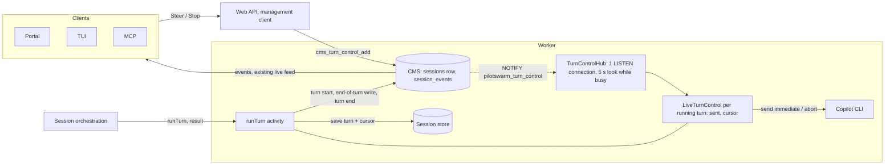

| Piece | Role | New or existing |
|---|---|---|
| `cms_turn_control_add` | Locks the session row, answers a retried request id, checks a turn is running, writes `user.steer` or `user.stop`, notifies. | New procedure |
| Session row | `active_turn_index` (the running turn) exists. `turn_high` marks turns that listen for controls. `turn_base_seq` scopes controls to one orchestration lifetime. | Two new columns |
| `TurnControlHub` | One dedicated LISTEN connection per worker. Wakes the right turn. Looks every 5 s while the worker runs a turn, and once when a turn registers. | New, worker |
| `LiveTurnControl` | One per running turn: an ordered apply queue and two numbers, `sent` and `cursor`. | New, worker |
| `runTurnV4` | Today's order, with turn start, the cursor in the save, and turn end. | New activity names, shared handler |
| Turn end | Writes one outcome per open control, and the closing record of carried steers the turn took. Idempotent. Returns late steers. | New procedure |
| Orchestration | No Stop race on the new version. Runs late steers with the next turn and clears them on proof of consumption. | New version 1.0.81 |

### 2.3 Key decisions

1. **Stop and Steer are session events.** One durable write, which the worker
   reads and the transcript shows. No new table.
2. **Notifications only say "look".** They carry no data. Correctness comes from
   reading events by position; notifications only make it fast.
3. **The cursor lives with the conversation.** It is in memory while the
   conversation is live, inside the saved turn when the turn is saved, and gone
   when the conversation is lost. It is never stored on its own.
4. **Outcomes are written once, at turn end, from the saved cursor.** No
   delivery state machine. What later happens to a carried steer goes into a
   separate closing record; its outcome stays `carried`.
5. **duroxide stays the only owner of work.** No CMS ownership or attempt
   record. duroxide cancels a stale worker when its lock renewal fails, only
   one save of a turn can win, and a late turn end only repeats outcomes that
   are already written.
6. **No cost for turns without controls.** The existing end-of-turn write
   reports whether the turn has open controls. If it has none, and the turn
   took no carried steers, turn end is skipped.
7. **Controls belong to one orchestration lifetime.** A restarted or revived
   session starts a new lifetime. The procedures ignore events of the old one
   (`turn_base_seq`).
8. **Steer is off by default.** An operator turns on `sessions.steering`. Stop
   never depends on the flag.

### 2.4 What does not change

- The orchestration still runs one `runTurn` activity per turn.
- Today's abort code (`abortWarmSessionTurn`) still stops the CLI.
- The snapshot protocol, its store-wins rules and its already-committed
  recovery.
- Ordinary messages, queued prompts and their outbox behaviour.
- Older orchestration versions keep today's Stop path for sessions that run on
  them.

## 3. Sequence diagrams

The diagrams use the turn steps T1 to T9 of `runTurn`:

| Step | What | New? |
|---|---|---|
| T1 | Load the saved conversation (`runTurnPreamble`). | no |
| T2 | Budget and workspace gates. A refused turn returns here. | no |
| T3 | **Turn start**: mark the turn running, return its open controls. A failure throws, and the turn retries. | replaces `setActiveTurnIndex` |
| T4 | Model run. The live loop applies new controls once the initial prompt is sent; earlier controls wait. | loop is new |
| T5 | Settle: close the send gate, wait for unconfirmed steers. | new |
| T6 | Existing end-of-turn write. Clears the running turn, so new controls are refused. Now also reports whether the turn has open controls: true, false, or no answer when the best-effort write failed. | one more return value |
| T7 | Existing save. Carries the cursor when it is not 0. Skipped for a stopped turn, as today. | one more field |
| T8 | **Turn end**: one outcome per open control, and the closing record of carried steers the turn took. Skipped only when T6 answered false and the turn took no carried steers. | new |
| T9 | duroxide records the activity result. | no |

### 3.1 A normal turn without controls

The turn makes exactly today's calls. Turn start replaces today's "set running
turn" call. Turn end is skipped.

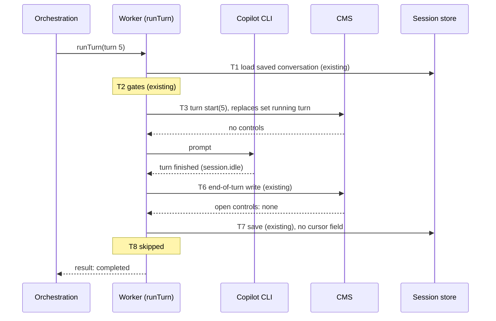

### 3.2 Steer during a turn

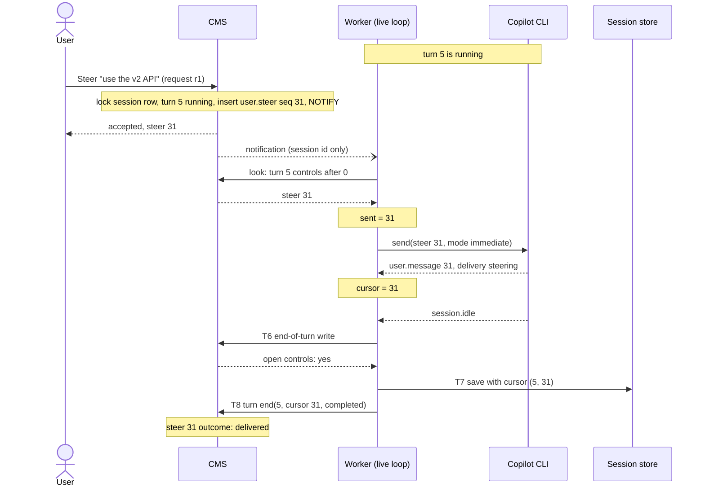

### 3.3 Stop during a turn

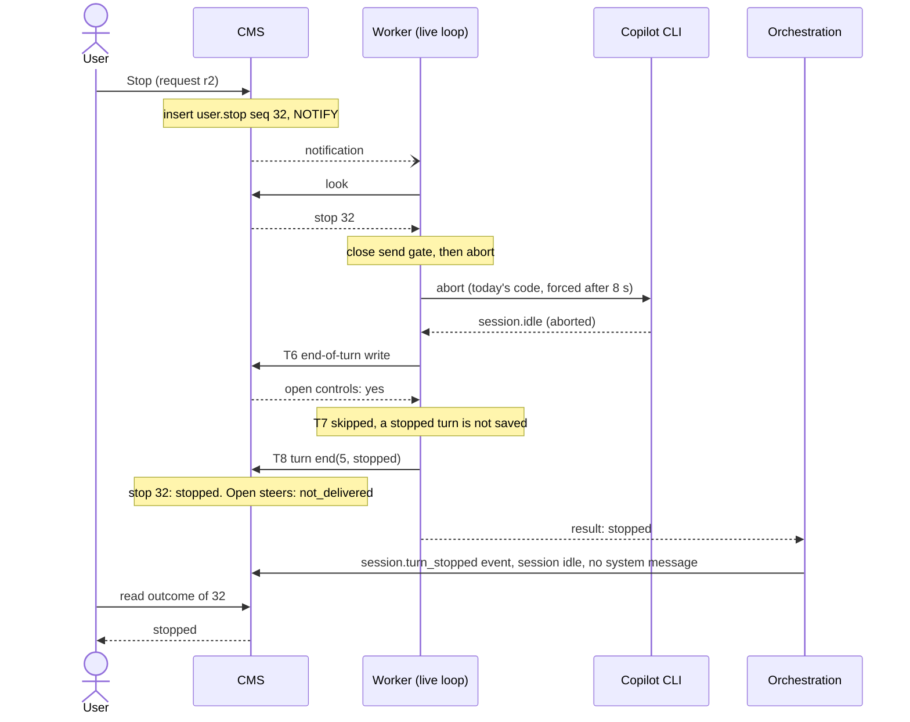

### 3.4 A control arrives as the turn ends

The end-of-turn write (T6) and control add both lock the session row, so one
of them always happens first. T6 clears `active_turn_index` under that lock.
The rule:

- A steer accepted after the send gate closed and before T6 is open at turn
  end. It is never sent, so its outcome is `carried`, and it runs with the
  next turn. (A steer the live loop had not yet taken when the gate closed
  ends the same way; see 5.2.)
- A steer that arrives after T6 is refused `no_turn`. Nothing is recorded.
  The client sends the text as an ordinary message with a new client message
  id (FR-004).

Only the first case produces `carried`. Source: workstream A's notes,
`.paw/work/turn-control/Docs.md` ("A steer after the end-of-turn write"); the
real-CLI window cases test both orders.

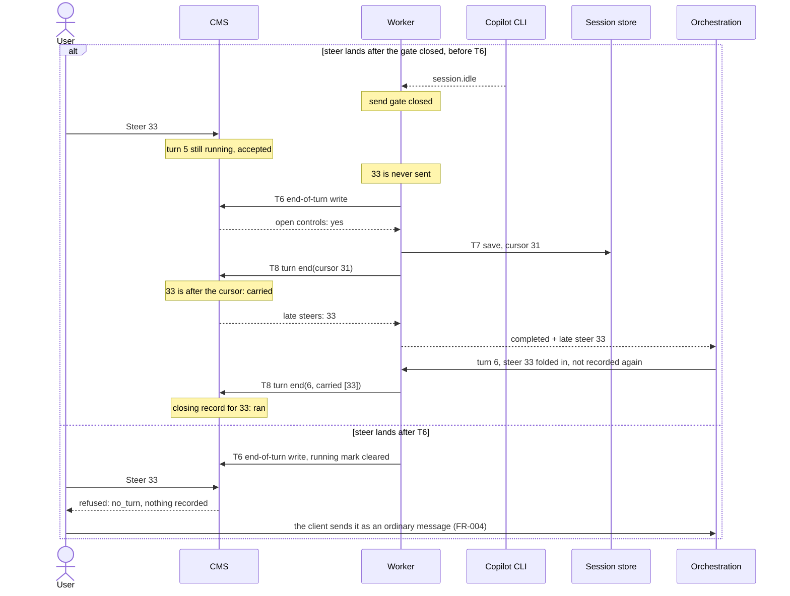

A Stop in the first branch is answered "too late", and it also cancels the
carry: open steers become "not delivered" instead of starting a new turn
(decision D5). A Stop in the second branch is answered "nothing to stop".

Turn 6 is the consuming turn. Its turn end writes the closing record: `ran`,
or `stopped` when turn 6 ends stopped. A stopped consuming turn does not run
the steer again (D6). The test hold `turn.control.before-writeback` (P23)
makes the first branch deterministic.

### 3.5 A worker crashes, and the user stops or steers meanwhile


Worker B does not record the prompt and the turn's system message a second
time, because the session row already shows `turnHigh >= 5` before its turn
start. No CMS call is added for this check.

### 3.6 Crash after the end-of-turn write, before the save

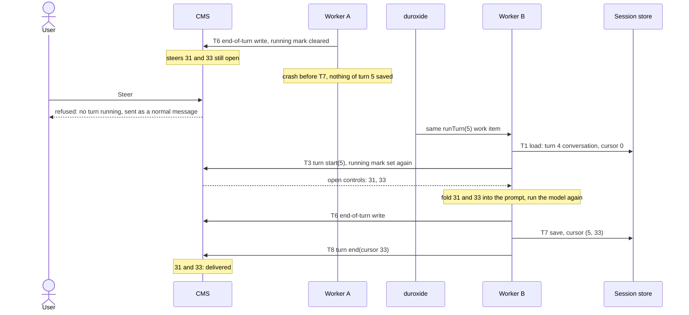

The conversation that held the steers was lost, so the surviving one gets each
of them once. The cost is one model re-run, the same as for any crash today.

### 3.7 Crash after the save, before turn end

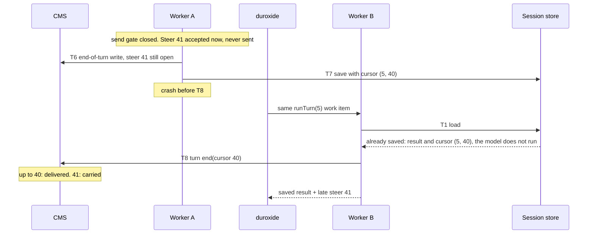

The same path covers a throw after the save. If turn end fails after its
in-place retries, the activity throws and the orchestration retries the turn.
On 1.0.81 that retry sends the thrown attempt's turnKey again
(`thrownTurnKey`, carried through continue-as-new and cleared by any result
or give-up), so the next worker finds the turn already saved and runs only
turn end. A new key would make the model run again and save the turn twice.

### 3.8 Crash after turn end, before duroxide records the result

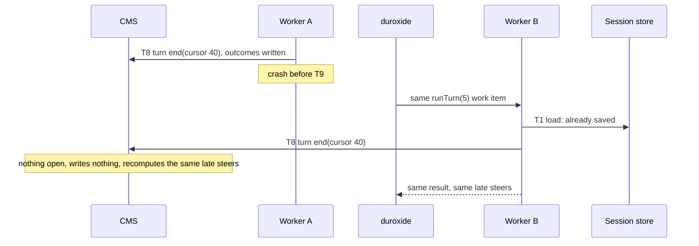

A stopped turn is not saved. Its retry finds the durable "stopped" outcome at
turn start and returns "stopped" again.

### 3.9 A stale worker comes back

duroxide renews an activity's lock every `lock_timeout / 2`, at least every
1 s. When a renewal fails, duroxide cancels the activity's token. PilotSwarm
polls that token every 2 s during a turn and aborts the CLI. So a stale worker
that comes back learns at its next renewal that it lost the work item.

Timing: the default worker lock timeout is 10 s (`resolveDuroxideLockOptions`
in `packages/sdk/src/worker.ts` uses 10,000 ms when no option or environment
override is set), so renewal runs every 5 s. A resumed stale worker sees the
cancellation within about `lock_timeout / 2` plus one 2 s poll: about 7 s.
In test M1, with a 2 s lock, it took 2,003 ms. Until then, the turn-end fence
below keeps the outcomes correct. Source: `.paw/work/turn-control/Docs.md`.

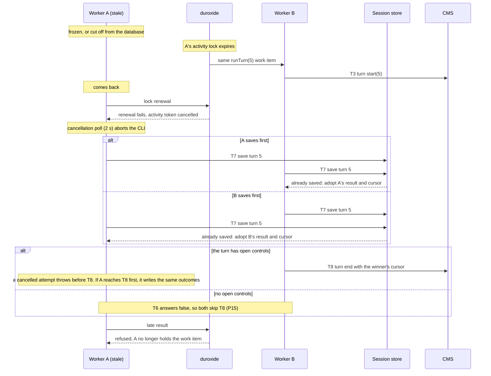

The turn-end fence comes from per-turn scoping and idempotency, not from an
explicit `turn_high` check. A turn end closes only the open controls of its
own turn. It clears `active_turn_index` only while it still names that turn.
It skips carried steers that already have a closing record. So a late turn end
of an older turn changes nothing of a newer turn. With P15 a stale worker
skips turn end when no controls are open; the outcome is the same as when both
workers call it.

Residual risk, documented and accepted: A applies a Stop and reaches T8 in the
moment before it observes its cancellation, while B had already finished the
turn. The Stop then reads "stopped" on a turn that completed. Nothing is lost
silently.

### 3.10 Duplicate and lost notifications

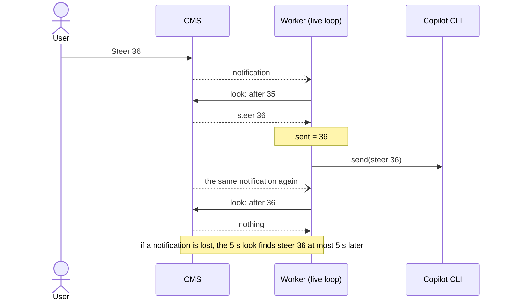

### 3.11 The turn returns an error

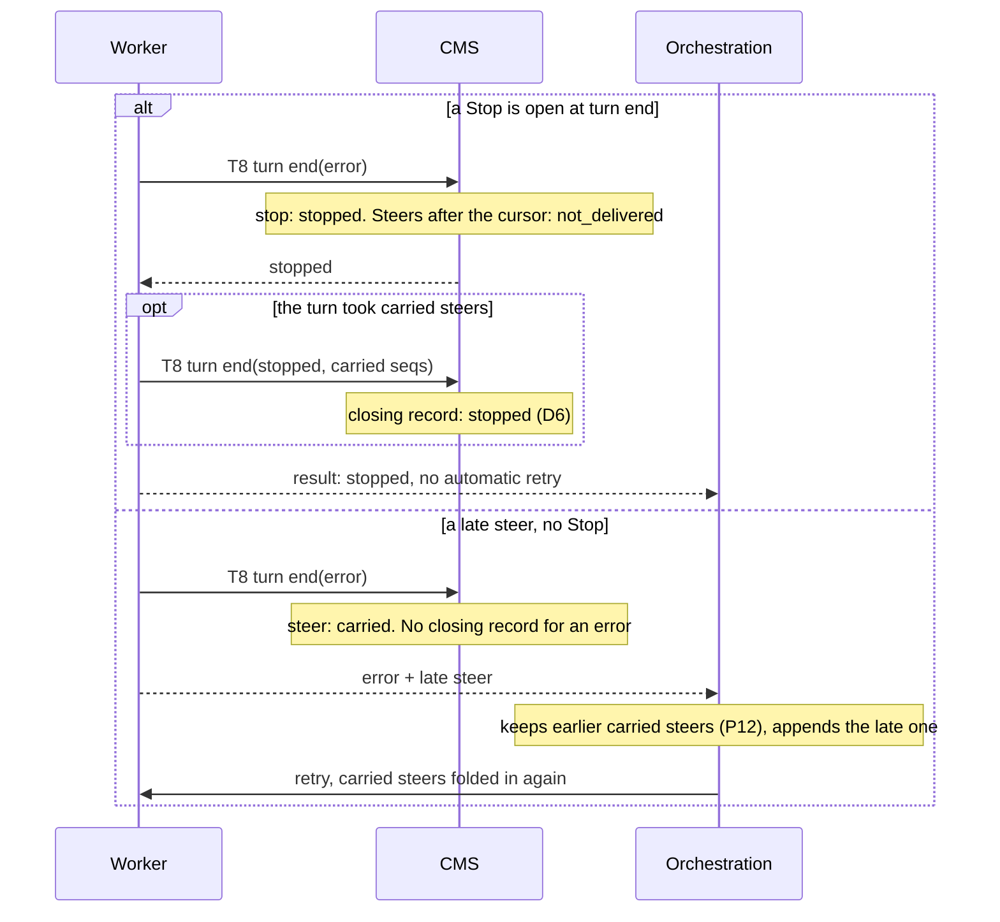

A returned error never closes carried steers. The retry re-sends the same
prompt and folds them again (P12). An error that an open Stop turns into
"stopped" calls turn end a second time with kind `stopped`, so the carried
steers that turn took close as `stopped` (D6).

### 3.12 A refused turn, a turn the orchestration gives up on, and a terminal state

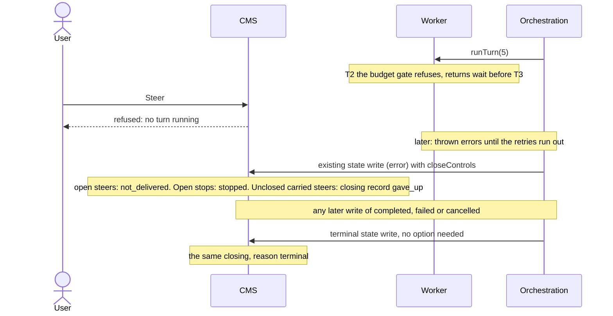

A gate-refused turn never calls turn start, so it leaves the turn's controls
alone. Its carried steers stay in the orchestration state and ride with the
next attempt.

The SQL closes controls on every terminal state, whoever writes it: the
orchestration, the `cancelSession` activity, a management delete, or a status
sync (P20). The revive of a soft-deleted session closes the old lifetime's
unclosed carried steers as `terminal` (P19).

## 4. Component design

### 4.1 CMS schema

One migration, `0082_turn_control`
(`packages/sdk/src/migrations/turn-control-0082.ts`), with its companion file
`packages/sdk/src/migrations/0082_diff.md`. No new table and no new index.

| Item | Change |
|---|---|
| `sessions.turn_high` | New. `INTEGER NOT NULL DEFAULT -1`. The highest turn started on the new path in this lifetime. It never goes down within a lifetime. It refuses a late, stale start of an older turn, and `turn_high = active_turn_index` marks a running turn that listens for controls. |
| `sessions.turn_base_seq` | New. `BIGINT NOT NULL DEFAULT 0`. The last event position of earlier orchestration lifetimes. Every turn-control procedure ignores events at or below it. |
| `sessions.active_turn_index` | Exists (migration 0024). Set by turn start. Cleared by the end-of-turn write, by turn end, and by any state change away from "running", including a mid-turn wait or question (P11). |
| `user.steer` event | `{ turn, text, requestId, actor }`. `actor` is the server-stamped sender, or null. |
| `user.stop` event | `{ turn, text, requestId, actor }`. `text` is the reason. |
| `session.control_outcome` event | `{ seq, turn, outcome }`. `outcome` is one of `delivered`, `carried`, `not_delivered`, `stopped`, `too_late`. Written once per control. |
| `session.steer_confirmed` event | `{ seq, turn, messageId }`. Best-effort. The worker writes it when the CLI confirms a steer (P13). Not a transcript item. |
| `session.carried_steers_closed` event | `{ seqs, turnIndex, reason }`. `reason` is one of `ran`, `stopped`, `gave_up`, `terminal`. At most one record lists a given carried steer (P17). |
| New procedures | `cms_turn_control_add`, `cms_turn_start`, `cms_turn_look`, `cms_turn_end`. Helpers: `cms_turn_base_seq`, `cms_turn_open_controls`, `cms_turn_open_controls_json`, `cms_turn_is_stopped`, `cms_turn_unclosed_carried`, `cms_turn_close_all`, `cms_turn_lifetime_reset`. |
| Changed procedures | `cms_complete_turn_writeback` returns `BOOLEAN`. `cms_update_session` closes controls on `closeControls` and on terminal states. `cms_archive_system_session_for_restart` and the four revivable overloads of `cms_create_session` reset the lifetime. |
| Unchanged | `cms_get_session`. `PgSessionCatalog.getSession` reads `turn_high` through its existing join on the `sessions` row. The code differs from plan P5 here, which widened the procedure. |
| Feature flag | Definition row `sessions.steering`: default off, no user override, no required capability. Cluster setting: off, no user override. |
| Notification | Channel `pilotswarm_turn_control`, payload `{ schema, sessionId }`. Not stored. |
| Index | None new. Every read uses `session_events (session_id, event_type, seq)`. |

A control is **open** while it has no `session.control_outcome` event. A
carried steer is **closed** when a `session.carried_steers_closed` event lists
its seq.

### 4.2 Stored procedures

All access goes through stored procedures, as the repository requires. The
full text is in `packages/sdk/src/migrations/turn-control-0082.ts`. The delta
of every changed procedure against its previous definition is in
`packages/sdk/src/migrations/0082_diff.md`. `${s}` is the CMS schema. Every
procedure below ignores events with `seq <= turn_base_seq`.

| Procedure | Signature | Role |
|---|---|---|
| `cms_turn_open_controls` | `(p_session TEXT, p_turn INT) RETURNS TABLE (seq BIGINT, kind TEXT, text TEXT, created_at TIMESTAMPTZ)` | Open controls of one turn, in position order. |
| `cms_turn_open_controls_json` | `(p_session TEXT, p_turn INT, p_after BIGINT DEFAULT 0) RETURNS JSONB` | The same as `[{seq, kind, text, createdAt}]`, after a position. |
| `cms_turn_control_add` | `(p_session TEXT, p_kind TEXT, p_text TEXT, p_request_id TEXT, p_actor JSONB, p_steering_allowed BOOLEAN DEFAULT true) RETURNS JSONB` | Client: add a Steer or a Stop. |
| `cms_turn_start` | `(p_session TEXT, p_turn INT) RETURNS JSONB` | Worker, T3. |
| `cms_turn_look` | `(p_turns JSONB) RETURNS TABLE (session_id TEXT, turn INT, controls JSONB)` | Worker: one read for all live turns. Input `[{session, turn, after}]`. |
| `cms_turn_end` | `(p_session TEXT, p_turn INT, p_cursor BIGINT, p_result TEXT, p_carried BIGINT[] DEFAULT NULL) RETURNS JSONB` | Worker, T8. `p_result` is `stopped`, `error` or `other`. Returns `{stopped, late}`. |
| `cms_complete_turn_writeback` | the same 23 parameters, now `RETURNS BOOLEAN` | Worker, T6. Dropped and created again, because PostgreSQL cannot change a return type in place. |
| `cms_update_session` | unchanged | Closes controls on `closeControls` and on terminal states. |
| `cms_turn_close_all` | `(p_session TEXT, p_reason TEXT) RETURNS VOID` | Helper. The caller holds the row lock. |
| `cms_turn_lifetime_reset` | `(p_session TEXT) RETURNS VOID` | Helper. Acts only on a soft-deleted row. |

**Add a control.** `cms_turn_control_add` locks the session row
(`FOR UPDATE`, live rows only) and answers in this order:

1. `not_found` when the row is missing or soft-deleted.
2. A request id already used in this lifetime gets the first answer,
   `{seq, turn, repeat: true}`. A different kind or text under that id gets
   `request_id_reused`.
3. A new Steer is refused with `steering_disabled` when the caller passes
   `p_steering_allowed = false`. A Stop ignores the flag. The check comes
   after the request-id lookup, so a lost-response retry still gets its first
   answer after Steer was turned off.
4. `no_turn` when no turn runs. `legacy_turn` when `turn_high` is not
   `active_turn_index`. `too_many` when the turn already has 20 open controls.
5. Otherwise it inserts the event, notifies, and returns `{seq, turn}`.

```sql
-- after the row lock and the request-id lookup
IF p_kind = 'steer' AND NOT COALESCE(p_steering_allowed, true) THEN
    RETURN '{"refused":"steering_disabled"}'::jsonb;
END IF;
IF v_active IS NULL THEN RETURN '{"refused":"no_turn"}'::jsonb; END IF;
IF v_high IS DISTINCT FROM v_active THEN RETURN '{"refused":"legacy_turn"}'::jsonb; END IF;
IF (SELECT count(*) FROM ${s}.cms_turn_open_controls(p_session, v_active)) >= 20 THEN
    RETURN '{"refused":"too_many"}'::jsonb;
END IF;
INSERT INTO ${s}.session_events (session_id, event_type, data)
VALUES (p_session, 'user.' || p_kind, jsonb_build_object(
    'turn', v_active, 'text', p_text, 'requestId', p_request_id, 'actor', COALESCE(p_actor, 'null'::jsonb)))
RETURNING seq INTO v_seq;
PERFORM pg_notify('pilotswarm_turn_control',
    json_build_object('schema', '<schema>', 'sessionId', p_session)::text);
RETURN jsonb_build_object('seq', v_seq, 'turn', v_active);
```

**Turn start.** `cms_turn_start` locks the row. It returns `{stale: true}`
when `p_turn < turn_high`: a newer turn already started. Otherwise it sets
`active_turn_index` and `turn_high` to `p_turn` and returns
`{stopped, controls}`: whether a `stopped` outcome exists for the turn, and
the turn's open controls. A missing row returns no controls and writes
nothing, as today's `cms_set_active_turn_index` does.

**Turn end.** `cms_turn_end` locks the row and gives every open control of the
turn one outcome:

```sql
CASE
    WHEN c.kind = 'stop' AND p_result IN ('stopped', 'error') THEN 'stopped'
    WHEN c.kind = 'stop'                                     THEN 'too_late'
    WHEN p_result = 'stopped'                                THEN 'not_delivered'
    WHEN c.seq <= COALESCE(p_cursor, 0)                      THEN 'delivered'
    WHEN v_stop_open                                         THEN 'not_delivered'
    ELSE 'carried'
END
```

Then:

- When `p_carried` is not empty and `p_result` is not `error`, it writes one
  `session.carried_steers_closed` record for the seqs of this lifetime that
  have no closing record yet. The reason is `stopped` for a stopped turn, else
  `ran`.
- It clears `active_turn_index` only while it still equals `p_turn`.
- It returns `stopped` (a `stopped` outcome exists for the turn) and `late`
  (every steer of the turn whose outcome is `carried`, in order).

Every value is computed again from the events, so a second call writes nothing
and returns the same answer.

**End-of-turn write.** `cms_complete_turn_writeback` keeps its body. After its
existing `UPDATE`, which takes the row lock and clears `active_turn_index`, it
returns:

```sql
RETURN EXISTS (SELECT 1 FROM ${s}.cms_turn_open_controls(p_session_id, COALESCE(p_turn_index, 0)));
```

The check runs after the lock is taken, so a control added just before is
seen, and none can be added after. Older workers call it with `SELECT` and
ignore the value.

**Session state write.** `cms_update_session` keeps its signature. After its
existing updates:

```sql
IF p_updates ? 'closeControls' AND (p_updates->>'closeControls') = 'true' THEN
    PERFORM ${s}.cms_turn_close_all(p_session_id, 'gave_up');
ELSIF (p_updates ? 'state') AND (p_updates->>'state') IN ('completed', 'failed', 'cancelled') THEN
    PERFORM ${s}.cms_turn_close_all(p_session_id, 'terminal');
END IF;
```

`cms_turn_close_all` gives every open control of the lifetime an outcome:
`stopped` for a Stop, `not_delivered` for a Steer. It writes one closing record
with the given reason for the carried steers that have none, with `turnIndex`
set to the session's `current_iteration`. It writes nothing when nothing is
open.

**Lifetime reset.** Each of the four revivable `cms_create_session` overloads
first calls `cms_turn_lifetime_reset`. It acts only when the row exists and is
soft-deleted (the revive branch). It closes the old lifetime with
`cms_turn_close_all(..., 'terminal')`, then sets `turn_high = -1`,
`active_turn_index = NULL` and `turn_base_seq` to the session's highest event
seq. `cms_create_session` on a live row still does nothing.

`cms_archive_system_session_for_restart` already deletes the session's events.
It now also sets `turn_high = -1`, `active_turn_index = NULL` and
`turn_base_seq = 0`. The code differs from plan P19 here, which named the
highest event seq; with no event left, 0 has the same effect.

### 4.3 Management client, Web API, MCP and CLI

A new management operation lands on `PilotSwarmManagementClient` first, then
the Web API route, then MCP, CLI and the user interfaces, as the repository
requires. Code: `packages/sdk/src/management-client.ts`.

```ts
// packages/sdk/src/management-client.ts (shape)
async steerSessionTurn(sessionId: string, opts: SteerTurnOptions): Promise<SteerTurnResult> {
    // text must not be empty; requestId is required
    // sessions.steering is resolved for opts.caller.viewer (cluster scope without one)
    const steeringAllowed = await this._steeringEnabled(opts.caller);
    const added = await this._turnControlAdd(sessionId, "steer", text, requestId, opts.caller, steeringAllowed);
    if ("refused" in added) return { outcome: added.refused };  // steering_disabled | no_turn | legacy_turn | not_found | too_many | request_id_reused
    return { outcome: "accepted", steerId: added.seq, turn: added.turn, ...(added.repeat ? { repeat: true } : {}) };
}

async stopSessionTurn(sessionId: string, opts?: StopTurnOptions): Promise<StopTurnResult> {
    const requestId = opts?.requestId ?? crypto.randomUUID();     // pass one to make retries safe
    const added = await this._turnControlAdd(sessionId, "stop", reason, requestId, opts?.caller);
    if ("refused" in added) {
        if (added.refused === "legacy_turn") return this._legacyStopSessionTurn(sessionId, { reason, timeoutMs });
        return { outcome: "no_active_turn", detail };             // "no turn is running", or the refusal name
    }
    return this._waitForStopOutcome(sessionId, added.seq, added.turn, timeoutMs);  // stopped | too_late | timeout
}
```

Notes:

- **Flag.** The flag gates new steers only. The client resolves it and
  passes it to `turnControlAdd`. The procedure decides under the row lock,
  after its request-id lookup, so a retry of a recorded request id still gets
  its first answer.
- **Older catalogs.** A catalog without migration 0082 throws
  `TurnControlUnavailableError`. The client treats it as `legacy_turn`, or as
  `steering_disabled` for a Steer with the flag off.
- **Stop wait.** The client polls `session.control_outcome` every 250 ms (P6).
  `timeoutMs` is 0 to 300,000 ms, default 30,000. A `timeout` result keeps
  `controlSeq`: the Stop was accepted, and a client shows it as pending. A
  failed read reaches the caller; it is never reported as a timeout.
- **Caller (P18).** `opts.caller` carries `{ sender, viewer }`. The Web API
  overwrites it from the authenticated request, as `sendMessage` does. In
  direct mode, a trusted subsystem, it is optional.

| Surface | Change |
|---|---|
| Web API | New `POST /management/sessions/:sessionId/steer` (access `session:write`, the same as sending a message). `stop-turn` accepts `options.requestId`. Both stamp `options.caller` from the principal and ignore body values. |
| Detailed session view | `activeTurnIndex`, `turnHigh` and `acceptsTurnControl` (P5), in direct and Web API mode. List rows do not carry them. |
| `StopTurnResult` | Gains `too_late` and `controlSeq`. `stop_forced` is reported only on the legacy path: on the new path a forced settle is still a stopped turn, and the trace records how it was stopped. |
| MCP | New `steer_session_turn` (`session_id`, `text`, `request_id?`). `stop_turn` accepts `request_id` and reports `too_late`. A request id is generated when omitted and always returned. Refusals are ordinary results, with a `send_message` hint only for `no_turn` and `legacy_turn`. |
| CLI | No separate command exposes Stop or Steer. The TUI is the terminal surface (4.10). |
| Client contract (P14) | One request id per user action, kept with its kind and text until a definite answer. A client retries with the same id only after a transport failure. After a definite `no_turn` or `legacy_turn` refusal of a Steer, the composer sends the text as a normal message with a new client message id and never retries that request id. |
| Size limit | No management-level limit, as for `sendMessage`. The Web API's 2 MB JSON body limit applies to the steer route too. |

### 4.4 Worker: TurnControlHub

One per worker process, in `packages/sdk/src/turn-control.ts`. PostgreSQL
LISTEN is a core PostgreSQL feature, which the repository's provider rules
allow in core.

- **Connection.** The session catalog creates the LISTEN client
  (`SessionCatalog.createTurnControlListener()`): a plain `pg.Client` from the
  catalog's own connection settings, with `keepAlive` on and
  `application_name = pilotswarm-turn-control`. The worker does not import a
  cloud-aware pool factory.
- **Notifications.** On `pilotswarm_turn_control` the hub ignores other
  schemas and looks for the live turns of the named session.
- **Periodic look.** While at least one turn is registered, one batched look
  every 5 s covers a lost notification or a connection that died silently.
  The timer does not keep the process alive.
- **Register.** `register(turn)` adds that exact turn instance and looks once
  for it, so a control that arrived before registration is found (P21).
  `unregister` removes only that instance.
- **Reconnect.** A lost connection reconnects with a backoff from 1 s to 15 s,
  one attempt at a time. After a reconnect the hub looks once for all live
  turns.
- **No LISTEN.** If `LISTEN` fails (a provider without it, or a database that
  is down), the hub logs a warning, keeps the periodic look and tries again
  later. Worker start does not fail.
- **Lifecycle.** The worker starts the hub after the catalog and before the
  runtime. It stops the hub only after the runtime and the session manager
  have shut down, so a Stop that arrives during a graceful drain still reaches
  running turns.

```ts
// packages/sdk/src/turn-control.ts (shape)
class TurnControlHub {
    start(): Promise<void>;                          // 5 s interval and one LISTEN connection
    stop(): Promise<void>;                           // ends the connection, clears the timers
    register(turn: LiveTurnControl): Promise<void>;  // and one look for that turn
    unregister(turn: LiveTurnControl): void;
    lookAll(sessionId?: string): Promise<void>;      // one cms_turn_look for the matching turns
}
```

The portal's LISTEN relays use the same pattern
(`packages/app/web/api/live-plane.js`, `packages/app/web/api/canvas-plane.js`).

### 4.5 Worker: LiveTurnControl

One per running turn, in `packages/sdk/src/turn-control.ts`. It is named
`LiveTurnControl` because `live-turn.ts` already exports streaming types named
`LiveTurn*`. `sent` is the last control taken from the CMS; it stops a
duplicate wake-up from taking a control twice. `cursor` is the last steer the
CLI confirmed. Only `cursor` is saved.

- Controls wait in one queue, in position order.
- The queue drains only while the run's send gate is open. While the gate is
  `pending` (before the initial prompt is sent), controls wait. When the gate
  is `closed` (settling, stopping, ended), the rest are dropped, and turn end
  labels them.
- A Stop closes the gate, clears the queue, and then calls
  `abortWarmSessionTurn`. Nothing is sent after an abort (spike cell C5b).
- A Steer goes to `ManagedSession` through a port bound to the current run. On
  confirmation the cursor moves, the trace line
  `[turn-control] steer-confirmed session=<id> turn=<n> seq=<seq> messageId=<id>`
  is written, and `session.steer_confirmed` is recorded (best-effort, P13).
- `retire()` ends the turn: nothing more is sent, and late confirmations are
  ignored. A failure in the apply chain fails the run only while that run is
  current.
- When the warm conversation is lost and the turn runs again from its start
  prompt, `conversationLost()` sets the cursor back to its start value. Steers
  applied to the lost conversation are then carried, not reported delivered.

```ts
// packages/sdk/src/turn-control.ts (shape)
class LiveTurnControl implements TurnControlBinding {
    sent: number; cursor: number;                     // both start at the turn's start cursor
    enqueue(controls: TurnControl[]): Promise<void>;  // skip seq <= sent, then drain in order
    attach(port); heldStop(); gateOpened(); detach(); // the binding ManagedSession uses (4.6)
    retire(); conversationLost();
}
```

### 4.6 ManagedSession: send gate and settlement

`ManagedSession.runTurn` (`packages/sdk/src/managed-session.ts`) receives a
`turnControl` binding for a V4 turn. It creates a send gate for the run, with
three states.

| Gate | When | Effect |
|---|---|---|
| `pending` | From the start of the run until the initial prompt is sent | Controls wait in order (P21). |
| `open` | After the initial send | Steers are sent with `mode: "immediate"`. |
| `closed` | At `session.idle`, on a Stop, on the wall-clock timeout, on the inactivity watchdog, on any error unwind, and when the run ends | Nothing more is sent. |

- **Initial send.** Before the initial send, the session asks the binding for
  a held Stop. If there is one, it does not send the prompt, and the turn ends
  "stopped" without a model run. Otherwise it sends the prompt, opens the gate
  and calls `gateOpened()`, which applies the held controls in order.
- **Send.** `sendSteer` arms the watch for the `user.message` before it calls
  `copilotSession.send({ prompt, mode: "immediate" })`, because the event can
  come first. It matches the confirmation by the message id that `send()`
  returns. Installed Copilot SDK 1.0.13: `send` returns `Promise<string>`, and
  `MessageOptions.mode` is `"enqueue" | "immediate"`.
- **Settlement.** At `session.idle` the gate closes first. The turn settles
  only when no send is in flight, no sent steer is unconfirmed, and an idle
  came after the last confirmation. The existing turn timeout bounds the wait.
- **Failed send.** A steer send that fails ends the turn with an `error`
  result through the existing error path. The retry starts from the saved
  conversation and folds the still-open steer into its prompt.

Why: a send just before the run's final idle is answered in the same run, but a
send after the idle starts a new CLI run (spike cells C4a to C4c). Closing the
gate at idle, and waiting for steers already sent, keeps every steer inside the
turn that collects its events.

### 4.7 runTurn activity

The new path runs under new activity names, `runTurnV4` and `runTurnEpochV4`,
routed by a capability tag (section 6). V3 and V4 share one handler body in
`packages/sdk/src/session-proxy.ts`. Every turn-control step runs only on the
V4 names and only with a session catalog, so the V3 path is unchanged. The
order is today's order with the additions below.

```ts
// packages/sdk/src/session-proxy.ts, V4 path (shape)
const pre = await runTurnPreamble(lifecycle);                           // T1
if (pre.kind === "already-committed") {                                  // an earlier attempt saved this turn
    tc.carriedTaken = carried.length > 0;
    return finishTurnControl(stored, savedControlCursor(pre.result, turn), { alwaysEnd: true });   // T8 only
}
// T2: existing budget and workspace gates. A refused turn returns here, before T3.
// Existing: record the prompt as user.message, except for the carried wake prompt and when
//   the session row loaded before T3 has turnHigh >= turn (an earlier attempt passed T3); state = running.
const st = await cmsRetryCritical(() => catalog.turnStart(S, turn));     // T3, replaces setActiveTurnIndex; throws on failure
if ("stale" in st) throw staleTurnError();
let start = 0;
if (lifecycle && (st.stopped || st.controls.length > 0))
    start = savedControlCursor(readTurnCommitFile(sessionDir)?.result, turn);   // read only when needed
const open = st.controls.filter((c) => c.seq > start);
if (st.stopped || open.some((c) => c.kind === "stop")) {
    tc.earlyStop = true;
    tc.carriedTaken = carried.length > 0;                                // D6: a stopped turn takes them
    return { type: "stopped" };                                          // no model run, no T6, no T7
}
prompt = foldCarriedBefore(prompt, carried);                             // replaces the wake prompt when present
prompt = foldAfter(prompt, openSteers); start = max(start, ...openSteers.seq);   // never recorded again
const live = new LiveTurnControl({ sessionId: S, turn, start, abort, record });
hub.register(live);                                                      // and one look (P21)
let result = await session.runTurn(prompt, { turnControl: live });       // T4, T5
live.retire(); hub.unregister(live);
tc.hasControls = await completeTurnWriteback(result);                   // T6: true | false | undefined (P15)
// T7, after the turn body: existing save; controlCursor only when the cursor is not 0 and the turn is not stopped
const c = await runTurnCommit(lifecycle, base, cursor > 0 ? { ...result, controlCursor: { turn, cursor } } : result);
if (c.alreadyCommitted)
    return finishTurnControl(adopted, savedControlCursor(c.storedResult, turn), { alwaysEnd: true });
return finishTurnControl(saved, c.published ? cursor : 0);               // T8; not published: nothing of this turn survives

async function finishTurnControl(result, cursor, { alwaysEnd = false } = {}) {
    if (result.type === "cancelled") return result;
    if (!tc.started && !alwaysEnd) return result;                        // T3 did not run in this attempt
    const carriedSeqs = tc.carriedTaken ? carried.map((c) => c.seq) : [];
    if (alwaysEnd || tc.earlyStop || tc.hasControls !== false || carriedSeqs.length > 0) {
        if (activityCtx.isCancelled()) throw cancelledError();
        const kind = result.type === "stopped" ? "stopped" : result.type === "error" ? "error" : "other";
        let end = await turnEndWithRetry(kind, cursor, carriedSeqs);     // 3 attempts, then the activity fails
        if (end.stopped && kind !== "stopped" && carriedSeqs.length > 0)
            end = await turnEndWithRetry("stopped", cursor, carriedSeqs); // an error turned stopped: carried close as stopped (D6)
        if (end.stopped) result = { type: "stopped", reason, workspaceAttached };
        else if (end.late.length > 0) result = { ...result, lateSteers: end.late };
    }
    if (tc.carriedTaken && carried.length > 0 && result.type !== "error")
        result = { ...result, carriedSteersConsumed: true };             // P12, D6
    return result;
}
```

Notes:

- **Saved cursor.** `readTurnCommitFile` reads `.ps-turn-commit.json`, which
  every saved turn writes into the session folder and which a hydrated
  snapshot contains. `savedControlCursor` returns the saved cursor only when
  it belongs to this turn; a conversation saved for an earlier turn holds none
  of this turn's steers, so its cursor counts as 0. A session without a store
  reads no saved cursor (D4).
- **Fold order.** Carried steers go in front of the prompt, or replace
  `CARRIED_STEERS_WAKE_PROMPT` when it is the prompt. Steers that are open at
  turn start go after the prompt. Neither is recorded again.
- **Stop at turn start.** The turn skips the model run, the end-of-turn write
  and the save. Turn end labels the controls and clears the running mark.
- **When T8 runs.** T8 is skipped only when the end-of-turn write answered
  `false` and the turn took no carried steers. A turn that did not reach T3 in
  this attempt leaves the turn's controls alone, except on the already-saved
  path.
- **Turn end is not best-effort.** Unlike the projection writes around it, a
  failure is retried in place (three attempts, 500 ms and 1,000 ms apart) and
  then fails the activity, so the turn retries.
- **`carriedSteersConsumed`** is set when the carried text reached the model
  run, on the already-saved path, and when a stopped turn took the carried
  steers (D6). It is never set on a gate return, a returned error before the
  model run, a throw or a stale start, and never on an `error` result.
- **`workspaceAttached`** is set on every V4 result when the workspace was
  attached in this attempt: a normal result, a Stop at turn start, a
  carried-only turn, an already-saved result and an adopted result. The
  orchestration clears delivered workspace notes from it. Turn control does
  not change workspace attach (the runTurn gates) or release
  (`releaseAffinity`, worker eviction and shutdown).
- **Duplicate prompt after worker loss.** A worker loss gives
  the same activity input to another worker. Before this change the next
  worker recorded the prompt and the turn's system message again; this
  duplicate already exists on `main` and on V3. On V4, when the session row
  that the activity already loads before T3 has `turnHigh >= turnIndex`, both
  records are skipped. No CMS call is added. Known limits: a crash between the
  prompt record and T3 still records the prompt again, and two attempts of one
  turn that run at the same time (3.9) can both read the old `turnHigh` and
  both record it.
- **Fault points.** `turn.control.after-start` (T3), `after-writeback` (T6),
  `after-commit` (T7) and `after-end` (T8) (P10). Session-scoped hold points
  `turn.control.before-send` (after T3, before the initial send) and
  `turn.control.before-writeback` (after the gate closed, before T6) (P23).
- **Cancellation.** PilotSwarm already polls `activityCtx.isCancelled()` every
  2 s during a turn and aborts the CLI. T8 checks it again first.

### 4.8 Session lifecycle and the cursor

| The conversation is... | Its cursor is... | So the next attempt... |
|---|---|---|
| live in a worker | in memory, in `LiveTurnControl` | continues from it |
| lost during the run, and the turn runs again from its start prompt in the same attempt | back to the start cursor (`conversationLost`) | carries the steers that only the lost conversation held |
| saved | inside the saved turn: `controlCursor: { turn, cursor }`, only when not 0 | uses the saved result and cursor without running the model |
| saved by another attempt first | the winner's | adopts the winner's result and cursor |
| lost, stopped or superseded | 0 for this turn | folds every open steer into its prompt |

No change to the snapshot protocol: the cursor is one optional field of the
result that the turn-commit file already stores.

### 4.9 Orchestration

A new version, 1.0.81. Version 1.0.80 is frozen in `orchestration_1_0_80/` and
stays registered, so sessions already running replay against their original
yield sequence. The canonical description is
`docs/architecture/orchestration/design.md`, section "Stop, Steer, and carried
guidance (1.0.81)".

```ts
// packages/sdk/src/orchestration/turn.ts, 1.0.81 (shape)
const turnTask = runtime.session.runTurn(prompt, isBootstrap, state.iteration, {
    ...meta,
    ...(state.carriedSteers.length > 0 ? { carriedSteers: [...state.carriedSteers] } : {}),
});                                           // runTurnV4 or runTurnEpochV4, tag pilotswarm.turn-control.v1
turnResult = yield turnTask;                  // removed: ctx.race, the stopTurn.<n> queue, the abortTurn call

if (result.type !== "error" && result.carriedSteersConsumed === true) state.carriedSteers = [];
if (result.lateSteers?.length) state.carriedSteers.push(...result.lateSteers);

// case "stopped": session.turn_stopped { interrupt: "turn-result" }, state idle, retryCount = 0,
//                 timers and cron kept, no system.message (P22)
// give-up paths:  yield runtime.manager.updateCmsState(id, "error", message, null, { closeControls: true });
// terminal paths: the existing write; the SQL closes controls (P20)
```

Rules:

- **Proxy contract.** Every session proxy in 1.0.81 uses the activity
  contract `turn-control-v1`. Turn tasks carry only the tag
  `pilotswarm.turn-control.v1`; every worker that declares it also declares
  the handoff and workspace tags. Other manager activities keep the handoff
  contract, and workspace checks and releases keep workspace routing.
- **Consumption (P12).** Carried steers leave the state only on a non-error
  result with `carriedSteersConsumed`. Throws, returned errors before the model
  run (for example a provider-admission error), budget and workspace waits,
  and a stale start keep them. A returned error keeps them even when the model
  ran: the retry re-sends the same source prompt and folds them again. The
  `budgetStash` "past the gates" rule is not used.
- **Stopped consuming turn (D6).** It counts as consumption. The steer is not
  run again. Its outcome stays `carried`, and its closing record says
  `stopped`.
- **Next turn.** After a result with late steers: a question to the user
  carries them with the answer (D3); a returned error carries them into the
  retry; a result that ends the session closes them as `terminal`; any other
  result schedules the next turn at once, as if a user message had arrived when
  the turn ended. Pending ordinary work takes priority and carries them. With
  no pending prompt, the turn's prompt is `CARRIED_STEERS_WAKE_PROMPT`. That
  turn is a bootstrap turn, never merges with another queued prompt, and uses
  the timer-interrupt path, so a wait or a recurring schedule stays in place.
- **Continue-as-new** carries non-empty `carriedSteers` next to `budgetStash`.
- **Give-up writes** pass `closeControls: true` and then clear the state:
  retries exhausted, non-retryable error, authentication error, storeless
  connection-loss exhaustion, and legacy-hydration exhaustion. The last two
  are new single state writes in 1.0.81 only. Terminal writes pass nothing;
  the SQL closes controls.
- **No yield closes carried steers.** The closing records come from the
  worker's turn end and the existing state writes (P17). For a turn without
  controls, the scheduled-activity sequence differs from 1.0.80 only by the
  removed race.

### 4.10 Portal and TUI

The TUI and the portal share the controller, the history and the labels
(`packages/app/ui/core/src/`).

- **When Steer is offered.** `canSteer` needs the detailed view's
  `acceptsTurnControl`, a running session, and the viewer's
  `sessions.steering`. The controller sets `acceptsTurnControl` to `false` on
  turn end, Stop, wait and question events. The next detail read brings the
  authoritative value.
- **Portal.** A Steer button (`↪`) between Stop and Send. A non-accepted
  answer shows an inline notice with Retry and Dismiss.
- **TUI.** `Ctrl+T` in the prompt pane steers with the prompt text. `Ctrl+X`
  or `Ctrl+Esc` stops. Pressing the same key again resends an unconfirmed
  request with the same id. `Alt+T` (`Option+T`) gives up unresolved requests,
  like the portal's Dismiss. The status hints and the `?` help show the keys
  while they apply. The keybinding docs and
  `.github/skills/pilotswarm-tui/SKILL.md` are updated.
- **Request ids (P14).** One id per action. A transport failure shows
  "unconfirmed" with Retry, which reuses the id and never falls back to a
  message. Only a definite `no_turn` or `legacy_turn` refusal of a Steer sends
  the text as an ordinary message with a new client message id.
- **Transcript.** `user.steer` shows as a user message with a "steer" badge
  and its outcome. `user.stop` shows as a short system line with its outcome.
  `session.control_outcome` and `session.carried_steers_closed` are label
  inputs, matched by seq across all loaded history pages, on the bulk and the
  live path. Labels survive a reload. `session.steer_confirmed` is not shown.
- **Labels.** Pending, Delivered, Not delivered, Stopped, Too late. A
  `carried` steer is labelled only from its closing record: none gives "Will
  run next", `ran` gives "Carried, ran next", `stopped` gives "Carried, then
  stopped", and `gave_up` or `terminal` gives "Carried, not run".
- **Legacy Stop (P22).** On 1.0.80 and older, the legacy
  `session.turn_stopped` event renders a visible line marked
  `control-stop-legacy` (`stopped` or `stop_forced`). The stopped result of
  1.0.81 adds no line; its `user.stop` item is the record.

Portal `data-testid` contract, in brief (stable; the UX pass asserts it).
Composer selectors live under `.ps-prompt-shell[data-session-id]` and
transcript selectors under `.ps-scroll-panel[data-session-id]`, so dashboard
panels never collide.

| Selector | Attributes |
|---|---|
| `turn-stop-button` | `data-state`: `ready`, `stopping` |
| `turn-steer-button` | `data-state`: `ready`, `sending`, `disabled` (empty composer). Present only when `canSteer`. |
| `session-turn-state` | `data-turn-state` (the product state), `data-accepts-controls` |
| `control-steer`, `control-stop` | `data-control-seq`, `data-outcome` |
| `control-outcome-badge` | `data-outcome`: `pending`, `delivered`, `carried`, `carried_ran`, `carried_then_stopped`, `carried_not_run`, `not_delivered`, `stopped`, `too_late` |
| `control-stop-legacy` | `data-outcome`: `stopped`, `stop_forced` |
| `control-notice` | `data-kind`: `steer`, `stop`; `data-reason`: every refusal, fallback and failure |
| `control-retry-button` | `data-request-id` |
| `composer-input`, `transcript-user-message` | `transcript-user-message` has `data-client-message-id` |

Parity: the TUI reports the same answers in its status line instead of inline
notices, and its `Alt+T` gives up both kinds at once. The portal keeps a
read-only collaborator out of the composer; the TUI in direct mode has no
per-session access model.

### 4.11 Feature flag and observability

- **Flag.** `sessions.steering` ("Steer running turns") gates Steer. It is off
  by default and allows no user override: the operator turns it on at cluster
  scope and may then allow user overrides (P7). Migration 0082 publishes the
  definition and the cluster setting. The management client resolves the
  flag for the caller's viewer, or at cluster scope without a viewer, and
  passes the value to `cms_turn_control_add`, which decides under the row
  lock.
- **Stop is never gated.** Stop takes the new path whenever the running turn
  listens for controls, because version 1.0.81 no longer races the old Stop
  event.
- **Signals.** All signals are session events with database timestamps:
  - Stop latency: `createdAt` of the Stop's outcome minus `createdAt` of the
    `user.stop`.
  - Steer latency: `createdAt(session.steer_confirmed)` minus
    `createdAt(user.steer)` (P13). Both are database clock times, so there is
    no clock skew; insertion lag makes the figure conservative.
  - `cms_turn_open_controls` returns `created_at`, so the worker sees each
    control's acceptance time.

  The existing event read APIs and the tuner's event tools reach them. No new
  metric tables.
- **Traces.** `[turn-control] stop ...`, `[turn-control] steer-confirmed ...`,
  `[turn-control] session=<id> turn=<n> stopped at turn start`,
  `[turn-control] turnEnd attempt <n> failed ...`, and the hub's
  `[turn-control] LISTEN unavailable ...` warning.
- **Connection.** Operators find the hub's LISTEN connection in
  `pg_stat_activity` by `application_name = pilotswarm-turn-control`.

### 4.12 Surfaces updated in the same change

- Canonical docs: `docs/api/reference.md` (the steer route, Stop options and
  outcomes, a "Stop and Steer" section), `docs/user-guide/portal.md`,
  `docs/user-guide/keybindings.md`, `docs/user-guide/tui.md`, the MCP docs,
  `docs/proposals/mcp-web-api-parity.md`, and `CHANGELOG.md`.
- Architecture: `docs/architecture/orchestration/design.md` (1.0.81),
  `docs/architecture/internals/cms-schema.md` (columns, events, procedures,
  channel) and `docs/architecture/system-reference.md` (the V4 activities and
  the hub).
- `examples/devops-command-center/` and `templates/builder-agents/`: no change
  needed. Neither shows Stop or lists management operations that include it.
- `scripts/local-pilotswarm.sh`: no new setting is needed; LISTEN works against
  the local PostgreSQL container. Stop and Steer are walked by hand there in
  U1b (7.6).

## 5. Recovery and edge cases

### 5.1 Every crash point

After a crash, duroxide gives the same `runTurn` input to another worker once
the activity lock expires.

| Crash between | Left behind | Next attempt | Verdict |
|---|---|---|---|
| T1 and the prompt record | nothing new | runs normally | as today |
| the prompt record and T3 | the prompt recorded, `turn_high` not yet moved | runs normally, and records the prompt again | as today; known limit of the duplicate-prompt guard |
| T3 and T6 | turn marked running, prompt recorded, controls open | starts from the previous saved turn. Turn start returns all open controls. A Stop ends the turn without a model run. Steers are folded in. The prompt is not recorded again. | correct (3.5) |
| T6 and T7 | running mark cleared, controls open, nothing saved | as above. Turn start marks the turn running again. | correct, one model re-run (3.6) |
| T7 and T8 | turn saved with its cursor, controls open | existing "already saved" path, no model run, then turn end with the saved cursor and the carried seqs | correct (3.7) |
| T8 and T9 | saved, outcomes and closing record written | "already saved". Turn end writes nothing and returns the same answer. | correct (3.8) |
| stopped turn, before T8 | Stop open, not saved | turn start sees the Stop, turn end (stopped) | correct |
| stopped turn, after T8 | Stop outcome "stopped" | turn start returns stopped, turn end writes nothing new | correct |
| thrown error | controls open, carried steers kept by the orchestration | the orchestration retries the same turn index. Turn start returns the controls; the carried steers ride in the input. | correct (3.12) |
| T7 and a throw (for example turn end fails after its in-place retries) | turn saved under the attempt's turnKey, controls open | the retry of a thrown turn sends the same turnKey again (1.0.81), so it takes the "already saved" path: no model run, then turn end | correct; before this rule, a new key ran the model again and saved twice |
| session without a store | no saved conversation | re-runs from nothing. A stopped turn's earlier delivered steer is labelled `not_delivered`, although the live conversation keeps it. | as today (D4) |

The reverse order, turn end before the save, is wrong in every form: a crash
between them leaves outcomes for a conversation that was never saved. Keep
save, then turn end.

### 5.2 Outcomes written by turn end

| Control | Turn stopped | Turn returned an error | Turn finished otherwise |
|---|---|---|---|
| Steer at or below the cursor | not_delivered | delivered | delivered |
| Steer after the cursor, no Stop open | not_delivered | carried, into the retry | carried, into the next turn |
| Steer after the cursor, a Stop open | not_delivered | not_delivered | not_delivered |
| Stop | stopped | stopped, no automatic retry | too_late |

A turn the orchestration gives up on gets `not_delivered` for its open steers
and `stopped` for its open Stops. So does any terminal state (P20).

When a steer becomes `carried`: it was accepted before the end-of-turn write
(T6), no Stop is open, and the saved conversation does not hold it. In
practice that is a steer accepted after the send gate closed and before T6.
Two edge cases give the same result: a steer the live loop had not yet taken
when the gate closed (a late or lost notification), and a steer applied only
to a conversation that was then lost. A steer that arrives after T6 gets no
outcome at all: T6 cleared `active_turn_index` under the row lock,
so the add is refused `no_turn`, nothing is recorded, and the client sends the
text as an ordinary message (FR-004). Source:
`.paw/work/turn-control/Docs.md`, "A steer after the end-of-turn write".

A `carried` outcome never changes. What became of a carried steer is a
separate closing record. Clients take the label of a carried steer only from
that record:

| Closing record | Written by | Label |
|---|---|---|
| none yet | — | Will run next |
| `ran` | `cms_turn_end` of the consuming turn; the result is not stopped and not an error | Carried, ran next |
| `stopped` | `cms_turn_end` of the consuming turn; the result is stopped (D6) | Carried, then stopped |
| `gave_up` | `cms_update_session` with `closeControls` | Carried, not run |
| `terminal` | `cms_update_session` with a terminal state, or the revive of a soft-deleted session | Carried, not run |

A returned error writes no closing record; the carried steer rides into the
retry. The consuming turn is the first later turn that reaches its model run
with the steer, or that takes it and ends stopped. It is not always the next
turn index.

### 5.3 Races

| Race | Resolution |
|---|---|
| Control add and the end-of-turn write (T6) | Both lock the session row, and T6 clears `active_turn_index` under that lock. Before T6 (after the send gate closed): the control is open and turn end labels it; a steer becomes `carried`. After T6: refused `no_turn`, nothing recorded; a Steer falls back to an ordinary message (FR-004) and a Stop answers "nothing to stop". |
| Control add and turn end | Both lock the row. Turn end only closes controls it sees. A control added after turn end is refused, because the running mark is already cleared. |
| Two clients steer at once | Serialized by the row lock. Positions follow the order. |
| Steer and Stop together | Applied in position order. After a Stop, the gate is closed, so later steers are labelled by turn end. |
| Control after turn start, before the initial send | Held in order until the gate opens. A held Stop prevents the initial send, and the turn ends "stopped" without a model run (P21). |
| Client retry with the same request id | Returns the first answer. A different kind or text under the same id is refused. |
| Steer while the flag is off | Refused `steering_disabled`. A retry of a request id that is already recorded still gets its first answer. |
| Stop between Send and the turn's start | No turn is running yet: "nothing to stop", as today. |
| Mid-turn wait or question | The state write clears `active_turn_index` (P11). A later Steer is refused "no turn running" and falls back to a message; a Stop answers "nothing to stop". |
| Stop during a thrown-error retry backoff | Accepted, because the running mark is still set. The retry's turn start applies it. If the retries run out, the give-up path labels it "stopped". |
| Delayed, stale turn start | Refused when a newer turn already started (`turn_high`). The worker throws. |
| Same-turn delivery started later than the current one | duroxide cancels the stale delivery at its next failed lock renewal, and refuses its result. Both deliveries read the same controls. Cost: at most one wasted model run (3.9). |
| Late turn end of an older turn | It closes only that turn's open controls, clears `active_turn_index` only while it still names that turn, and skips carried steers that are already closed. A newer turn is not affected. |
| Restart or revive of a session id | The lifetime reset closes the old lifetime, resets `turn_high` and `active_turn_index`, and moves `turn_base_seq`. Turn 0 of the new lifetime ignores the old events (P19). |
| Terminal state written outside the orchestration | The SQL closes open controls as on a give-up, with reason `terminal` (P20). |

## 6. Rollout and compatibility

1. **Migration 0082.** Additive: two columns, new procedures, a new return
   value, closing rules in `cms_update_session`, a lifetime reset on archive
   and revive, and the flag row. Old workers keep working against it: they
   ignore the end-of-turn write's value and never set `turn_high`. Phase A5
   added `p_steering_allowed` to 0082 in place, before its release. A
   development database that applied the earlier 0082 keeps the old function
   until its schema is reset.
2. **Workers and the portal/Web API together.** New workers register
   `runTurnV4` and `runTurnEpochV4` and declare the capability tag
   `pilotswarm.turn-control.v1` (contract `turn-control-v1` in
   `packages/sdk/src/activity-routing.ts`), the same pattern as
   `pilotswarm.agent-handoff.v2`. Version 1.0.81 routes its turns with that
   tag, so an old worker never runs a turn whose Stop no longer goes through
   the orchestration. The early aliases of the V4 names to today's handler
   (plan P3) existed only on the integration branch and were replaced before
   any release.
3. **Old sessions.** Sessions on 1.0.80 or older keep today's Stop. Their turns
   never set `turn_high`, so the management client gets `legacy_turn` and uses
   the event path. A 1.0.80 session that continues as new moves to 1.0.81, and
   its next turn routes to V4.
4. **Flag.** The operator turns on `sessions.steering` to show Steer. Turning
   it off hides Steer. It is not an orchestration rollback.
5. **Rollback.** As for any orchestration version: keep workers that can run
   1.0.81 until its sessions drain, or roll back the database with the code.
   A database that ran draft PR 142's migrations 0082 to 0087 is not
   compatible: its numbers collide with this migration. That affected only
   development and test databases; use a fresh database there.
6. **Providers.** The hub works on stock PostgreSQL. A provider without LISTEN
   degrades to the 5 s look (8.2, check C3).

Recommended dependency: duroxide-node 0.2.1 or later (duroxide 0.1.32,
duroxide-pg 0.1.36). See appendix 10.3.

## 7. Test plan

All suites run in parallel as today. Tests use the default model unless they
are about models. New test files are added to `scripts/run-tests.sh` and the
`test:local` script. Test files are in `packages/sdk/test/local/` unless the
path says otherwise.

### 7.1 Stored procedures

`turn-control-cms.test.js`, against real PostgreSQL:

| Test | Checks |
|---|---|
| add, accepted | event written with turn, text, request id, actor; a LISTEN client receives `{schema, sessionId}` |
| add, refusals | `no_turn`, `legacy_turn`, `not_found`, `too_many` (21st open control), `request_id_reused` |
| add, retry | same request id returns the first `seq` and `repeat: true` |
| add, flag | a new Steer with `p_steering_allowed = false` is refused `steering_disabled`; a retried request id still gets its first answer; a Stop ignores the flag |
| turn start | sets `active_turn_index` and `turn_high`; returns open controls in order, with `created_at`; `stale` for an older turn; `stopped` after a stopped outcome |
| look | returns only controls after `after`, per (session, turn) |
| turn end | every cell of the outcome table in 5.2; idempotent: a second call writes nothing and returns the same `late` and `stopped` |
| carried closing | `p_carried` writes `ran` (completed) or `stopped` (stopped) once; a second call writes nothing; `error` writes nothing; a steer closed `ran` is never closed again |
| end-of-turn write | returns true only when the turn has open controls; ordering against a concurrent add on a second connection (lock first, then check) |
| add and end-of-turn write race | two connections, both orders, with `pg_sleep` inside one transaction |
| give-up and terminal close | `closeControls` labels open steers `not_delivered`, open stops `stopped`, and closes carried steers `gave_up`; `completed`, `failed` and `cancelled` close with `terminal` |
| lifetime | archive and revive reset `turn_high` and `active_turn_index` and set `turn_base_seq`; after a soft delete and revive, an old `stopped` outcome, an old open control and an old `carried` steer at turn 0 are ignored by turn 0 of the new lifetime; the revive closes the old carried steers `terminal` |
| stale turn end | a late turn end of an older turn changes nothing of a newer turn and writes nothing twice |
| mixed versions | 0081-era catalog calls (the end-of-turn write ignoring the value, `updateSession` without `closeControls`) work against 0082 |
| cost | a turn with no controls: the call count equals today's (T3 replaces one call, T8 is not called) |

### 7.2 ManagedSession, LiveTurnControl and the hub

`turn-control-live.test.js` (fake Copilot session):

- the gate closes at `session.idle` before anything else;
- a sent, unconfirmed steer delays settlement until its `user.message` and the
  next idle;
- a `user.message` that arrives before `send()` resolves still confirms the steer;
- Stop closes the gate before abort; a later steer is not sent;
- a Stop or a steer that arrives before the initial send is held: the Stop
  prevents the send, the steer is sent after it (P21);
- `session.steer_confirmed` is recorded once per confirmed steer (P13);
- a send that throws fails the turn;
- duplicate controls (`seq <= sent`) are skipped; order is kept;
- settlement is bounded by the turn timeout.

`turn-control-hub.test.js` (real PostgreSQL): a notification wakes the right
live turn; a killed LISTEN connection still delivers within 5 s through the
periodic look and reconnects; no look while no turn is registered;
registering triggers one look; one batched look serves several turns; a
refused LISTEN degrades to the periodic look without failing start; `stop()`
closes the connection; the worker holds one extra connection.

### 7.3 The activity and the real CLI

`turn-control-run-turn.test.js` (activity harness, fake model session): a
turn without controls makes today's calls and saves no cursor; a steer folded
at start; a Stop at start ends without a model run; the saved cursor is used
on the already-saved path; each result kind maps to the activity result; turn
end is retried in place; carried steers are folded and the wake prompt
replaced; a gate-refused turn never calls turn start; `carriedSteersConsumed`
is set and not set exactly as in P12 and D6; a writeback with no answer still
runs turn end (P15); a failed turn start throws; T8 runs for a carried-only
turn and passes the carried seqs; `workspaceAttached` is set on a Stop at
start, a carried-only turn and a stopped result; storeless outcomes (D4).

`turn-control.test.js`, real Copilot CLI, default model:

| Test | Requirement |
|---|---|
| Steer during a multi-tool turn: delivered before the next model call, outcome `delivered` | R2, R4 |
| Steer during a long tool call: delivered after the tool ends | R2 |
| Late steer (accepted after the final model call): `carried`, the next turn runs it, closing record `ran`, the transcript shows it once | R3, R4 |
| Stop during a turn: `stopped`, no retry, session idle, timers and cron kept, no system message | R1, R6 |
| Stop with a pending steer: steer `not_delivered` | R4, D2 |
| Stop when the turn already finished: `too_late`, late steers `not_delivered` | R4, D5 |
| Turn with no controls: no turn-end call, no cursor field in the saved turn | R7 |
| Lost notification (LISTEN connection killed): steer delivered within 5 s | R2 |
| Worker `stop()` closes the LISTEN connection | R7 |
| Window cases with the P23 holds: a steer and a Stop after the gate closed and before T6; a control racing the end-of-turn write in both orders; a Stop and a steer held before the initial send | R3, R4 |

### 7.4 Crash and recovery

`turn-control-crash.test.js` uses the fault points after T3,
T6, T7 and T8 (P10) on forked worker processes. Each case asserts the outcome
table, the transcript, and that each steer reaches the surviving conversation
once (read the restored conversation's events).

| Case | Section |
|---|---|
| crash after T3, then Stop / then Steer | 3.5 |
| crash after T6 | 3.6 |
| crash after T7 | 3.7 |
| crash after T8 | 3.8 |
| stopped turn, crash before and after T8 | 5.1 |
| thrown error with a Stop during the backoff | 5.3 |

Window cases use the session-scoped `hold` action (P23): an entry
`<point>:hold@<sessionId>` in `PILOTSWARM_FAULT_INJECT`, or the test-only
`armFaultHold(point, sessionId)`, arms one point for one session. The point
waits until the file `$PILOTSWARM_FAULT_RELEASE_DIR/<point>.<sessionId>`
exists, at most 120 s, then throws. Other sessions in the same process never
block, so these cases run concurrently with the rest of the file.

### 7.5 Multiple workers and orchestration versions

- **Stale worker** (`turn-control-multi-worker.test.js`):
  - M1: a worker frozen during the model run past its lock timeout. After it
    resumes, the cancellation reaches the activity within the 2 s poll.
  - M2: a worker parked before the end-of-turn write. Its late attempt writes
    nothing new; only one save wins; the outcomes are the same (3.9).
- **Orchestration** (`turn-control-orchestration.test.js`, scripted results):
  late steers start the next turn; they ride with an answer and into a retry;
  they survive continue-as-new, waits, provider-admission errors, returned
  errors and throws; they are cleared only on consumption and on give-up and
  terminal paths; give-up writes carry `closeControls`; no `stopTurn` dequeue
  in 1.0.81.
- **Live orchestration** (`turn-control-orchestration-live.test.js`): Stop
  through the catalog keeps cron and returns idle without a system message;
  late guidance closes `ran`; a consuming Stop closes `stopped`; give-up closes
  once in SQL; 1.0.80 still uses its event Stop path.
- **Routing** (`turn-control-orchestration-routing.test.js`): a worker
  without `pilotswarm.turn-control.v1` never runs `runTurnV4`.
- **Replay:** the existing replay and multi-worker suites pass with 1.0.80
  frozen and 1.0.81 current.
- **Restart** (`turn-control-cms.test.js`): a system-session restart archive
  resets the turn columns, and its revive starts at turn 0 (P19).

### 7.6 Browser and TUI

Component level: `packages/app/ui/core/test/turn-control-history.test.mjs`,
`turn-control-controller.test.mjs`, `packages/app/tui/test/turn-control-keys.test.mjs`,
and the portal e2e specs `packages/app/web/test/e2e/turn-control.spec.mjs`
and `mobile-header-status.spec.mjs`. They assert every selector and attribute
of the `data-testid` contract (4.10), labels across history pages and after a
reload, and request-id reuse on Retry.

The UX pass (plan phase U1) runs a real model and a browser:

- **U1, deployed test environment.** Steer appears only while a turn runs and
  only with the flag on; each outcome label renders and survives a reload;
  Stop latency over 30 runs, 95th percentile at most 2 s (R1); Steer latency
  from `user.steer` to `session.steer_confirmed` over 30 runs between tool
  calls, at most 2 s at the 95th percentile (R2); the TUI flows with matching
  keybinding and help surfaces; layouts at 320 x 400 and on the desktop, in Zen
  and a two-panel dashboard.
- **U1b, local instance.** The window scenarios need a control to land in
  about 100 ms between the run's final idle and the end-of-turn write. U1b runs
  them on `scripts/local-pilotswarm.sh` with the exact candidate, a real model
  and the browser, with the session-scoped `hold` armed only for the test
  session. Each window outcome is produced deterministically, with reload
  evidence. In the deployed environment they are only observed.

### 7.7 Providers

Repeat the CLI cells that matter (immediate send during tools, during a long
tool, at the final message, after idle, abort then send) on each model
provider: Azure AI Foundry OpenAI Responses (done in the spikes), GitHub
Copilot, and Anthropic. Record missing credentials explicitly.

### 7.8 Performance

Measured with `packages/sdk/test/perf/turn-control-look-cost.mjs` in the dev
pod, run 2026-10-13T07:07:55Z (the script's own header). Parameters:
PostgreSQL 16.15, local database, `PERF_TURNS=1,10,50`,
`PERF_ITERATIONS=200`, `PERF_STEER_EVERY=5` (open steers at zero-based turn
indices 0, 5, ...). Each count is warmed with 10 looks, then 200 round-trip
and CPU samples and 100 server-side `EXPLAIN ANALYZE` samples are taken.

| Live turns per worker | Round trip mean | Round trip p95 | Server mean | Server p95 | Database CPU per look |
|---:|---:|---:|---:|---:|---:|
| 1 | 0.53 ms | 0.71 ms | 0.32 ms | 0.41 ms | 0.38 ms |
| 10 | 0.88 ms | 1.17 ms | 0.60 ms | 0.71 ms | 0.73 ms |
| 50 | 2.16 ms | 2.25 ms | 1.79 ms | 1.91 ms | 1.98 ms |

Server time is the `EXPLAIN ANALYZE` execution time of the same look.
Database CPU is the CPU time of the selected backend process: the one
dedicated database backend that runs the look, read from
`/proc/<pid>/schedstat`. The script reads it only when the database runs on
the same host and the process title names the user, database and client port
that `pg_stat_activity` reports for `pg_backend_pid()`; otherwise it prints no
number. At the 5 s look interval, one worker with 50 live turns uses about
1.98 ms of database CPU every 5 s, about 0.04% of one core.
`pg_stat_statements` was not installed.

Connections: one extra connection per worker while the hub runs, none after
`stop()`. At the default pool sizes a worker holds 16 connections before
(CMS 3, facts 3, duroxide 10) and 17 with turn control. With
`max_connections` 1,600, 3 reserved and 6 for the portal, 99 workers fit
before and 93 with turn control.

### 7.9 Session workspaces

`turn-control-workspaces.test.js` runs on the reference
repo-workspaces harness: two workers, a real git clone and the repo service
lease table. Turn control must not change the lease mechanism.

| Case | Checks |
|---|---|
| W1 | Worker 1 is lost mid-turn with the clone mounted. The turn retries on worker 2. The lease for that checkout and session moves to worker 2 with the same turn index. The transcript has each item once. |
| W2 | As W1, with a Stop accepted while worker 1 is dead. On worker 2, turn start sees it; the turn ends "stopped" without a model run; `workspaceAttached` is true; the lease is on worker 2. |
| W3 | As W1, with a steer accepted while worker 1 is dead. It is delivered exactly once on worker 2. |
| W4 | A stopped turn (during the run, and at start) on a workspace session. After idle, the hold window releases the workspace (`session.workspace_released`, reason `moved`) and no lease remains. |
| W5 | A graceful worker drain while a turn with a pending Stop runs. The Stop is applied before the drain completes, the release has reason `shutdown`, and the next turn attaches on the other worker. |
| W6 | A stale release from the old worker after the move does not remove worker 2's lease. |

## 8. Decisions and open checks

### 8.1 Decisions

All decisions are decided by the owner.

| ID | Decision | Decided |
|---|---|---|
| D1 | Stop latency target | 2 s at the 95th percentile, not counting a CLI that ignores abort |
| D2 | Steers of a stopped turn | not delivered; they do not start a new turn |
| D3 | Late steers when the turn ended with a question | they ride with the user's answer |
| D4 | Sessions without a session store | today's crash behaviour; no crash guarantee for steers |
| D5 | A Stop that arrives after the turn finished | answered "too late", and it cancels any carried steers |
| D6 | A carried steer whose consuming turn ends stopped | option A: it is not run again; its outcome stays `carried`; clients show "Carried, then stopped" (2026-10-13) |

### 8.2 Checks

| Check | Result |
|---|---|
| C1. The CLI folds an "immediate" send into a running turn and confirms it with the same message id | Done on Copilot SDK 1.0.13 with CLI 1.0.83, the current pins, with an Azure AI Foundry OpenAI Responses model (appendix 10.1). The installed SDK types confirm it: `send` returns the message id and accepts `mode: "immediate"`. GitHub Copilot and Anthropic cells belong to the integration run (7.7). |
| C2. `activityCtx.isCancelled()` turns true when the activity's lock renewal fails | Confirmed in source: duroxide renews every `lock_timeout / 2` (at least every 1 s) and cancels the activity's token when a renewal fails; duroxide-node 0.2.1 reads that token (appendix 10.3). Live tests M1 and M2 (7.5) cover it: with a 2 s lock, the resumed worker saw the cancellation after 2,003 ms. With the default 10 s lock timeout, expect about 7 s (3.9). |
| C3. A worker can hold a LISTEN connection | Stock PostgreSQL: yes, covered by `turn-control-hub.test.js`. Without LISTEN, the hub degrades to the 5 s look, retries the connection, and worker start does not fail. HorizonDB: not covered yet; the dev pod has no HorizonDB configuration. The integration run decides HorizonDB coverage per test file. |

## 9. Alternatives considered

| Alternative | Why not |
|---|---|
| Keep Stop in the orchestration, add Steer through the ledger (PR 141, PR 142) | Six migrations, windows, leases, a delivery state machine and an admission gate. Delivery state had to be recovered after crashes; this design derives it from the saved cursor instead. |
| Async turns: the activity starts the turn and returns; the orchestration owns turn control | Needs ownership records, handovers, grace periods, process sandboxes and watchdogs to keep two workers from running one session. |
| Unlogged control table | The request must be a transcript event in the same transaction, so there is no latency gain. Contents are lost on a crash or a failover. |
| CMS attempt counter to fence stale workers | A second ownership record next to duroxide's lock. A delayed start could evict the live worker. Duroxide cancellation, the single winning save, and per-turn scoping of turn end already fence stale work. |
| Writing "delivered" during the turn | Premature: the conversation can still be lost or stopped, and it would block the correct final outcome. Turn end writes every outcome once. |

## 10. Appendices

### 10.1 CLI spike evidence

Spikes S-1, S-2 and S-4 ran the pinned `@github/copilot-sdk` 1.0.13 with its
bundled CLI 1.0.83, without PilotSwarm code, against an Azure AI Foundry
deployment using the OpenAI Responses API.

| Cell | Result | Used by |
|---|---|---|
| A | Immediate send during tool calls: `user.message` with `delivery: "steering"` and the id that `send()` returned, before the next model call | 4.5, 4.6 |
| D, C7 | Folded only after the running tool call(s) complete | R2 |
| S1f, C1 | Two sends fold in order as two user messages with distinct ids | 4.5 |
| C2 | `send()` resolved before the event in every sample, but the order is not guaranteed | 4.6 (watch armed before send) |
| C4a, C4b | Send at the final message or turn end: `queued`, answered in the same run, one idle | 4.6 |
| C4c | Send in the `session.idle` handler: a new run and a second idle | 4.6 (gate closes at idle) |
| S3, C5a | Abort with an unfolded steer drops it | D2 |
| C5b | Abort, then send in the same tick: a 120 s wedge | 4.5 (no send after a Stop) |
| C8 | A steer accepted by the SDK but not yet folded is lost if the CLI dies | 4.5 (cursor moves on confirmation only) |
| S5, C6 | A folded steer survives a cold resume as its own user message | 4.8 |

### 10.2 Code references (main at `12dfd3ee`)

| What | Where |
|---|---|
| Stop race | `packages/sdk/src/orchestration/turn.ts:494` |
| Stop handling, `abortTurn` | `orchestration/turn.ts:707`, `session-manager.ts:1727` |
| Turn index on gate refusal | `orchestration/turn.ts:650-651` |
| Retry continue-as-new | `orchestration/turn.ts:196`, `orchestration/lifecycle.ts:590` |
| `budgetStash` cleared past the gates | `orchestration/turn.ts:1319` |
| Stashed prompts folded, not re-recorded | `session-proxy.ts:1964` |
| Already-committed recovery | `session-proxy.ts:1634`, `session-lifecycle.ts:279` |
| Set running turn | `session-proxy.ts:4010` |
| End-of-turn write, clears the running turn | `session-proxy.ts:4407`, `cms-migrations.ts:7235` |
| Save (commit) | `session-proxy.ts:4517`, `session-lifecycle.ts:358`; stopped turns skip it at `:384` |
| Cancellation poll | `session-proxy.ts:3777` |
| Events index | `cms-migrations.ts:7356` |
| Capability routing | `packages/sdk/src/activity-routing.ts` |
| Portal LISTEN relays | `packages/app/web/api/live-plane.js:110`, `canvas-plane.js:126` |
| Stop client | `management-client.ts:2498` |

Implementation files (revision 6, `waldemort/turn-control`; no line numbers):

| What | Where |
|---|---|
| Migration 0082 and its delta | `packages/sdk/src/migrations/turn-control-0082.ts`, `packages/sdk/src/migrations/0082_diff.md` |
| Catalog methods | `packages/sdk/src/cms.ts` (`turnControlAdd`, `turnStart`, `turnLook`, `turnEnd`, `completeTurnWriteback`, `createTurnControlListener`) |
| Contract constants | `packages/sdk/src/turn-control-contract.ts` |
| Types | `packages/sdk/src/types.ts` |
| Hub and live loop | `packages/sdk/src/turn-control.ts` |
| Send gate and settlement | `packages/sdk/src/managed-session.ts` (`SteerTurnState`) |
| V4 activity path | `packages/sdk/src/session-proxy.ts` (`finishTurnControl`) |
| Routing | `packages/sdk/src/activity-routing.ts` (contract `turn-control-v1`) |
| Worker start and stop of the hub | `packages/sdk/src/worker.ts` |
| Orchestration 1.0.81 | `packages/sdk/src/orchestration/` (`turn.ts`, `queue.ts`, `lifecycle.ts`, `state.ts`); frozen 1.0.80 in `packages/sdk/src/orchestration_1_0_80/` |
| Orchestration design | `docs/architecture/orchestration/design.md` |
| Management client | `packages/sdk/src/management-client.ts` (`steerSessionTurn`, `stopSessionTurn`) |
| Fault injection | `packages/sdk/src/fault-injection.ts` (`faultPointAsync`, `armFaultHold`) |
| MCP | `packages/app/mcp/src/tools/turn-control.ts` |
| Shared UI | `packages/app/ui/core/src/history.js`, `controller.js` |

### 10.3 duroxide releases

duroxide 0.1.32, duroxide-pg 0.1.36 and duroxide-node 0.2.1 are not required by
this design but help it:

- **Activity cancellation (C2):** duroxide cancels an activity when its lock
  renewal fails (`src/runtime/dispatchers/worker.rs`, around line 860 at the
  0.1.32 tag). duroxide-node 0.2.1 reads that token in `activityIsCancelled`
  and reports a finished invocation as cancelled (`src/handlers.rs:46`).
- **Fewer stale workers during deploys:** since 0.1.32, activity lock renewal
  continues until the result is acknowledged and shutdown no longer releases
  locks early, so a long turn is not stolen and run twice during a graceful
  drain. Shutdown also returns as soon as work drains.
- **Exact message intake:** the queue and race fixes stop the orchestration's
  message drain from losing, duplicating or reordering messages when a read
  races a timer. Normal messages sent while a turn runs, and the Steer fallback
  to a normal message, depend on that path.
- **Exact continue-as-new carry:** carried steers ride in the continue-as-new
  input of a retry.
- **Lease at claim (duroxide-pg):** under load, orchestration items no longer
  come with an expired lock that makes every acknowledgement fail.

Still missing in duroxide, not needed here: the activity's delivery count
(which would let turn start refuse an older delivery exactly instead of
relying on cancellation), and a notification to the worker when it loses a
session.

### 10.4 Glossary

| Term | Meaning |
|---|---|
| Control | A Stop or a Steer, stored as a `user.stop` or `user.steer` event |
| Open control | A control without an outcome event |
| Running turn | `sessions.active_turn_index` |
| Turn start / turn end | The two new CMS calls of `runTurnV4`, T3 and T8 |
| Position | A control's `session_events.seq` |
| `sent` | In memory: the last control the live loop took from the CMS |
| Cursor | The last steer the conversation provably holds; saved with the turn |
| Late steer | A steer accepted for a turn but not delivered in it; carried to the next turn |
| Carried steer | A steer with outcome `carried`; it rides in the orchestration state until a turn consumes it |
| Closing record | `session.carried_steers_closed`: what became of carried steers (`ran`, `stopped`, `gave_up`, `terminal`) |
| Consuming turn | The first later turn that reaches its model run with a carried steer, or that takes it and ends stopped |
| Carried wake prompt | `CARRIED_STEERS_WAKE_PROMPT`: the prompt of a turn that only runs carried steers; the worker replaces it |
| Lifetime | One orchestration run of a session id; `sessions.turn_base_seq` marks where the current one starts |
| Send gate | Per run in `ManagedSession`: pending until the initial send, open while steers may be sent, closed at idle, on Stop, on timeouts and on errors |
| `LiveTurnControl` | The worker object of one running turn: its apply queue, `sent` and `cursor` |
