# Session turn control: Stop and Steer through the CMS

**Status:** Proposal, not built. **Date:** 2026-10-13, revision 5.
**Owner:** Affan Dar (@affandar).
**Supersedes:** the steering-ledger design in draft PRs #141 (spec) and #142
(implementation), and the "async turns" exploration that followed them.
**Source pinned to:** `main` at `12dfd3ee`. Line references in this document
are at that commit.

A user can stop a running turn quickly, or steer it: add guidance that the
model receives inside the same turn. Both requests travel from the client
through the CMS to the worker that runs the turn. The session orchestration
keeps running `runTurn` exactly as it does today and learns what happened
only from the turn's result.

## Contents

1. [Problem statement](#1-problem-statement)
2. [High-level design](#2-high-level-design)
3. [Sequence diagrams](#3-sequence-diagrams)
4. [Component design](#4-component-design)
5. [Recovery and edge cases](#5-recovery-and-edge-cases)
6. [Rollout and compatibility](#6-rollout-and-compatibility)
7. [Test plan](#7-test-plan)
8. [Decisions and open checks](#8-decisions-and-open-checks)
9. [Alternatives considered](#9-alternatives-considered)
10. [Appendices](#10-appendices)

## 1. Problem statement

### 1.1 What users need

- **Stop.** A turn that goes the wrong way wastes time and tokens. The user
  must be able to stop it, and the stop must take effect in about a second.
- **Steer.** Often the user does not want to stop. They want to correct
  course: "use the v2 API", "skip the tests for now". The model should get
  that guidance at its next model call, inside the running turn, without
  losing the work it has done.
- **Nothing lost, nothing doubled.** Guidance that arrives too late for the
  running turn must not disappear. Guidance must not reach the model twice.
  A Stop must not be lost when a worker crashes.

### 1.2 Why today's design cannot do it

Today Stop is an orchestration event. `stopSessionTurn` reads the running turn
index from the CMS and enqueues an event on the turn-scoped queue
`stopTurn.<n>` (`packages/sdk/src/management-client.ts:2498`). The orchestration
waits for either the `runTurn` result or that event
(`orchestration/turn.ts:494`, `ctx.race(turnTask, stopTask)`). When the Stop
wins, the orchestration runs a second activity, `abortTurn`, which must land on
the same worker and needs a free activity slot there
(`orchestration/turn.ts:707`, `session-manager.ts:1727`).

Two consequences follow.

1. **Stop is slow.** Measured on a real model: about 5.7 s from the click to a
   stopped turn. Most of it is orchestration overhead: the race, the second
   activity and its dispatch.
2. **Steer is impossible on this path.** Any event that wins the race ends the
   turn. The orchestration cannot hand something to a running activity.

### 1.3 Requirements

| ID | Requirement | Measure |
|---|---|---|
| R1 | Stop a running turn quickly. | 95th percentile at most 2 s from the accepted Stop to the stopped turn, not counting a CLI that ignores abort (today's forced settle after 8 s still applies). |
| R2 | Steer a running turn. | The worker hands an accepted steer to the CLI within 2 s at the 95th percentile. The model gets it at its next model call, after any tool call that is running. |
| R3 | A late steer is not lost. | A steer accepted too late for the running turn runs automatically with the next turn. A retry never drops it. |
| R4 | Every request is visible once. | Each Stop and Steer appears once in the transcript and ends with exactly one outcome. |
| R5 | No steer reaches a conversation twice. | Each steer reaches each conversation at most once. The conversation that survives a crash gets every accepted steer that was not stopped. |
| R6 | An accepted Stop is never lost. | Across crashes and retries, the turn ends "stopped" and is not retried automatically. |
| R7 | Simple and cheap. | A turn with no Stop or Steer makes the same CMS round trips as today. Per worker: one dedicated database connection, and one look query every 5 s while the worker runs at least one turn. |

### 1.4 Non-goals

- Withdrawing or editing a steer after it was accepted.
- Steering a turn that has not started yet. That is an ordinary queued message.
- Stopping a session that is waiting between turns, for example during a
  returned-error retry backoff. That answers "nothing to stop", as today.
- Crash guarantees for sessions without a session store. They re-run the turn
  from scratch, as today (decision D4).

### 1.5 What we learned from earlier attempts

- **Steering ledger (PRs #141, #142).** It worked, but it added six migrations,
  steering windows with leases, a per-steer delivery state machine and an
  admission gate. Most of that machinery existed to recover delivery state that
  this design does not need to store.
- **Async turns.** Moving the turn out of the activity needed an ownership
  record, handovers, grace periods, process sandboxes and watchdogs. Rejected as
  too complex.
- **Unlogged control table.** Rejected. A Stop or Steer must be a durable
  transcript event, so the write waits for the write-ahead log anyway, and an
  unlogged table is emptied after a crash and not copied to an HA standby.

## 2. High-level design

### 2.1 The idea in one paragraph

When the user presses Stop or Steer, one database transaction checks that a
turn is running, writes the request as an ordinary transcript event, and sends
a notification. The worker that runs the turn wakes up, reads the turn's new
controls and applies them: Stop aborts the CLI turn, Steer is handed to the CLI
with its "immediate" send mode. When the turn ends, the worker saves it with a
**cursor**: how far the saved conversation provably got through the turn's
steers. Then it calls **turn end**, which gives every open control exactly one
outcome from that cursor. Turn end can run again after any crash and gives the
same answer. The orchestration runs `runTurn` as today. It learns only from the
result: "stopped", or a result with late steers that ride with the next turn.

### 2.2 Architecture

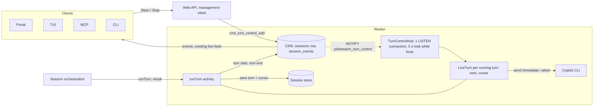

| Piece | Role | New or existing |
|---|---|---|
| `cms_turn_control_add` | Locks the session row, checks a turn is running, writes `user.steer` or `user.stop`, notifies. | New procedure |
| Session row | `active_turn_index` (the running turn) exists. `turn_high` marks turns that listen for controls. | One new column |
| `TurnControlHub` | One dedicated LISTEN connection per worker. Wakes the right turn. Looks every 5 s while the worker runs a turn. | New, worker |
| `LiveTurn` | One per running turn: an apply loop and two numbers, `sent` and `cursor`. | New, worker |
| `runTurn` | Today's order, with turn start, the cursor in the save, and turn end. | Changed |
| Turn end | Writes one outcome per open control. Idempotent. Returns late steers. | New procedure |
| Orchestration | No Stop race on the new version. Runs late steers with the next turn. | New version 1.0.81 |

### 2.3 Key decisions

1. **Stop and Steer are session events.** One durable write, which the worker
   reads and the transcript shows. No new table.
2. **Notifications only say "look".** They carry no data. Correctness comes from
   reading events by position; notifications only make it fast.
3. **The cursor lives with the conversation.** It is in memory while the
   conversation is live, inside the saved turn when the turn is saved, and gone
   when the conversation is lost. It is never stored on its own.
4. **Outcomes are written once, at turn end, from the saved cursor.** No
   delivery state machine.
5. **duroxide stays the only owner of work.** No CMS ownership or attempt
   record. A stale worker is cancelled by duroxide, and only one save of a turn
   can win.
6. **No cost for turns without controls.** The existing end-of-turn write
   reports whether the turn had any control. If it had none, turn end is
   skipped.

### 2.4 What does not change

- The orchestration still runs one `runTurn` activity per turn.
- Today's abort code (`abortWarmSessionTurn`) still stops the CLI.
- The snapshot protocol, its store-wins rules and its already-committed
  recovery.
- Ordinary messages, queued prompts and their outbox behaviour.
- Older orchestration versions keep today's Stop path for sessions that run on
  them.

## 3. Sequence diagrams

The diagrams use the turn steps T1 to T9 of `runTurn`:

| Step | What | New? |
|---|---|---|
| T1 | Load the saved conversation (`runTurnPreamble`). | no |
| T2 | Budget and workspace gates. A refused turn returns here. | no |
| T3 | **Turn start**: mark the turn running, return its open controls. | replaces `setActiveTurnIndex` |
| T4 | Model run. The live loop applies new controls. | loop is new |
| T5 | Settle: close the send gate, wait for unconfirmed steers. | new |
| T6 | Existing end-of-turn write. Clears the running turn, so new controls are refused. Now also reports whether the turn has open controls. | one more return value |
| T7 | Existing save. Carries the cursor when it is not 0. Skipped for a stopped turn, as today. | one more field |
| T8 | **Turn end**: one outcome per open control. Runs only when the turn has controls. | new |
| T9 | duroxide records the activity result. | no |

### 3.1 A normal turn without controls

The turn makes exactly today's calls. Turn start replaces today's "set running
turn" call. Turn end is skipped.

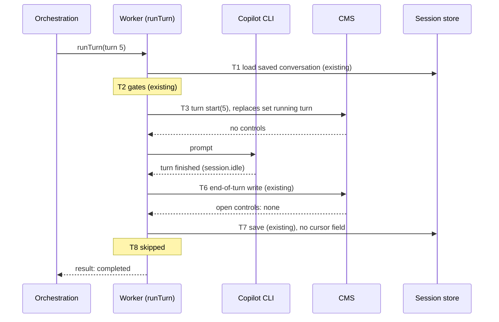

### 3.2 Steer during a turn

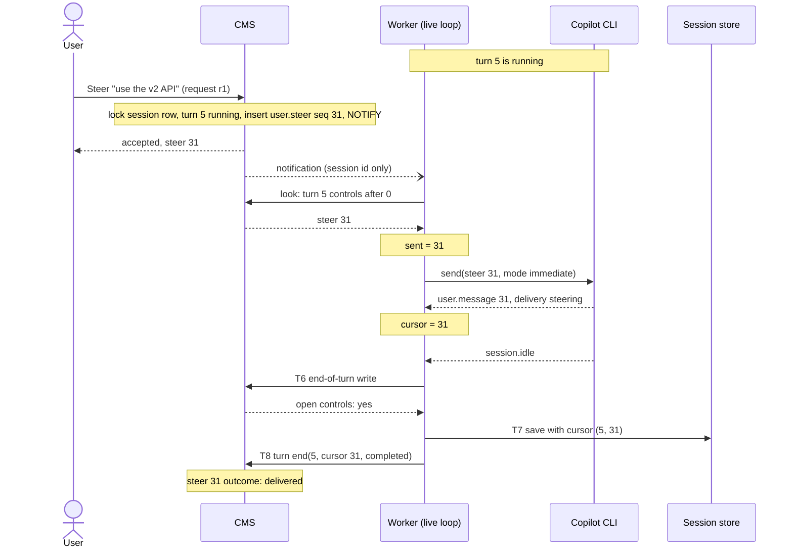

### 3.3 Stop during a turn

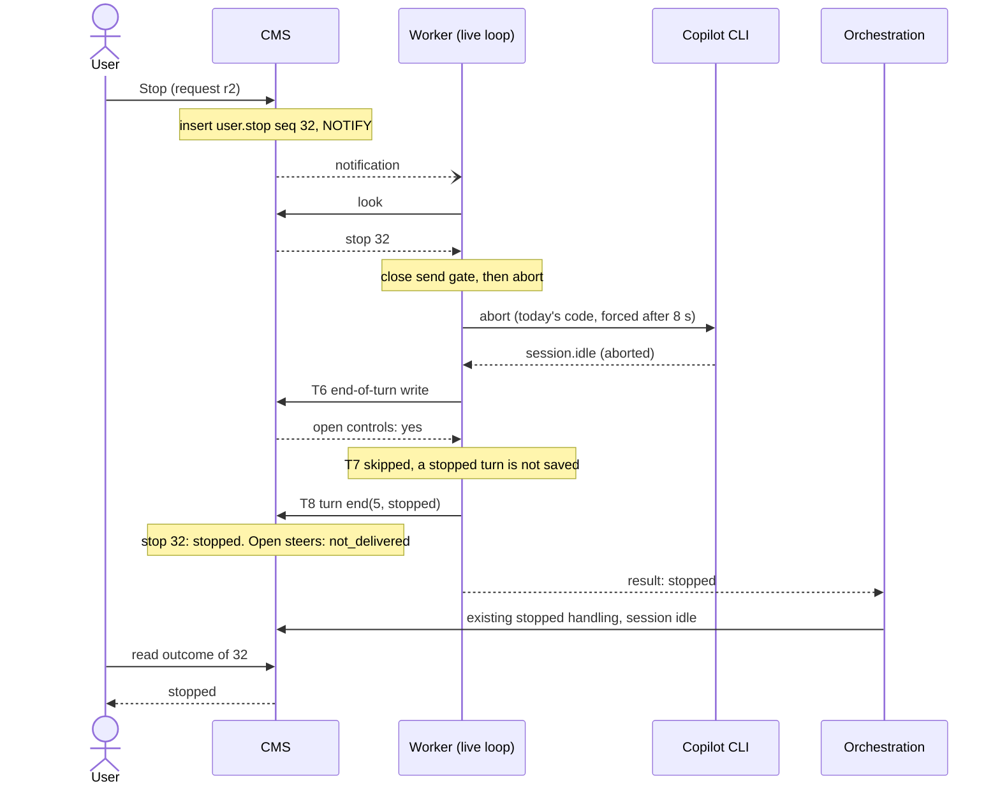

### 3.4 A control arrives as the turn ends

Turn end and control add both lock the session row, so one of them always
happens first.

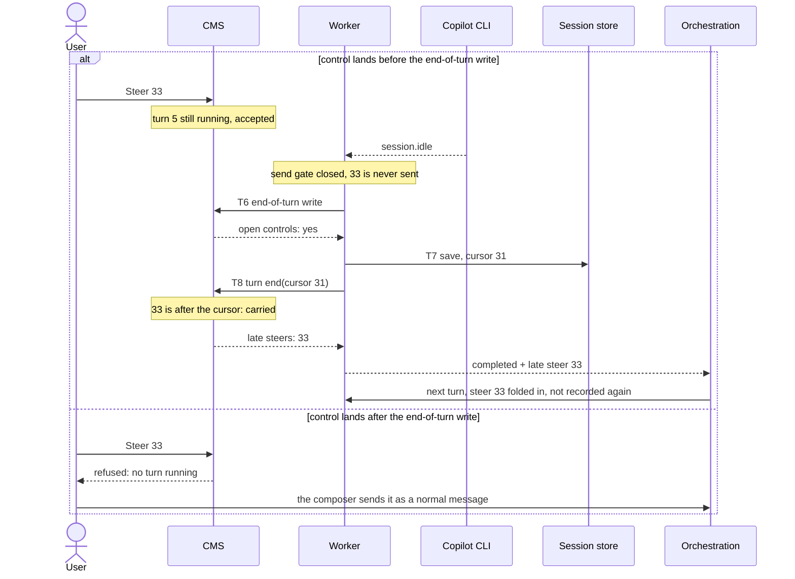

A Stop in the first branch is answered "too late", and it also cancels the
carry: open steers become "not delivered" instead of starting a new turn
(decision D5). A Stop in the second branch is answered "nothing to stop".

### 3.5 A worker crashes, and the user stops or steers meanwhile

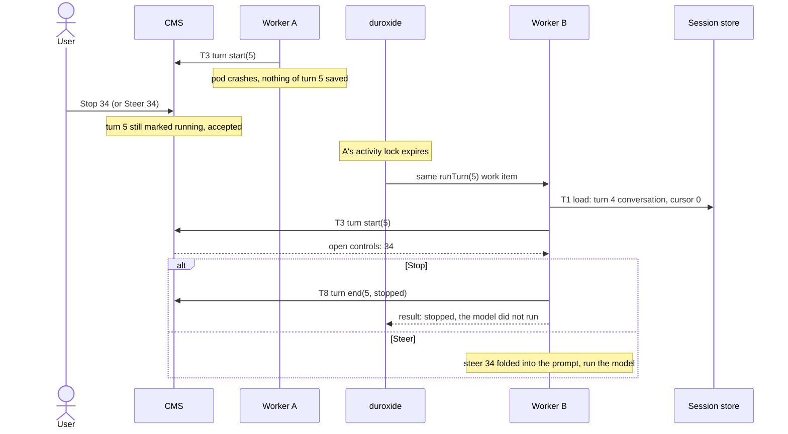

### 3.6 Crash after the end-of-turn write, before the save

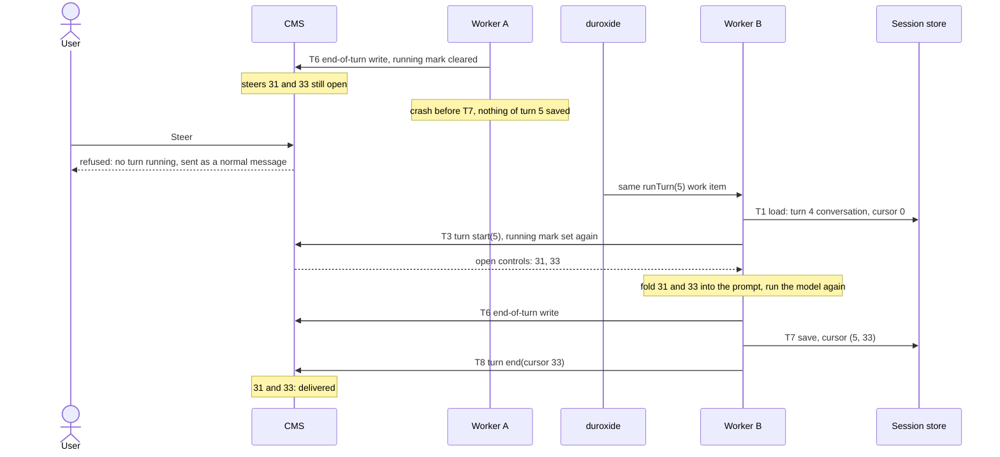

The conversation that held the steers was lost, so the surviving one gets each
of them once. The cost is one model re-run, the same as for any crash today.

### 3.7 Crash after the save, before turn end

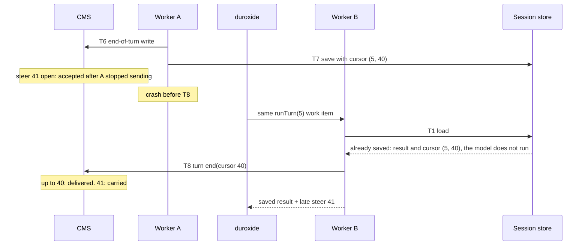

### 3.8 Crash after turn end, before duroxide records the result

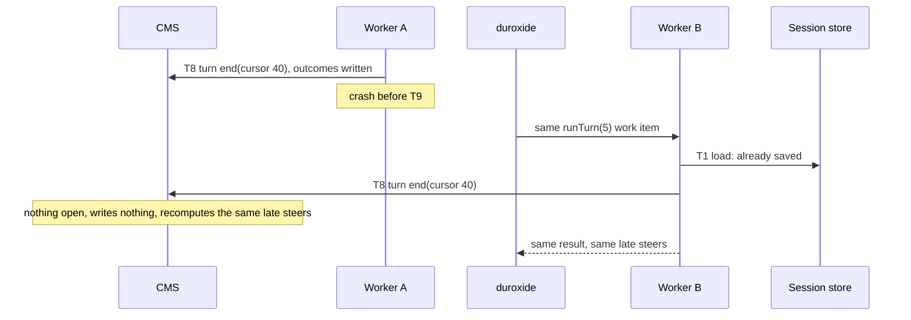

A stopped turn is not saved. Its retry finds the durable "stopped" outcome at
turn start and returns "stopped" again.

### 3.9 A stale worker comes back

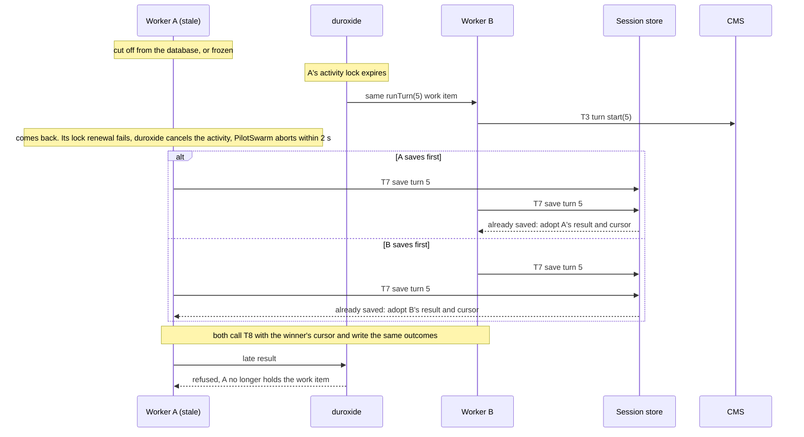

Residual risk, documented and accepted: A applies a Stop and reaches T8 in the
moment before it observes its cancellation, while B had already finished the
turn. The Stop then reads "stopped" on a turn that completed. Nothing is lost
silently.

### 3.10 Duplicate and lost notifications

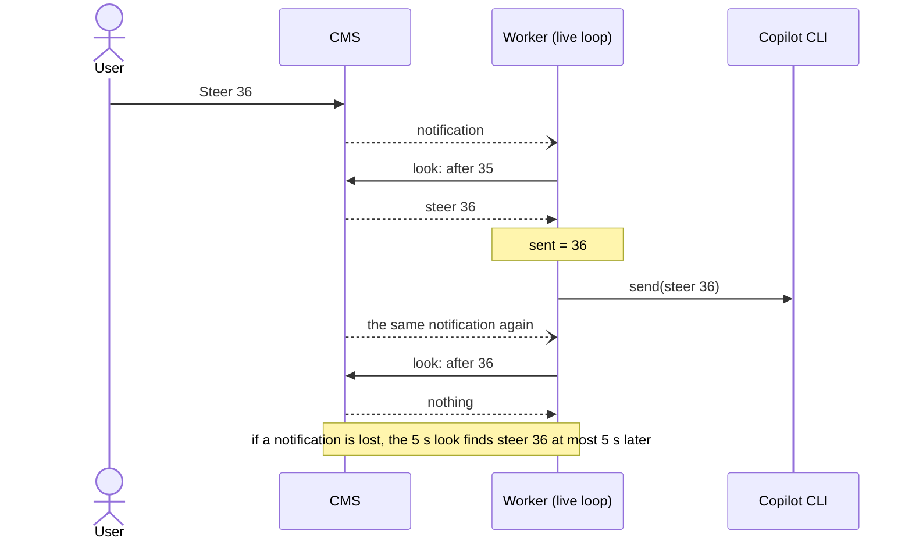

### 3.11 The turn returns an error

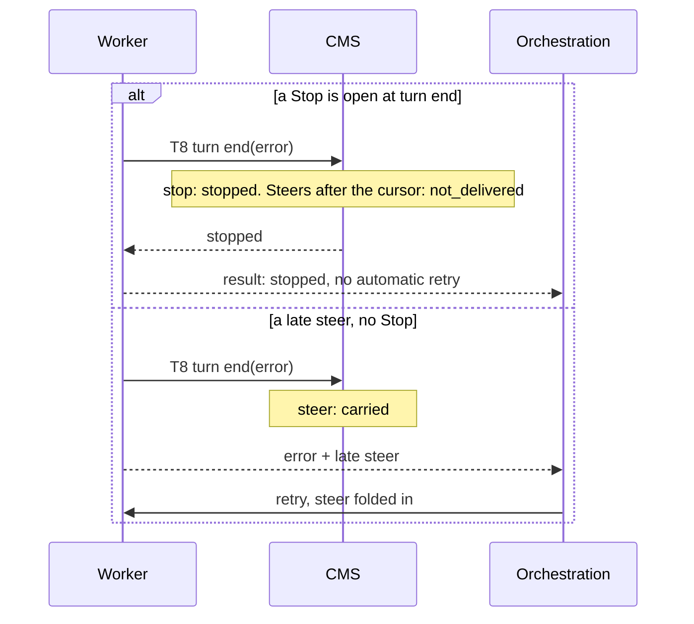

### 3.12 A refused turn, and a turn the orchestration gives up on

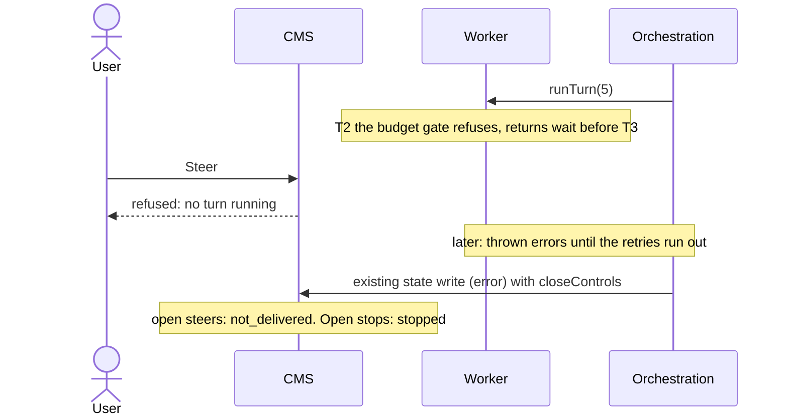

## 4. Component design

### 4.1 CMS schema

One migration, `0082_turn_control`, with its `migrations/0082_diff.md` companion
file. No new table and no new index.

| Item | Change |
|---|---|
| `sessions.turn_high` | New. `INTEGER NOT NULL DEFAULT -1`. The highest turn started on the new path. It never goes down. It refuses a late, stale start of an older turn, and `turn_high = active_turn_index` marks a running turn that listens for controls. |
| `sessions.active_turn_index` | Exists (migration 0024). Set by turn start. Cleared by the existing end-of-turn write and by any state change away from "running". |
| `user.steer` event | `{ turn, text, requestId, actor }` |
| `user.stop` event | `{ turn, text, requestId, actor }`. `text` is the reason. |
| `session.control_outcome` event | `{ seq, turn, outcome }`. `outcome` is one of `delivered`, `carried`, `not_delivered`, `stopped`, `too_late`. |
| Procedures | New: `cms_turn_control_add`, `cms_turn_start`, `cms_turn_look`, `cms_turn_end`, and the helper `cms_turn_open_controls`. Changed: `cms_complete_turn_writeback` returns a boolean; `cms_update_session` accepts `closeControls`. |
| Notification | Channel `pilotswarm_turn_control`, payload `{ schema, sessionId }`. Not stored. |
| Index | None new. Every read uses `session_events (session_id, event_type, seq)` (`cms-migrations.ts:7356`). |

A control is **open** while it has no `session.control_outcome` event.

### 4.2 Stored procedures

All access goes through stored procedures, as the repository requires. `${s}` is
the CMS schema, as in `cms-migrations.ts`.

```sql
ALTER TABLE ${s}.sessions ADD COLUMN IF NOT EXISTS turn_high INTEGER NOT NULL DEFAULT -1;

-- Open controls of one turn, in position order.
CREATE OR REPLACE FUNCTION ${s}.cms_turn_open_controls(p_session TEXT, p_turn INT)
RETURNS TABLE (seq BIGINT, kind TEXT, text TEXT) LANGUAGE sql STABLE AS $$
    SELECT e.seq, substr(e.event_type, 6), e.data->>'text'
      FROM ${s}.session_events e
     WHERE e.session_id = p_session
       AND e.event_type IN ('user.steer', 'user.stop')
       AND (e.data->>'turn')::int = p_turn
       AND NOT EXISTS (SELECT 1 FROM ${s}.session_events o
                        WHERE o.session_id = p_session
                          AND o.event_type = 'session.control_outcome'
                          AND (o.data->>'seq')::bigint = e.seq)
     ORDER BY e.seq;
$$;

-- 1. Client: add a Steer or a Stop.
CREATE OR REPLACE FUNCTION ${s}.cms_turn_control_add(
    p_session TEXT, p_kind TEXT, p_text TEXT, p_request_id TEXT, p_actor JSONB
) RETURNS JSONB LANGUAGE plpgsql AS $$
DECLARE
    v_active INT; v_high INT; v_prior RECORD; v_seq BIGINT;
BEGIN
    IF p_kind NOT IN ('steer', 'stop') OR coalesce(p_request_id, '') = '' THEN
        RAISE EXCEPTION 'invalid turn control';
    END IF;
    SELECT active_turn_index, turn_high INTO v_active, v_high
      FROM ${s}.sessions WHERE session_id = p_session AND deleted_at IS NULL FOR UPDATE;
    IF NOT FOUND THEN RETURN '{"refused":"not_found"}'; END IF;

    -- A retry with the same request id gets the first answer.
    SELECT seq, event_type, data INTO v_prior FROM ${s}.session_events
     WHERE session_id = p_session AND event_type IN ('user.steer', 'user.stop')
       AND data->>'requestId' = p_request_id LIMIT 1;
    IF FOUND THEN
        IF v_prior.event_type <> 'user.' || p_kind OR v_prior.data->>'text' IS DISTINCT FROM p_text THEN
            RETURN '{"refused":"request_id_reused"}';
        END IF;
        RETURN jsonb_build_object('seq', v_prior.seq, 'turn', v_prior.data->'turn', 'repeat', true);
    END IF;

    IF v_active IS NULL THEN RETURN '{"refused":"no_turn"}'; END IF;
    IF v_high IS DISTINCT FROM v_active THEN RETURN '{"refused":"legacy_turn"}'; END IF;
    IF (SELECT count(*) FROM ${s}.cms_turn_open_controls(p_session, v_active)) >= 20 THEN
        RETURN '{"refused":"too_many"}';
    END IF;

    INSERT INTO ${s}.session_events (session_id, event_type, data)
    VALUES (p_session, 'user.' || p_kind, jsonb_build_object(
        'turn', v_active, 'text', p_text, 'requestId', p_request_id, 'actor', p_actor))
    RETURNING seq INTO v_seq;
    PERFORM pg_notify('pilotswarm_turn_control',
        json_build_object('schema', '${schema}', 'sessionId', p_session)::text);
    RETURN jsonb_build_object('seq', v_seq, 'turn', v_active);
END $$;

-- 2. Worker: turn start. Called where setActiveTurnIndex is called today, after the gates.
CREATE OR REPLACE FUNCTION ${s}.cms_turn_start(p_session TEXT, p_turn INT)
RETURNS JSONB LANGUAGE plpgsql AS $$
DECLARE v_high INT;
BEGIN
    SELECT turn_high INTO v_high FROM ${s}.sessions WHERE session_id = p_session FOR UPDATE;
    IF p_turn < v_high THEN RETURN '{"stale":true}'; END IF;     -- a newer turn already started
    UPDATE ${s}.sessions SET active_turn_index = p_turn, turn_high = p_turn, updated_at = now()
     WHERE session_id = p_session;
    RETURN jsonb_build_object(
        'stopped', EXISTS (SELECT 1 FROM ${s}.session_events
                            WHERE session_id = p_session AND event_type = 'session.control_outcome'
                              AND (data->>'turn')::int = p_turn AND data->>'outcome' = 'stopped'),
        'controls', coalesce((SELECT jsonb_agg(to_jsonb(c)) FROM ${s}.cms_turn_open_controls(p_session, p_turn) c), '[]'));
END $$;

-- 3. Worker: one look for all its running turns.
CREATE OR REPLACE FUNCTION ${s}.cms_turn_look(p_turns JSONB)     -- [{session, turn, after}]
RETURNS TABLE (session_id TEXT, turn INT, controls JSONB) LANGUAGE sql STABLE AS $$
    SELECT t.session, t.turn,
           coalesce((SELECT jsonb_agg(to_jsonb(c)) FROM ${s}.cms_turn_open_controls(t.session, t.turn) c
                      WHERE c.seq > t.after), '[]')
      FROM jsonb_to_recordset(p_turns) AS t(session TEXT, turn INT, after BIGINT);
$$;

-- 4. Worker: turn end. After the save. Idempotent: everything is recomputed from outcomes.
CREATE OR REPLACE FUNCTION ${s}.cms_turn_end(
    p_session TEXT, p_turn INT, p_cursor BIGINT, p_result TEXT     -- 'stopped' | 'error' | 'other'
) RETURNS JSONB LANGUAGE plpgsql AS $$
DECLARE v_stop_open BOOLEAN;
BEGIN
    PERFORM 1 FROM ${s}.sessions WHERE session_id = p_session FOR UPDATE;
    v_stop_open := EXISTS (SELECT 1 FROM ${s}.cms_turn_open_controls(p_session, p_turn) WHERE kind = 'stop');
    INSERT INTO ${s}.session_events (session_id, event_type, data)
    SELECT p_session, 'session.control_outcome', jsonb_build_object('seq', c.seq, 'turn', p_turn, 'outcome',
        CASE
            WHEN c.kind = 'stop' AND p_result IN ('stopped', 'error') THEN 'stopped'
            WHEN c.kind = 'stop'                                     THEN 'too_late'
            WHEN p_result = 'stopped'                                THEN 'not_delivered'
            WHEN c.seq <= p_cursor                                   THEN 'delivered'
            WHEN v_stop_open                                         THEN 'not_delivered'
            ELSE 'carried'
        END)
      FROM ${s}.cms_turn_open_controls(p_session, p_turn) c;
    UPDATE ${s}.sessions SET active_turn_index = NULL
     WHERE session_id = p_session AND active_turn_index = p_turn;
    RETURN jsonb_build_object(
        'stopped', EXISTS (SELECT 1 FROM ${s}.session_events
                            WHERE session_id = p_session AND event_type = 'session.control_outcome'
                              AND (data->>'turn')::int = p_turn AND data->>'outcome' = 'stopped'),
        'late', coalesce((SELECT jsonb_agg(jsonb_build_object('seq', s.seq, 'text', s.data->>'text') ORDER BY s.seq)
                            FROM ${s}.session_events s
                            JOIN ${s}.session_events o ON o.session_id = s.session_id
                             AND o.event_type = 'session.control_outcome'
                             AND (o.data->>'seq')::bigint = s.seq AND o.data->>'outcome' = 'carried'
                           WHERE s.session_id = p_session AND s.event_type = 'user.steer'
                             AND (s.data->>'turn')::int = p_turn), '[]'));
END $$;
```

Changed procedures:

- `cms_complete_turn_writeback` returns `BOOLEAN` instead of `VOID`. The
  migration drops and recreates it, because PostgreSQL cannot change a return
  type in place. After its existing `UPDATE` of the session row, which takes the
  row lock and clears `active_turn_index`, it returns
  `EXISTS (SELECT 1 FROM cms_turn_open_controls(p_session_id, p_turn_index))`.
  The order matters: the check runs after the lock is taken, so a control added
  just before is seen, and no control can be added after. Old workers call it
  as before and ignore the return value.
- `cms_update_session` accepts `p_updates.closeControls = true`. It writes an
  outcome for every open control of the session: `stopped` for a Stop,
  `not_delivered` for a Steer. Only the orchestration's give-up and terminal
  paths set it.

### 4.3 Management client, Web API, MCP and CLI

A new management operation lands on `PilotSwarmManagementClient` first, then
the Web API route, then MCP, CLI and the user interfaces, as the repository
requires.

```ts
// packages/sdk/src/management-client.ts
async steerSessionTurn(sessionId: string, opts: { text: string; requestId: string }): Promise<SteerTurnResult> {
    const r = await this._catalog.turnControlAdd(sessionId, "steer", opts.text, opts.requestId, actor);
    if (r.refused) return { outcome: r.refused };    // no_turn | legacy_turn | not_found | too_many | request_id_reused
    return { outcome: "accepted", steerId: r.seq, turn: r.turn };
}

async stopSessionTurn(sessionId: string, opts?: { requestId?: string; reason?: string; timeoutMs?: number }): Promise<StopTurnResult> {
    const requestId = opts?.requestId ?? newRequestId();   // pass one to make retries safe
    const r = await this._catalog.turnControlAdd(sessionId, "stop", opts?.reason ?? "Stopped by user", requestId, actor);
    if (r.refused === "no_turn") return { outcome: "no_active_turn" };
    if (r.refused === "legacy_turn") return this.legacyStopSessionTurn(sessionId, opts);   // today's event path
    if (r.refused) return { outcome: "no_active_turn", detail: r.refused };
    return this.waitForControlOutcome(sessionId, r.seq, opts?.timeoutMs ?? 30_000);         // stopped | too_late | timeout
}
```

| Surface | Change |
|---|---|
| Web API | New `POST /management/sessions/:sessionId/steer` (access `session:write`, the same as sending a message). `stop-turn` accepts `options.requestId`. |
| `StopTurnResult` | Gains `too_late`. `stop_forced` is no longer reported separately on the new path: a forced settle is still a stopped turn, and the trace records how it was stopped. |
| MCP | New `steer_session_turn` tool next to the existing Stop tool. |
| CLI | Where the CLI exposes Stop, add Steer with the same argument shape. |
| Client contract | A client retries `steer` or `stop` with the same `requestId` only after a transport failure. After a definite `no_turn`, the composer sends the text as a normal message with a new client message id and never retries that request id. |
| Size limit | The same text limit as `sendMessage`. |

### 4.4 Worker: TurnControlHub

One per worker process. PostgreSQL LISTEN is a core PostgreSQL feature, which
the repository's provider rules allow in core.

```ts
// packages/sdk/src/turn-control.ts (new)
export class TurnControlHub {
    private live = new Map<string, LiveTurn>();              // "session/turn" -> the exact running turn
    private listener: pg.Client | null = null;

    async start() {
        await this.connect();                                // one dedicated pg.Client, keepAlive on
        this.timer = setInterval(() => { if (this.live.size) void this.lookAll(); }, 5_000);
        this.timer.unref?.();
    }
    private async connect() {                                // reconnect with backoff, as in the portal's live-plane relay
        const c = new pg.Client({ ...cmsListenClientConfig, keepAlive: true });
        c.on("notification", (m) => {
            const p = JSON.parse(m.payload ?? "{}");
            if (p.schema === this.schema) void this.lookAll(p.sessionId);
        });
        c.on("error", () => this.reconnectSoon());
        c.on("end", () => this.reconnectSoon());
        await c.connect();
        await c.query("LISTEN pilotswarm_turn_control");
        this.listener = c;
    }
    register(t: LiveTurn) { this.live.set(t.key, t); }
    unregister(t: LiveTurn) { if (this.live.get(t.key) === t) this.live.delete(t.key); }

    private async lookAll(sessionId?: string) {
        const turns = [...this.live.values()].filter((t) => !sessionId || t.sessionId === sessionId);
        if (turns.length === 0) return;
        for (const row of await this.cms.turnLook(turns.map((t) => t.lookArgs())))
            this.live.get(`${row.sessionId}/${row.turn}`)?.enqueue(row.controls);
    }
    async stop() { clearInterval(this.timer); await this.listener?.end().catch(() => {}); }   // from worker.stop()
}
```

The 5 s look covers a notification connection that dies silently. The portal's
LISTEN relay has a periodic liveness probe for the same reason
(`packages/app/web/api/canvas-plane.js:126`).

### 4.5 Worker: LiveTurn

One per running turn. `sent` stops a duplicate wake-up from sending twice.
`cursor` is the last steer the CLI confirmed; only `cursor` is saved.

```ts
export class LiveTurn {
    sent: number; cursor: number;
    private chain: Promise<void> = Promise.resolve();
    constructor(readonly sessionId: string, readonly turn: number, start: number, private session: ManagedSession) {
        this.sent = this.cursor = start;
    }
    get key() { return `${this.sessionId}/${this.turn}`; }
    lookArgs() { return { session: this.sessionId, turn: this.turn, after: this.sent }; }

    enqueue(controls: TurnControl[]) {                       // one at a time, in position order
        this.chain = this.chain.then(() => this.apply(controls)).catch((err) => this.session.failTurn(err));
    }
    private async apply(controls: TurnControl[]) {
        for (const c of controls) {
            if (c.seq <= this.sent) continue;                // a duplicate wake-up
            if (!this.session.steerGateOpen()) return;       // settling or stopping: turn end labels the rest
            this.sent = c.seq;
            if (c.kind === "stop") {
                this.session.closeSteerGate();               // never send after an abort (spike cell C5b)
                await this.manager.abortWarmSessionTurn(this.sessionId, { reason: c.text });
                return;
            }
            await this.session.sendSteer(c.text, () => { this.cursor = Math.max(this.cursor, c.seq); });
        }
    }
}
```

### 4.6 ManagedSession: send gate and settlement

`ManagedSession.runTurn` gains a per-turn **send gate** and a small set of sent
but unconfirmed steers.

```ts
// packages/sdk/src/managed-session.ts
async sendSteer(text: string, onConfirmed: () => void) {
    const watch = this.watchUserMessages();                  // armed before send: the event can come first
    const id = await this.copilotSession.send({ prompt: text, mode: "immediate" });   // a throw fails the turn
    if (watch.seen(id)) onConfirmed(); else this.unconfirmed.set(id, onConfirmed);
}
// event handler: user.message with a messageId in `unconfirmed` -> call its callback, remove it
// settlement, on session.idle:
//   1. close the send gate (synchronously, before anything else)
//   2. if `unconfirmed` is empty, settle the turn
//   3. else wait for the confirmations and the following session.idle, bounded by the turn timeout
```

Why: a send just before the run's final idle is answered in the same run, but a
send after the idle starts a new CLI run (spike cells C4a to C4c). Closing the
gate at idle, and waiting for steers already sent, keeps every steer inside the
turn that collects its events.

A failed send fails the turn. The retry starts from the saved conversation and
folds the still-open steer into its prompt.

### 4.7 runTurn activity

The new path runs under new activity names, routed by a capability tag (see
section 6). The order is today's order with three additions.

```ts
// packages/sdk/src/session-proxy.ts: runTurnV4 / runTurnEpochV4
const pre = await runTurnPreamble(lifecycle);                          // T1 (existing)
if (pre.kind === "already-committed") {                                 // an earlier delivery saved this turn
    return finishTurn(pre.result, savedCursor(pre.result, turn));       // T8 only
}
// T2: existing budget and workspace gates. A refused turn returns here, before turn start.
// existing: getOrCreate, turn sentinel, user.message, state=running
if (activityCtx.isCancelled()) throw cancelledError();
const st = await cms.turnStart(S, turn);                                // T3, replaces setActiveTurnIndex
if (st.stale) throw staleTurnError();                                   // duroxide would refuse its result anyway
let start = 0;
if (st.stopped || st.controls.length > 0) {                             // the saved cursor is read only when needed
    start = savedCursor(readTurnCommitFile(sessionDir)?.result, turn);
    const open = st.controls.filter((c) => c.seq > start);
    if (st.stopped || open.some((c) => c.kind === "stop")) return finishTurn({ type: "stopped" }, start);
    prompt = foldSteers(prompt, open);                                  // folded, not recorded again
    start = Math.max(start, ...open.map((c) => c.seq));
}
const live = new LiveTurn(S, turn, start, session);
hub.register(live);
let result: TurnResult;
try { result = await session.runTurn(prompt); }                         // T4, T5
finally { hub.unregister(live); }

const hasControls = await completeTurnWriteback(result);                // T6: true | false | undefined (write failed)
let cursor = live.cursor;
if (result.type !== "stopped" && lifecycle) {                           // T7: existing save, cursor only when not 0
    const toSave = cursor > 0 ? { ...result, controlCursor: { turn, cursor } } : result;
    const c = await runTurnCommit(lifecycle, baseVersion, toSave);
    if (c.alreadyCommitted) { result = c.storedResult; cursor = savedCursor(c.storedResult, turn); }
    else if (!c.published) cursor = 0;                                  // superseded: nothing of this turn survives
}
if (hasControls === false) return result;                               // no controls: T8 skipped
return finishTurn(result, cursor);                                      // T8

async function finishTurn(result: TurnResult, cursor: number) {
    if (activityCtx.isCancelled()) throw cancelledError();
    const kind = result.type === "stopped" ? "stopped" : result.type === "error" ? "error" : "other";
    const end = await cms.turnEnd(S, turn, cursor, kind);              // retried in place on a database error
    if (end.stopped) return { type: "stopped", reason: "Stopped by user" };
    return end.late.length > 0 ? { ...result, lateSteers: end.late } : result;
}

function savedCursor(saved: any, turn: number) {
    return saved?.controlCursor?.turn === turn ? saved.controlCursor.cursor : 0;
}
```

Notes:

- `readTurnCommitFile` reads `.ps-turn-commit.json` (`snapshot-protocol.ts:30`),
  which every saved turn writes into the session folder and which a hydrated
  snapshot contains. A conversation saved for an earlier turn holds none of
  this turn's steers, so its cursor counts as 0.
- Turn end is not best-effort: unlike the projection writes around it, a
  failure is retried in place and then fails the activity, so the turn retries.
- PilotSwarm already polls `activityCtx.isCancelled()` every 2 s during a turn
  and aborts the CLI (`session-proxy.ts:3777`).

### 4.8 Session lifecycle and the cursor

| The conversation is... | Its cursor is... | So the next attempt... |
|---|---|---|
| live in a worker | in memory, in `LiveTurn` | continues from it |
| saved | inside the saved turn: `controlCursor: { turn, cursor }`, only when not 0 | uses the saved result and cursor without running the model |
| saved by another attempt first | the winner's | adopts the winner's result and cursor |
| lost, stopped or superseded | 0 for this turn | folds every open steer into its prompt |

No change to the snapshot protocol: the cursor is one optional field of the
result that the turn-commit file already stores.

### 4.9 Orchestration

A new version, 1.0.81. Version 1.0.80 is frozen in `orchestration_1_0_80/` and
stays registered, so sessions already running replay against their original
yield sequence.

```ts
// orchestration/turn.ts, 1.0.81
const turnTask = runtime.session.runTurn(prompt, ..., {
    ...input,
    ...(state.carriedSteers?.length ? { carriedSteers: state.carriedSteers } : {}),
});                                                    // routed to runTurnV4 with tag pilotswarm.turn-control.v1
const turnResult = yield turnTask;                     // removed: ctx.race, stopTurn.<n> queue, abortTurn call

// result handling
if (result.lateSteers?.length) state.carriedSteers = [...(state.carriedSteers ?? []), ...result.lateSteers];
// case "stopped": unchanged (session.turn_stopped event, idle, timers and cron kept)
// give-up paths (retries exhausted, non-retryable, auth, fatal) and terminal paths:
yield runtime.manager.updateCmsState(sessionId, "error", message, { closeControls: true });
```

Carried steers follow the existing `budgetStash` pattern exactly:

- they ride in the continue-as-new input (`orchestration/lifecycle.ts:590`);
- the activity folds them in front of the prompt and does not record them a
  second time (`session-proxy.ts:1964`);
- they are cleared once a turn gets past the gates (`orchestration/turn.ts:1319`).

A turn that returns late steers is followed at once by a turn that carries
them, as if a user message had arrived at the moment the turn ended. If they
are the only pending work, the carried text is the prompt, the same way a
budget wake turn replays held prompts. If the turn ended with a question to the
user, the carried steers ride with the answer (decision D3).

### 4.10 Portal and TUI

- The composer offers Steer while a turn runs and the session's turn listens
  for controls. Reuse the composer action from PR #142.
- The transcript shows `user.steer` as a user message with a "steer" badge and
  its outcome: Delivered, Will run next, Not delivered, Stopped, Too late. A
  `user.stop` shows as a short system line with its outcome.
- The TUI and portal stay in parity. Any keybinding change updates every
  keybinding surface listed in the repository instructions, and
  `.github/skills/pilotswarm-tui/SKILL.md` is updated.

### 4.11 Feature flag and observability

- The `sessions.steering` flag (default off) gates the Steer action and the
  steer API. Stop takes the new path whenever the running turn listens for
  controls, regardless of the flag, because version 1.0.81 no longer races the
  old Stop event.
- All signals are session events: request, outcome and their timestamps. Stop
  latency is the outcome's `createdAt` minus the Stop's `createdAt`. The
  existing event read APIs and the tuner's event tools already reach them. No
  new metric tables.

### 4.12 Surfaces to update in the same change

- Canonical docs: management client, Web API reference, MCP tools, CLI.
- `examples/devops-command-center/` and `templates/builder-agents/` where they
  show Stop.
- `scripts/local-pilotswarm.sh`: no new setting is needed; LISTEN works against
  the local PostgreSQL container. Verify Steer by hand there.

## 5. Recovery and edge cases

### 5.1 Every crash point

After a crash, duroxide gives the same `runTurn` input to another worker once
the activity lock expires.

| Crash between | Left behind | Next attempt | Verdict |
|---|---|---|---|
| T1 and T3 | nothing new | runs normally | as today |
| T3 and T6 | turn marked running, controls open | starts from the previous saved turn. Turn start returns all open controls. A Stop ends the turn without a model run. Steers are folded in. | correct (3.5) |
| T6 and T7 | running mark cleared, controls open, nothing saved | as above. Turn start marks the turn running again. | correct, one model re-run (3.6) |
| T7 and T8 | turn saved with its cursor, controls open | existing "already saved" path, no model run, then turn end with the saved cursor | correct (3.7) |
| T8 and T9 | saved, outcomes written | "already saved". Turn end writes nothing and returns the same answer. | correct (3.8) |
| stopped turn, before T8 | Stop open, not saved | turn start sees the Stop, turn end (stopped) | correct |
| stopped turn, after T8 | Stop outcome "stopped" | turn start returns stopped | correct |
| thrown error | controls open | the orchestration retries the same turn index. Turn start returns them. | correct (3.12) |
| session without a store | no saved conversation | re-runs from nothing | as today (D4) |

The reverse order, turn end before the save, is wrong in every form: a crash
between them leaves outcomes for a conversation that was never saved. Keep
save, then turn end.

### 5.2 Outcomes written by turn end

| Control | Turn stopped | Turn returned an error | Turn finished otherwise |
|---|---|---|---|
| Steer at or below the cursor | not_delivered | delivered | delivered |
| Steer after the cursor, no Stop open | not_delivered | carried, into the retry | carried, into the next turn |
| Steer after the cursor, a Stop open | not_delivered | not_delivered | not_delivered |
| Stop | stopped | stopped, no automatic retry | too_late |

A turn the orchestration gives up on gets `not_delivered` for its open steers
and `stopped` for its open Stops.

### 5.3 Races

| Race | Resolution |
|---|---|
| Control add and the end-of-turn write | Both lock the session row. Before: the control is open and turn end labels it. After: refused, "no turn running". |
| Control add and turn end | Both lock the row. Turn end only closes controls it sees. A control added after turn end is refused, because the running mark is already cleared. |
| Two clients steer at once | Serialized by the row lock. Positions follow the order. |
| Steer and Stop together | Applied in position order. After a Stop, the gate is closed, so later steers are labelled by turn end. |
| Client retry with the same request id | Returns the first answer. A different kind or text under the same id is refused. |
| Stop between Send and the turn's start | No turn is running yet: "nothing to stop", as today. |
| Stop during a thrown-error retry backoff | Accepted, because the running mark is still set. The retry's turn start applies it. If the retries run out, the give-up path labels it "stopped". |
| Delayed, stale turn start | Refused when a newer turn already started (`turn_high`). |
| Same-turn delivery started later than the current one | Duroxide cancels the stale delivery when its lock renewal fails, and refuses its result. Both deliveries read the same controls. Cost: at most one wasted model run. |

## 6. Rollout and compatibility

1. **Migration 0082.** Additive: one column, new procedures, a new return
   value. Old workers keep working against it.
2. **Workers and the portal/Web API together.** New workers register
   `runTurnV4` and `runTurnEpochV4` and declare the capability tag
   `pilotswarm.turn-control.v1`, the same pattern as
   `pilotswarm.agent-handoff.v2` (`activity-routing.ts`). Version 1.0.81 routes
   its turns with that tag, so an old worker never runs a turn whose Stop no
   longer goes through the orchestration.
3. **Old sessions.** Sessions on 1.0.80 or older keep today's Stop. Their turns
   never set `turn_high`, so the management client gets `legacy_turn` and uses
   the event path.
4. **Flag.** Turn on `sessions.steering` to show Steer.
5. **Rollback.** As for any orchestration version: keep workers that can run
   1.0.81 until its sessions drain, or roll back the database with the code.
   A database that ran draft PR #142's migrations 0082 to 0087 is not
   compatible: its numbers collide with this migration. That affected only
   development and test databases; use a fresh database there.

Recommended dependency: duroxide-node 0.2.1 or later (duroxide 0.1.32,
duroxide-pg 0.1.36). See appendix 10.3.

## 7. Test plan

All suites run in parallel as today. Tests use the default model unless they
are about models. New test files are added to `scripts/run-tests.sh` and the
`test:local` script.

### 7.1 Stored procedures

`test/local/turn-control-cms.test.js`, against real PostgreSQL:

| Test | Checks |
|---|---|
| add, accepted | event written with turn, text, request id, actor; notification sent |
| add, refusals | `no_turn`, `legacy_turn`, `not_found`, `too_many` (21st open control), `request_id_reused` |
| add, retry | same request id returns the first `seq` and `repeat: true` |
| turn start | sets `active_turn_index` and `turn_high`; returns open controls in order; `stale` for an older turn; `stopped` after a stopped outcome |
| look | returns only controls after `after`, per (session, turn) |
| turn end | every row of the outcome table in 5.2; idempotent: a second call writes nothing and returns the same `late` and `stopped` |
| end-of-turn write | returns true only when the turn has open controls; ordering against a concurrent add on a second connection (lock first, then check) |
| add and end-of-turn write race | two connections, both orders, with `pg_sleep` inside one transaction |
| give-up close | `closeControls` labels open steers `not_delivered` and open stops `stopped` |
| cost | a turn with no controls: the call count equals today's (T3 replaces one call, T8 is not called) |

### 7.2 ManagedSession and LiveTurn

Unit tests with a fake Copilot session (`test/unit`):

- the gate closes at `session.idle` before anything else;
- a sent, unconfirmed steer delays settlement until its `user.message` and the
  next idle;
- a `user.message` that arrives before `send()` resolves still confirms the steer;
- Stop closes the gate before abort; a later steer is not sent;
- a send that throws fails the turn;
- duplicate controls (`seq <= sent`) are skipped; order is kept.

### 7.3 Integration with the real CLI

`test/local/turn-control.test.js`, real Copilot CLI, default model:

| Test | Requirement |
|---|---|
| Steer during a multi-tool turn: delivered before the next model call, outcome `delivered` | R2, R4 |
| Steer during a long tool call: delivered after the tool ends | R2 |
| Late steer (accepted after the final model call): `carried`, the next turn runs it, the transcript shows it once | R3, R4 |
| Stop during a turn: `stopped`, no retry, session idle, timers and cron kept | R1, R6 |
| Stop with a pending steer: steer `not_delivered` | R4, D2 |
| Stop when the turn already finished: `too_late`, late steers `not_delivered` | R4, D5 |
| Turn with no controls: no turn-end call, no cursor field in the saved turn | R7 |
| Lost notification (LISTEN connection killed): steer delivered within 5 s | R2 |
| Worker `stop()` closes the LISTEN connection | R7 |

### 7.4 Crash and recovery

Add fault points after T3, T6, T7 and T8 (the existing `faultPoint` mechanism in
`session-lifecycle.ts`) and run them through the existing live fault-injection
suite. Each case asserts the outcome table, the transcript, and that each steer
reaches the surviving conversation once (read the restored conversation's
events).

| Case | Section |
|---|---|
| crash after T3, then Stop / then Steer | 3.5 |
| crash after T6 | 3.6 |
| crash after T7 | 3.7 |
| crash after T8 | 3.8 |
| stopped turn, crash before and after T8 | 5.1 |
| thrown error with a Stop during the backoff | 5.3 |

### 7.5 Multiple workers and orchestration versions

- **Stale worker:** two workers; pause one mid-turn past its lock timeout; check
  that it is cancelled, that only one save wins, and that both turn ends write
  the same outcomes (3.9).
- **Replay:** the existing replay and multi-worker suites pass with 1.0.80
  frozen and 1.0.81 current.
- **Routing:** a worker without `pilotswarm.turn-control.v1` never runs
  `runTurnV4`.
- **Legacy session:** a 1.0.80 session still stops through the event path
  (`legacy_turn`).

### 7.6 Browser and TUI

In the test environment, with a real model:

- Steer appears only while a turn runs, and only with the flag on.
- Each outcome label renders, and survives a reload.
- Stop latency: 30 runs, 95th percentile at most 2 s (R1).
- Steer latency: acceptance to `user.message`, 30 runs, at most 2 s at the 95th
  percentile while the turn is between tool calls (R2).
- TUI: the same flows; keybinding and help surfaces match.

### 7.7 Providers

Repeat the CLI cells that matter (immediate send during tools, during a long
tool, at the final message, after idle, abort then send) on each model provider:
Azure AI Foundry OpenAI Responses (done in the spikes), GitHub Copilot, and
Anthropic. Record missing credentials explicitly.

### 7.8 Performance

- Look query cost at 1, 10 and 50 running turns per worker: query time and
  database CPU.
- Database connections: one more per worker; check the deployment's
  `max_connections` budget.

## 8. Decisions and open checks

### 8.1 Decisions (proposed defaults, awaiting the owner)

| ID | Decision | Proposed |
|---|---|---|
| D1 | Stop latency target | 2 s at the 95th percentile, not counting a CLI that ignores abort |
| D2 | Steers of a stopped turn | not delivered; they do not start a new turn |
| D3 | Late steers when the turn ended with a question | they ride with the user's answer |
| D4 | Sessions without a session store | today's crash behaviour; no crash guarantee for steers |
| D5 | A Stop that arrives after the turn finished | answered "too late", and it cancels any carried steers |

### 8.2 Checks before building

| Check | Status |
|---|---|
| C1. The CLI folds an "immediate" send into a running turn and confirms it with the same message id | Done on Copilot SDK 1.0.13 with CLI 1.0.83, the current pins, with an Azure AI Foundry OpenAI Responses model (appendix 10.1). Open: GitHub Copilot and Anthropic providers. |
| C2. `activityCtx.isCancelled()` turns true when the activity's lock renewal fails | Confirmed in source: duroxide cancels the activity's token when renewal fails, and duroxide-node 0.2.1 reads that token (appendix 10.3). Add a test (7.5). |
| C3. A worker can hold a LISTEN connection | Stock PostgreSQL: the portal already does. HorizonDB: to test. |

## 9. Alternatives considered

| Alternative | Why not |
|---|---|
| Keep Stop in the orchestration, add Steer through the ledger (PRs #141, #142) | Six migrations, windows, leases, a delivery state machine and an admission gate. Delivery state had to be recovered after crashes; this design derives it from the saved cursor instead. |
| Async turns: the activity starts the turn and returns; the orchestration owns turn control | Needs ownership records, handovers, grace periods, process sandboxes and watchdogs to keep two workers from running one session. |
| Unlogged control table | The request must be a transcript event in the same transaction, so there is no latency gain. Contents are lost on a crash or a failover. |
| CMS attempt counter to fence stale workers | A second ownership record next to duroxide's lock. A delayed start could evict the live worker. Duroxide cancellation and the single winning save already fence stale work. |
| Writing "delivered" during the turn | Premature: the conversation can still be lost or stopped, and it would block the correct final outcome. Turn end writes every outcome once. |

## 10. Appendices

### 10.1 CLI spike evidence

Spikes S-1, S-2 and S-4 ran the pinned `@github/copilot-sdk` 1.0.13 with its
bundled CLI 1.0.83, without PilotSwarm code, against an Azure AI Foundry
deployment using the OpenAI Responses API.

| Cell | Result | Used by |
|---|---|---|
| A | Immediate send during tool calls: `user.message` with `delivery: "steering"` and the id that `send()` returned, before the next model call | 4.5, 4.6 |
| D, C7 | Folded only after the running tool call(s) complete | R2 |
| S1f, C1 | Two sends fold in order as two user messages with distinct ids | 4.5 |
| C2 | `send()` resolved before the event in every sample, but the order is not guaranteed | 4.6 (watch armed before send) |
| C4a, C4b | Send at the final message or turn end: `queued`, answered in the same run, one idle | 4.6 |
| C4c | Send in the `session.idle` handler: a new run and a second idle | 4.6 (gate closes at idle) |
| S3, C5a | Abort with an unfolded steer drops it | D2 |
| C5b | Abort, then send in the same tick: a 120 s wedge | 4.5 (no send after a Stop) |
| C8 | A steer accepted by the SDK but not yet folded is lost if the CLI dies | 4.5 (cursor moves on confirmation only) |
| S5, C6 | A folded steer survives a cold resume as its own user message | 4.8 |

### 10.2 Code references (main at `12dfd3ee`)

| What | Where |
|---|---|
| Stop race | `packages/sdk/src/orchestration/turn.ts:494` |
| Stop handling, `abortTurn` | `orchestration/turn.ts:707`, `session-manager.ts:1727` |
| Turn index on gate refusal | `orchestration/turn.ts:650-651` |
| Retry continue-as-new | `orchestration/turn.ts:196`, `orchestration/lifecycle.ts:590` |
| `budgetStash` cleared past the gates | `orchestration/turn.ts:1319` |
| Stashed prompts folded, not re-recorded | `session-proxy.ts:1964` |
| Already-committed recovery | `session-proxy.ts:1634`, `session-lifecycle.ts:279` |
| Set running turn | `session-proxy.ts:4010` |
| End-of-turn write, clears the running turn | `session-proxy.ts:4407`, `cms-migrations.ts:7235` |
| Save (commit) | `session-proxy.ts:4517`, `session-lifecycle.ts:358`; stopped turns skip it at `:384` |
| Cancellation poll | `session-proxy.ts:3777` |
| Events index | `cms-migrations.ts:7356` |
| Capability routing | `packages/sdk/src/activity-routing.ts` |
| Portal LISTEN relays | `packages/app/web/api/live-plane.js:110`, `canvas-plane.js:126` |
| Stop client | `management-client.ts:2498` |

### 10.3 duroxide releases

duroxide 0.1.32, duroxide-pg 0.1.36 and duroxide-node 0.2.1 are not required by
this design but help it:

- **Activity cancellation (C2):** duroxide cancels an activity when its lock
  renewal fails (`src/runtime/dispatchers/worker.rs`, around line 860 at the
  0.1.32 tag). duroxide-node 0.2.1 reads that token in `activityIsCancelled`
  and reports a finished invocation as cancelled (`src/handlers.rs:46`).
- **Fewer stale workers during deploys:** since 0.1.32, activity lock renewal
  continues until the result is acknowledged and shutdown no longer releases
  locks early, so a long turn is not stolen and run twice during a graceful
  drain. Shutdown also returns as soon as work drains.
- **Exact message intake:** the queue and race fixes stop the orchestration's
  message drain from losing, duplicating or reordering messages when a read
  races a timer. Normal messages sent while a turn runs, and the Steer fallback
  to a normal message, depend on that path.
- **Exact continue-as-new carry:** carried steers ride in the continue-as-new
  input of a retry.
- **Lease at claim (duroxide-pg):** under load, orchestration items no longer
  come with an expired lock that makes every acknowledgement fail.

Still missing in duroxide, not needed here: the activity's delivery count
(which would let turn start refuse an older delivery exactly instead of
relying on cancellation), and a notification to the worker when it loses a
session.

### 10.4 Glossary

| Term | Meaning |
|---|---|
| Control | A Stop or a Steer, stored as a `user.stop` or `user.steer` event |
| Open control | A control without an outcome event |
| Running turn | `sessions.active_turn_index` |
| Turn start / turn end | The two new CMS calls of `runTurn`, T3 and T8 |
| Position | A control's `session_events.seq` |
| `sent` | In memory: the last control the live loop handed to the CLI |
| Cursor | The last steer the conversation provably holds; saved with the turn |
| Late steer | A steer accepted for a turn but not delivered in it; carried to the next turn |
| Send gate | Per turn in `ManagedSession`; closed at idle and on Stop |
