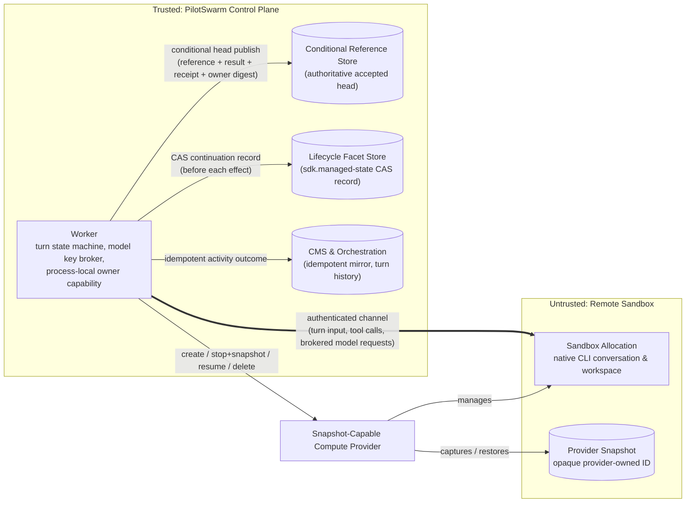

# Snapshot-owned state for platform-managed remote sandboxes

**Status:** proposal and draft PR for discussion.

**What exists today:** The generic managed-reference core state machine (`managed-runtime.ts`, `managed-admission.ts`, `managed-turn.ts`) has been prototyped and verified in isolation (TypeScript compile + 208 unit tests across 5 local suites on a separate prototype branch). It is **not** wired into `main`, Worker/CMS, or orchestration yet.

**What is deliberately not in Phase 1:** Automatic worker-loss replacement recovery, cross-worker takeover, stale-executor physical fencing, and worker-side filesystem archive fallback. Replacement recovery stays disabled until a provider's snapshot retention, post-resume durability, and old-executor retirement semantics are independently qualified (sections 5 and 6).

**Date:** 2026-11-25, revision 1. Companion to [`docs/proposals/compute-providers.md`](./compute-providers.md) and [`docs/proposals/snapshot-store-wins.md`](./snapshot-store-wins.md). Nothing in this design names a specific cloud, vendor, or sandbox product; it defines the generic PilotSwarm contract for any compute provider that owns native session state through provider-side snapshots.

---

## High-level design

**The problem.** When PilotSwarm runs a session's agent runtime inside a platform-created remote sandbox, the sandbox holds both the native CLI conversation files and the session workspace. Today, PilotSwarm's default durability model tars a local session directory on the worker and uploads those bytes to a blob store after every turn. Extending that byte-archive model to remote sandboxes forces the worker to pull native state bytes out of untrusted compute on every turn, duplicates what snapshot-capable sandbox platforms already do natively, and leaves workspace state split across two mechanisms.

**The solution.** Let a snapshot-capable compute provider own the native sandbox state (conversation files, workspace, and supported runtime state) inside provider-managed snapshots, while PilotSwarm's trusted control plane owns the **accepted snapshot reference**, turn ordering, execution admission, model credentials, and CMS history.

**Concrete example.**
1. Turn 1 runs in a platform-created sandbox `A` and writes `proof.txt` in the workspace.
2. At the safe turn boundary, PilotSwarm stops admitting new model or tool work to `A`, asks the provider to stop and snapshot `A`, validates the returned snapshot identity against `A`, and atomically publishes an **accepted snapshot reference** (`version: 1`, bound to `turnKey` and the worker's owner capability) into PilotSwarm's conditional reference store.
3. Turn 2 runs on the same sandbox `A` after re-establishing current-generation admission and reads `proof.txt`.
4. In Phase 2 (once provider retention and retirement are qualified), if the worker or sandbox `A` is lost after Turn 1 is accepted, a replacement worker verifies that `A` can no longer act, creates a fresh sandbox `B` from the accepted snapshot reference, bootstraps fresh transport and credentials, and runs Turn 2 without restoring obsolete credentials or control-plane ownership from the snapshot.



> **Core rule:** The sandbox owns the bytes; the trusted control plane owns acceptance. A provider snapshot ID returned by `stop` is never an accepted checkpoint until PilotSwarm conditionally publishes it to the reference store. Model keys, provider API credentials, and control-plane leases never enter the sandbox or the snapshot.

**Main design choices**

| Choice | Instead of | Why |
|---|---|---|
| Conditional reference head is authoritative; CMS mirrors idempotently | Assuming a cross-store transaction between provider, reference store, and CMS | External providers, blob/reference stores, and PostgreSQL do not share atomic transactions; a single conditional head write lets lost replies recover idempotently. |
| Opt-in sibling policy (`statePolicy: "managed"`) | Changing default worker sessions or user-supplied static hosts | Ordinary sessions and user-supplied static resources (where the user owns lifecycle and disk state) stay untouched. |
| No silent fallback to worker-side archive capture | Falling back to tarring native bytes when a snapshot fails | Mixing two state authorities hides retention bugs and breaks trust-boundary expectations. |
| Separate checkpoint acceptance from restore qualification | Treating every accepted snapshot ID as proven restorable | Empirical testing showed that a provider can return a valid snapshot ID that later becomes unrestorable under certain lifecycle sequences (section 5). |
| Write-ahead continuation record before every side effect | Recording state only after an effect returns | A crash or lost response between invoking an external provider and recording the outcome must fail closed (`held`), never silently replay or double-allocate. |

---

## 1. Scope, non-goals, and relationship to other modes

PilotSwarm distinguishes three remote-execution models:

1. **Default worker sessions (unchanged):** Agent runtime runs locally on the worker; session directory is archived to the snapshot store under the store-wins protocol ([`snapshot-store-wins.md`](./snapshot-store-wins.md)).
2. **User-supplied static hosts (unchanged):** The user provisions and owns the host's lifecycle and disk state; PilotSwarm attaches to it over a brokered connection without creating, stopping, snapshotting, restoring, or deleting the host.
3. **Platform-managed snapshot-owned sandboxes (this proposal):** PilotSwarm creates and manages the sandbox allocation through a compute provider, uses explicit opt-in `statePolicy: "managed"`, and stores typed snapshot references rather than native filesystem archives.

**Non-goals in this proposal:**
- Defining a specific vendor's REST API, authentication setup, or cloud networking topology.
- Making provider snapshots roll back external tool side effects (database writes, API calls, emails). External side effects require their own operation journals and reconciliation.
- Enabling automatic failover or multi-worker takeover before provider snapshot durability and physical fencing are independently proven.

---

## 2. State ownership and trust boundary

| State | Authoritative Owner | Notes |
|---|---|---|
| Native CLI conversation files, workspace files, supported runtime state | Provider snapshot, selected by the externally accepted reference | Never copied as raw tar archives through the worker in this mode. |
| Accepted snapshot reference, version, turn result, and receipt | Trusted conditional reference store | Single authoritative commit point per turn. |
| Logical session, queued inputs, orchestration history, visible turn outcomes | Trusted CMS and orchestration | Mirrors the accepted outcome idempotently; activity retries read the accepted head without re-running the turn. |
| Pre-effect phase and bounded turn ledger (`sdk.managed-state`) | Trusted lifecycle facet store (CAS) | Bookkeeping written **before** each effect; holds on unknown outcomes. |
| Execution ownership proof (raw owner token) | Process-local worker capability map | Never persisted to disk, continuation records, receipts, logs, or snapshots; the reference head stores only a domain-separated digest. |
| Model API keys and provider control-plane credentials | Trusted worker / control plane | Model calls are brokered by the worker; neither model keys nor control-plane tokens are injected into the sandbox or captured in snapshots. |
| External tool side-effect operation IDs | Durable external journal | Snapshot rollback never rolls back external effects. |

---

## 3. Data model, operation identities, and bounds

### 3.1 Transcript epoch requirement

Existing PilotSwarm reference-store primitives (create journal, lifecycle facet, owner stamp, and first-reference commit) enforce `transcriptEpoch >= 1` ("epoch chains from 1 up"). Ordinary and static-host sessions start at epoch 0.

- Platform-managed sessions **must initialize at `transcriptEpoch: 1`** consistently in both CMS and orchestration input.
- Implementations **must not** reuse session-regeneration startup paths to reach epoch 1, because doing so would emit false regeneration metrics and semantics.
- The managed core refuses epoch 0 with `MANAGED_EPOCH_UNSUPPORTED` before any effect.

### 3.2 Separate pre-effect operation identities

Create, turn dispatch, snapshot capture, head publication, and warm resume cannot share one pre-computed ID (for example, capture depends on a confirmed allocation handle that does not exist before create). Each operation receives its own deterministic or durable ID **recorded before its effect**:

| Operation | Identity | Recorded when |
|---|---|---|
| Allocation create | Pure function of `(sessionId, epoch, target)` | In the create journal before calling provider `create`. |
| Turn dispatch | Orchestration `turnKey` + SDK `attemptId` | In `sdk.managed-state` (`dispatched`) before sending input to the sandbox runtime. |
| Snapshot capture | `captureId = sha256(domain \| sessionId \| epoch \| turnKey \| allocationHandle \| runtimeGeneration)` | In `sdk.managed-state` (`capturing`) before calling provider `stop`/snapshot. |
| Head publication | Full write identity (`managedWriteId`) covering reference envelope digest, result, bounded receipt, and owner digest | In `sdk.managed-state` (`publishing`) after pure pre-send validation, before invoking the reference-store CAS. |
| Warm resume | `resumeId = sha256(domain \| captureId \| "resume")` | In `sdk.managed-state` (`published-resume-pending`) before resuming the same allocation. |

### 3.3 Bounded continuation record, receipt, and turn ledger

To keep control-plane state predictable and secret-free, every persisted object is strictly schema-checked and UTF-8 byte-bounded **before** any store write or provider call:

- **Continuation record (`sdk.managed-state`, schema `pilotswarm.managed-state/v1`, max 4,096 bytes):** Holds session, epoch, target ID, provider kind, allocation handle, runtime generation, owner generation (`1` in Phase 1), current `phase`, in-flight `current` metadata (`turnKey`, `attemptId`, `captureId`, optional `snapshotId` and `managedWriteId`), `lastAccepted` (`version`, `turnKey`, `envelopeDigest`), explicit `hold` code when held, and the accepted turn ledger. Contains **no secrets, no tokens, and no free-form error text**.
- **Accepted turn receipt (`turnRecord.receipt`, max 2,048 bytes):** Bound into the reference head with session, epoch, `turnKey`, `turnIndex`, `attemptId`, `captureId`, allocation digest, runtime generation, execution identity digest, and native profile.
- **Non-evicting turn ledger (`MANAGED_TURN_LEDGER_MAX = 32` in Phase 1):** Stores `<turnIndex>:<turnKeyDigest>` for every accepted turn so a spent `turnKey` can never be replayed at a different index. Entries are **never evicted**; at the 32-turn cap, the next new input fails closed with `MANAGED_HISTORY_FULL` before any admission or provider call (while retries of already-accepted turns still return their stored result read-only). Removing this cap requires a store-level turn journal in a later iteration.
- **Profile and qualification tagging:** Every Phase 1 reference proposal must carry an explicit experimental profile (`managed.experimental.<provider-profile>`) and `providerEvidence.detail.restoreQualification = "unproven"`. The core rejects any proposal that omits this field or attempts to self-declare `"qualified"`.

---

## 4. Normal turn state machine and failure rules

### 4.1 Per-turn admission and write-ahead acquisition

Each turn on the same allocation requires a fresh per-turn admission (fresh `runtimeGeneration` and broker binding) created by a process-local admission factory (`createManagedAdmission`). A proxy, wrapper, or forged plain object is rejected before any effect.

Before invoking the admission factory or opening the provider executor—both on a normal turn and on a read-only inspection path—the state machine commits a durable **`acquiring`** CAS transition carrying the prior phase. If that CAS fails or is unconfirmed, nothing is opened; if the worker dies after committing `acquiring`, the next turn sees `acquiring` and holds (`MANAGED_ACQUISITION_UNKNOWN`) rather than opening a duplicate runtime.

### 4.2 Turn sequence

```text
1. Read-only preflight:
   - Read the reference head. If the head already bears this turnKey, return the
     stored result and receipt read-only (no owner capability, no admission, no
     provider contact, no store write).
   - Check pure guards (epoch >= 1, turn ledger cap, 4,096-byte projection,
     owner capability matches head owner digest) before any effect.
2. Reconcile prior continuation phase (read-only head check first).
3. Write-ahead `acquiring` CAS -> open per-turn admission and provider lease.
4. CAS `dispatched` (turnKey, attemptId) -> run native CLI turn on the sandbox
   with model requests brokered through the worker.
5. At safe turn boundary: stop new model/tool admission -> CAS `capturing`
   (captureId) -> provider quiesces/stops sandbox and captures snapshot.
6. Validate returned snapshot proposal (allocation match, experimental profile,
   restoreQualification === "unproven", full pre-send check of reference +
   result + receipt + owner proof).
7. CAS `publishing` (captureId, snapshotId, managedWriteId) -> execute ONE
   conditional head write to the reference store.
8. CAS `published-resume-pending` -> optionally resume the same sandbox for
   warm continuity -> close per-turn lease (`confirmed` | `unknown`) ->
   CAS `idle` (or sticky hold if resume/close was unknown).
9. Return the immutable turn outcome to CMS / orchestration.
```

### 4.3 Failure rules

| Failure point | Required behavior |
|---|---|
| `acquiring` CAS fails or reply is lost | Never open executor on failure; if lost after commit, next turn holds (`MANAGED_ACQUISITION_UNKNOWN`). |
| Allocation create outcome unknown | Reconcile recorded create operation; never blindly allocate a second sandbox. |
| Turn fails, cancels, or errors *after* `dispatched` | Live sandbox state may differ from the last accepted head. Transition to `diverged` and **hold** subsequent turns (never auto-replay a dispatched turn). |
| Snapshot capture fails or outcome is unknown | Never complete the turn without an accepted checkpoint. Keep previous accepted head intact; record `capture-unknown` hold when outcome is uncertain. |
| Pure pre-send publication validation fails | Refusal happened strictly before invoking the reference store; the new snapshot is provably unaccepted and may be released/marked for cleanup. |
| Reference store publish returns any error or lost reply | **3-valued publication:** once the publisher is invoked, every non-success is **`unknown`**, never "confirmed not accepted" (a conflict or timeout can follow an attempted or committed write). Hold the session and **do not delete** the snapshot; reconcile by reading the head for the exact `managedWriteId`. |
| Reference head accepted, but CMS activity reply is lost | Activity retry hits read-only preflight, finds the matching `turnKey` on the accepted head, and returns the exact stored outcome idempotently. |
| Post-commit warm resume or lease `close()` returns `unknown` | **Never roll back or replay the accepted turn.** Return the accepted outcome and record a sticky `resume-unknown` / `held` state so the next turn holds until reconciled. |
| Worker restarts in Phase 1 (process-local owner capability lost) | Retries of already-accepted turns still succeed read-only; any new input holds (`MANAGED_OWNER_CAPABILITY_MISSING`) rather than silently taking over without Phase 2 fencing. |

---

## 5. Provider snapshot contract and empirical lifecycle findings

### 5.1 Why acceptance is not restore qualification

A provider's `stop` API returning a snapshot ID only proves that the provider emitted a handle at that moment. For PilotSwarm to rely on that handle for **crash recovery or worker failover**, the provider must guarantee four stronger properties:

1. **Retention window:** How long a snapshot remains restorable (minutes, hours, days).
2. **Post-resume durability:** Whether resuming the source sandbox—and letting it later idle or auto-suspend—preserves or invalidates earlier explicit `stop` snapshots.
3. **Post-delete survival:** Whether a snapshot remains restorable after the source sandbox is deleted or reaches its auto-delete expiry.
4. **Cleanup contract:** Whether PilotSwarm can enumerate and delete obsolete snapshots to prevent unbounded storage growth.

### 5.2 Empirical finding from a real remote sandbox provider

Controlled multi-arm experiments against a real snapshot-capable remote sandbox service isolated a critical lifecycle constraint that directly shapes this design:

| Controlled test sequence (fresh disposable sandbox per arm) | Elapsed from `stop` to restore | Restore `POST` result | What it proved |
|---|---:|---|---|
| **Stop → immediate restore** (without resuming source `A`) | ~1 s | **HTTP 201**; disk, tmpfs, and process-identity markers verified in restored sandbox `B` | Basic snapshot creation and restore works. |
| **Stop → resume `A` → immediate restore** (no guest edits) | 4–12 s | **HTTP 201**; markers verified in `B` | Resuming `A` does not instantaneously invalidate the snapshot. |
| **Stop → wait 8 min (`480 s`) with `A` left stopped → restore** | 486.5 s | **HTTP 201**; markers verified in `B` | Snapshot age (~8 minutes) alone does **not** cause restore failure. |
| **Stop → resume `A` → wait 8 min (`480 s`) idle (zero API calls, zero guest edits; `A` auto-stops) → restore** | 485.6–489.2 s | **HTTP 404 `SnapshotNotFound`** (*"The snapshot does not exist or is not owned by the caller."*) | Resuming `A` and allowing it to sit idle/auto-suspend invalidates the prior `stop` snapshot ID, even with zero mutations to `A`. |

Note that waking or executing commands on the **original sandbox `A`** after idle auto-suspend still succeeded with files intact; what failed was creating a **new sandbox `B`** from `A`'s earlier stop snapshot ID.

### 5.3 Architectural implications and options

Until a provider documents and proves its snapshot retention model, PilotSwarm treats same-sandbox continuation and cross-sandbox recovery as separate capabilities:

- **Option A — Immutable provider checkpoints (preferred if supported by the provider):** The provider guarantees that explicit `stop` snapshots are immutable, survive source resume/auto-suspend and source deletion for a documented TTL, and expose a deletion API. PilotSwarm's snapshot-owned model then supports full worker-loss recovery directly from the accepted reference head.
- **Option B — Never resume the checkpointed allocation:** After `stop` produces snapshot `S_N`, leave source `A` stopped (or delete `A` if snapshots outlive `A`) and start Turn `N+1` by creating a fresh sandbox `B` from `S_N` (~1.3 s restore latency in measurements). This avoids the resume+idle invalidation path, but is only viable if the provider confirms long-term TTL, post-delete survival, and snapshot cleanup.
- **Option C — Hybrid state for non-immutable providers:** Use provider `stop`/`resume` for fast same-sandbox continuity between turns, while persisting only the minimal agent conversation metadata (not the full OS/workspace image) to PilotSwarm's durable blob store at turn boundaries for cold fallback recovery.

Because Option A vs. B vs. C depends on the provider's guaranteed contract, **Phase 1 explicitly keeps `restoreQualification: "unproven"` and disables automatic replacement recovery** so the control-plane contract is honest from day one.

---

## 6. Phase 2: recovery, takeover, and stale-execution fencing

Automatic failover after worker or sandbox loss is deferred to Phase 2 and requires every item below:

1. **Qualified provider retention:** Documented and experimentally verified retention across the target recovery window, including post-resume/auto-suspend and post-source-delete behavior.
2. **Independent retirement evidence:** A CMS or reference-head generation bump alone **does not** prove that an old sandbox process or stale network session has stopped acting. Takeover must establish that the old allocation is retired (or physically fenced from model brokering, tool dispatch, and external side-effect channels) before admitting the new generation.
3. **Fresh credential and transport bootstrap:** Restoring a snapshot into sandbox `B` must bind fresh transport credentials and a new execution generation. Restored memory or disk must never revive an old worker's owner capability, broker secret, or expired leases.
4. **Fail-closed on ambiguity:** If old-execution retirement, snapshot availability, or restored profile verification is uncertain, the replacement worker must **hold** rather than allow overlapping writers.

---

## 7. Phased rollout and qualification criteria

| Phase | Deliverable | Qualification gate |
|---|---|---|
| **Phase 0 (complete in prototype)** | Generic managed-reference core (`managed-runtime.ts`, `managed-admission.ts`, `managed-turn.ts`) with write-ahead acquisition, 3-valued publication, bounded 4 KiB state / 2 KiB receipt, and non-evicting 32-turn ledger | Isolated TypeScript compile (`tsc --noEmit` exit 0) and 5 local Vitest suites (**208/208 tests passing**); zero changes to default or static-host paths. |
| **Phase 1 (next implementation milestone)** | Opt-in `statePolicy: "managed"` wiring in Worker/CMS/SessionManager, dedicated `transcriptEpoch: 1` initialization (without regeneration metadata), and provider composition | One live platform-created sandbox completes **two real-model turns** through normal Worker/CMS, Turn 2 reads a file written in Turn 1, model keys remain worker-side, and both turns publish accepted snapshot references (`restoreQualification: "unproven"`, replacement recovery off). |
| **Provider qualification gate** | Provider contract confirmation + controlled retention & post-delete experiments | Verified answers on snapshot TTL, resume/auto-suspend retention, post-delete survival, and snapshot cleanup/garbage collection. |
| **Phase 2 (recovery & fencing)** | Replacement-worker takeover, cross-sandbox restore from accepted reference, stale-executor retirement/fencing, and store-level turn journal (lifting the 32-turn cap) | Controlled worker-loss failover test proving Turn 2 resumes the exact Turn 1 conversation on a fresh sandbox, plus a stale-executor test proving the old execution cannot produce accepted model, state, or control-plane effects after takeover. |

---

## 8. Open questions

1. **Snapshot retention and lifecycle contract:** For target sandbox providers, does idle auto-suspend overwrite the prior `stop` snapshot (one active snapshot per sandbox), or does `resume` schedule delayed deletion of the prior snapshot? What retention window and post-delete guarantees are supported?
2. **Snapshot garbage collection:** What API or retention policy removes superseded snapshots once a newer accepted reference is published (while never deleting snapshots whose publication outcome is `unknown`)?
3. **Store-level turn journal:** Should the 32-turn cap in `sdk.managed-state` be lifted via a dedicated append/lookup turn-key journal in the reference store before Phase 1 leaves experimental status?
4. **Hybrid fallback vs. provider-native recovery:** If a provider cannot guarantee immutable checkpoints across source resume/idle, should PilotSwarm adopt Option B (restore-per-turn without resuming the source) or Option C (hybrid durable conversation metadata + provider warm resume)?
