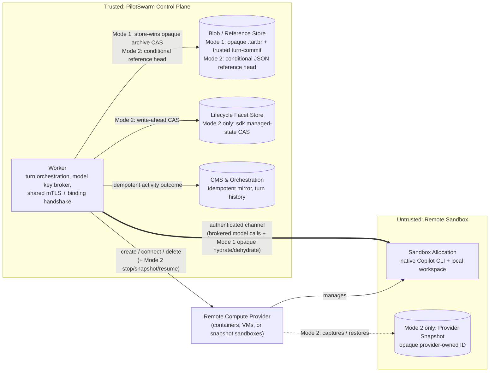

# Remote-compute state modes: store-owned and snapshot-owned sandboxes

**Status:** proposal and draft PR for discussion (revision 2 — reframed around two supported state modes for worker-separated compute providers).

**What exists today:**
- **Mode 1 (`statePolicy: "store-owned"`):** Extends PilotSwarm's shipped `store-wins` durability model ([`docs/proposals/snapshot-store-wins.md`](./snapshot-store-wins.md)) to separated remote compute providers using opaque, size-bounded session-state archives (never extracted on the worker). Being prototyped on a separate branch alongside Mode 2.
- **Mode 2 (`statePolicy: "managed"`):** The generic managed-reference core state machine (`managed-runtime.ts`, `managed-admission.ts`, `managed-turn.ts`, `managed-worker.ts`) is prototyped and verified in isolation (TypeScript compile + 243/243 Vitest tests across 8 suites on a separate prototype branch), and Turn 1 has been exercised end-to-end against a real remote sandbox provider with worker-side model key brokering. Automatic worker-loss replacement recovery remains disabled (`restoreQualification: "unproven"`) until provider snapshot retention and stale-executor retirement are independently qualified (sections 5 and 6).

**Date:** 2026-11-25, revision 2. Companion to [`docs/proposals/compute-contract-foundation.md`](./compute-contract-foundation.md) and [`docs/proposals/snapshot-store-wins.md`](./snapshot-store-wins.md). Nothing in this design names a specific cloud, vendor, or sandbox product; it defines the generic PilotSwarm contract for separated worker + remote compute providers.

---

## High-level design: two modes on one shared foundation

**The problem.** When PilotSwarm separates the trusted worker (orchestration, CMS, facts, artifacts, model API keys) from an untrusted remote sandbox (Copilot CLI, shell, file tools), the deployment must decide **who owns authoritative session state between turns**.
- Relying exclusively on **provider-managed VM/container snapshots** preserves full disk and workspace state without transferring archive bytes through the worker, but ties failover and durability to provider-specific snapshot immutability, retention TTL, and garbage-collection guarantees (which empirical testing showed can fail after resume + idle auto-suspend; section 5).
- Relying exclusively on **store-owned session archives** gives immediate self-healing worker failover across *any* compute provider (including providers with no snapshot API at all), but does not automatically persist arbitrary OS/build files outside the CLI session directory and requires strict untrusted-archive boundaries on the worker.

**The solution.** Support **two explicit `statePolicy` modes** on top of **one shared remote-compute foundation** (mutual TLS + per-binding handshake, strict native CLI client, worker-side model key brokerage, CMS/Duroxide orchestration):

1. **Mode 1 — Store-Owned Remote Compute (`statePolicy: "store-owned"`, universal default):**
   - **Blob Storage + CMS own authoritative session state** under PilotSwarm's `store-wins` protocol (`If-Match` ETag CAS + `turnKey` idempotency).
   - The remote sandbox is a **disposable warm cache**. Between turns on the same worker, a warm sandbox whose local cache marker matches `(version, contentHash)` skips hydration. If the worker restarts, the sandbox dies, or the provider evicts it, any worker allocates a fresh sandbox and hydrates the CLI session-state archive from the store.
   - **Untrusted-archive boundary:** The worker moves only **opaque, size-bounded compressed bytes** (e.g. `<= 16 MiB`) between the authenticated guest channel and Blob Storage—**the worker never untars or parses guest archive bytes on the worker filesystem**. Only an untrusted sandbox extracts them using a hardened unpacker (no `..`, no absolute paths, no symlinks/hardlinks/device nodes, strict entry and expanded-byte caps). Idempotent `turnKey` retries read a separate **worker-owned trusted turn-commit record**, never from the guest archive.
   - **Workspace durability** stays cleanly separated from conversation memory via PilotSwarm's session workspaces, git clones, and artifacts (or best-effort warm sandbox cache).

2. **Mode 2 — Provider-Snapshot-Owned Remote Compute (`statePolicy: "managed"`, opt-in full-disk tier):**
   - **A snapshot-capable compute provider owns full native sandbox state** (conversation files, workspace, installed tools, build caches) inside provider-managed snapshots, while PilotSwarm's trusted control plane stores only a small **accepted snapshot reference** (`~2 KiB` JSON head) in the conditional reference store.
   - **Zero guest archive bytes ever cross back into worker storage**, at the cost of a stricter write-ahead state machine and hard provider snapshot-retention prerequisites before automatic cross-sandbox failover can be enabled.

| Dimension | Mode 1: `store-owned` (Universal Default) | Mode 2: `managed` (Opt-In Full-Disk Tier) |
|---|---|---|
| **Authoritative session state** | Blob Storage (session archive) + CMS (`store-wins`) | Provider snapshot + conditional JSON reference head in Blob |
| **Role of the remote sandbox** | Disposable warm cache (reuse, pause, or replace freely) | State authority (snapshots back durability) |
| **What crosses back to worker** | Bounded `cli-home` archive (`<= 16 MiB` opaque bytes; never extracted on worker) | Small JSON reference record (`~2 KiB`; opaque snapshot ID only) |
| **Worker crash / sandbox loss** | **Self-healing immediately** (fresh sandbox hydrates from Blob) | **Gated on Phase 2** (verified snapshot retention + physical fencing) |
| **Compute provider requirements** | Minimal: create, exec/connect, delete (works on any container/VM/sandbox provider) | Strict: immutable snapshots surviving resume/idle/delete, documented TTL, GC API |
| **Workspace & installed tools** | Ephemeral on sandbox replacement unless paired with durable workspaces / artifacts | Preserved automatically inside provider snapshot |
| **Control-plane complexity** | Low: reuses existing `snapshot-store-wins` (no 32-turn cap, works at epoch 0 or >= 1) | High: write-ahead CAS phases, 32-turn ledger, owner tokens, `restoreQualification` gate |
| **Model keys & control-plane creds** | **Worker-only** (brokered; zero secrets in sandbox) | **Worker-only** (brokered; zero secrets in sandbox or snapshots) |



> **Shared invariant across both modes:** Model API keys, provider control-plane tokens, and worker leases never enter the sandbox or any snapshot/archive.

---

## 0. Mode 1 architecture: Store-Owned Remote Compute (`statePolicy: "store-owned"`)

### 0.1 Concrete two-turn failover example

1. Turn 1 runs in remote sandbox `A`. Model calls are brokered through the worker (zero model keys in `A`).
2. At turn end, the guest quiesces/stops the Copilot CLI, packs **only** `cli-home/session-state/<sessionId>` (excluding markers/sentinels and rejecting symlinks/special files) into a size-capped compressed stream, and sends the opaque bytes over the authenticated channel.
3. The worker verifies the byte cap, computes `contentHash`, writes the trusted `{ turnKey, result }` record, and commits the opaque archive to Blob Storage at `version: 1` via standard `store-wins` conditional Put (`If-Match` / `If-None-Match`). The worker never extracts the archive.
4. Sandbox `A` is deleted (or the worker restarts).
5. Turn 2 starts on any worker. The worker probes Blob (`version: 1`), allocates a fresh sandbox `B`, streams the opaque archive to `B`, runs `B`'s hardened guest unpacker into `cli-home`, boots Copilot CLI, resumes the exact conversation, and commits `version: 2`.

### 0.2 Warm-cache fast path and `store-wins` conflict safety

- **Warm hit:** If the same worker still holds warm sandbox `A` whose local cache marker matches Blob's `(version, contentHash)`, the worker skips downloading and hydrating the archive and runs Turn 2 directly on `A`.
- **Idempotent retry:** If Duroxide retries a turn whose `turnKey` already matches Blob's `psturnkey`, the worker returns the stored result from its **worker-owned trusted turn-commit record** with zero sandbox contact and zero archive parsing.
- **412 conflict (`store-wins`):** If another writer advanced Blob between preamble and commit, the conditional Put returns `412`. The worker invalidates its warm cache marker, emits `session.snapshot_unpublished`, and does **not** brick the session; the next turn rehydrates whatever won.
- **Oversized archive refusal:** If the guest returns more than `REMOTE_SNAPSHOT_ARCHIVE_MAX_BYTES` (default `16 MiB` compressed), the worker rejects the stream before touching Blob Storage and surfaces a bounded error.

---

## High-level design (Mode 2: Snapshot-Owned Managed Sandboxes)

**Concrete example (Mode 2).**
1. Turn 1 runs in a platform-created sandbox `A` and writes `proof.txt` in the workspace.
2. At the safe turn boundary, PilotSwarm stops admitting new model or tool work to `A`, quiesces the guest runtime, asks the provider to stop and snapshot `A`, validates the returned snapshot identity against `A`, and atomically publishes an **accepted snapshot reference** (`version: 1`, bound to `turnKey` and the worker's owner capability) into PilotSwarm's conditional reference store.
3. Turn 2 runs on the same sandbox `A` after re-establishing current-generation admission and reads `proof.txt`.
4. In Phase 2 (once provider retention and retirement are qualified), if the worker or sandbox `A` is lost after Turn 1 is accepted, a replacement worker verifies that `A` can no longer act, creates a fresh sandbox `B` from the accepted snapshot reference, bootstraps fresh transport and credentials, and runs Turn 2 without restoring obsolete credentials or control-plane ownership from the snapshot.

**Main design choices (Mode 2)**

| Choice | Instead of | Why |
|---|---|---|
| Conditional reference head is authoritative; CMS mirrors idempotently | Assuming a cross-store transaction between provider, reference store, and CMS | External providers, blob/reference stores, and PostgreSQL do not share atomic transactions; a single conditional head write lets lost replies recover idempotently. |
| Explicit mode selection (`statePolicy: "store-owned"` vs `"managed"`) | Silently falling back from Mode 2 to Mode 1 on snapshot error | Mixing two state authorities inside one session hides retention bugs and breaks trust-boundary expectations. Each session chooses one mode explicitly. |
| Separate checkpoint acceptance from restore qualification | Treating every accepted snapshot ID as proven restorable | Empirical testing showed that a provider can return a valid snapshot ID that later becomes unrestorable under certain lifecycle sequences (section 5). |
| Write-ahead continuation record before every side effect | Recording state only after an effect returns | A crash or lost response between invoking an external provider and recording the outcome must fail closed (`held`), never silently replay or double-allocate. |

---

## 1. Scope, non-goals, and relationship to other modes

PilotSwarm distinguishes three execution models:

1. **Default worker sessions (unchanged):** Agent runtime runs locally on the worker; session directory is archived to the snapshot store under the store-wins protocol ([`snapshot-store-wins.md`](./snapshot-store-wins.md)).
2. **Mode 1 — Store-owned remote compute (`statePolicy: "store-owned"`, this proposal):** PilotSwarm creates and manages remote sandboxes through a compute provider, runs Copilot CLI remotely with worker-side model key brokerage, and persists bounded `cli-home` session archives in Blob Storage under `store-wins` (never extracted on the worker).
3. **Mode 2 — Snapshot-owned managed sandboxes (`statePolicy: "managed"`, this proposal):** PilotSwarm creates and manages remote sandboxes through a snapshot-capable compute provider and stores typed conditional snapshot references rather than native filesystem archives.

*(User-supplied static hosts are intentionally outside the scope of this proposal.)*

**Non-goals in this proposal:**
- Defining a specific vendor's REST API, authentication setup, or cloud networking topology.
- Making provider snapshots roll back external tool side effects (database writes, API calls, emails). External side effects require their own operation journals and reconciliation.
- Enabling Mode 2 automatic failover or multi-worker takeover before provider snapshot durability and physical fencing are independently proven.

---

## 2. State ownership and trust boundary

| State | Authoritative Owner | Notes |
|---|---|---|
| Native CLI conversation files, workspace files, supported runtime state | Provider snapshot, selected by the externally accepted reference | Never copied as raw tar archives through the worker in this mode. |
| Accepted snapshot reference, version, turn result, and receipt | Trusted conditional reference store | Single authoritative commit point per turn. |
| Logical session, queued inputs, orchestration history, visible turn outcomes | Trusted CMS and orchestration | Mirrors the accepted outcome idempotently; activity retries read the accepted head without re-running the turn. |
| Pre-effect phase and bounded turn ledger (`sdk.managed-state`) | Trusted lifecycle facet store (CAS) | Bookkeeping written **before** each effect; holds on unknown outcomes. |
| Execution ownership proof (raw owner token) | Process-local worker capability map | Never persisted to disk, continuation records, receipts, logs, or snapshots; the reference head stores only a domain-separated digest. |
| Model API keys and provider control-plane credentials | Trusted worker / control plane | Model calls are brokered by the worker; neither model keys nor control-plane tokens are injected into the sandbox or captured in snapshots. |
| External tool side-effect operation IDs | Durable external journal | Snapshot rollback never rolls back external effects. |

---

## 3. Data model, operation identities, and bounds

### 3.1 Transcript epoch requirement

Existing PilotSwarm reference-store primitives (create journal, lifecycle facet, owner stamp, and first-reference commit) enforce `transcriptEpoch >= 1` ("epoch chains from 1 up"). Ordinary and static-host sessions start at epoch 0.

- Platform-managed sessions **must initialize at `transcriptEpoch: 1`** consistently in both CMS and orchestration input.
- Implementations **must not** reuse session-regeneration startup paths to reach epoch 1, because doing so would emit false regeneration metrics and semantics.
- The managed core refuses epoch 0 with `MANAGED_EPOCH_UNSUPPORTED` before any effect.

### 3.2 Separate pre-effect operation identities

Create, turn dispatch, snapshot capture, head publication, and warm resume cannot share one pre-computed ID (for example, capture depends on a confirmed allocation handle that does not exist before create). Each operation receives its own deterministic or durable ID **recorded before its effect**:

| Operation | Identity | Recorded when |
|---|---|---|
| Allocation create | Pure function of `(sessionId, epoch, target)` | In the create journal before calling provider `create`. |
| Turn dispatch | Orchestration `turnKey` + SDK `attemptId` | In `sdk.managed-state` (`dispatched`) before sending input to the sandbox runtime. |
| Snapshot capture | `captureId = sha256(domain \| sessionId \| epoch \| turnKey \| allocationHandle \| runtimeGeneration)` | In `sdk.managed-state` (`capturing`) before calling provider `stop`/snapshot. |
| Head publication | Full write identity (`managedWriteId`) covering reference envelope digest, result, bounded receipt, and owner digest | In `sdk.managed-state` (`publishing`) after pure pre-send validation, before invoking the reference-store CAS. |
| Warm resume | `resumeId = sha256(domain \| captureId \| "resume")` | In `sdk.managed-state` (`published-resume-pending`) before resuming the same allocation. |

### 3.3 Bounded continuation record, receipt, and turn ledger

To keep control-plane state predictable and secret-free, every persisted object is strictly schema-checked and UTF-8 byte-bounded **before** any store write or provider call:

- **Continuation record (`sdk.managed-state`, schema `pilotswarm.managed-state/v1`, max 4,096 bytes):** Holds session, epoch, target ID, provider kind, allocation handle, runtime generation, owner generation (`1` in Phase 1), current `phase`, in-flight `current` metadata (`turnKey`, `attemptId`, `captureId`, optional `snapshotId` and `managedWriteId`), `lastAccepted` (`version`, `turnKey`, `envelopeDigest`), explicit `hold` code when held, and the accepted turn ledger. Contains **no secrets, no tokens, and no free-form error text**.
- **Accepted turn receipt (`turnRecord.receipt`, max 2,048 bytes):** Bound into the reference head with session, epoch, `turnKey`, `turnIndex`, `attemptId`, `captureId`, allocation digest, runtime generation, execution identity digest, and native profile.
- **Non-evicting turn ledger (`MANAGED_TURN_LEDGER_MAX = 32` in Phase 1):** Stores `<turnIndex>:<turnKeyDigest>` for every accepted turn so a spent `turnKey` can never be replayed at a different index. Entries are **never evicted**; at the 32-turn cap, the next new input fails closed with `MANAGED_HISTORY_FULL` before any admission or provider call (while retries of already-accepted turns still return their stored result read-only). Removing this cap requires a store-level turn journal in a later iteration.
- **Profile and qualification tagging:** Every Phase 1 reference proposal must carry an explicit experimental profile (`managed.experimental.<provider-profile>`) and `providerEvidence.detail.restoreQualification = "unproven"`. The core rejects any proposal that omits this field or attempts to self-declare `"qualified"`.

---

## 4. Normal turn state machine and failure rules

### 4.1 Per-turn admission and write-ahead acquisition

Each turn on the same allocation requires a fresh per-turn admission (fresh `runtimeGeneration` and broker binding) created by a process-local admission factory (`createManagedAdmission`). A proxy, wrapper, or forged plain object is rejected before any effect.

Before invoking the admission factory or opening the provider executor—both on a normal turn and on a read-only inspection path—the state machine commits a durable **`acquiring`** CAS transition carrying the prior phase. If that CAS fails or is unconfirmed, nothing is opened; if the worker dies after committing `acquiring`, the next turn sees `acquiring` and holds (`MANAGED_ACQUISITION_UNKNOWN`) rather than opening a duplicate runtime.

### 4.2 Turn sequence

```text
1. Read-only preflight:
   - Read the reference head. If the head already bears this turnKey, return the
     stored result and receipt read-only (no owner capability, no admission, no
     provider contact, no store write).
   - Check pure guards (epoch >= 1, turn ledger cap, 4,096-byte projection,
     owner capability matches head owner digest) before any effect.
2. Reconcile prior continuation phase (read-only head check first).
3. Write-ahead `acquiring` CAS -> open per-turn admission and provider lease.
4. CAS `dispatched` (turnKey, attemptId) -> run native CLI turn on the sandbox
   with model requests brokered through the worker.
5. At safe turn boundary: stop new model/tool admission -> CAS `capturing`
   (captureId) -> provider quiesces/stops sandbox and captures snapshot.
6. Validate returned snapshot proposal (allocation match, experimental profile,
   restoreQualification === "unproven", full pre-send check of reference +
   result + receipt + owner proof).
7. CAS `publishing` (captureId, snapshotId, managedWriteId) -> execute ONE
   conditional head write to the reference store.
8. CAS `published-resume-pending` -> optionally resume the same sandbox for
   warm continuity -> close per-turn lease (`confirmed` | `unknown`) ->
   CAS `idle` (or sticky hold if resume/close was unknown).
9. Return the immutable turn outcome to CMS / orchestration.
```

### 4.3 Failure rules

| Failure point | Required behavior |
|---|---|
| `acquiring` CAS fails or reply is lost | Never open executor on failure; if lost after commit, next turn holds (`MANAGED_ACQUISITION_UNKNOWN`). |
| Allocation create outcome unknown | Reconcile recorded create operation; never blindly allocate a second sandbox. |
| Turn fails, cancels, or errors *after* `dispatched` | Live sandbox state may differ from the last accepted head. Transition to `diverged` and **hold** subsequent turns (never auto-replay a dispatched turn). |
| Snapshot capture fails or outcome is unknown | Never complete the turn without an accepted checkpoint. Keep previous accepted head intact; record `capture-unknown` hold when outcome is uncertain. |
| Pure pre-send publication validation fails | Refusal happened strictly before invoking the reference store; the new snapshot is provably unaccepted and may be released/marked for cleanup. |
| Reference store publish returns any error or lost reply | **3-valued publication:** once the publisher is invoked, every non-success is **`unknown`**, never "confirmed not accepted" (a conflict or timeout can follow an attempted or committed write). Hold the session and **do not delete** the snapshot; reconcile by reading the head for the exact `managedWriteId`. |
| Reference head accepted, but CMS activity reply is lost | Activity retry hits read-only preflight, finds the matching `turnKey` on the accepted head, and returns the exact stored outcome idempotently. |
| Post-commit warm resume or lease `close()` returns `unknown` | **Never roll back or replay the accepted turn.** Return the accepted outcome and record a sticky `resume-unknown` / `held` state so the next turn holds until reconciled. |
| Worker restarts in Phase 1 (process-local owner capability lost) | Retries of already-accepted turns still succeed read-only; any new input holds (`MANAGED_OWNER_CAPABILITY_MISSING`) rather than silently taking over without Phase 2 fencing. |

---

## 5. Provider snapshot contract and empirical lifecycle findings

### 5.1 Why acceptance is not restore qualification

A provider's `stop` API returning a snapshot ID only proves that the provider emitted a handle at that moment. For PilotSwarm to rely on that handle for **crash recovery or worker failover**, the provider must guarantee four stronger properties:

1. **Retention window:** How long a snapshot remains restorable (minutes, hours, days).
2. **Post-resume durability:** Whether resuming the source sandbox—and letting it later idle or auto-suspend—preserves or invalidates earlier explicit `stop` snapshots.
3. **Post-delete survival:** Whether a snapshot remains restorable after the source sandbox is deleted or reaches its auto-delete expiry.
4. **Cleanup contract:** Whether PilotSwarm can enumerate and delete obsolete snapshots to prevent unbounded storage growth.

### 5.2 Empirical finding from a real remote sandbox provider

Controlled multi-arm experiments against a real snapshot-capable remote sandbox service isolated a critical lifecycle constraint that directly shapes this design:

| Controlled test sequence (fresh disposable sandbox per arm) | Elapsed from `stop` to restore | Restore `POST` result | What it proved |
|---|---:|---|---|
| **Stop → immediate restore** (without resuming source `A`) | ~1 s | **HTTP 201**; disk, tmpfs, and process-identity markers verified in restored sandbox `B` | Basic snapshot creation and restore works. |
| **Stop → resume `A` → immediate restore** (no guest edits) | 4–12 s | **HTTP 201**; markers verified in `B` | Resuming `A` does not instantaneously invalidate the snapshot. |
| **Stop → wait 8 min (`480 s`) with `A` left stopped → restore** | 486.5 s | **HTTP 201**; markers verified in `B` | Snapshot age (~8 minutes) alone does **not** cause restore failure. |
| **Stop → resume `A` → wait 8 min (`480 s`) idle (zero API calls, zero guest edits; `A` auto-stops) → restore** | 485.6–489.2 s | **HTTP 404 `SnapshotNotFound`** (*"The snapshot does not exist or is not owned by the caller."*) | Resuming `A` and allowing it to sit idle/auto-suspend invalidates the prior `stop` snapshot ID, even with zero mutations to `A`. |

Note that waking or executing commands on the **original sandbox `A`** after idle auto-suspend still succeeded with files intact; what failed was creating a **new sandbox `B`** from `A`'s earlier stop snapshot ID.

### 5.3 Architectural implications and options

Until a provider documents and proves its snapshot retention model, PilotSwarm treats same-sandbox continuation and cross-sandbox recovery as separate capabilities:

- **Option A — Immutable provider checkpoints (preferred if supported by the provider):** The provider guarantees that explicit `stop` snapshots are immutable, survive source resume/auto-suspend and source deletion for a documented TTL, and expose a deletion API. PilotSwarm's snapshot-owned model then supports full worker-loss recovery directly from the accepted reference head.
- **Option B — Never resume the checkpointed allocation:** After `stop` produces snapshot `S_N`, leave source `A` stopped (or delete `A` if snapshots outlive `A`) and start Turn `N+1` by creating a fresh sandbox `B` from `S_N` (~1.3 s restore latency in measurements). This avoids the resume+idle invalidation path, but is only viable if the provider confirms long-term TTL, post-delete survival, and snapshot cleanup.
- **Option C — Hybrid state for non-immutable providers:** Use provider `stop`/`resume` for fast same-sandbox continuity between turns, while persisting only the minimal agent conversation metadata (not the full OS/workspace image) to PilotSwarm's durable blob store at turn boundaries for cold fallback recovery.

Because Option A vs. B vs. C depends on the provider's guaranteed contract, **Phase 1 explicitly keeps `restoreQualification: "unproven"` and disables automatic replacement recovery** so the control-plane contract is honest from day one.

---

## 6. Phase 2: recovery, takeover, and stale-execution fencing

Automatic failover after worker or sandbox loss is deferred to Phase 2 and requires every item below:

1. **Qualified provider retention:** Documented and experimentally verified retention across the target recovery window, including post-resume/auto-suspend and post-source-delete behavior.
2. **Independent retirement evidence:** A CMS or reference-head generation bump alone **does not** prove that an old sandbox process or stale network session has stopped acting. Takeover must establish that the old allocation is retired (or physically fenced from model brokering, tool dispatch, and external side-effect channels) before admitting the new generation.
3. **Fresh credential and transport bootstrap:** Restoring a snapshot into sandbox `B` must bind fresh transport credentials and a new execution generation. Restored memory or disk must never revive an old worker's owner capability, broker secret, or expired leases.
4. **Fail-closed on ambiguity:** If old-execution retirement, snapshot availability, or restored profile verification is uncertain, the replacement worker must **hold** rather than allow overlapping writers.

---

## 7. Phased rollout and qualification criteria

| Track / Phase | Deliverable | Qualification gate |
|---|---|---|
| **Mode 1 (`store-owned` remote compute)** | Opaque-archive `store-wins` CAS (`commitSnapshotArchive` / `readSnapshotArchive` + worker-owned trusted turn-commit), `RemoteStoreOwnedExecutor`, `statePolicy: "store-owned"` routing, and hardened guest-side pack/unpack over the shared mTLS bridge | Isolated `tsc --noEmit` + Vitest tests proving zero worker-side untar, warm-cache hit, 412 `store-wins` non-bricking conflict, oversized archive refusal, and **cross-sandbox failover** (Turn 1 on Sandbox A → destroy A → Turn 2 on fresh Sandbox B hydrates from Blob and continues the conversation). |
| **Mode 2 Phase 0 (complete in prototype)** | Generic managed-reference core (`managed-runtime.ts`, `managed-admission.ts`, `managed-turn.ts`) with write-ahead acquisition, 3-valued publication, bounded 4 KiB state / 2 KiB receipt, and non-evicting 32-turn ledger | Isolated TypeScript compile (`tsc --noEmit` exit 0) and 5 local Vitest suites (**208/208 tests passing**); zero changes to default or static-host paths. |
| **Mode 2 Phase 1 (in live validation)** | Opt-in `statePolicy: "managed"` wiring in Worker/CMS/SessionManager, dedicated `transcriptEpoch: 1` initialization (without regeneration metadata), and provider composition | Isolated **243/243** Vitest tests passed; live Turn 1 passed end-to-end with real model calls and accepted snapshot reference v1 (`restoreQualification: "unproven"`). Turn-2 same-sandbox rebind quiesce fix in progress. |
| **Mode 2 provider qualification gate** | Provider contract confirmation + controlled retention & post-delete experiments | Verified answers on snapshot TTL, resume/auto-suspend retention, post-delete survival, and snapshot cleanup/garbage collection. |
| **Mode 2 Phase 2 (recovery & fencing)** | Replacement-worker takeover, cross-sandbox restore from accepted reference, stale-executor retirement/fencing, and store-level turn journal (lifting the 32-turn cap) | Controlled worker-loss failover test proving Turn 2 resumes the exact Turn 1 conversation on a fresh sandbox, plus a stale-executor test proving the old execution cannot produce accepted model, state, or control-plane effects after takeover. |

---

## 8. Open questions

1. **Default remote-compute mode:** Should `statePolicy: "store-owned"` be the recommended default for separated compute providers (maximizing portability and immediate worker-failover safety), with `statePolicy: "managed"` reserved for opt-in full-disk workspace persistence on providers with qualified snapshot contracts?
2. **Mode 1 archive size cap & transport:** Is `16 MiB` compressed (checked on the worker before Blob upload, never extracted on the worker) the right default cap for `cli-home` session archives, and should large workspace files always stay in PilotSwarm session workspaces / artifacts rather than session archives?
3. **Mode 2 snapshot retention and lifecycle contract:** For snapshot-capable providers, does idle auto-suspend overwrite the prior `stop` snapshot (one active snapshot per sandbox), or does `resume` schedule delayed deletion of the prior snapshot? What retention window, post-delete guarantee, and snapshot GC API are supported?
4. **Mode 2 store-level turn journal:** Should the 32-turn cap in `sdk.managed-state` be lifted via a dedicated append/lookup turn-key journal in the reference store before Mode 2 leaves experimental status?
