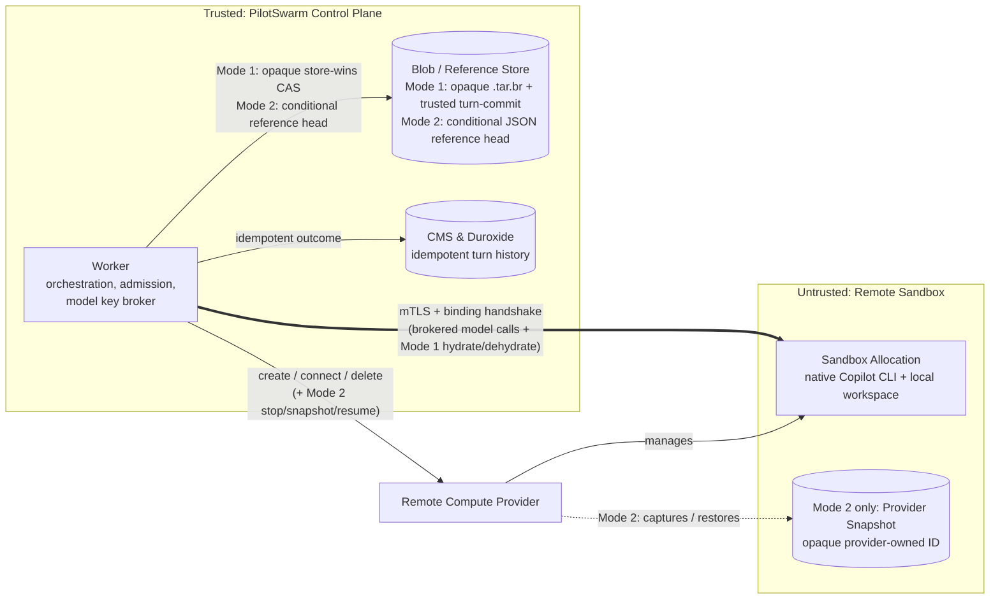

# Remote-Compute State Modes: Store-Owned and Snapshot-Owned Sandboxes

**Status:** Proposal and draft PR for discussion (November 25, 2026 — Revision 3).

Companion to [`docs/proposals/compute-contract-foundation.md`](./compute-contract-foundation.md) and [`docs/proposals/snapshot-store-wins.md`](./snapshot-store-wins.md). This proposal is provider-neutral: it defines the PilotSwarm contract for any separated remote compute provider.

---

## 1. What This Covers

This proposal defines how PilotSwarm persists session state when the **trusted worker** (orchestration, CMS, facts, artifacts, and model API keys) is separated from an **untrusted remote sandbox** (Copilot CLI, shell, and file tools).

PilotSwarm supports **two explicit state modes** on top of one shared remote-compute foundation:
- **Mode 1 (`statePolicy: "store-owned"`):** PilotSwarm's blob store and CMS own authoritative session state under `store-wins`. The remote sandbox is a disposable warm cache.
- **Mode 2 (`statePolicy: "managed"`):** A snapshot-capable compute provider owns full sandbox state (conversation files and workspace disk) inside provider snapshots, while PilotSwarm stores an accepted conditional snapshot reference.

Default local-worker sessions are unchanged. User-supplied static hosts are outside the scope of this proposal.

---

## 2. How Separated Remote Compute Works

Both modes share the same trust boundary and transport layer:

1. **Worker stays trusted:** The worker owns Duroxide orchestration, CMS history, execution admission, and all model API keys. Neither model keys nor control-plane credentials enter the sandbox, its snapshots, or its archives.
2. **Sandbox runs untrusted tools:** The sandbox runs only the native Copilot CLI and agent tools behind mutual TLS and a per-binding cryptographic handshake. Model requests flow back over the authenticated channel to the worker's model broker.
3. **Explicit mode choice per target:** A compute target declares either `statePolicy: "store-owned"` or `statePolicy: "managed"`. A session never silently falls back from Mode 2 to Mode 1 on error.

---

## 3. Two Supported State Modes

| Dimension | Mode 1: `store-owned` (Universal Default) | Mode 2: `managed` (Opt-In Full-Disk Tier) |
|---|---|---|
| **Authoritative state** | Blob storage (opaque `.tar.br`) + CMS under `store-wins` | Provider snapshot + conditional JSON reference head in store |
| **Role of the sandbox** | Disposable warm cache (reuse, pause, or replace freely) | State authority (provider snapshots back durability) |
| **What crosses back to worker** | Size-capped `cli-home` archive (`<= 16 MiB` opaque bytes; **never extracted on worker**) | Small JSON reference record (`~2 KiB`; opaque snapshot ID only) |
| **Worker crash or sandbox loss** | **Self-healing immediately:** any worker allocates a fresh sandbox and hydrates from Blob | **Gated on Phase 2:** requires qualified provider retention and stale-executor fencing |
| **Provider requirements** | Minimal: create, exec/connect, delete (works on any container, VM, or sandbox service) | Strict: immutable snapshots surviving resume/idle/delete, documented TTL, and snapshot GC |
| **Workspace & installed tools** | Ephemeral on replacement (pair with durable session workspaces or artifacts) | Preserved automatically inside the provider snapshot |
| **Control-plane complexity** | Low: reuses `store-wins` (`If-Match` ETag + `turnKey` idempotency, no turn cap) | High: write-ahead CAS phases, bounded 32-turn ledger, owner tokens, `restoreQualification` gate |

### How Mode 1 (`store-owned`) works
1. **Preflight & retry:** The worker probes the store (`probeSnapshot`). If the store already holds this `turnKey`, the worker returns the result from a **worker-owned trusted turn-commit record** with zero sandbox contact.
2. **Warm hit or cold hydrate:** If the worker holds a clean warm sandbox matching `(version, contentHash)`, it skips downloading the archive. Otherwise it allocates a fresh sandbox, streams the opaque archive bytes over the authenticated channel, and runs a hardened guest-side unpacker (rejecting `..`, absolute paths, symlinks, hardlinks, devices, and oversized expansions) before starting the CLI.
3. **Brokered turn & opaque dehydrate:** After the turn completes, the guest stops the CLI cleanly, packs only `cli-home/session-state/<sessionId>` into a size-capped brotli archive (`<= 16 MiB`), and streams it back. The worker checks the byte cap, hashes the opaque bytes without extracting them, and commits via `store-wins` conditional Put.
4. **Non-bricking conflicts:** On a `412` conflict, the worker invalidates its warm cache marker and emits telemetry. The session never bricks; the next turn rehydrates whatever won.

### How Mode 2 (`managed`) works
1. **Epoch 1 & write-ahead CAS:** Managed sessions start at `transcriptEpoch: 1` (without emitting regeneration metadata) and record bounded pre-effect intent (`acquiring`, `dispatched`, `capturing`, `publishing`) in a 4 KiB lifecycle facet (`sdk.managed-state`) before every external side effect.
2. **Quiesce, capture, and conditional head publish:** At turn end, the worker stops model/tool admission, closes the runtime connection, asks the provider to stop/snapshot the sandbox, validates the returned proposal (`restoreQualification: "unproven"` in Phase 1), and publishes one conditional reference head bound to `turnKey` and the worker's process-local owner capability digest.
3. **Fail-closed safety:** Ambiguous post-send store errors are treated as `unknown` (never assumed unwritten, never deleting the snapshot). Dispatched turn failures hold rather than replaying. Phase 1 enforces a non-evicting 32-turn ledger and keeps automatic cross-sandbox takeover disabled until provider snapshot durability and physical fencing are proven.

---

## 4. What We Know

1. **Separated execution with worker-only model keys works:** Both modes cleanly run the native Copilot CLI inside an untrusted remote sandbox while keeping model API keys, orchestration, and CMS on the worker.
2. **Provider snapshot retention cannot be assumed:** A provider's `stop` snapshot ID can succeed on restore while the source stays stopped, yet return `404 SnapshotNotFound` after the source is resumed and left idle/auto-suspended. Separating checkpoint acceptance from restore qualification (`restoreQualification: "unproven"`) is mandatory until a provider guarantees immutable snapshots across resume, idle, and deletion.
3. **Runtime quiesce before snapshot is required:** Closing the runtime transport and stopping the guest CLI before snapshotting prevents stale connections and ensures conversation state is flushed cleanly.
4. **Prototype status:** Both modes compile and pass isolated SDK unit tests (opaque `store-wins` archive CAS, cross-sandbox failover, warm-cache reuse, 412 conflict handling, and the Mode 2 managed state machine). Mode 2 same-sandbox two-turn execution is proven against a real remote sandbox provider; Mode 1 live cross-sandbox failover validation is underway.

---

## 5. Direction & Decisions Made

1. **Mode 1 (`store-owned`) is the universal default for separated compute:** It delivers immediate worker-restart and cross-sandbox failover across any compute provider without waiting on provider-specific snapshot retention guarantees.
2. **Mode 2 (`managed`) is the opt-in full-disk tier:** Kept behind explicit opt-in (`statePolicy: "managed"`, `restoreQualification: "unproven"`) for providers whose snapshot immutability, TTL, and garbage collection are independently verified.
3. **Strict untrusted-guest boundary in both modes:** The worker never extracts guest archives in Mode 1 and never injects model keys or control-plane credentials in either mode. External tool side effects (database writes, API calls, emails) are never rolled back by snapshots or archives.

---

## 6. Open Questions & Next Steps

| # | Owner | Question / Decision |
|---|---|---|
| 1 | **PilotSwarm maintainers** | Confirm adopting the two-mode contract (`store-owned` default + `managed` opt-in) as the target architecture for separated compute providers. |
| 2 | **PilotSwarm maintainers** | Confirm `16 MiB` compressed as the default `cli-home` archive cap for Mode 1, keeping larger workspace files in session workspaces and artifacts. |
| 3 | **Snapshot-provider teams** | Clarify Mode 2 snapshot guarantees: retention TTL, behavior across source resume and idle auto-suspend, post-delete survival, and snapshot garbage-collection APIs. |
| 4 | **PilotSwarm maintainers** | Decide whether Mode 2's 32-turn ledger cap should be lifted with a store-level turn journal before graduating Mode 2 out of experimental opt-in. |
| 5 | **Implementation (next)** | Complete Mode 1 live cross-sandbox failover verification, then run full-suite PR qualification before moving out of draft. |
