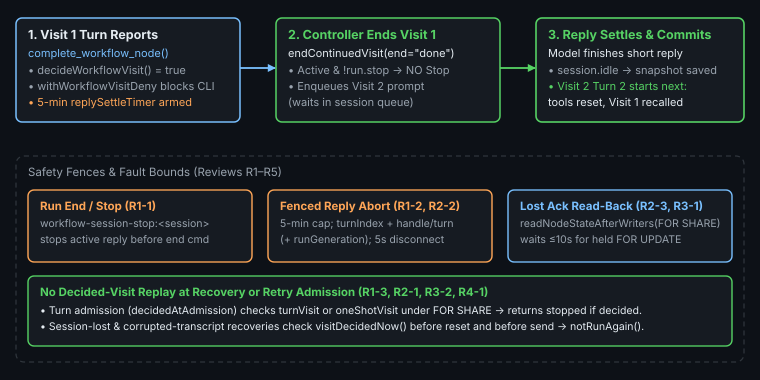

# Continued Agent Step Visit Memory (I1)

| | |
|---|---|
| **Status** | Implemented |
| **Date** | 2026-11-27 |
| **Sign-off** | Signed off by the owner 2026-11-27 |
| **As built** | `654c17dd15a0c0f36dd8abfd29fbf82e0efb7f1c` (formal full-run receipt at `ba899abfd447fcfae7a4fcd5f25a3e5a79e94d48`); additions of the Phase 1 merge in §12.1 |
| **Base** | `b79be29d1bdc94b05b5ea8ef8cce08716a984b4c` (`0.8.19`) |
| **Formal Model** | [`continued-session/README.md`](../formal/workflow/continued-session/README.md) |

This design was written after the implementation.

---

## 1. Intent & Why

An agent step with `session: continue` keeps one durable agent session across visits (cycles), so a coder step can build in visit 1, fix review findings in visit 2, and publish in visit 3. Inside a visit turn, the model reports its typed result with `complete_workflow_node` and then writes its final reply.

On `0.8.19`, `endContinuedVisit` (`packages/sdk/src/workflow/runtime.ts`) sent `workflow-cycle-stop:<nodeExecutionId>` on **every** visit end, including when the agent completed the visit itself (`end === "done"`). That Stop hit the turn while the model was still writing its reply. Because a stopped turn discards its snapshot (`session-proxy.ts`: `modelMemoryCommitted: false`), the next visit hydrated the snapshot from **before** the visit and forgot everything it did whenever the session dehydrated or moved workers.

On a completed visit of an active run, the Workflow now sends no Stop: the turn closes all tools, finishes its reply, reaches `session.idle`, and commits its snapshot. The next visit's prompt queues behind that turn and starts a new turn with the earlier visit in memory.

---

## 2. Terms

| Term | Meaning |
|---|---|
| **Visit (`nodeExecutionId`)** | One execution of a Workflow `type: agent` state (`workflow_node_executions` row). |
| **Turn visit** | Visit a continued session's turn is fenced to (`store.readTurnVisit`), or `oneShotVisit()` for `session: new`. |
| **Decided visit** | A visit whose `workflow_node_executions.state` is `'completed'` (the only value after `'pending'`). The row's `winner` says who decided it: the agent (`done`), its time limit, a cancel, or the run's end (`cancel`). |
| **Cycle Stop** | Turn-control Stop `workflow-cycle-stop:<nodeExecutionId>`, fenced to a turn of that single visit. |
| **Session Stop** | Unfenced Stop `workflow-session-stop:<childSessionId>`, sent before the session end command when a run stops or ends. |
| **Reply settle limit** | `WORKFLOW_AGENT_REPLY_SETTLE.ms` (`300,000` ms = 5 minutes): max post-report reply duration before worker abort. |

---

## 3. Goals & Non-Goals

- **Goals:**
  - Send no cycle Stop in `endContinuedVisit` when the agent completed the visit (`end === "done"`) while the run is active and not stopping (`!run.stop`), so the turn ends naturally and commits its snapshot.
  - Keep cycle Stops for visit timeouts, visit cancellations, and stopping/ended runs; send `workflow-session-stop:<childSessionId>` before the session's end command when the run stops or ends and the session's newest visit is decided. A reply that the end path does not stop (the owed-end retry path `endOwedContinuedSession` sends no Stop) is still bounded by the 5-minute reply limit.
  - Refuse **every** later tool call in the turn after `complete_workflow_node` — including CLI built-ins (`bash`, file edits, native tasks) via `withWorkflowVisitDeny`.
  - Cap post-report reply duration at `5` minutes (even with `turnTimeoutMs: 0`), fence async aborts by turn index and handle/active-turn identity (with `runGeneration` on the forced-stop backstop), and bound forced-stop session disconnects to `5` seconds.
  - Prevent re-running a decided visit with tools open across lost-session/transcript-corruption recovery, lost completion acks, and multi-worker retries (`FOR SHARE` visit read `readNodeStateAfterWriters`).
- **Non-Goals:**
  - No CMS schema change, SQL migration, or controller/orchestration version bump.
  - Steering the next visit's prompt into the running reply turn (by owner decision, the prompt queues between turns).
  - Blocking sibling tool calls emitted in the **same** model message as `complete_workflow_node` (CLI runs `onPreToolUse` for all calls in one message before any handler; documented in user/developer guides).
  - Restarting an unresponsive Copilot CLI process after `invalidateWarmSession` forgets its handle.

---

## 4. Approaches Considered

| Option | Summary | Trade-offs | Verdict |
|---|---|---|---|
| **1. Commit snapshots on stopped turns** | Keep sending cycle Stop on `done`, but commit the snapshot anyway when stopped by Workflow. | Saves half-aborted model state and blurs user/timeout Stop semantics (which must discard partial turns). | **Rejected** |
| **2. Steer next visit into running turn** | Deliver visit 2's prompt as an in-turn steer while visit 1 writes its reply. | Breaks `1:1` turn-to-visit fencing (`RT-1..RT-3`) and mixes two visits inside one uncommitted turn. | **Rejected** |
| **3. No Stop on active `done` + queued next visit + bounded reply & `FOR SHARE` fences** | Let active `done` turns finish and commit; deny post-report tools; queue next visit; bound reply (`5` min), run-end Stop, disconnect (`5` s), and `FOR SHARE` visit reads (`10` s). | Zero schema or controller version changes; preserves `1:1` visit fencing and commits clean turn snapshots. | **Chosen** |

---

## 5. Architecture & Component Ownership



| File | Functions / Symbols | Role |
|---|---|---|
| `packages/sdk/src/workflow/runtime.ts` | `endContinuedVisit`, `endContinuedSession`, `endContinuedSessionLocked`, `endWorkflowContinuedSessions`, `endWorkflowRunAgentSessions` | Skips cycle Stop on active `done` visits (`turnStopped: false`); sends `workflow-session-stop:<childSessionId>` when run stops/ends. |
| `packages/sdk/src/managed-session.ts` | `ManagedSession.decideWorkflowVisit`, `workflowVisitIsDecided`, `resetWorkflowToolsOpen`, `markRunUnsettled`, `getRunGeneration` | Tracks per-turn decided flag (separate from `closeWorkflowTools`) and per-handle `runGeneration`. |
| `packages/sdk/src/session-manager.ts` | `withWorkflowVisitDeny`, `WORKFLOW_VISIT_DECIDED_DENIAL`, `abortWarmSessionTurn`, `invalidateWarmSession`, `FORCED_STOP_DESTROY_DEADLINE_MS` | Denies post-report tool calls via `onPreToolUse`; resets at next turn; fences async abort by turn index + `(managed, active)` (and `runGeneration` on the forced-stop backstop) and caps disconnect at `5` s. |
| `packages/sdk/src/workflow/agent-node-service.ts` | `WORKFLOW_AGENT_REPLY_SETTLE`, `completeWorkflowNodeFromTool` (`visitDecided`) | `5`-minute reply cap; reconciles non-refusal completion write errors via `visitDecided()` read-back. |
| `packages/sdk/src/workflow/store.ts` | `WorkflowStore.readNodeStateAfterWriters` | Reads `workflow_node_executions.state` `FOR SHARE` with `lock_timeout` so checks order after held `FOR UPDATE` locks. |
| `packages/sdk/src/session-proxy.ts` | `noteVisitDecided`, `oneShotVisit`, `storedTurnVisitDecided`, `decidedAtAdmission`, `visitDecidedNow`, `notRunAgain` | Arms `5`-min timer, enforces `FOR SHARE` admission fence (`continue` + `new`), and blocks recovery replay of decided visits. |
| `docs/formal/workflow/continued-session/*` | `WfContinuedSession.tla`, `cases.json`, `README.md`, `CORRESPONDENCE-i1-*.md` | TLA+/TLC model and correspondence notes across initial fix and reviews R1–R5. |

---

## 6. Data & Wire Contracts

```ts
// packages/sdk/src/workflow/store.ts
async readNodeStateAfterWriters(nodeExecutionId: string, lockTimeoutMs: number): Promise<WorkflowNodeExecutionRow["state"] | null>;

// packages/sdk/src/session-manager.ts
export const WORKFLOW_VISIT_DECIDED_DENIAL =
    "The result of this workflow step is recorded, so this cycle is over and no more tools run in "
    + "this turn. Write a short final reply and stop.";
export function withWorkflowVisitDeny(hooks: SessionConfig["hooks"], decided: (() => boolean) | null): SessionConfig["hooks"];

// packages/sdk/src/workflow/agent-node-service.ts
export const WORKFLOW_AGENT_REPLY_SETTLE = { ms: 5 * 60_000 };
```

- **Cycle end event (`workflow.agent_cycle_ended`):** written once per visit, only while the run is active (`runtime.ts:1434`). `data.turnStopped` is `true` only when this end sent a cycle Stop: `end === "cancel"` or `run.stop`, on a worker with turn controls, at the visit's first end or the after-spawn re-check. A visit its agent completed (`done`) while the run is active and not stopping always records `turnStopped: false`, even when the reply limit or the run's end stops that turn later.
- **Session Stop request ID (`runtime.ts:1514`):** `workflow-session-stop:<childSessionId>` (reason: `` `The workflow run this session served ${why}.` ``, `why` computed at `1511`). Matches no `workflow-cycle-stop:*` prefix, so `admitTurnControls` applies it to whichever turn runs.
- **Visit read lock bound (`session-proxy.ts:675`):** `WORKFLOW_VISIT_READ_LOCK_MS = 10_000` (`10` s transaction-local `lock_timeout` on `readNodeStateAfterWriters`).
- **Stopped TurnResults (`session-proxy.ts`):**
  - Reply settle timeout (`WORKFLOW_AGENT_REPLY_SETTLE.ms`, `300,000` ms): `"The workflow step's result is recorded, and its turn did not finish its reply in time."`
  - Lost session / corrupted transcript after decision: `{ type: "stopped", reason: "The workflow step's result is recorded; the rest of its turn was lost with its Copilot session, so the turn was not run again." }`
  - Admission fence hit: `{ type: "stopped", reason: "The workflow already ended cycle <visit>; this turn was not run." }`
- **Bounded stop stages:** Task cancel `1,500` ms -> grace `8,000` ms -> force-settle (`2,000` ms) -> workspace shell cancel `20,000` ms -> disconnect `5,000` ms (`FORCED_STOP_DESTROY_DEADLINE_MS` / `DROPPED_TURN_DESTROY_DEADLINE_MS`).

---

## 7. Visit End & Turn Lifecycle State Table

| Current State | Event / Fault | Atomic Action & Next State | Snapshot Committed? |
|---|---|---|---|
| Visit 1 turn running, run `active`, `!run.stop` | `complete_workflow_node` succeeds | `decideWorkflowVisit()` closes all tools; `5`-min timer starts; `endContinuedVisit` skips Stop (`turnStopped: false`). Model finishes reply -> `session.idle`. | **Yes** |
| Visit 1 reply running | Visit 2 prompt arrives | Queues on `messages`; starts Turn 2 after Turn 1 commits; `resetWorkflowToolsOpen()` re-opens tools. | Turn 1: **Yes** |
| Visit 2 entered while Visit 1's reply runs | Visit 2's `timeoutSeconds` elapses before Turn 1 ends | Visit 2 is decided `timed_out`; its cycle Stop names `nx-2` and does not touch Turn 1; Turn 2 (`nx-2`) is refused at admission. The next visit's time limit includes the time its prompt waits (`<= 5` min + stop stages). | Turn 1: **Yes** |
| Visit 1 reply running | `5`-min timer fires | `abortWarmSessionTurn` checks the turn index, then that the same handle still runs the same turn object (the forced-path backstop also checks `runGeneration`), and stops Turn 1 (drops handle with `5` s cap if forced). Turn 2 runs from pre-Visit-1 snapshot. | **No** (step result stays in DB) |
| Visit 1 reply running | Run cancelled, stopped, or ended | `endContinuedSessionLocked` sends `workflow-session-stop:<session>`, then enqueues session `done`/`cancel` command. | **No** |
| `complete_workflow_node` write drops connection | Non-`WorkflowStoreError` caught | `readNodeStateAfterWriters(visit, 10_000)` (`FOR SHARE`) waits behind held `FOR UPDATE`. `completed` -> `onDecided()`; `pending` -> retryable. | **Yes** if reply finishes |
| Read-back cannot verify (lock held `> 10` s, connection lost) and the write did not commit | `visitDecided()` -> `null` | Tools close anyway (fail closed); no reminder this turn; the visit stays `pending` and ends at its time limit (`timed_out`). | **Yes** if the reply finishes |
| Copilot session lost or 400 transcript error after decision | `runTurn` recovery | `visitDecidedNow()` checked before reset and before send -> `notRunAgain()` drops handle (`5` s cap), returns `stopped`. | **No** (no replay) |
| Worker A crashes mid-`COMMIT` or during reply; Worker B retries | `runTurn` admission (`decidedAtAdmission`) | Reads `turnVisit` (`continue`) or `oneShotVisit` (`new`) under `FOR SHARE` (`10` s). Sees `completed` -> returns `stopped`, zero model calls. | **No** (no replay) |
| Admission read waits `> 10` s (a decision's row lock still held) | `readNodeStateAfterWriters` throws `55P03` (not retried in-activity) | The turn fails and is retried by the orchestration; repeated lock holds can exhaust the turn's retries. | **No** |

A turn stopped after its report (reply limit, run end, lost session) commits nothing, so at `654c17dd1` the next visit remembers none of that visit, only its recorded result; the Workflow's own events do not show this, while the child session records `session.snapshot_unpublished` (`reason: "stopped"`). **Added in the Phase 1 merge:** deciding a continued visit also cancels background tasks started in that turn (`D-1`), and post-report memory loss records a lost-memory flag on the visit, exposes it in `read_workflow`, and switches the next visit's prompt to state that the earlier conversation is not available (`D-2`; see §12.1).

---

## 8. Worked Examples

### 8.1 Normal Trace: Two-Visit Coder Across Worker Restart

1. `wf-pr` enters `code` visit 1 (`nx-1`) on continued session `s-coder` (Worker A, Turn 1). The model calls `complete_workflow_node({ operation_id: "c1", outcome: "built", output: { headSha: "abc1" } })`.
2. `completeAgentNode` commits `nx-1`. `onDecided` sets `workflowVisitDecided = true` (`withWorkflowVisitDeny` denies any later `bash` call) and arms the `5`-minute timer.
3. `endContinuedVisit` sees `end === "done"`, `active === true`, `!run.stop` -> sends no Stop. Model writes `"Built abc1."`, reaches `session.idle`, and Worker A commits snapshot `snap-1`.
4. Worker A restarts. Visit 2 (`nx-2`) runs on Worker B, which hydrates `snap-1`, resets `workflowVisitDecided = false`, binds Turn 2 to `nx-2`, and recalls Turn 1's transcript.

### 8.2 Race Trace: Reply Settle Timer Firing as Visit 2 Starts on Warm Session (R2-2)

1. Turn 1 (`active = A1`, `runGeneration = 1`) reports `nx-1` and stalls `5` minutes. `replySettleTimer` calls `abortWarmSessionTurn("s-coder", { expectedTurnIndex: 0 })`.
2. `abortWarmSessionTurn` marks Turn 1 stopped and sends the abort (`session-manager.ts:2374-2376`), then waits up to `1.5` s for the turn's background tasks to cancel. Turn 1 unwinds as `stopped`. Its snapshot is not committed (`session-lifecycle.ts:393-405`), and its activity releases the session lock. Visit 2's Turn 2 starts (`active = A2`) and rehydrates the last committed snapshot, which is from before Visit 1. Visit 1 is not remembered.
3. `stillRunning()` (`session-manager.ts:2404`) is `false` (the registered handle or its active turn is no longer `A1`), so the Stop returns `{ outcome: "stopped", turnIndex: 0 }` and does not settle or invalidate Turn 2. Only when Turn 1 is still running after the `8` s grace does the Stop escalate (`forceSettleTurn`, `markRunUnsettled`). Its backstop `invalidateWarmSession(..., { onlyRun })` then skips a handle whose `getRunGeneration()` has moved on (`session-manager.ts:2419-2427`, `4420`).

If the timer fires after Turn 1's run has ended, the Stop finds no active turn (or `expectedTurnIndex` does not match Turn 2) and returns `no_active_turn` (`session-manager.ts:2357-2371`).

---

## 9. Compatibility & Upgrade

- **Zero schema or orchestration/controller version change:** All changes are in worker activities; in-flight orchestrations replay cleanly.
- **Queue wait counts toward the next visit's `timeoutSeconds`:** A `session: continue` visit's `deadline_at` is set on its node row at entry (`store.ts:7178`). Because the prompt now waits behind the previous visit's reply (up to `5` min plus `~36.5` s of stop stages) instead of cutting it with a cycle Stop, a continued step configured with `timeoutSeconds` shorter than the previous reply's settle time can time out before its turn starts.
- **Rollback & mixed-version window:** Rollback restores the cycle Stop on every visit end (memory loss returns; nothing stored changes). In a mixed-version window, a new controller activity sends no Stop while an old worker may run the turn without the deny hook or the reply limit. Post-report tools then run and, with `turnTimeoutMs: 0`, the reply is unbounded. The combined Phase 1 branch deploys stop-all (I6), which avoids that window.
- **Combined Phase 1 note:** I1 ships with I2 and I6, so deploy using I6's stop-all-workers rule ([`wf-i6-whole-child-results.md`](wf-i6-whole-child-results.md)).

---

## 10. Differences from the Build Plan

Relative to the build plan for I1, `654c17dd1` adds five safety mechanisms from testing and reviews R1–R5:

1. **CLI built-ins closed (`session-manager.ts:762-771`):** Confirmed `bash` still ran on `main` after `complete_workflow_node`; added `withWorkflowVisitDeny` (`onPreToolUse`).
2. **`afterSpawn` skips Stop on `done` (`runtime.ts:1423-1425`):** Avoids stopping the reporting turn when completion beats spawn's post-send check.
3. **Unfenced `workflow-session-stop:<session>` at run end/stop (`runtime.ts:1514`, R1-1):** Stops an active post-report reply turn before the session end command.
4. **5-minute reply cap, run-fenced abort & 5-second disconnect bound (`agent-node-service.ts:99`, `session-manager.ts:2404, 2427`, R1-2 / R2-2 / R3-3):** Bounds stalled replies and hung CLI disconnects without hitting the next visit's turn.
5. **`FOR SHARE` visit ordering across lost acks, recoveries, and `session: new` retries (`store.ts:4527`, `session-proxy.ts:2754, 4848, 5266`, R1-3 / R2-1 / R2-3 / R3-1 / R3-2 / R4-1 / R5-2):** Orders read-backs and turn admission relative to any decision holding `FOR UPDATE` on the node row, blocking duplicate execution.

---

## 11. Quality Gates & Receipts

- **Gate 1 (`TLA+ / TLC`):** Extended `docs/formal/workflow/continued-session/WfContinuedSession.tla` + R1–R4 correspondence notes. The `101` case configs from `main` (and, from R2 on, the `17` of batch `i1`) are byte-identical except for the new constants, all `FALSE`. Batch results: `i1` `17`, `r2a` `9`, `r3a` `3` (`i1.fix-safety` `445,565`; `i1.fix-r2-safety` `6,521,296`; `i1.fix-r2-live` `188,101` distinct states); `11` witnesses reached. Full `128`-case run on the final model completed (`128/128` as expected under TLC 2.19: `72` PASS, `48` safety and `8` liveness violations where expected; recorded in `docs/formal/workflow/continued-session/README.md` at `ba899abfd`). Outside the formal model (covered by worker and store tests only): `session: new` retry admission (`R3-2`), the `5`-second forced-stop disconnect bound (`R3-3`), `FOR SHARE` lock timeouts (`55P03`) and fail-closed unverified read-backs, and non-atomic turn admission (`TurnStart` is atomic in TLC; code orders via `FOR SHARE`, `R4-1`).
- **Gate 2 (`PostgreSQL 16` + `HorizonDB`):** `workflow-agent-memory-worker.test.js` `11/11` at `654c17dd` (`9` cases + `2` lost-acknowledgement variants; the `R5-1` rerun of those `2` at `02d7b8b8` is green), `stop-turn.test.js` (`19/19`), `workflow-simplified-turn-fence.test.js` (`15/15`). SDK unit `3,136/0/1`, targeted PG16 `308/308` (`83` files), and targeted HorizonDB `307/308` at `d365db40` (the 1 load-sensitive test `M-09` in `workflow-agent-node.test.js` passed `3/3` in isolation on both branch and `main`); later commits change one test file and formal docs only.
- **Gate 3 / Gate 4 & review:** Unmocked 2-cycle live checks passed (`2/2` models recalled visit-1 secret and post-report reply with `turnStopped: false`, vs `0/2` on `main`). Five cross-family review rounds completed (`APPROVE` at `d365db40`, `0` must-fix; `R5-1`/`R5-2` applied in `02d7b8b8` and `654c17dd`).

---

## 12. Phase 1 Merge Additions, Accepted Known Limits & Open Follow-Ups

### 12.1 Added in the Phase 1 Merge (`1e0ea8563`, review fixes `7499bae9b`)

Owner decision (2026-11-26): fix both design-review findings.

1. **Cancel the turn's background tasks when a continued visit is decided (`D-1`):** Background shells or native tasks started before `complete_workflow_node` keep the CLI turn open (no `session.idle`), which otherwise triggers the `5`-minute reply-settle Stop and drops the whole visit's memory. `noteVisitDecided` (`session-proxy.ts`) now cancels the background tasks started by that turn (`cancelBackgroundTasks` with `startedWithin` from the turn's start to the report, matching the V4 Stop's own cancel and bounded like it at `1.5` s by `withWorkspaceDeadline`). A second bounded pass runs `2` s later (`WORKFLOW_REPORT_TASK_RECHECK_MS`), only while the same turn still runs, for work that a call in the report's own model message started. Tasks of earlier turns are kept. The `complete_workflow_node` tool description says to call it alone and last.
2. **Lost-memory flag on the visit, `read_workflow` surface, and next-visit prompt (`D-2`):** When a continued visit its agent decided ends its turn without a committed snapshot (reply-limit Stop, a forced Stop, a Stop while the run is stopping, a lost Copilot session / `notRunAgain`), the turn records the event `workflow.agent_cycle_memory_lost` on the Workflow session before it ends (reasons `reply_limit`, `forced_stop`, `session_lost`, `stopped`, `not_committed`; once per visit, only while the run is active, stopping included; no migration). `read_workflow` shows it as `agent.memoryLost`, and the next cycle's prompt says "The conversation of cycle N is not available ..." instead of "what you did in earlier cycles is above" (`workflowAgentCycleMemoryLostPrompt`, `agent-node-service.ts`). The reply-settle timer is also cleared when the model run returns, so it never marks a finished reply as stopped.
3. **Formal model:** `WfContinuedSession.tla` adds `NoteLoss` with `Inv_NoFalseMemoryClaim` and `Inv_LostNotCommitted`; all `134` cases on the final model ended as expected (`75` PASS, `51` safety and `8` liveness violations where the case expects one), recorded in `docs/formal/workflow/continued-session/README.md`.
4. **Tests:** `workflow-agent-memory-worker.test.js` (background shell ended at the report, including one started in the report's own message; reply limit and lost session recorded and told; the reply limit of one visit never stops the next visit's turn), `workflow-agent-memory-store.test.js` (the record's guards), and `workflow-simplified-session-continue.test.mjs` (the prompt rewrite).

### 12.2 Accepted Known Limits (Owner Sign-Off, 2026-11-26)

1. **No Stop for a very fast finish:** `endContinuedVisit`'s `afterSpawn` re-check sends no cycle Stop when a visit already completed (`end === "done"`, `runtime.ts:1423-1425`), keeping stale-send Stops only for cancelled, timed-out, or stopping runs so a fast completion never aborts its own reply.
2. **Run-end Stop can cut the last reply:** Normal run completion sends `workflow-session-stop:<childSessionId>` (`runtime.ts:1514`) before the session end command, which can stop the final visit's still-running reply turn (and a cancelled continued visit receives both its cycle Stop and the session Stop).
3. **Fixed 5-minute reply limit:** `WORKFLOW_AGENT_REPLY_SETTLE.ms` (`300,000` ms) is a fixed `5`-minute cap and is not configurable per Workflow or step.

The `D-2` record covers visits their agent completed. Not recorded (documented known limits): a visit decided by its time limit or a cancel, whose Stop ends its turn unsaved; a recovery that starts a fresh conversation; and a turn whose activity fails for good after the report.

### 12.3 Other Limits & Open Follow-Ups

1. **Same-message sibling tool calls:** CLI runs `onPreToolUse` for every call in a single model message before any handler executes; the tool description says to call `complete_workflow_node` alone and last, the report's second task-cancel pass ends background work such a call starts, and code can optionally track pending calls in `onPreToolUse`.
2. **Unverified read-back on uncommitted write (`D-3`):** When `visitDecided()` returns `null` (for example `55P03` after `10` s) and the completion write did not commit, fail-closed tool closure plus suppressed reminder leaves the visit `pending` until `timed_out`; follow-up option is one pre-reminder re-read at turn end.
3. **Deny-hook handle lookup after invalidation (`D-4`):** `withWorkflowVisitDeny` queries `this.sessions.get(sessionId)?.workflowVisitIsDecided() === true` (`session-manager.ts:3456`); if a disconnected handle's `destroy()` timed out at `5` s after `invalidateWarmSession` removed or replaced map entry `sessionId`, late callbacks from that old CLI session would not match. Follow-up: pin the predicate to its own `ManagedSession` instance.
4. **Short `timeoutSeconds` on `session: continue` (`D-5`):** Continued steps with `timeoutSeconds` below `~6` minutes can expire while queued behind a stalled prior reply (§7, §9).
5. **Wedged CLI process retirement & per-turn `FOR SHARE` read:** Optionally retire a shared CLI runtime process whose RPC disconnect timed out (`R5` note); every Workflow agent turn takes one short `FOR SHARE` read of its visit row at admission.
