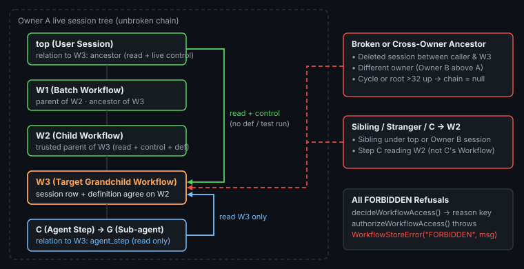

# Nested Workflow Access and Agent-Step Self-Read (I2)

| | |
|---|---|
| **Status** | Implemented |
| **Date** | 2026-11-27 |
| **Sign-off** | Signed off by the owner 2026-11-27 |
| **As built** | `943f17b5339620e0d4bae935e52d8350c8ee5bca`; changes of the Phase 1 merge in §13 |
| **Base** | `b79be29d1bdc94b05b5ea8ef8cce08716a984b4c` (`0.8.19`) |

This design was written after the implementation.

---

## 1. Intent & Why

On `0.8.19`, `authorizeParent` (`packages/sdk/src/workflow/tools.ts:285-291`) allowed only a Workflow's direct parent session to call `read_workflow` or `update_workflow`. Every other session received `FORBIDDEN` (`"Only the agent that created this workflow may change or read it with this tool."`).

Two cases broke whenever Workflows nested:

1. **Grandparents and higher ancestors.** When a user session starts a batch Workflow (`W1`) whose `spawn` step starts child Workflows (`W2`, `W3`), the user session is `W2`'s grandparent. It could not read, pause, resume, stop, cancel, set variables on, or recover `W2`.
2. **A Workflow's own agent step.** An agent session created by a `type: agent` state sits below its Workflow (`parent_session_id = W`), so neither the step nor its sub-agents could call `read_workflow` on its own run.

Nesting a Workflow inside a batch must not blind the ancestor session that owns the tree. An agent step also needs read-only access to its own Workflow without gaining run-control authority.

---

## 2. Terms

| Term | Meaning |
|---|---|
| **Trusted parent (`parent`)** | Caller whose `sessionId` matches both `sessions.parent_session_id` and `workflow_definitions.parent_session_id`. |
| **Whole chain** | Unbroken session list from a starting session (the Workflow on the ancestor path, or the caller on the agent-step path) up `parent_session_id` to a root (`parent_session_id IS NULL`) within `WORKFLOW_LINEAGE_MAX_DEPTH` (`32` sessions above it, `<= 33` rows), with no cycles or missing rows (`access.ts:chainFrom`). Otherwise `null` (fails closed). |
| **Owner identity** | Exact key from `access.ts:ownerIdentity`: `"system"` if `isSystem`, `"none"` if `owner === null`, or `JSON.stringify([provider, subject])` when both are non-blank (`null` if partial/blank, which matches nothing). **Owner classes:** Ownerless sessions all share the identity `"none"`, so an all-unowned chain grants nested read and control (typed input stays parent-only there). A system root (`is_system`) is `"system"`; the sessions it spawns carry the System user principal (`["system","system"]`) and are not `is_system`, so the root is refused (`otherOwner`) on Workflows below its direct child, while System-principal sessions between them match one another. |
| **Ancestor (`ancestor`)** | Caller at index `>= 2` in a Workflow's whole chain above a trusted parent, with every link `1..at` live (`!deleted`) and matching `chain[0]`'s owner identity. |
| **Agent step (`agent_step`)** | Caller whose `store.ts:readWorkflowLineage` is live, non-cyclic (`level !== null`), and has `agentRoot.workflowSessionId === workflowSessionId`, and whose whole chain reaches the Workflow at `at = distance + 1` with `chain[at - 1]` equal to `agentRoot.childSessionId` (the step itself) and every link `0..at-1` live and same-owner. Covers the step (`distance = 0`) and its sub-agents (`distance >= 1`). |
| **Retained outcome** | Record kept in `session_child_outcomes` under the parent (`catalog.getChildOutcome`) after a finished live Workflow is soft-deleted. |

---

## 3. Goals & Non-Goals

- **Goals:**
  - Let every live, same-owner ancestor above a Workflow's trusted parent (the Workflow, and for an agent step the caller, must reach its tree's root within `32` sessions above it; a deeper tree is refused as `unrelated`) read (`read_workflow`), control live runs (`pause`, `resume`, `stop`, `cancel`, `set_vars`, `recover`), and read retained outcomes after cleanup.
  - Let a Workflow's own agent step and its sub-agents call `read_workflow` on that Workflow only.
  - Keep definition authoring, testing, starting, and `mode === "test"` run control strictly with the direct parent (`mode === "test"` runs remain readable by authorized ancestors via `read_workflow`).
  - Centralize authorization in `packages/sdk/src/workflow/access.ts` with rule-specific `FORBIDDEN` messages, align `child_workflows` parent checks with it, and update tool descriptions so models discover nested access directly.
- **Non-Goals:**
  - No CMS schema change, SQL migration, or orchestration/controller version bump.
  - Widening `child_workflows` (still direct children only; grandchildren return `WORKFLOW_NOT_FOUND`).
  - Changing `send_workflow_input` (`workflow/authority.ts:decideTypedInputAuthority`), which already allows the trusted parent or any live session of the same user.
  - Locking intermediate ancestor rows across the run-command write (checks run on command arrival, matching the prior parent check).

---

## 4. Approaches Considered

| Option | Summary | Trade-offs | Verdict |
|---|---|---|---|
| **1. Direct-parent-only (`authorizeParent`)** | Keep `read_workflow` and `update_workflow` restricted to `parentSessionId === callerSessionId`. | Chat grandparents lack `child_workflows` and cannot inspect, pause, cancel, or recover nested Workflows; agent steps cannot read their own run. | **Rejected** |
| **2. Flat same-owner access** | Allow any live session with the same `userOwnerKey` to read and control any Workflow of that user. | Breaks tree isolation: sibling branches, replacement sessions, or child steps could pause or cancel peer or parent Workflows. | **Rejected** |
| **3. Lineage & invocation rule (`workflow/access.ts`)** | Walk `readSessionAncestry` (including soft-deleted rows) and `readWorkflowLineage`. Grant `parent` full access, unbroken same-owner `ancestor` `read` + live `control`, and `agent_step` `read` only. | Bounded recursive reads (at most three, each `<= 33` rows) plus two point reads; a direct parent needs only the point reads. Enforces tree, owner, deleted-link, cycle, and parent-only definition boundaries. | **Chosen** |

---

## 5. Architecture & Component Ownership



| File | Functions / Symbols | Role |
|---|---|---|
| `packages/sdk/src/workflow/access.ts` *(new)* | `decideWorkflowAccess`, `authorizeWorkflowAccess`, `mayReadRetainedWorkflow`, `chainFrom`, `brokenLink`, `ownerIdentity`, `sameOwner`, `grants`, `WORKFLOW_ACCESS_REFUSALS` | Single rule for `read`, `control`, and `definition` access to live and retained Workflows. |
| `packages/sdk/src/workflow/store.ts` | `WorkflowStore.readSessionAncestry`, `WorkflowStore.listChildWorkflows` (`requireDefinitionParent`) | Recursive CTE reading up to `32` ancestors (soft-deleted rows + owners included); parent-agreement filter on `list`. |
| `packages/sdk/src/workflow/tools.ts` | `authorizeRunControl`, `updateWorkflowFromTool`, `recoverWorkflowFromTool`, `readWorkflowFromTool`, `authorizeChildOfWorkflow`, `childWorkflowsFromTool`, `updateWorkflowDescription`, `READ_WORKFLOW_TOOL_SPEC` | Wires tools to `access.ts`, blocks ancestor control of `mode === "test"` runs, sets `ANCESTOR_CANCEL_REASON` (replaced in the Phase 1 merge by the relation passed to `controlWorkflowRun`, §13), updates descriptions. |
| `docs/*`, `CHANGELOG.md`, `workflow-tools/SKILL.md` | User guide, `workflow-sessions.md`, `workflow-child-workflows.md`, skill refusals | Documents the access matrix, test-run rule, and refusal codes. |

---

## 6. Data & Wire Contracts

```ts
// packages/sdk/src/workflow/access.ts
export type WorkflowAccess = "read" | "control" | "definition";
export type WorkflowRelation = "parent" | "ancestor" | "agent_step";
export type WorkflowAccessDecision =
    | { allowed: true; relation: WorkflowRelation }
    | { allowed: false; reason: keyof typeof WORKFLOW_ACCESS_REFUSALS };

export async function decideWorkflowAccess(host: AccessHost, workflowSessionId: string, callerSessionId: string): Promise<WorkflowAccessDecision>;
export async function authorizeWorkflowAccess(host: AccessHost, workflowSessionId: string, callerSessionId: string, access: WorkflowAccess): Promise<WorkflowRelation>;
export async function mayReadRetainedWorkflow(host: AccessHost, retainedParentSessionId: string, callerSessionId: string): Promise<boolean>;

// packages/sdk/src/workflow/store.ts
async readSessionAncestry(sessionId: string): Promise<Array<AuthoritySession & { sessionId: string }>>;
```

`readSessionAncestry` runs `WITH RECURSIVE chain` on `sessions` (`distance < 32`), `LEFT JOIN session_owners` and `users`, ordered by `distance`. Soft-deleted rows stay in the result (`deleted: true`) so `chainFrom` distinguishes a deleted link from a root.

| Condition | Code | Exact Message / Value |
|---|---|---|
| Missing/deleted/non-workflow row or missing definition (and no readable retained outcome) | `WORKFLOW_NOT_FOUND` | `"No Workflow <workflowSessionId> is visible to this session."` |
| Non-child target on `child_workflows` | `WORKFLOW_NOT_FOUND` | `"No child Workflow <workflowSessionId> belongs to this Workflow."` |
| Unrelated caller, sibling, step reading grand-Workflow, cycle, or root `> 32` sessions up (`unrelated`) | `FORBIDDEN` | `"Only a session above this Workflow (the session that started it, or one above that) may read or control it with this tool; its own agent steps may read it."` |
| Ancestor calling definition op or targeting `mode === "test"` run (`definition`) | `FORBIDDEN` | `"Only the session that started this Workflow may save or start its definition, or test it."` |
| Agent step or its sub-agent calling `control` or `definition` (`agentStep`) | `FORBIDDEN` | `"An agent step, and a session under it, may read its own Workflow but not control it."` |
| Deleted session between caller and Workflow (`deleted`) | `FORBIDDEN` | `"A session between this session and the Workflow was deleted, so this session may no longer read or control it."` |
| Different owner along chain (`otherOwner`) | `FORBIDDEN` | `"This session belongs to another owner than the Workflow, so it may not read or control it."` |
| Ancestor `cancel` with `reason` omitted (`ANCESTOR_CANCEL_REASON` at `943f17b53`; `controlWorkflowRun` `aboveParent` after the Phase 1 merge) | *(run control)* | `"Cancelled by a session above it"` (parent keeps `"Cancelled by its parent"`) |

---

## 7. Authorization Matrix

| Caller | `read_workflow` (live) | `read_workflow` (retained) | `update_workflow` live run (`pause`, `resume`, `stop`, `cancel`, `set_vars`, `recover`) | `update_workflow` definition ops or `mode === "test"` run | `child_workflows` | `send_workflow_input` (`authority.ts`) |
|---|---|---|---|---|---|---|
| **`parent`** (session + definition agree) | Allowed | Allowed | Allowed | Allowed | Allowed (Workflow caller) | Allowed |
| **`ancestor`** (whole live same-owner chain) | Allowed | Allowed while every session from the swept Workflow's parent up to the caller is live | Allowed | `FORBIDDEN` (`definition`) | `WORKFLOW_NOT_FOUND` | Allowed for user trees; `FORBIDDEN` for system/unowned |
| **`agent_step`** (own step or sub-agent) | Allowed | `WORKFLOW_NOT_FOUND` | Not offered (a session inside a Workflow has no `update_workflow`; a stale call gets the inside-Workflow refusal). `access.ts` also refuses it (`agentStep`). | Not offered (a session inside a Workflow has no `update_workflow`; a stale call gets the inside-Workflow refusal). `access.ts` also refuses it (`agentStep`). | Direct children of step's Workflow (step only) | Allowed for user trees; `FORBIDDEN` for system/unowned |
| **System / unowned chains** | All-unowned (`"none"`): Allowed; `["system","system"]` chain: Allowed; `is_system` root (`"system"`) below direct child: `FORBIDDEN` (`otherOwner`) | Same owner-chain rule while intermediate links are live | Same as `read_workflow` (live) | `FORBIDDEN` (`definition` / `otherOwner`) | `WORKFLOW_NOT_FOUND` | `FORBIDDEN` (parent-only for system/unowned) |
| **Above deleted link** | `FORBIDDEN` (`deleted`) | `WORKFLOW_NOT_FOUND` | `FORBIDDEN` (`deleted`) | `FORBIDDEN` (`deleted`) | `WORKFLOW_NOT_FOUND` | Allowed if same non-system user |
| **Above owner boundary** | `FORBIDDEN` (`otherOwner`) | `WORKFLOW_NOT_FOUND` | `FORBIDDEN` (`otherOwner`) | `FORBIDDEN` (`otherOwner`) | `WORKFLOW_NOT_FOUND` | Allowed only if the caller itself is the Workflow's (non-system) user |
| **Sibling, stranger, cycle, mismatch** | `FORBIDDEN` (`unrelated`) | `WORKFLOW_NOT_FOUND` | `FORBIDDEN` (`unrelated`) | `FORBIDDEN` (`unrelated`) | `WORKFLOW_NOT_FOUND` | Allowed only if same non-system user |

**Owner decision (2026-11-26): keep the code as built.** Keep this `access.ts` behavior rather than changing system/unowned chains to fail closed (an earlier build note said these trees fail closed; that note did not match the code): in an all-unowned tree, a live ancestor may read and control/cancel a nested Workflow while `send_workflow_input` stays parent-only; a system root (`is_system`) is refused (`otherOwner`) below its direct child like another owner, while `["system","system"]` descendants match one another. **Added in the Phase 1 merge (`08f8f7366`):** regression tests in `workflow-nested-access.test.js` pin both the unowned-tree and system-root cases.

---

## 8. Worked Examples

### 8.1 Normal Trace: Great-Grandparent Control and Sub-Agent Self-Read

Tree (all live, owner `alice` = `["entra", "u-alice"]`): `s-top -> wf-batch (W1) -> wf-item (W2) -> wf-coder (W3, run-3) -> s-step -> s-sub`.

1. **`s-sub` reads `wf-coder`:** `readWorkflowLineage("s-sub")` returns `{ deleted: false, level: 5, agentRoot: { workflowSessionId: "wf-coder", childSessionId: "s-step", distance: 1 } }`. `chainFrom("s-sub")` returns `[s-sub, s-step, wf-coder, wf-item, wf-batch, s-top]`. At `at = 2`, `chain[2]` is `wf-coder`, `chain[1]` is `s-step`, and `brokenLink([s-sub, s-step], wf-coder)` is `null` -> `{ allowed: true, relation: "agent_step" }` -> `read` succeeds.
2. **`s-sub` attempts to pause `wf-coder`:** In a live session `update_workflow` is not declared to `s-sub` (`managed-session.ts:1618`), and any stale invocation is refused by `workflowDefinitionToolsRefusal()` (`managed-session.ts:3590`). On a direct `updateWorkflowFromTool` call, `grants("agent_step", "control")` is `false` -> `FORBIDDEN` (`WORKFLOW_ACCESS_REFUSALS.agentStep`).
3. **`s-top` cancels `wf-item` with no `reason`:** `authorizeRunControl` verifies live mode and returns `relation === "ancestor"`; `controlWorkflowRun` cancels `wf-item` and records the default reason `"Cancelled by a session above it"` in `lastControl`. (At `943f17b53` a pre-check set `args.reason` instead; the Phase 1 merge moved the choice after the request hash, §13.)

### 8.2 Fault Traces: Deleted Intermediate Link and Cyclic Parent Rows

1. **Deleted intermediate session (`s-top -> s-mid -> s-parent -> wf-1`):** `s-mid` is soft-deleted (`deleted_at` set) without cascading. When `s-top` calls `read_workflow("wf-1")`, `readSessionAncestry("wf-1")` returns `[wf-1, s-parent, s-mid (deleted: true), s-top]`. `brokenLink` returns `"deleted"` -> `FORBIDDEN` (`WORKFLOW_ACCESS_REFUSALS.deleted`). `s-parent` still matches the direct `parent` check and keeps full control.
2. **Corrupt parent loop (`wf-1 -> s-top -> s-step -> wf-1`):** If corrupt rows set `s-top.parent_session_id = "s-step"`, `chainFrom("wf-1")` sees `"wf-1"` repeat in `seen` before `parentSessionId === null` and returns `null`. `readWorkflowLineage("s-step")` also sets `level: null`. Both `ancestor` and `agent_step` checks reject `null` -> `FORBIDDEN` (`unrelated`).

---

## 9. Compatibility & Upgrade

- **No schema or version change:** Uses existing tables and controller/orchestration versions. Direct-parent calls resolve in one `Promise.all` without walking ancestry.
- **Audit & parent observability:** Ancestor commands are recorded with actor `{ kind: "agent", sessionId: <ancestor> }` (`tools.ts:678`). The coordinating direct parent receives no notice of an ancestor's `pause`, `resume`, or `set_vars`; it hears only the end notice after `cancel` or `stop`, with default reason `"Cancelled by a session above it"`.
- **Deployment:** Ships with I6, so deploy follows I6's stop-all-workers rule ([`wf-i6-whole-child-results.md`](wf-i6-whole-child-results.md)). I2 itself has no worker-version hazard.

---

## 10. Differences from the Build Plan & Owner Decisions

Relative to the build plan for I2, `943f17b53` adds five refinements and two owner-confirmed policy decisions (2026-11-26):

1. **Sub-agents of an agent step (`access.ts:121-129`; owner decision: keep read access):** Sub-agents spawned under a Workflow agent step (`distance >= 1`) receive `relation: "agent_step"`, matching the step itself (`distance = 0`): every session under the step may read the whole Workflow (definition, variables, step executions and outputs, and inbox previews) via `read_workflow`, and may not control it.
2. **`stop` in ancestor control (`tools.ts:682`):** Ancestors may call `stop` (`grace_seconds`) in addition to `pause`, `resume`, `cancel`, `set_vars`, and `recover`.
3. **Test runs stay parent-only (`tools.ts:296-306`):** Ancestors naming a `mode === "test"` `run_id` are refused with `WORKFLOW_ACCESS_REFUSALS.definition`.
4. **Ancestor cancel reason (`tools.ts:290, 684-688`):** Default ancestor cancel reason is `"Cancelled by a session above it"` (chosen after the request hash since the Phase 1 merge, §13).
5. **Retained outcomes & `child_workflows` list check (`access.ts:157-162`, `store.ts:3610`):** Ancestors read swept Workflows via `mayReadRetainedWorkflow`, and `child_workflows` `list` enforces `d.parent_session_id = $1`.
6. **System and unowned trees (`access.ts:46-55`; owner decision: keep the code as built):** Supersedes an earlier note that said these trees fail closed with the real `access.ts` behavior: unowned ancestors (`"none"`) may read and control/cancel nested Workflows (without `send_workflow_input`), and a system root (`"system"`) is refused (`otherOwner`) below its direct child because spawned descendants carry `["system","system"]`. **Added in the Phase 1 merge (`08f8f7366`):** tests pinning both cases.

---

## 11. Quality Gates & Receipts

- **Unit & build:** `npm run build`, `npm run lint`, and `npm run test:unit --workspace=pilotswarm-sdk` passed at `9b6361669` (`3,127 passed, 0 failed, 1 skipped`; `943f17b53` is docs only, `workflow-decision-docs` `3/3`).
- **Gate 2 (`PostgreSQL 16` + `HorizonDB`):** `workflow-nested-access.test.js` confirmed RED on `main`; PG16 `80/80` (`14` Workflow files) at `58bba4fc0`; HorizonDB `81/85` at `5ecf3cccc` (`4` failures: model credentials missing in the environment), those files `25/25` with credentials at `58bba4fc0`; later commits are tool-description strings and docs.
- **Gate 4 (live-model evals) & review:** Four live runs on two models during the build: `7/8`, `11/12`, `10/12`, `11/12`; the remaining failures are model variance on the `A1` case (no skill loaded). The final tool wording (`9b6361669`) was not re-run live. Three cross-family adversarial review rounds completed; all must-fix items resolved with tests. *(Gate 1 TLA+/TLC not applicable: stateless arrival-time authorization check.)*

---

## 12. Open Follow-Ups

1. **Commit-time ancestor lock:** Lock intermediate ancestor rows `FOR SHARE` inside the run-command transaction if arrival-time deletion windows ever matter.
2. **`ManagedSession` wrapper smoke test:** Add a thin `ManagedSession` dispatch test alongside direct `tools.ts` PostgreSQL coverage if tool wiring changes.
3. **Check selected run mode inside `commandRun` (`D-3`):** `authorizeRunControl` currently inspects `args.run_id` before selection (`tools.ts:299-304`, safe today because `parseRunCommandArgs` reads only `run_id` and `commandRun` defaults to `mode === "live"`); checking the selected run's mode inside the command path guards against future parameter aliases.

---

## 13. Changes in the Phase 1 Merge

1. **An ancestor's cancel replays on retry (`7499bae9b`):** At `943f17b53`, `updateWorkflowFromTool` read the caller's access once more before the real check to pick `ANCESTOR_CANCEL_REASON`, and swallowed that read's errors. A transient failure there hashed a retry with another reason, so the retry failed `OPERATION_CONFLICT`. Now the authorization that grants control returns the caller's relation (`authorizeRunControl` / `authorizeWorkflowAccess` return `WorkflowRelation`), `runUpdateWorkflowCommand` passes `aboveParent: true` for an ancestor, and `controlWorkflowRun` (`service.ts`) picks the default reason after the request hash. The text is unchanged: `"Cancelled by a session above it"`; the parent keeps `"Cancelled by its parent"`.
2. **Tests (`workflow-nested-access.test.js`):** the unowned-tree and system-root cases (`08f8f7366`); the ancestor's cancel repeated with the same `operation_id` replays (`replayed: true`); a grandchild through `child_workflows` is `WORKFLOW_NOT_FOUND` for `read`, `read` `full_output`, `stop` and `cancel`, while its own parent reads it.
3. **Docs:** stale "parent only" text corrected in the user guide, `docs/developer/building/workflow-sessions.md`, `workflow-child-workflows.md`, the formal README and the `workflow-authoring` skill.
