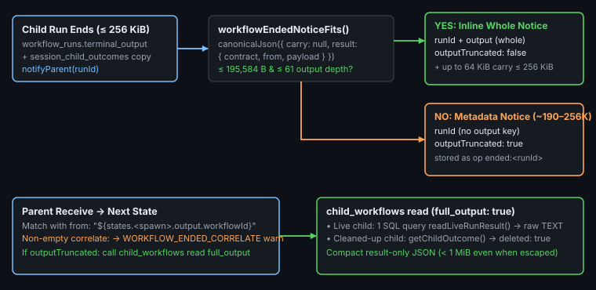

# Whole Child Workflow Results and `WorkflowEnded@1` Correlation Warning (I6)

| | |
|---|---|
| **Status** | Implemented |
| **Date** | 2026-11-27 |
| **Sign-off** | Signed off by the owner 2026-11-27 |
| **As built** | `943f17b5339620e0d4bae935e52d8350c8ee5bca`; additions of the Phase 1 merge in §12.1 |
| **Base** | `b79be29d1bdc94b05b5ea8ef8cce08716a984b4c` (`0.8.19`) |
| **Related** | [`workflow-child-workflows.md`](workflow-child-workflows.md) |

This design was written after the implementation.

---

## 1. Intent & Why

When a child Workflow started by a `spawn` state ends, `notifyParent` (`packages/sdk/src/workflow/runtime.ts`) writes one `WorkflowEnded@1` message to the active parent run's inbox. On `0.8.19`, three gaps broke parent collection:

1. **Outputs above 16 KiB were dropped.** `notifyParent` capped `WorkflowEnded@1` at `16,384` bytes. A 20 KiB child output arrived as `outputTruncated: true` with no `output` field.
2. **A Workflow parent could not read the full stored output.** `workflow_runs.terminal_output` already held the full JSON up to `256 KiB` (`WORKFLOW_PAYLOAD_MAX_BYTES`), and `session_child_outcomes` kept a copy across cleanup. Yet `child_workflows` `read` returned only a 2,000-character preview and threw `WORKFLOW_NOT_FOUND` after child cleanup.
3. **`correlate:` on `WorkflowEnded@1` hung forever (UX round 2, A1).** `WorkflowEnded@1` carries `correlationText = "{}"`, while an older line in `workflow-reference/SKILL.md` said `"correlate by workflowId"`. Any non-empty `correlate:` silently never matched.

This change raises the inline notice budget to `195,584` bytes, adds `runId`, adds `full_output: true` (live and post-cleanup) on `child_workflows` `read`, and warns `WORKFLOW_ENDED_CORRELATE` at save time.

---

## 2. Terms

| Term | Meaning |
|---|---|
| **Widest received form** | `canonicalJson({ carry: null, result: { contract: "WorkflowEnded@1", from: childWorkflowSessionId, payload } })` — largest wrapper a list `receive` with `carry` hands to the next state. |
| **`WORKFLOW_ENDED_NOTICE_MAX_BYTES`** | `195,584` bytes (`262,144` state-input cap minus `65,536` max `carry` minus `1,024` wrapper margin). |
| **Full-output child read** | `child_workflows` `{ operation: "read", workflow_id, full_output: true }`, returning `{ workflowId, deleted?, run: { runId, status, outcome, terminalState, output, error } }`. |
| **Retained child outcome** | Copy in `session_child_outcomes` kept under the parent Workflow before a finished child session is soft-deleted. |

---

## 3. Goals & Non-Goals

- **Goals:**
  - Send `terminal_output` whole in `WorkflowEnded@1` whenever the widest received form fits within `195,584` bytes and `64` JSON nesting levels (at most `61` levels inside `output`), so the received value, passed on as is with a `carry` of up to `64 KiB`, fits the next state's `256 KiB` input. The next state's own `input:` mapping and later limits (a parallel join, a `send`, the run's output) are still checked as usual.
  - Add `runId` to `WorkflowEnded@1` in both whole and truncated notices.
  - Add `full_output?: boolean` to `child_workflows` `read` so a parent script reads the whole canonical JSON string (`<= 256 KiB`, staying `< 1 MiB` even when escaped) in one SQL query while live, and via `session_child_outcomes` after cleanup.
  - Emit compiler warning `WORKFLOW_ENDED_CORRELATE` when a `receive` of `WorkflowEnded@1` has a non-empty `correlate`, and update skills to specify `from:` + `wait`.
  - Treat the first stored end notice of a child run (`ended:<runId>` from the direct child) as its receipt so a retry in any form returns it without conflict.
- **Non-Goals:**
  - No CMS schema change, SQL migration, or controller/orchestration version bump (`WORKFLOW_CONTROLLER_VERSION` stays `"1.3.0"`).
  - Raising the `256 KiB` run output cap or changing 1,000-character chat-parent notices.
  - Rolling worker upgrades across mixed old/new workers while child notices are in flight (Section 9).

---

## 4. Approaches Considered

| Option | Summary | Trade-offs | Verdict |
|---|---|---|---|
| **1. Keep 16 KiB cap; add `full_output` read only** | Leave `WorkflowEnded@1` at 16 KiB; fetch larger outputs in a follow-up script state. | Forces boilerplate `script` states onto ordinary 20–180 KiB child results. | **Rejected** |
| **2. Raise notice cap to 256 KiB with no margin** | Send up to `262,144` bytes inline in `WorkflowEnded@1`. | List `receive` + `carry` (`<= 64 KiB`) exceeds `262,144` bytes and fails the next state with `invalid_input`. | **Rejected** |
| **3. Spill large outputs to artifacts or a new table** | Store >16 KiB child outputs externally and pass a reference. | Redundant: PostgreSQL already stores `terminal_output` (`TEXT`) and `session_child_outcomes` up to `256 KiB`. | **Rejected** |
| **4. Wrapper budget (`195,584` B) + `runId` + `full_output: true` + `A1` warning** | Measure worst-case wrapper against `195,584` B, add `runId`, add single-query `readLiveRunResult` + retained fallback, and warn on `correlate:`. | Zero migrations; inline delivery up to ~190 KiB; exact fallback up to 256 KiB live or swept. Requires stop-all-workers deploy. | **Chosen** |

---

## 5. Architecture & Component Ownership



| File | Functions / Symbols | Role |
|---|---|---|
| `packages/sdk/src/workflow/runtime.ts` | `WORKFLOW_ENDED_NOTICE_MAX_BYTES`, `workflowEndedNoticeFits`, `registerWorkflow` (`notifyParent`) | Enforces `195,584`-byte wrapper budget, adds `runId`, and omits `output` only past budget or `64`-level wrapper depth (`~61` levels inside `output`). |
| `packages/sdk/src/workflow/store.ts` | `WorkflowStore.readLiveRunResult`, `WorkflowStore.acceptInput` (`sameEndNotice`) | Atomic 1-query read of live run status + raw `terminal_output`; returns the first stored receipt for any retry of `ended:<runId>` from the direct child. |
| `packages/sdk/src/workflow/tools.ts` | `CHILD_WORKFLOWS_TOOL_SPEC`, `childResultView`, `fullOutputArg`, `childWorkflowsFromTool` | Adds `full_output?: boolean`, reads retained outcomes only when the child is gone, strips `retainedOutcome` on previews. |
| `packages/sdk/src/workflow/compiler.ts` | `compileMessaging` (`WORKFLOW_ENDED_CORRELATE`) | Warns on non-empty `correlate:` when receiving `WorkflowEnded@1`. |
| `docs/*`, `CHANGELOG.md`, `workflow-*/SKILL.md` | `workflow-reference`, `workflow-patterns`, `workflow-tools`, `docs/developer/deploy/aks.md`, user/proposal docs | Documents `WorkflowEnded@1` fields, `from:` + `wait`, `full_output: true`, and the stop-deploy-start operator procedure. |

---

## 6. Data & Wire Contracts

```ts
// packages/sdk/src/workflow/runtime.ts
export const WORKFLOW_ENDED_NOTICE_MAX_BYTES = WORKFLOW_PAYLOAD_MAX_BYTES - WORKFLOW_CARRY_MAX_BYTES - 1024; // 195,584
export function workflowEndedNoticeFits(childWorkflowSessionId: string, payload: JsonValue): boolean;

// packages/sdk/src/workflow/store.ts
async readLiveRunResult(workflowSessionId: string): Promise<{
    runId: string; status: WorkflowRunStatus; outcome: string | null;
    terminalState: string | null; outputText: string | null; error: JsonValue;
} | null>;
```

| `WorkflowEnded@1` Field | Type | Contract (`workflow_inbox.payload`, `correlationText = "{}"`, `operationId = "ended:<runId>"`) |
|---|---|---|
| `workflowId`, `runId` | `string` | Child session ID and additive child run ID (`runId` absent on pre-upgrade rows; treat as optional). |
| `definition`, `revision`, `spawnedBy` | `string`, `number`, `{ stateId, visit } \| null` | Definition name, revision, and spawning parent step/visit. |
| `status`, `outcome`, `stateId` | `WorkflowRunStatus`, `string \| null`, `string \| null` | Final run status, terminal outcome, and terminal node ID. |
| `output` | `JsonValue` | Included whole when its widest form fits (`null` means JSON `null` or no output; `child_workflows read` `full_output` distinguishes them); omitted when `outputTruncated` is `true`. |
| `outputTruncated` | `boolean` | `true` only when `output` was omitted. |
| `error` | `{ code: string; message: string } \| null` | Present on failed or cancelled runs, else `null`. |

- **`runId` usage (`store.ts:6648-6661`):** `runId` is informational. `child_workflows` `read` with `full_output: true` takes no `run_id` and returns the child's newest live run; a script that must be exact compares `read.run.runId` with the notice's `runId`.
- **`child_workflows` `read` (`tools.ts`):**
  - Non-boolean `full_output` throws `WORKFLOW_COMMAND_INVALID` (`"full_output must be true or false."`). Live child with no live run throws `RUN_NOT_FOUND` (`"This workflow has no live run."`). Non-child throws `WORKFLOW_NOT_FOUND` (`"No child Workflow <id> belongs to this Workflow."`).
  - `full_output: true` returns `{ ok: true, workflowId, deleted?: true, run: { runId, status, outcome, terminalState, output, error } }`, where `run.output` is the exact canonical JSON string (`"null"` for JSON `null`, `null` when absent) and `run.error` is `null` or `previewJson(error, 2_000)`.
  - Default (`full_output` omitted/`false`) keeps `readWorkflowModel` (`2,000`-char preview) and deletes `view.retainedOutcome` on swept children.
- **Compiler warning (`compiler.ts`):** `WORKFLOW_ENDED_CORRELATE` (`severity: "warning"`, `path: "states.<id>.correlate"`) when `contract` is or includes `"WorkflowEnded@1"` and `correlate` is a non-empty object:
  ``WorkflowEnded@1 carries no correlation, so this receive never takes a child's end message. Match one child with from: "${states.<spawn>.output.workflowId}" instead of correlate, and give the receive a wait.``

---

## 7. Delivery, Read & Retry State Table

| Input / State | Atomic Check / Action | Outcome |
|---|---|---|
| `180 KiB` output; parent uses list `receive` + `60 KiB` `carry` | `workflowEndedNoticeFits` `<= 195,584` B | Whole `output` + `runId`, `outputTruncated: false`; `{ carry, result }` passed on as is with `<= 64 KiB` `carry` fits the next state's `256 KiB` input (its own `input:` mapping and later join/`send`/run-output limits still apply). |
| `~240 KiB` quote-heavy output or an `output` nested deeper than about `61` levels (the wrapper adds three) | `workflowEndedNoticeFits` `false` (or depth throw) | `output` omitted, `outputTruncated: true`, `runId` kept. |
| `child_workflows read` (`full_output: true`) on live child | `decideWorkflowAccess` (`parent`) + 1-query `readLiveRunResult` | Atomic `(status, outcome, terminalState, outputText, error)` snapshot (`< 1 MiB` escaped). Never mixes `running` with final output. |
| `child_workflows read` after child soft-delete | `decideWorkflowAccess` -> `WORKFLOW_NOT_FOUND`; `getChildOutcome` verifies `parentSessionId` | Returns `deleted: true` with whole `output` (`full_output: true`) or 2,000-char preview (`false`). |
| Live Workflow not owned as caller's child | `decision !== null` with `!allowed` or `relation !== "parent"` | `WORKFLOW_NOT_FOUND` without consulting `getChildOutcome`. |
| First stored end notice under `ended:<runId>` from direct child; retry arrives in any form (for example `old -> new` across upgrade) | `acceptInput` matches `sameEndNotice` (`bypassInboxLimits`, `WorkflowEnded@1`, `ended:*`, direct child) | Returns the first stored receipt and records `workflow.parent_notified` (no `OPERATION_CONFLICT`). |

---

## 8. Worked Examples

### 8.1 Normal + Oversized + Post-Cleanup Trace

1. Parent `wf-parent` spawns `wf-child` (`run-c1`), which finishes with `{ blob: "\"".repeat(122880) }` (`245,771` canonical JSON bytes, about `240 KiB`).
2. `workflowEndedNoticeFits` measures `245,771` B + wrapper `> 195,584` B, so `notifyParent` delivers `{ workflowId: "wf-child", runId: "run-c1", status: "completed", outcome: "succeeded", stateId: "done", outputTruncated: true, ... }`.
3. Parent's `collect` (`from: "${states.spawn_big.output.workflowId}"`) routes to script `fetch`, which calls `callTool("child_workflows", { operation: "read", workflow_id: "wf-child", full_output: true })`. `readLiveRunResult` returns `run.output` (serialized inside the tool answer at about `491,600` bytes / `~480 KiB`, within `1 MiB`); `JSON.parse(read.run.output).blob.length === 122880`.
4. After `wf-child` is soft-deleted, script `fetch_kept` repeats the same call and receives `deleted: true` with the identical `122,880`-quote `run.output` from `session_child_outcomes`.

### 8.2 Mixed-Version Worker Retry Race (Why Rolling Upgrade Fails)

1. During a rolling deploy, **Worker N** (new) runs alongside **Worker O** (old). Child `run-c2` ends with a `20 KiB` output.
2. **Worker N** inserts the new `WorkflowEnded@1` row (with `runId` and whole `20 KiB` `output`, `request_sha256 = "sha-new"`) under `operation_id = "ended:run-c2"`, then crashes before sending `workflow-wake` or recording `workflow.parent_notified`.
3. Duroxide retries `notifyParent` on **Worker O**, which builds the old payload (no `runId`, `output` dropped at 16 KiB -> `request_sha256 = "sha-old"`).
4. Old `store.acceptInput` lacks `sameEndNotice`, sees `"sha-new" !== "sha-old"`, and throws **`WorkflowStoreError("OPERATION_CONFLICT", "Operation ended:run-c2 was already used for a different input.")`** before `workflow-wake` (`runtime.ts:3025-3031`) and before `told()` (`3032`). Impact: the notice row exists, but a waiting parent `receive` may not be woken and the child's notify step keeps failing until a new worker retries it.

---

## 9. Compatibility & Upgrade

- **Mandatory non-rolling upgrade (accepted owner decision):** **Stop every worker, deploy the new build, then start the workers. Do not roll the workers.** Otherwise an older worker retrying a notice already stored by a newer worker hits `OPERATION_CONFLICT` (Trace 8.2). Impact: the notice row exists, but a waiting parent `receive` may not be woken and the child's notify step keeps failing until a new worker retries it. Documented in `CHANGELOG.md` (`Unreleased`) and `docs/developer/deploy/aks.md` (*"Upgrading to whole child Workflow results (stop, deploy, start)"*).
- **First-write-wins end-notice retry (`sameEndNotice`) and legacy rows:** `sameEndNotice` (`store.ts:4877-4883`) makes the first stored end notice of a child run (`ended:<runId>` from the direct child) its receipt; a retry in any form returns it, which covers `old -> new` retries once old workers are stopped. Receivers treat `runId` as optional on pre-upgrade rows.
- **Behaviour change for existing parents:** Child outputs from about `16 KiB` to `195,584` bytes, which `0.8.19` dropped (`outputTruncated: true`), now arrive whole. The notice budget guarantees only the receiving state's own input. Downstream limits still apply and can now be hit: a parallel join's output (`256 KiB`, `invalid_output`), a `send` state's message (`16 KiB`), and the run's output (`256 KiB`). Review fan-out parents that end branches with a received `WorkflowEnded@1` or forward it with `send`, and test them with realistic child output sizes before the upgrade. **Added in the Phase 1 merge (owner decision, 2026-11-26):** changelog, user-guide and developer docs for this behavior change, pinning tests (`~150 KiB` two-branch `forEach` join failure, `> 16 KiB` `send` failure, mapped-down pass), the save warning `WORKFLOW_ENDED_WHOLE_OUTPUT` when an unmapped `WorkflowEnded@1` receive reaches a join, `send`, or run output unchanged, and a new `workflow-limits` skill linked from `workflow-reference` and `workflow-authoring` (§12.1).

- **Rollback:** Drain child end notices first: let running child Workflows finish and keep new workers up until every ended child with a live Workflow parent has recorded its notice (`workflow.parent_notified` or `workflow.parent_notification_skipped`). Verify with SQL on the CMS schema (default `copilot_sessions`), repeat until empty, then stop every worker, deploy the older release, and start them:

```sql
SELECT r.workflow_session_id, r.run_id, r.status
FROM copilot_sessions.workflow_runs r
JOIN copilot_sessions.workflow_definitions d ON d.workflow_session_id = r.workflow_session_id
JOIN copilot_sessions.sessions c ON c.session_id = r.workflow_session_id AND c.deleted_at IS NULL
JOIN copilot_sessions.sessions p ON p.session_id = d.parent_session_id AND p.deleted_at IS NULL
WHERE r.mode = 'live'
  AND d.notify_parent = true
  AND p.session_kind = 'workflow'
  AND (
    r.status IN ('admitted', 'running', 'paused')
    OR NOT EXISTS (
      SELECT 1 FROM copilot_sessions.session_events e
      WHERE e.session_id = r.workflow_session_id
        AND e.event_type IN ('workflow.parent_notified', 'workflow.parent_notification_skipped')
        AND e.data->>'runId' = r.run_id
    )
  );
```

- **Storage footprint:** Per child, the output can now be stored several times: the parent's `workflow_inbox` row (up to about `191 KiB`, expires after `24` h), `workflow_runs.terminal_output` (up to `256 KiB`), the retained `session_child_outcomes` copy (stored twice in `result_json`, under `current` and `revisions[0]`), and the receiving state's stored value. A `50`-child batch can hold tens of MB.

---

## 10. Differences from the Build Plan

Relative to the build plan for I6, `943f17b53` specifies four details:

1. **Exact `195,584`-byte budget (`runtime.ts:1665-1675`):** Reserves `64 KiB` `carry` + `1 KiB` keys on `{ carry: null, result: { contract, from, payload } }`.
2. **Opt-in `full_output: true` result-only shape (`tools.ts:1993-2000`, `store.ts:6648-6661`):** Default `read` stays a 2,000-char preview; `full_output: true` uses 1-query `readLiveRunResult` and omits graph/history so escaped `256 KiB` outputs stay `< 1 MiB`.
3. **`WORKFLOW_ENDED_CORRELATE` warning (`compiler.ts:1106-1111`):** Included UX round 2 item `A1` in the compiler and skills.
4. **`sameEndNotice` & stop-deploy-start upgrade docs (`store.ts:4877-4880`, `CHANGELOG.md`, `docs/developer/deploy/aks.md`):** Added first-write-wins retry acceptance on `ended:<runId>` and documented the non-rolling worker upgrade and rollback drain rules.

---

## 11. Quality Gates & Receipts

- **Unit & build:** `npm run build`, `npm run lint`, and `npm run test:unit --workspace=pilotswarm-sdk` passed at `9b6361669` (`3,127 passed, 0 failed, 1 skipped`), plus `workflow-decision-docs` `3/3` at `943f17b53`, `workflow-spawn-compiler.test.mjs`, and `20,480 / 20,480` B `workflow-reference/SKILL.md` budget.
- **Gate 2 (`PostgreSQL 16` + `HorizonDB`):** `workflow-child-whole-result.test.js` and `workflow-child-ended-store.test.js` confirmed RED on `main`; PG16 `80/80` (`14` Workflow files) at `58bba4fc0`; HorizonDB `81/85` at `5ecf3cccc` (`4` failures: model credentials missing in the environment), those files `25/25` with credentials at `58bba4fc0`; later commits are descriptions and docs.
- **Gate 4 (live-model evals) & review:** Four live runs on two models during the build: `7/8`, `11/12`, `10/12`, `11/12`; the remaining failures are model variance on the `A1` positive case whenever the model loads no skill. The final tool wording (`9b6361669`) was not re-run live. Three cross-family adversarial review rounds completed; all must-fix items resolved with tests. *(Gate 1 TLA+/TLC: controller `1.3.0` state transitions unchanged from `workflow-child-workflows/formal/`. The first-write-wins acceptance of `ended:<runId>` retries is a store rule outside the controller model; it is covered by `workflow-child-ended-store.test.js`.)*

---

## 12. Phase 1 Merge Additions & Open Follow-Ups

### 12.1 Added in the Phase 1 Merge (`8e7f3050b`, merged as `f3f11cff2`; `ba5651ac8`; `7bd070c7a`)

Owner decision (`D-1`, 2026-11-26): document the change, plus a save warning and a dedicated limits skill.

1. **Documentation (`CHANGELOG.md`, `docs/user-guide/workflows.md`, `docs/developer/building/workflow-sessions.md`):** Child outputs of `16 KiB`–`195,584` B now arrive whole in `WorkflowEnded@1` and can reach the downstream `256 KiB` parallel-join, `16 KiB` `send`, and `256 KiB` run-output limits. The earlier claim that the next state never fails `invalid_input` on size is corrected: the notice budget guarantees only the receiving state's own input.
2. **Pinning tests (`workflow-child-whole-result.test.js`):** a two-branch `forEach` whose children return `~150 KiB` each fails at the parallel join with `invalid_output` naming the `256 KiB` limit; a received `> 16 KiB` child result sent on fails `invalid_input`; the same fan-out passes when each branch maps the result down (`output: "${input.outcome}"`).
3. **Save warning `WORKFLOW_ENDED_WHOLE_OUTPUT` (`compiler.ts` `warnWholeChildOutputs`):** warns when a child's whole output reaches a `send` or `request` message, a parallel branch's output that is joined with others, or (two or more of them) the run's output, with no `input:` or `output:` mapping in between. It follows the value only through waits with no `input:` and no `carry`, so any mapping ends it; it can never fail a save. Positive and negative cases in `workflow-spawn-compiler.test.mjs`.
4. **New `workflow-limits` skill + cross-links:** one table of the limits a run meets (with their values checked against the code constants by `workflow-authoring-skill.test.mjs`; `3,484` bytes of an `8 KiB` budget) and the fan-out rule (*"keep only what you need from each child; read the full result with `child_workflows` `read` `full_output`"*), with pointers from `workflow-reference` and `workflow-authoring`. The script tool-call cap is stated once per mode: `500` per script visit in a live run in `workflow-limits`, and the test-run cap in the hidden testing guide. A live check on two models: with the skill, both mapped four large child results down in a fan-out; a small single-child Workflow got no needless mapping and loaded no unrelated skill.
5. **`WorkflowEnded@1` values (`7bd070c7a`):** `workflow-reference` now states that `status` is `completed` (`outcome` `succeeded` or `blocked`), `failed`, `cancelled` or `stopped`, and that `outcome` is the terminal state's, else `null`; `workflow-child-runtime.test.js` pins the four endings. A live check had found a model testing a child's end with `status === "succeeded"`.

### 12.2 Open Follow-Ups

1. **Skill-skipping variance on `A1`:** When a model skips `load_skill("workflow-reference")`, the `WORKFLOW_ENDED_CORRELATE` save warning catches `correlate:` on the first save attempt.
2. **`workflow-reference/SKILL.md` size ceiling:** `packages/sdk/plugins/workflow/skills/workflow-reference/SKILL.md` was at `20,480 / 20,480` bytes at `943f17b53` (`20,384` B at base `b79be29d1`); the Phase 1 merge trimmed redundant text to add the `workflow-limits` pointer and the `WorkflowEnded@1` values (`20,457` bytes), so the skill budgets stay nearly full.
3. **A collecting script's `256 KiB` output:** a script that collects several whole child outputs can fail at its own `256 KiB` output limit; this is documented in `workflow-limits` but not warned at save.
3. **Direct agent-step `full_output` context size:** `CHILD_WORKFLOWS_TOOL_SPEC` is shared with direct agent steps (`managed-session.ts:1613, 3708`), so an agent step calling `child_workflows` `read` with `full_output: true` can pull up to `256 KiB` into model context (comparable to `read_workflow`, up from the 2,000-character preview).
4. **Optional `run_id` filter on `child_workflows` `read`:** Accept an optional `run_id` alongside `full_output: true` if callers ever need store-enforced run matching instead of comparing `read.run.runId` against `WorkflowEnded@1.runId`.
