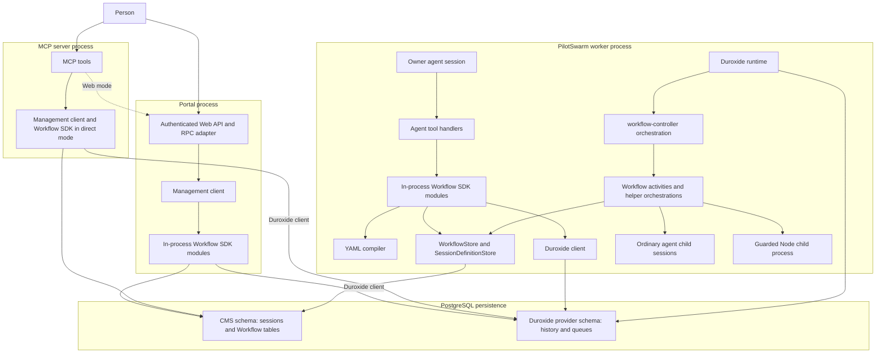
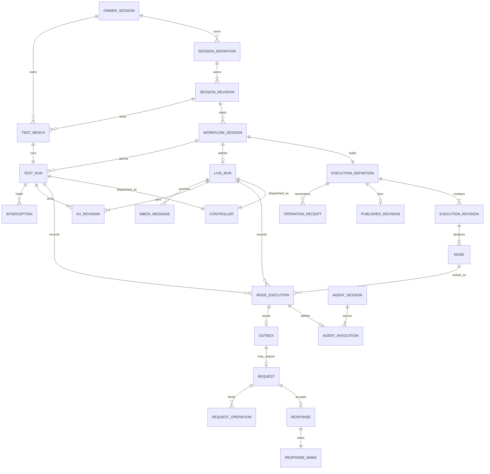

# Architecture and concepts

This file answers where Workflow code runs and which objects it creates. For example, starting revision 3 of `check-build` creates a new Workflow session, a pinned execution definition, one CMS run and one Duroxide controller instance.

## Components

**CMS** is PilotSwarm's session catalog and related application state in PostgreSQL. **Duroxide** is the durable execution library hosted by the worker; its PostgreSQL provider stores orchestration state. These are separate persistence interfaces, even when both schemas use the same server.

Each SDK box runs in its caller's process. The compiler and store drawn in the worker are the same modules the other direct-mode callers use. A web-mode management client instead uses the existing Web API. No portal-to-worker definitions RPC is required: the caller writes CMS state and enqueues a Duroxide start, which a worker serves. There is **no separate definitions service or network service**. `workflow/service.ts` is an in-process SDK module called through the agent, portal and MCP paths. Its catalog projections use CMS stored functions; its Workflow stores also issue direct parameterized SQL in transactions. See `packages/sdk/src/workflow/service.ts:70-85`, `packages/sdk/src/management-client.ts:2274-2311`, `packages/app/web/runtime.js:867-896`, `packages/app/mcp/src/tools/workflows.ts:18-21`, and `packages/sdk/src/workflow/store.ts:2373-2415`.

**`workflow-controller` is a Duroxide orchestration, not a service or an API.** It is registered by `registerWorkflow` in `packages/sdk/src/workflow/runtime.ts:2956`. `packages/sdk/src/worker.ts:1043-1064` supplies the store, tool executor, parent notifier and agent host. `packages/sdk/src/worker.ts:932-944` constructs the Duroxide runtime; `packages/sdk/src/duroxide-provider-factory.ts:55-73` selects its PostgreSQL connection path.

## Reusable definitions versus execution copies

The owner session saves reusable definitions in `session_workflow_definitions` and `session_workflow_revisions`. A start chooses a saved revision and compiles that YAML with the current compiler. It makes a new Workflow session and saves the resulting execution copy in `workflow_definitions` and `workflow_revisions`. The copy records `session_definition_id` and `session_revision`; its own revision numbering is separate. In the normal start path, the execution copy is published and started together. See `packages/sdk/src/workflow/session-definitions.ts:324-386`, `packages/sdk/src/workflow/service.ts:864-886`, and `packages/sdk/src/migrations/workflow-session-names-0089.ts:63-73`.

Low-level compatibility operations can still create a Workflow draft, replace that draft, publish it and then start it. A session-pinned execution copy rejects those mutations: edit the owner's definition and start another Workflow instead. See `packages/sdk/src/workflow/service.ts:905-986` and `packages/sdk/src/workflow/store.ts:472-486`.

## Cardinalities

The diagram shows application cardinalities. A relationship is not necessarily a SQL foreign key; the [data model](data-model.md) distinguishes them.

`CONTROLLER` means the designated instance identity. CMS admission can exist before that instance is materialized; the two-store gap is described in [Duroxide integration](duroxide.md). A session claim can also exist briefly before its execution definition is written. The completed-creation relationships above do not assert that intermediate states are impossible. A test bench is itself a hidden Workflow session; the diagram separates it to show purpose. See `packages/sdk/src/workflow/service.ts:783-886` and `packages/sdk/src/workflow/definition-test.ts:1-26`.

| Concept | Stored where | Cardinality | Lifecycle owner |
|---|---|---|---|
| Owner session | CMS `sessions`, ownership rows and ordinary Duroxide session history | One owner session can own zero or more definitions and Workflows; normal start requires one parent | Ordinary session lifecycle; `session-definitions.ts:324-386` |
| Reusable Workflow definition | `session_workflow_definitions` | One non-deleted definition per `(owner_session_id, name)`; deleted rows can retain the name | Owner session; person deletes; migration 0088 `:649-672`, 0089 `:24-34` |
| Saved reusable revision | `session_workflow_revisions` | One or more after first save; unique `(definition_id, revision)`; maximum 1,000 | Save/attach transaction; `session-definition-store.ts:180`, `:551-637` |
| Workflow session | `sessions`, with `session_kind = 'workflow'` | Many starts from one reusable revision; each start operation derives one stable session ID | Start operation and parent; `session-definitions.ts:326`, `:374-382` |
| Execution definition | `workflow_definitions` | One per completed Workflow creation; zero only in an interrupted claim | Workflow store; `service.ts:783-886` |
| Execution revisions | `workflow_revisions` | One or more for a low-level draft; normal session start makes one pinned copy | Draft save/publication; `store.ts:2358-2370` |
| Published revision | Fields of `workflow_definitions` | Zero for a draft, one for a published execution copy | Publication transaction; migration 0088 `:109-134` |
| Live run | `workflow_runs`, `mode = 'live'` | **At most one per Workflow session, ever** | Controller or accepted external end; migration 0088 `:216-218` |
| Test run | `workflow_runs`, `mode = 'test'` | Zero or more per low-level draft; separate inputs, variables, executions and controller | Test command/controller; `service.ts:1473-1525` |
| Test bench | Hidden `sessions.service_kind = 'workflow-test'`, creation config and draft | One bench for one definition-test identity and one test run; no live run in the definition-test path | Definition-test helper and retention; `definition-test.ts:1-26` |
| Controller instance | Duroxide instance; ID also in CMS run | Exactly one designated ID per run: live `session-<workflowSessionId>`, test `wft-<runId>` | Duroxide; `runtime.ts:270-281` |
| Node | Pinned IR JSON | Up to 100 declared graph nodes; node type is one of six | Compiler; `compiler.ts:65-82` |
| Node execution | `workflow_node_executions` | Zero or many visits per node; unique `(run, scope, node, ordinal)` | Controller admission and single-result decision; migration 0088 `:235-267` |
| Agent invocation | `workflow_agent_invocations` | Zero or one per agent node execution, including an intent not yet spawned | Agent admission; migration 0088 `:584-612` |
| Agent child session | Ordinary `sessions` row and `session-<id>` orchestration | A continued session serves multiple visits; `new` serves one. An invocation can precede actual child creation | Workflow agent host; `agent-ids.ts:1`, `runtime.ts:1825-1835` |
| Run KV | `workflow_runs.kv` and `workflow_kv_revisions` | One current map and one or more immutable revisions per run; each admitted visit pins one | Parent/person update, not script mutation; `store.ts:2405-2407`, `:2739-2744` |
| Inputs and outputs | Revisions/IR for schemas; run and node rows for values | One run input; one admitted input and at most one accepted result per node execution | Admission and result transaction; migration 0088 `:152-210`, `:235-267` |
| Operation receipt | `workflow_operations`, `session_workflow_operations`, request/agent operation tables | One binding per owning scope and operation ID; many per scope | Command transaction; migration 0088 `:153-161`, `:698-710` |
| Typed inbox input | `workflow_inbox` | Many per run; each message consumed at most once; a receive consumes at most one message | Input acceptance/receive transaction; migration 0088 `:273-298` |
| Send/request intent | `workflow_outbox`, plus `workflow_requests` for request mode | At most one outbox per messaging execution; at most one request per outbox; frozen responder | Admission/delivery; migration 0088 `:300-379` |
| Request result and wake | `workflow_request_responses`, `workflow_response_wakes` | At most one accepted response per request; exactly one wake intent with an accepted response | Response transaction; `store.ts:1582-1654` |
| Notify parent | CMS session events and parent queue message; optional notifier orchestration | One logical terminal notice per live run, with retries or a recorded skip; not exactly-once model exposure | Controller/recovery notifier; `service.ts:500-526` |

In this table, shortened paths such as `store.ts` mean `packages/sdk/src/workflow/store.ts`; migration citations mean `packages/sdk/src/migrations/workflow-0088.ts` or `workflow-session-names-0089.ts`.
