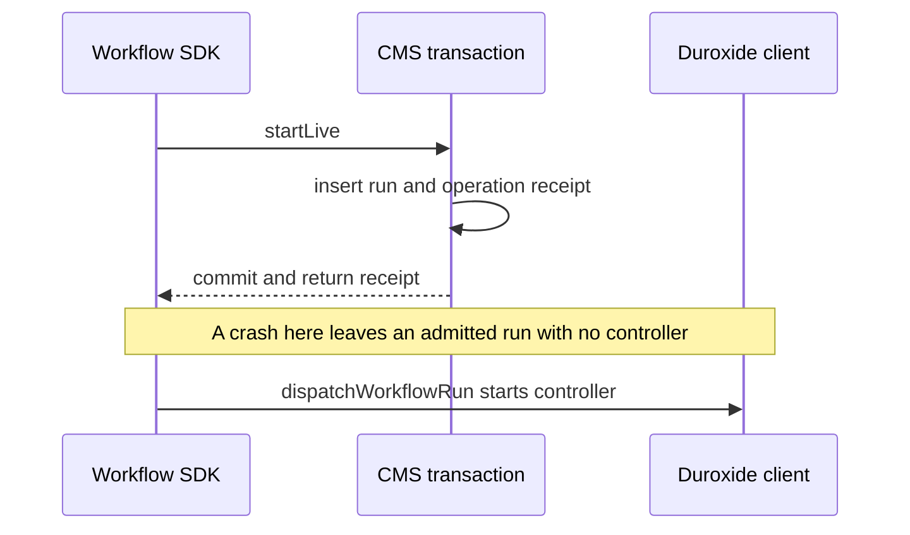

# Duroxide integration and the two-store gap

This file answers which durability guarantees come from Duroxide and which remain the application's responsibility. For example, a CMS run can be committed as admitted while a crash prevents its Duroxide controller from being started.

## Dependency pins and evidence

| Source | Pin used here | What it establishes |
|---|---|---|
| PilotSwarm package manifest and lock | `4fa702dc`; `packages/sdk/package.json:93`, `package-lock.json:6501` | The JavaScript package is `duroxide` **0.2.4**. |
| `microsoft/duroxide-node` | `7722f193184af0f2b01095b72464607b97d92aa1` (v0.2.4) | JavaScript/native API contracts. `Cargo.toml:10-12` declares Duroxide `0.1.32` and duroxide-pg `0.1.38`. |
| `microsoft/duroxide` | `585c89c86f03956f799913cf0b98186452221e75` (v0.1.32) | Core start, replay, history, timer and limit behavior discussed below. |
| Native dependency resolution | **Unverified for the distributed binary** | Cargo declarations are version ranges. These source checkouts do not prove the exact Rust dependency versions embedded in an installed native binary. |

Dependency citations below use `duroxide/...` or `duroxide-node/...` with those pins, not the PilotSwarm pin.

## Versioned registration and starts

The worker registers every supported ordinary session handler by `(name, version)`, then registers the seven Workflow handlers. A run stores its controller version. A start or recovery that cannot run that version returns `CONTROLLER_UNAVAILABLE`; it does not substitute the newest controller. See `packages/sdk/src/worker.ts:1005-1013`, `packages/sdk/src/workflow/runtime.ts:2954-2962` and `packages/sdk/src/workflow/service.ts:269-283`.

There are two similarly named start APIs with different argument order:

| API | Call shape and use |
|---|---|
| Client `startOrchestrationVersioned` | `(instanceId, name, input, version)`. Service dispatch starts a controller; recovery can start a notifier or retry helper. `packages/sdk/src/workflow/service.ts:433-441`; `duroxide-node/lib/duroxide.js:888-895`. |
| Context `startOrchestrationVersioned` | `(name, version, instanceId, input)`. A generator yields a detached start action for effect/send/request/agent helpers. `packages/sdk/src/workflow/runtime.ts:1467-1526`; `duroxide-node/lib/duroxide.js:456-469`. |
| `scheduleSubOrchestration*` | Awaited child orchestration APIs exist, including versioned and explicit-ID forms. The Workflow controller does **not** use them for its helper graph. `duroxide-node/lib/duroxide.js:390-438`. |

The detached helper's completion is not the controller's business-result channel. Its CMS node result and subsequent wake are that channel. This allows the controller to continue as new, pause, stop or collect a result even when the helper's wake was lost.

## Instance identities

| Object | Identity convention | Source |
|---|---|---|
| Ordinary agent session | `session-<sessionId>` | `packages/sdk/src/client.ts:1006-1025` |
| Live Workflow controller | `session-<workflowSessionId>` | `packages/sdk/src/workflow/runtime.ts:270-272` |
| Test controller | `wft-<runId>` | `packages/sdk/src/workflow/runtime.ts:279-281` |
| Script effect | `wfx-<nodeExecutionId>` | `packages/sdk/src/workflow/runtime.ts:274-276` |
| Parent notifier | `wfn-<runId>` | `packages/sdk/src/workflow/runtime.ts:283-285` |
| Send helper | `wfs-<nodeExecutionId>` | `packages/sdk/src/workflow/runtime.ts:287-289` |
| Request helper | `wfr-<nodeExecutionId>` | `packages/sdk/src/workflow/runtime.ts:327-329` |
| Agent spawn helper | `wfa-<nodeExecutionId>` | `packages/sdk/src/workflow/runtime.ts:296-298` |
| Continued-session end retry | `wfc-<childSessionId>`, then `wfc-<childSessionId>-<n>` | `packages/sdk/src/workflow/runtime.ts:2881-2883` |
| Recovery notifier after an earlier notifier ended | Base notifier ID plus `-recover-` and operation-derived digest | `packages/sdk/src/workflow/service.ts:520-525` |
| Node execution | `nx-` plus deterministic digest of run, scope, node and ordinal | `packages/sdk/src/workflow/store.ts:1796-1798` |

These identities are different from an agent child's session UUID. A helper called `workflow-agent` creates the child; the child's model turns run under its own `durable-session-v2` instance.

## Idempotent start

A second detached/client start of the same existing instance is ignored; it does not restart a completed Workflow or create a new execution of it. The client enqueues a start message (`duroxide/src/client/mod.rs:295-317`). The core filters a duplicate `StartOrchestration` when history already exists (`duroxide/src/runtime/state_helpers.rs:422-426`). Terminal-instance handling also distinguishes colliding awaited sub-orchestrations (`duroxide/src/runtime/dispatchers/orchestration.rs:632`, `:1486-1557`).

This is why service dispatch can repeat the original controller ID, and why recovery uses a new notifier ID after a previous notifier has ended. It is not permission to reuse IDs for different requests. CMS operation hashes and permanent tombstones reject that misuse. Deleting Duroxide history is not equivalent to erasing the application's identity record.

## Queues, events and timers

The Workflow command queue carries lifecycle commands and wake hints. `enqueueEvent(instanceId, queueName, data)` is a client operation; `dequeueEvent(queueName)` is a generator operation. Ordinary recipient sessions use their `messages` queue. The controller races its queue against the nearest deadline or a backstop timer. See `packages/sdk/src/workflow/commands.ts:1`, `packages/sdk/src/workflow/runtime.ts:956-969`, `:1721-1730`, and `duroxide-node/lib/duroxide.js:369-377`, `:939-945`.

`scheduleTimer` takes milliseconds. `utcNow` and `newGuid` are yielded durable operations, not direct wall-clock/random calls inside a replayable generator (`duroxide-node/lib/duroxide.js:350-357`, `:471-488`). Workflow deadline decisions still belong to the CMS clock; Duroxide timers determine when to ask. Test-mode time is a CMS virtual clock.

Queue messages are not exactly-once business results. A duplicate event can be delivered, and a bounded number of unmatched persistent events are carried across continue-as-new. Duroxide 0.1.32 caps carried events at 100; it warns and drops the oldest beyond that limit. Workflow commands therefore commit state before their queue hint. See `duroxide/src/runtime/limits.rs:9-14` and `packages/sdk/src/workflow/runtime.ts:950-969`.

## Continue-as-new and replay

The controller continues as new at **its own 1.0.0 version**, carrying cursor/ordinal/parallel state. It uses 25 admissions or 50 idle waits as history boundaries. An idle wake counts even when it carries no command. A command already dequeued is applied before the boundary. See `packages/sdk/src/workflow/runtime.ts:164-171`, `:1076-1080`, `:1698-1730`.

The ordinary session instead continues as new to the latest supported session version. It carries intake and retry state through a single guarded helper. These policies are deliberately different; neither changes a running execution's replay handler in place (`packages/sdk/src/orchestration/lifecycle.ts:708-786`).

Duroxide's replay engine matches scheduled actions to history. Code must preserve deterministic action order and isolate I/O in activities. A script's activity result is in Duroxide history before the separate CMS result write, so retrying that later write need not rerun a script whose result was durably recorded. A crash before the activity result is recorded can still repeat the effect. See `packages/sdk/src/workflow/runtime.ts:1750-1768`.

One dependency-specific trap matters here: in Duroxide 0.1.32, the continue-as-new path can omit a detached start made in the same turn. The controller explicitly places a store activity after each detached helper start and before any continue-as-new. See `packages/sdk/src/workflow/runtime.ts:1367-1371`, `duroxide/src/runtime/replay_engine.rs:1065-1080`, and `duroxide/src/runtime/execution.rs:54-75`. This is an ordering invariant, not an incidental extra read.

## PostgreSQL provider

PilotSwarm creates Duroxide's native PostgreSQL provider through `createDuroxidePostgresProvider`. It uses `connectWithSchema` or the native Entra authentication path `connectWithSchemaAndEntra`. The provider owns its schema and migrations; it does not use `WorkflowStore`'s node-postgres transaction. See `packages/sdk/src/duroxide-provider-factory.ts:55-73` and `duroxide-node/src/pg_provider.rs`.

| Duroxide history/provider state | CMS Workflow state |
|---|---|
| Orchestration start/name/version and execution histories | Reusable definitions and revisions; Workflow execution copies |
| Scheduled activities and accepted activity results | Runs, node inputs/results/winners, current and historical KV |
| Durable timers, queued events and continuation input | Inbox/outbox, requests/responses, operation receipts, wake intents |
| Controller cursor/ordinal/parallel state carried as input | Agent invocation/completion/end records and test interceptions |
| Custom orchestration status and ordinary session orchestration KV | Session state/events/access, parentage and deletion tombstones |

The same values can appear in more than one place for different reasons. For example, an activity result in Duroxide history makes replay stable; its CMS projection makes the Workflow inspectable and lets concurrent completion/timeout writers select one winner. See `packages/sdk/src/workflow/runtime.ts:98-112`, `:1750-1768` and [data model](data-model.md).

`deleteInstance(instanceId, force)` removes Duroxide instance state through provider administration. Sweeper calls it after CMS soft deletion and cleanup checks. It does not automatically delete CMS Workflow rows or operation receipts. See `duroxide-node/lib/duroxide.js:1063-1065`, `duroxide/src/client/mod.rs:1408-1414`, `packages/sdk/src/sweeper-tools.ts:328-365`.

## Worked example: the live-start consistency gap

`applyWorkflowUpdate` calls `WorkflowStore.startLive`. The store transaction writes the live run, initial KV revision, session projection and operation receipt, then commits. Only after that return does `dispatchWorkflowRun` call Duroxide's `startOrchestrationVersioned`. See `packages/sdk/src/workflow/store.ts:2708-2737`, `:2373-2415`, `packages/sdk/src/workflow/service.ts:978-986`, `:433-441`.

The first half is atomic within CMS. The pair is not atomic across CMS and Duroxide, even if both schemas use the same physical PostgreSQL server.

| Mitigation | What it does | What it does not do |
|---|---|---|
| Repeat the original operation | Return the stored receipt and idempotently try the same controller start again | It does not prove a person or client will retry after a crash |
| Explicit recovery | `recoverWorkflowRun` records a recovery receipt and `dispatchRecoveredRun` starts a not-yet-begun NotFound run | It does not reconstruct a begun run whose history is gone |
| Begin recheck | Controller begin locks the Workflow session/run and reads their current state; cancel/delete accepted meanwhile prevents work | It does not dispatch a controller by itself |
| Sweeper guard | Keep any active CMS Workflow run, regardless of controller status | It does not repair the missing dispatch |

Evidence: `packages/sdk/src/workflow/service.ts:433-441`, `:561-565`, `:610-704`; `packages/sdk/src/workflow/store.ts:3470-3514`; `packages/sdk/src/sweeper-tools.ts:65-97`.

At the source pin an ordinary session start has the opposite order: `client.ts` starts `durable-session-v2`, then updates the CMS session to running with its orchestration ID, then enqueues the prompt. A crash can therefore leave Duroxide ahead of CMS. See `packages/sdk/src/client.ts:1006-1030`. Later in this PR (`bddbd878`, `50ad6493`) the first start writes the CMS row and starts the orchestration inside one CMS transaction on the session row's lock, with a bounded wait: the two are serialized with cleanup, still not atomic, because the CMS rollback cannot undo a start Duroxide committed. This comparison does not make either ordering transactional.

**Known gap and enhancement:** product-wide CMS-plus-Duroxide consistency is tracked as follow-up work, rather than a Workflow-only patch. No completed mechanism is present at this commit. Starts, child creation, notifications and cleanup need explicit consistency contracts. A durable start-intent record is also a follow-up. The narrower DR-01 and DR-02 cleanup fixes are [done in this PR](known-issues.md#done-in-this-pr-after-the-source-pin).
