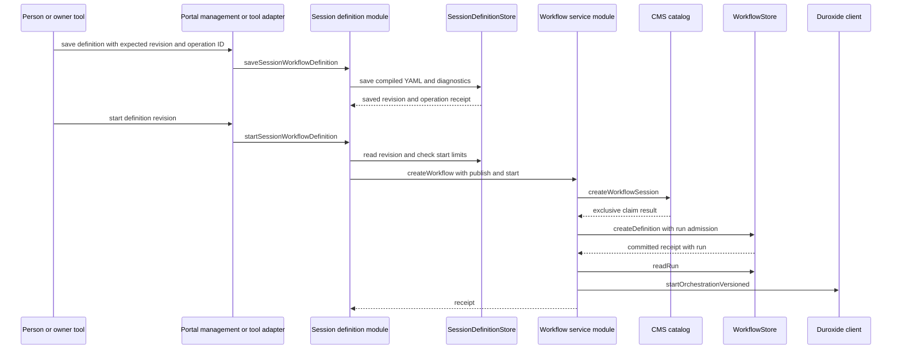
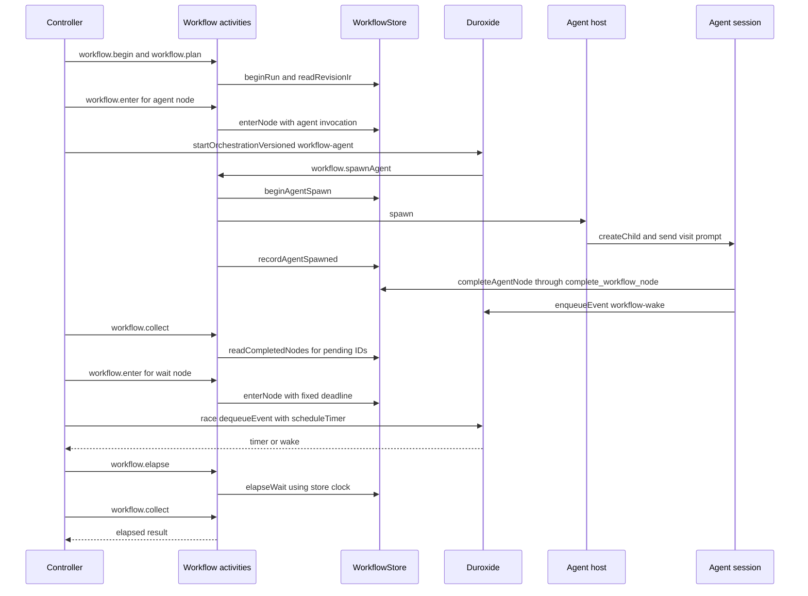
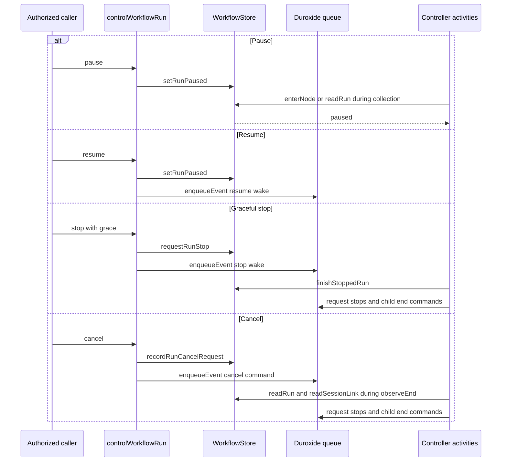
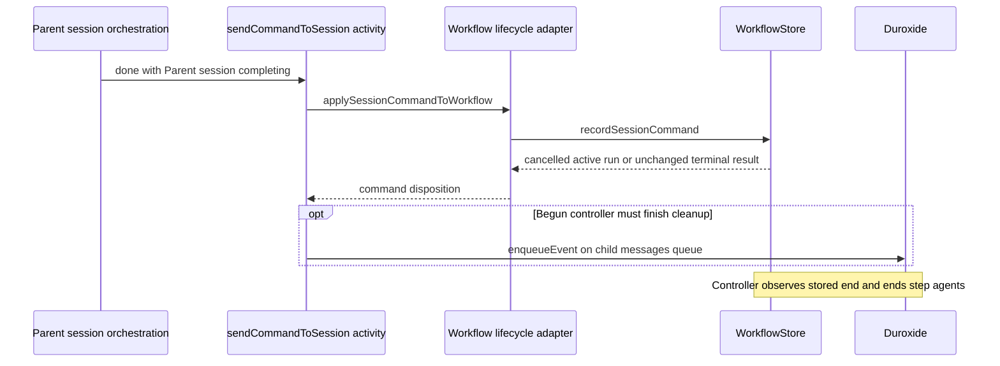
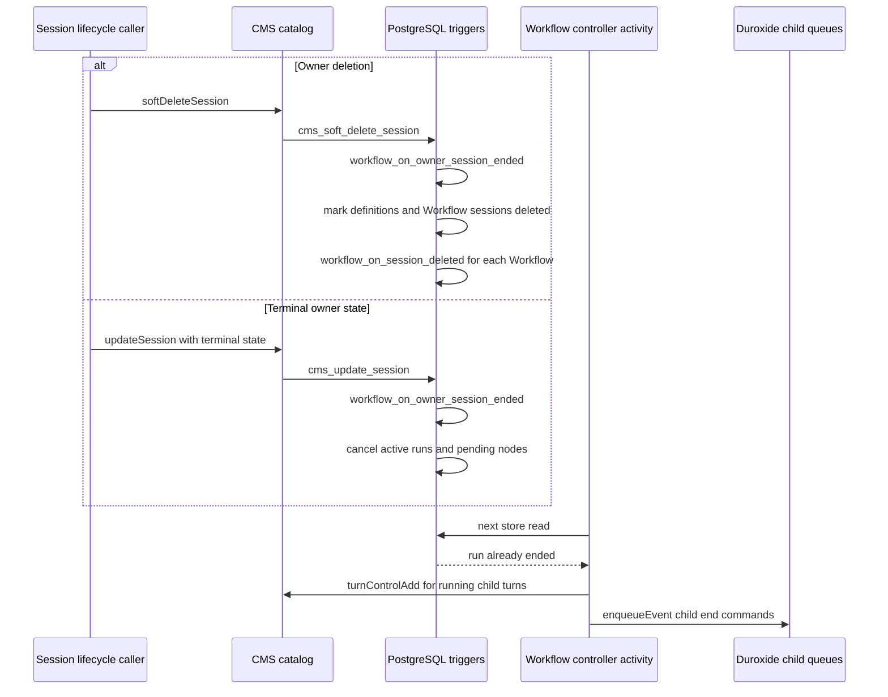
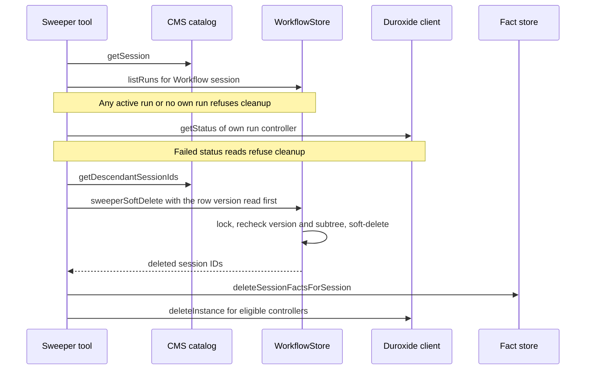
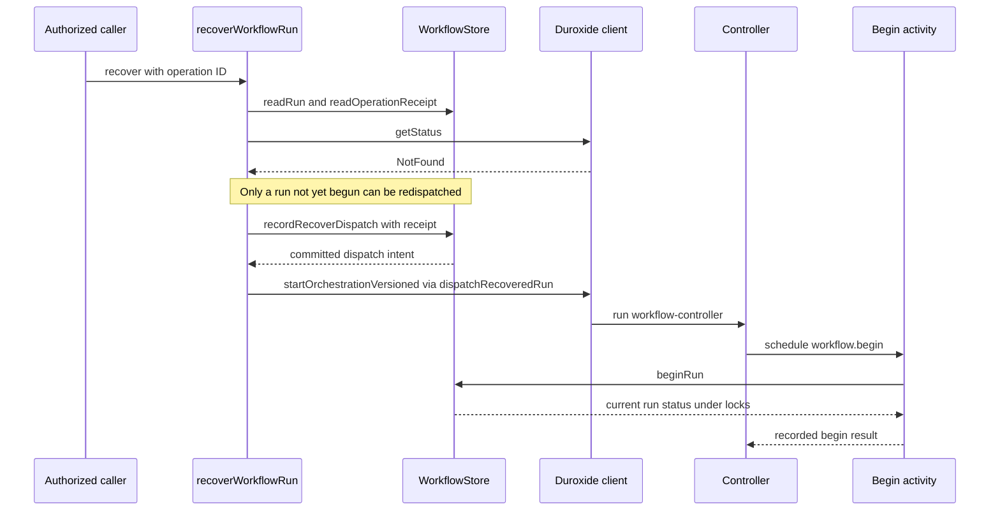

# Execution and lifecycle

This file answers how the graph advances without using a model to choose every next step. For example, an agent node can return `approved`; the controller takes that declared route, waits for a durable timer, and then runs a script.

All source citations refer to `4fa702dc`. A **controller** is the Duroxide orchestration for one run. An **activity** is worker code that can perform I/O; Duroxide records its result. A **helper orchestration** runs an effect or delivery separately from the controller. Helpers are detached starts, not awaited Duroxide sub-orchestrations.

## Orchestrations

All seven Workflow orchestrations are registered at version **1.0.0**. Session orchestration `durable-session-v2` is separate and uses version 1.0.83 for new starts. The registration is `packages/sdk/src/workflow/runtime.ts:2954-2962`.

| Name | Input | Work | End |
|---|---|---|---|
| `workflow-controller` | `{v:1, workflowSessionId, runId, state?}` | Begin/read pinned plan; admit nodes; collect results; route; wait; apply controls; continue as new with explicit state | Return run ID/status/outcome after terminal work or an external end; fail visibly if final writes exhaust retries. `runtime.ts:930-1079`, `:1340-1731`. |
| `workflow-effect` | `{runId, nodeExecutionId, controllerInstanceId}` | Run script activity; record its outcome by compare-and-swap; wake controller | Return null after stored result/wake; script exception becomes execution_failed. `runtime.ts:1742-1768`. |
| `workflow-notify` | `{runId}` | Retry terminal parent notification | Return null after notification or recorded skip; fail after retry schedule. `runtime.ts:1772-1776`. |
| `workflow-send` | Effect input above | Attempt message delivery with durable retry delays; record delivery_failed after exhaustion; wake controller | Return null, whether delivered, refused or already decided. `runtime.ts:1784-1794`. |
| `workflow-request` | Effect input above | Deliver the request, not wait for its answer; record delivery failure after exhaustion; wake controller | Return null. Controller and response transactions own the later decision. `runtime.ts:1804-1814`. |
| `workflow-agent` | Effect input above | Create/find the agent session and send its visit prompt; retry transient failures | Return null after spawn. Wake only on failure; successful typed completion sends its own wake. `runtime.ts:1825-1835`. |
| `workflow-agent-session-end` | `{runId, childSessionId}` | Recheck a continued child whose end is owed but whose session was not yet visible | Retry persistent end schedule, then make one last recorded look; return null. Up to 50 separately numbered retries can be started by later recovery. `runtime.ts:2875-2925`. |

In this table, `runtime.ts` means `packages/sdk/src/workflow/runtime.ts`.

## Save and start a live run

The adapters are `packages/app/web/runtime.js:867-877` and `packages/sdk/src/management-client.ts:2274-2311`; the agent tool uses the same definition functions. Save/start calls are in `packages/sdk/src/workflow/session-definitions.ts:197-233`, `:324-386`. Claim, create and dispatch calls are in `packages/sdk/src/workflow/service.ts:783-886`, `:433-441`. Arrows to stores are in-process calls that execute SQL, not network calls to a definitions service.

Start derives the Workflow session ID from the owner and operation ID. On a repeat, `storedStartPin` finds the original definition/revision from the execution copy or claim marker. A later save cannot make a retry pick a different revision. New requests compile the selected saved YAML again; already-admitted copies retain their IR. See `packages/sdk/src/workflow/session-definitions.ts:241-302`, `:324-379`.

## Scheduling and routing

The controller carries an IR hash, execution count, per-scope/node ordinals, whether the catch-all was entered, cursors and parallel state. A cursor identifies the next node, predecessor, arrival route, exact pending node execution and deadline. The controller never asks for "the latest execution" to rebuild a pending cursor. See `packages/sdk/src/workflow/runtime.ts:98-110`, `:1033-1058`, `:1076-1080`.

Each pass performs these operations:

1. Read queued commands before admitting work, with a bounded 32-message drain.
2. Retry owed stops/ends of cut branches, at most once per backstop period.
3. Admit each ready cursor, under session/run locks. Reject ended, expired, stopping or paused work before it can count as a new visit.
4. Start a helper for a pending script, send, request or real agent. Wait nodes need no helper.
5. Elapse due deadlines through store activities, observe request recipients, and collect the results for exact pending IDs.
6. Route accepted results, or wait for a queue hint/timer when nothing is ready.

Evidence: `packages/sdk/src/workflow/runtime.ts:950-969`, `:1340-1555`, `:1650-1731`. The node execution identifier is deterministic from run, scope, node and ordinal (`packages/sdk/src/workflow/store.ts:1796-1798`; unique SQL key at `packages/sdk/src/migrations/workflow-0088.ts:259`).

A business outcome takes its named route. A runtime error first takes its own code's route, then `failure`, then the Workflow's catch-all if not yet entered. The catch-all can execute only once per run, including explicit routes to it. An unhandled result fails the run. A branch-local error without a route ends the branch; it does not jump into the outer catch-all. See `packages/sdk/src/workflow/runtime.ts:812-817`, `:1650-1698`.

A root terminal decides the run. `succeeded` must satisfy both its own output schema and the Workflow output schema. An invalid terminal output can route once to the catch-all. A branch terminal ends only its branch. A blocked terminal produces run status completed with outcome blocked; failed/cancelled produce their corresponding run statuses. See `packages/sdk/src/workflow/runtime.ts:1416-1448`, `:2374-2376`.

## Agent node and wait node

Call evidence: controller `packages/sdk/src/workflow/runtime.ts:1036-1047`, `:1396-1400`, `:1455-1526`, `:1543-1555`, `:1721`; begin/plan `:3340-3378`; agent spawn `:4571-4699`; host `packages/sdk/src/workflow/agent-host.ts:139-233`, `:268`; typed completion `packages/sdk/src/workflow/agent-node-service.ts:108-130`. The wait's deadline is an admitted value. A duplicate wake does not start another visit.

### Waits and time

Seconds waits use a literal integer or whole-value binding in the range 1-86,400 s. Clock waits use `at` and a time zone to select the next hourly, daily, weekly or monthly occurrence. The store freezes the resolved deadline when it admits the visit. Changing KV later does not move an active wait. See `packages/sdk/src/workflow/compiler.ts:182-213`, `packages/sdk/src/workflow/runtime.ts:2161-2176` and the `workflow.enter` handler.

The controller uses replay-safe `ctx.utcNow()` and durable timers to decide when to ask the store. The store's clock decides whether the deadline has passed. If a worker's clock is ahead, elapse reports remaining time and the controller schedules another timer. Test deadlines use the run's virtual clock instead. See `packages/sdk/src/workflow/runtime.ts:1314-1326`, `:1543-1555`, `packages/sdk/src/workflow/test-mode.ts:15-27`.

### Parallel work and fork-join

`parallel` supports a `forEach` list with one body graph or named branches with separate initial nodes. The controller uses branch scopes and cursors inside the same controller, not one controller per branch. It starts at most the declared concurrency and never nests parallel bodies. See `packages/sdk/src/workflow/runtime.ts:1082-1124` and `packages/sdk/src/workflow/compiler.ts:1120-1365`.

The join is all branches by default, or the first k successful branches. For-each results are ordered by branch index; named results are keyed by branch name. Success means a branch reaches a succeeded terminal with a valid business result. The store uses the accepted work's commit order, not the controller's polling order, when selecting first-k winners and judging deadlines. See `packages/sdk/src/workflow/parallel.ts:47-52`, `:104-105`, `:150-221`, `:343-354`.

A join can produce `joined`, `blocked`, or runtime error `timed_out`. Once k successes are impossible, failure can be blocked. A success committed after the time limit is late and cannot count. `failFast`, a satisfied first-k join, or timeout cuts remaining branches. A decided report distinguishes terminal, error, cancelled, not_started and finished-but-not-routed branches; it preserves accepted outputs where they fit. See `packages/sdk/src/workflow/parallel.ts:54-143`.

Named forks settle their verdict, cut and node decision in one store transaction. They do not settle after an accepted graceful stop. For-each keeps its existing join schedule. An owed child stop/end does not freeze the graph indefinitely: the controller carries the debt and retries it on later passes and after continue-as-new. See `packages/sdk/src/workflow/runtime.ts:1105-1166`, `packages/sdk/src/workflow/store.ts:7090-7165`, and [fork-join correspondence](../../formal/workflow/fork-join/CORRESPONDENCE-cf2a3141.md).

### Messaging and requests

| Node mode | Admission and decision |
|---|---|
| `send` | Freeze recipient, contract, payload and correlation in one outbox row. An agent recipient gets a session-queue message; a Workflow recipient gets typed inbox input. `sent` means durable acceptance, not reading or execution. |
| `receive` | Freeze contract, sender/correlation and optional wait deadline. Consume the earliest eligible matching input once. Early messages can wait in the inbox. An unmatched message does not reset the deadline. |
| `request` | Freeze agent responder, response schema and deadline. Deliver separately. Response, decline, timeout, unavailable responder, delivery failure or run end compete for the same node result. A Workflow recipient cannot act as a request responder in this release. |

Evidence: `packages/sdk/src/workflow/compiler.ts:215-289`; `packages/sdk/src/workflow/runtime.ts:1784-1814`, `:4469-4515`, `:5318-5340`; `packages/sdk/src/workflow/store.ts:1554-1579`, `:4500`.

A response call first establishes current authority and then checks operation identity. A new answer needs one in-time store-clock reading after locks; equality with the deadline is late. Once a request has a recorded expired operation, clock rollback cannot make a later answer eligible. The response row, node result, operation binding, events and wake intent commit together. An expiry response does not itself produce timed_out; the controller's elapse does. See `packages/sdk/src/workflow/store.ts:4500-4720` and `packages/sdk/src/workflow/authority.ts:81-104`.

The immediate response wake is attempted by `WorkflowResponseWakeDispatcher.dispatchNow`. Its periodic `start()` implementation exists, but no worker starts it at this commit. The controller's backstop is the fallback. Durable-mode send intake is also not enabled by the default worker. Legacy session delivery therefore still uses the ordinary session's bounded recent-ID deduplication window. See `packages/sdk/src/workflow/request-service.ts:6-12`, `:64-135`; `packages/sdk/src/workflow/runtime.ts:4490-4509`; `packages/sdk/src/worker.ts:1043-1064`.

### Agent sessions, completion and turn stop

An agent node can name an inline prompt or a packaged agent. Publication resolves named agents and pins the visible package identity/revision and optional interface. The child inherits the Workflow's effective human owner. Its model normally follows the controlling owner session, unless start chose a per-node model. A choice is checked against the spending owner's catalog, not the administrator making the call. See `packages/sdk/src/workflow/service.ts:191-266`, `:365-414` and `packages/sdk/src/workflow/agent-host.ts:139-224`.

Outer-graph agents default to one continued session per run/state. Every visit still gets a separate invocation and node execution. A later prompt carries the new input, variables, changed variable keys and prior result. Parallel-body agents use new sessions per visit. If a continued session has ended, a later visit can choose a replacement; it must not revive a deleted row. See `packages/sdk/src/workflow/agent-ids.ts:1`, `packages/sdk/src/workflow/runtime.ts:2997-3040`, `packages/sdk/src/workflow/agent-host.ts:201-215`.

`complete_workflow_node` takes a host-bound child identity. Continued sessions must name `node_execution_id`, and the current turn's visit fence must agree. Invalid schema completions can be corrected three times; exhaustion decides invalid_output. The agent can report needs_input or execution_failed, but cannot invent a timeout winner. See `packages/sdk/src/workflow/agent-node-service.ts:23-67`, `:108-150`, `packages/sdk/src/workflow/store.ts:778`, `:6475-6653`.

A decided continued visit stops that visit's running turn, not the whole reusable child session. Stops use `workflow-cycle-stop:<visit>`, and the turn-control path applies them only to a matching visit. A new-session child gets done after its own typed completion and cancel after other winners. Run end stops running turns before ending all continued sessions. A spawn that created a child after an end was decided must carry that end forward. See `packages/sdk/src/workflow/runtime.ts:2555-2696`, `:2704-2851`; `packages/sdk/src/session-lifecycle.ts:505-517`.

The model can receive up to three in-turn completion reminders when it would otherwise finish quietly with no pending work. A queued question, schedule, sub-agent, stop or already-decided visit suppresses inappropriate reminders. If the agent turn finally fails after retries, the session orchestration reports failure for the visit carried by that turn; the run need not wait only for its outer timeout. See `packages/sdk/src/managed-session.ts:4616-4669`, `packages/sdk/src/workflow/store.ts:782`, `packages/sdk/src/orchestration/workflow-turn-failure.ts:1-74`.

## Pause, stop and cancel

Evidence: `packages/sdk/src/workflow/service.ts:1027-1104`; `packages/sdk/src/workflow/runtime.ts:975-999`, `:2648-2696`, `:3918-3965`, `:5206-5235`. Pause itself sends no wake; the next admission/collection sees the stored state. Stop/cancel receipts describe acceptance and stored run state, not proof that all external work has quiesced.

## Owner session ends or is deleted

There are two current paths. **Direct completion** through the management client still refuses an owner with an active Workflow (`WORKFLOW_ACTIVE`). **A parent's existing shutdown cascade** does not apply that refusal: it sends `done` with reason `Parent session completing` to its listed nonterminal children. Ordinary children end completed. When the command reaches an active Workflow, its run and Workflow session end cancelled with "Parent session completing", then the controller ends its step agents. Already-ended Workflow children keep their state. This cascade is current behavior at the source pin, not a proposed migration. See `packages/sdk/src/management-client.ts:1684-1704`, `packages/sdk/src/orchestration/agents.ts:727-758`, `packages/sdk/src/session-proxy.ts:6691-6702`, and `packages/sdk/src/workflow/service.ts:1187-1244`.

**Hidden test bench:** the child cascade does not reach a `workflow-test` service session. Child discovery uses `listSessions`, which filters these benches out. When the owner row becomes completed, `workflow_on_owner_session_ended` finds the bench through its stored parent link. It cancels the active test run with "The session that owns this Workflow ended, so the Workflow was canceled." and sets the affected bench session to cancelled. See `packages/sdk/src/orchestration/agents.ts:438-447`, `packages/sdk/src/session-proxy.ts:6809-6813`, `packages/sdk/src/client.ts:564-566`, and `packages/sdk/src/migrations/workflow-session-names-0089.ts:91-138`.

The same owner-session trigger is the backstop for **any Workflow child the cascade did not end first**, including active live or test runs. The cascade can cancel a visible Workflow before its owner reaches completed, so the later trigger can find no active run for that child. The following diagram shows the trigger path, not the only path by which children end.

The SQL cascade is synchronous inside the original CMS transaction; it does not call Duroxide. Controller cleanup happens later. At the source pin a normal owner completion request was refused first when live Workflows remained active; that refusal is removed later in this PR (below). The trigger still protects other terminal-state writers. Evidence: `packages/sdk/src/migrations/workflow-session-names-0089.ts:91-158`, `packages/sdk/src/migrations/workflow-0088.ts:733-757`, `packages/sdk/src/workflow/session-definitions.ts:449-462`, `packages/sdk/src/workflow/runtime.ts:975-982`.

### Done in this PR after the source pin: direct completion

Commit `ac3fef7b` removes the `WORKFLOW_ACTIVE` refusal on direct completion (the management API's `completeSession`, the portal's Complete, `complete_agent`, and the `Completed by parent` command). Completing a session that owns an active Workflow now uses the same existing child cascade and owner-session trigger, with the outcomes described above: the active run and its Workflow session end cancelled with "Parent session completing". Two exceptions are filed, not fixed ([issue 290](https://github.com/microsoft/PilotSwarm/issues/290) sections 2 and 3): a Workflow whose controller already failed is skipped, and its agent session stays alive; a direct `updateWorkflow` operation `test` on a retained test bench can still start after the owner completed. **No migration was needed.** The refusal is still present at `4fa702dc`.

The live-run cascade was also observed on a test deployment. That observation did not exercise hidden test benches; their behavior follows the source paths above.

## Sweeper cleanup

Evidence at the source pin: `packages/sdk/src/sweeper-tools.ts:65-115`, `:140-184`, `:310-365`; `packages/sdk/src/workflow/store.ts:3366-3400`. A begun or admitted Workflow with a missing controller stays a recovery problem, never a cleanup candidate. Bulk prune also reconciles NotFound CMS rows with the same active-run guard. The ordinary first-start race of the source pin is closed later in this PR (below).

### Done in this PR after the source pin: cleanup

These are not represented by `4fa702dc`:

- `bddbd878`: the final check compares the row's exact version (read before the session is judged) under the row's lock; a session's first message writes its row and starts its orchestration in one CMS transaction on that lock, so the first message and the Sweeper serialize; the cascade locks the sessions it would delete without waiting, and refuses when one is held.
- `5dcfc349` (**DR-01**): a session whose first message was accepted is never deleted because Duroxide reports NotFound, at any age; only a terminal status or an ended session state shows its end.
- `6f59403d` (**DR-02**): the cleanup subtree is read again under its locks, and a session is never created under a deleted parent.
- `50ad6493`: the first start waits at most 30 seconds for Duroxide's answer to the start. That bounds only this wait, not the row lock or the whole path; a start that answers late can still commit, and a retry is best-effort ([issue 291](https://github.com/microsoft/PilotSwarm/issues/291) section 1). The CMS update and the start are serialized, not atomic.

A durable start-intent record is a separate follow-up ([issue 291](https://github.com/microsoft/PilotSwarm/issues/291) section 1), not part of these fixes. See [Done in this PR](known-issues.md#done-in-this-pr-after-the-source-pin).

## Lost-dispatch recovery

Evidence: `packages/sdk/src/workflow/service.ts:561-565`, `:610-660`, `packages/sdk/src/workflow/runtime.ts:1036-1046`, `packages/sdk/src/workflow/store.ts:3470-3514`. If the run had begun and its controller is gone or terminal, recovery instead marks the run failed, ends pending work, repairs its session projection, ends owed children and arranges an owed parent notice. It does not guess a new cursor or replay external effects from scratch (`packages/sdk/src/workflow/service.ts:661-704`, `:529-552`).

## Determinism and durability rules

Ordinary store activity failures get five attempts with durable delays of 1,000, 2,000, 4,000 and 8,000 ms. Final writes and selected delivery/cleanup activities add the longer persistent retry schedule. If finalization still fails, the controller can end without settling CMS; explicit recovery is then required. The retry schedule is not a timeout for a single hung activity. See `packages/sdk/src/workflow/runtime.ts:198-207`, `:841-875`, and the notification-attempt limit in [Known issues](known-issues.md).

| Rule | Reason |
|---|---|
| No I/O or arbitrary script execution in a generator | A generator replays; activities isolate effects and journal their results. |
| Use deterministic IDs and recorded time | A replay must schedule the same identities in the same order. |
| Carry exact pending IDs and ordinals | Reading latest state could select another visit after a loop or concurrent completion. |
| Commit a result before its wake | A late, duplicate or lost hint cannot change the accepted result. |
| Recheck current CMS state inside activities | An accepted pause, stop, cancel or delete must fence future admission. |
| Do not combine a detached helper start with continue-as-new in one Duroxide turn | This dependency version can drop that detached start. A store activity follows every helper start before a continue-as-new boundary. |
| Treat external effects as at least once | A crash before the effect activity is durably recorded can repeat the script or delivery. Use target-side idempotency where needed. |

Evidence: `packages/sdk/src/workflow/runtime.ts:98-112`, `:1347-1371`, `:1750-1768`; [Duroxide integration](duroxide.md).
