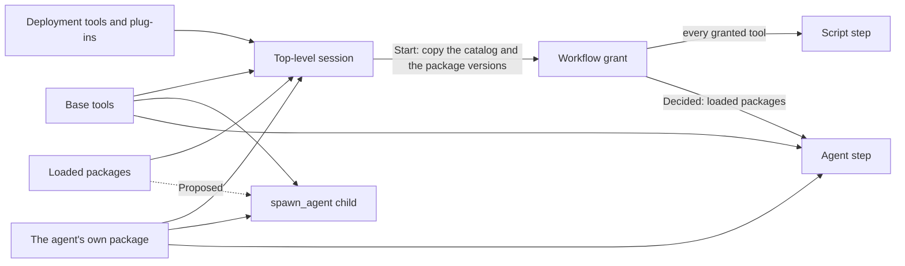
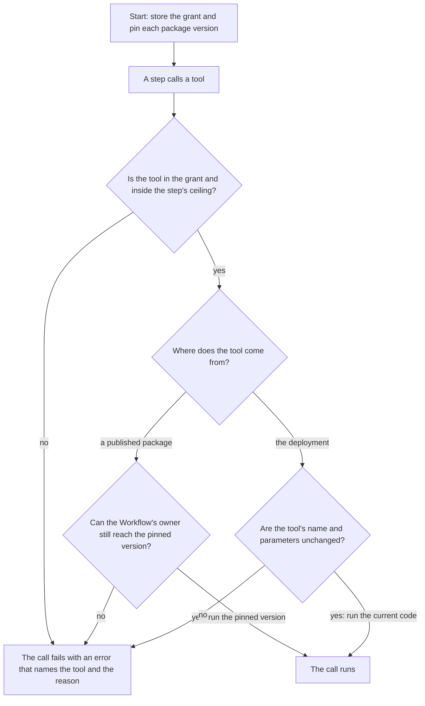

Status: Proposal (describes PilotSwarm 0.8.11 and the rules agreed after it; the agreed rules are not released; source citations are pinned to `7ee6eff4`)

# Tool and package composition

This file answers which tools a child agent, a script step or an agent step gets, and when those tools stop working. For example, a session loads a build-status tool from a published package and starts a watch Workflow. The Workflow's script polls that tool for weeks, and an agent step assesses each failure.

Citations refer to PilotSwarm 0.8.11, commit `7ee6eff4`, not to the pin of the other files in this folder. Paths are under `packages/sdk/src/`.

Each rule has one mark:

- **Today**: the behaviour of 0.8.11.
- **Decided**: an agreed rule that is not released yet.
- **Proposed**: planned, with no agreed design.

## Tool sources

| Source | What it is |
|---|---|
| Base tools | The tools that every session gets, such as wait, facts and sub-agent tools. |
| Deployment tools and plug-ins | Tools, skills, agents and MCP servers that ship with the worker image. |
| The agent's own package | The tools and MCP servers that a named agent's definition lists. |
| Loaded packages | Tools that a top-level session loads from a published package with `use_package`. Only a top-level session can load a package (`session-manager.ts:2705`). |

A published package version is immutable. A package has one active version.

## Who gets what

| Who | Base tools | Deployment tools | Own agent package | Loaded packages |
|---|---|---|---|---|
| Top-level session | Today: yes | Today: the names it was created with | Today: yes | Today: its own |
| `spawn_agent` child | Today: yes | Today: a custom child gets the spawner's names; a named child gets none | Today: yes, for a named child | Today: no. Proposed: yes |
| Script step | Today: through the grant | Today: through the grant | Today: the starter's, through the grant | Today: the active version. Decided: the pinned version |
| Agent step | Today: yes | Today: no | Today: yes, for a named agent | Today: no. Decided: the starter's, at the pinned version |
| Sub-agent of an agent step | Today: yes | Today: as a `spawn_agent` child | Today: as a `spawn_agent` child | Decided: none |

The **starter** is the session that starts the Workflow. The **grant** is the copy of the starter's tool catalog, loaded packages and package versions that a Start stores with the Workflow (`session-manager.ts:3862-3896`).

Today an agent step is an ordinary child session, so it gets no loaded package (`workflow/agent-host.ts:157-172`). In the example, the script can call the build-status tool and the agent step cannot. The decided rule closes this gap for Workflows that start after the change. The step's ceiling still applies.

## Lifecycle of a granted tool

Decided rules:

1. **The grant is fixed at Start.** A package that the starter loads later does not join a running Workflow.
2. **Package versions are pinned.** A Workflow calls the version that was active at its Start. A new version, or a rollback, does not change it. A worker can already run an earlier version beside the active one (`worker.ts:1693-1720`). To use a newer version, start a new Workflow.
3. **Running Workflows are pinned too.** The grant of a Workflow that started before this change already holds its versions.
4. **An unload does not cascade.** When the starter unloads a package, its running Workflows keep the package.
5. **A lost package stops only its own tools.** A package is lost when the Workflow's owner can no longer reach the pinned version: the package was deleted, disabled or made private. Tools of other packages keep working.
6. **The error is clear.** For example: "Tool 'build_status' is not available. This Workflow is pinned to build-tools 1.4.0, and that version was deleted. Start a new Workflow to use a current version."
7. **A deployment tool is checked by its contract.** Each call checks the name and the parameters of the tool that it calls (`workflow/tool-policy.ts:156-171`). After a worker upgrade, a running Workflow uses the new code of each tool whose contract did not change.

| Event | Today | Decided |
|---|---|---|
| A loaded package gets a new version | Every tool call of the Workflow fails | No effect |
| The starter unloads a package | Every tool call fails | No effect |
| A worker upgrade rewords one deployment tool | Every tool call fails | No effect |
| The pinned version is deleted, disabled or made private | Tool calls fail, with no reason given | Only that package's tools fail, with the reason |

Today each call compares every package revision in the grant with the active one, and compares the starter's live selections (`session-manager.ts:3906-3934`). Deployment tools count as one block (`worker.ts:1400-1405`).

## Gates

| Gate | Rule | Mark |
|---|---|---|
| `tools:` ceiling | An agent step's `tools:` list, or `tools: none`, removes tools from every source, also for its sub-agents (`session-proxy.ts:2541-2547`). It never adds a tool. | Today |
| `requiredTools` | An agent step lists tools that its agent must call. Each must be called at least once in the visit before the step completes with an outcome. A call that returned an error counts. | Decided |
| Start checks | A tool that a script names, a required tool and a named agent's startup tool must be available to their step. If not, the Start is refused and nothing is created. | Decided |
| Bridge-only tools | Canvas tools need a live session. They are not in a grant, and a script cannot call them. | Decided |
| Control tools | Tools that drive sessions, such as wait, cron and spawn, are never in a grant, so a script cannot call them (`workflow/tool-policy.ts:70`). An agent step has them as its own base tools. | Today |

## Other users' packages

A user can load a shared package of another user. A Workflow treats such a package as any other package: there is no refusal. Each Start writes one audit record that names, for each agent step, the tools passed, each source package and its owner, and the step agent's package and owner. Decided.

## Planned

- **Versions for capabilities that ship in the worker image.** Deployment tools, plug-ins, skills and agents have no version and no retained copy, so a Workflow cannot pin them. The plan is to version and retain them as published packages are.
- **`spawn_agent` parity.** A spawned child gets the spawner's loaded packages, by the same rules as an agent step.
- **An enforced check for other users' packages.** Today only the model's instructions say when a session may use another user's package.
