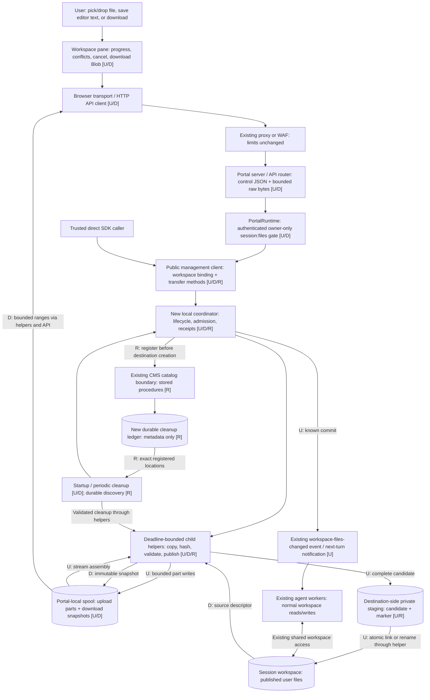

# Workspace file transfers: design and test plan

**Status:** Proposed; design-only, not implemented or performance-qualified.
**Issue:** [#191](https://github.com/microsoft/PilotSwarm/issues/191)
**Updated:** 2026-11-01

## TL;DR

**Problem (#191):** Workspace uploads send the entire file as base64 JSON.
A 20 MiB file becomes roughly 27 MiB on the wire, so a proxy/WAF with a 1-2 MB
request limit rejects it before PilotSwarm sees it. Raising the portal's limit
does not help; disabling WAF enforcement weakens protection for the whole site.

**Proposed fix:** Upload raw bytes in configurable parts (default 512 KiB),
then validate and atomically publish the completed file. Download immutable
file snapshots in bounded raw-byte ranges. Stream server-side I/O and hashing
so transfer memory scales with part size, not file size. Start with a
**portal-local spool and a single serving portal process**, matching the
checked-in deployment. Shared staging and multi-portal coordination are deferred.
Deliver this in three implementation PRs: uploads first, downloads second,
and stronger crash cleanup third. The final recovery increment adds a durable
CMS cleanup ledger for destination-side temporary candidates; file bytes and
upload parts remain local. The first two increments require no CMS migration.
Preserve owner-only access, overwrite/conflict behavior, and small JSON writes;
include cancellation, expiry, cleanup, and large editor saves.

**Validation:** First prove local upload lifecycle, tracked child shutdown,
and atomic target publication. Verify a 20 MiB upload through a real proxy
enforcing a 1,000,000-byte body limit, its hash, server memory, authorization,
conflicts, and UI flows. The download increment adds the bounded-response
round-trip; the recovery increment adds durable discovery and crash fault
injection. The existing 29-test unit baseline is not transfer qualification.

**Review focus:** Local-spool lifecycle, durable candidate cleanup, safe final
publication, download snapshot tradeoffs, and compatibility. Existing etag
checks are not atomic transactions with shell/agent writers; an interrupted
commit can have an explicitly reported unknown outcome. These limits must not
be hidden by automatic retries.

**Status/scope:** Design only; implementation and performance qualification
remain pending. Image attachments, agent packages, imports, previews, ZIPs, and
canvas-app APIs are outside this change.

## Outcome and scope

Upload and download a 20 MiB workspace file through a proxy that rejects bodies
larger than 1 MB, without relaxing that proxy's enforcement. Transfer memory
must depend on the part size and bounded concurrency, not the file size.
Throughout this document, MiB means 1,048,576 bytes; tests also use a stricter
1,000,000-byte proxy limit.

Deliver workspace file uploads, single-file downloads, and stronger crash
cleanup incrementally under #191, not together in one implementation PR.
Preserve overwrite dialogs, cancellation, expiry, SDK direct/Web API parity,
operation through a single portal process, and the existing JSON API.
Use the new upload helper for large editor saves too, so editing an uploaded
file does not immediately encounter the same request limit.

Not included: image attachments, agent packages, repository imports, folder or
multi-selection ZIP generation, canvas-app file APIs, and arbitrary-size files.
Existing preview reads and these other JSON surfaces retain their current
limits; this change must not claim that every workspace operation is proxy-safe.
The native TUI currently has no equivalent Workspace upload pane; expose the
same transfer APIs through its transport without inventing a new terminal UI.

Multi-portal transfers, shared transfer staging, automatic transfer resumption
after a portal restart, and transfer continuity during rolling replacement are
also deferred. Multiple agent workers can continue to use their existing
workspace storage; they do not receive upload parts or coordinate the spool.

## Delivery plan and issue tracking

Keep #191 as the umbrella issue. This documentation-only PR references it
without closing it and preserves the complete target design and test plan.
Track the three implementation issues below, each with its own PR. Each implementation
PR closes only its child issue and references #191; do not use `Fixes #191` on
the design PR or an upload-only PR. Close the umbrella only after verifying
its acceptance criteria, distinguishing required cleanup from extra hardening.

| Increment | Deliverable | Required evidence | Explicitly deferred |
| --- | --- | --- | --- |
| 1. [#241: Chunked workspace uploads](https://github.com/microsoft/PilotSwarm/issues/241) | Local spool/coordinator, bounded part requests and assembly, direct/Web API parity, owner-only access, conflict dialogs, large editor saves, normal failure/cancel/expiry cleanup, and compatibility. | G1/G2 upload spike, upload portions of G3-G5, P1-P4, C1/C2, upload A1/A2, L1/L2 normal lifecycle, upload U1/U2, I1, and B1. | New download endpoints/snapshots; CMS cleanup ledger; guaranteed orphan discovery after local spool loss or session deletion. |
| 2. [#242: Bounded workspace downloads](https://github.com/microsoft/PilotSwarm/issues/242) | Immutable snapshots, bounded raw ranges, release/expiry, SDK/API/UI integration, and the complete proxy round-trip. | Full G3-G5, D1/D2, download authorization/lifecycle/quota/UI coverage, direct/Web parity, and compatibility. | Durable destination-candidate cleanup and restart resumption. |
| 3. [#243: Crash-safe transfer cleanup](https://github.com/microsoft/PilotSwarm/issues/243) | CMS ledger/migration, write-ahead destination-candidate registration, durable orphan discovery, safe cleanup, explicit uncertain publication outcomes, and redacted management/tuner diagnostics. | L3, full C3 and recovery portions of G1/L1/L2, catalog/provider integration, helper-liveness and identity refusal cases. | Resumable transfers, multiple portals, exactly-once filesystem/database commits, and transactional CAS with arbitrary external writers. |

The second increment reuses the first increment's transport, admission, and
local lifecycle foundation. The third integrates with both shipped lifecycles.
These are sequential deliveries, not a requirement to open empty or stacked
implementation PRs before code exists. The design is reviewed in
[#240](https://github.com/microsoft/PilotSwarm/pull/240); record implementation
PR links here as they become available.

### Safety boundary for the first two increments

The architecture below describes the final combined behavior. Requirements
specific to the CMS ledger apply in increment 3, not as hidden prerequisites
for increments 1 and 2. Until then, local manifests track candidates and the
coordinator handles normal cleanup; transfer capability must not require a
new catalog capability. Register candidate locations locally before creation.

Do not defer authorization, path protection, size/quota enforcement, bounded
I/O, atomic publication, or normal failure/cancel/expiry cleanup. Track helper
processes through exit before releasing their reservations or deleting files
they may still use. Preserve unresolved temporary entries if liveness or
identity cannot safely be established; log/report the limitation rather than
guessing ownership or performing broad deletion.

After restart, old transfers do not resume. An unavailable transfer ID or a
missing receipt is not proof that publication rolled back; require target
refresh before a user retries an uncertain completion. Never infer success
from matching destination bytes or automatically replay publication.

The first two increments cannot guarantee discovery of destination-side
orphans when local manifests disappear. Document that limitation explicitly.
The recovery increment strengthens discovery; it still does not remove
filesystem/database transaction or helper-liveness uncertainty.

## Full process and component map

This is the proposed final architecture, not implemented transfer code.
Labels identify the delivery owner: **U = #241 uploads**, **D = #242 downloads**,
and **R = #243 stronger recovery**. Existing components are extended rather
than bypassed. The coordinator and transfer helpers are new responsibilities;
their final internal filenames are implementation decisions.

### End-to-end architecture



The portal is both the browser-facing API server and the process hosting the
local coordinator. The spool is private transfer storage, not a session's
workspace. The destination candidate is beside the target so publication can
remain atomic even when the spool is on a different filesystem.

Workers do not receive upload chunks. They see the published file through
their existing workspace access; the existing change event informs a later
agent turn. CMS is the durable session catalog, not payload storage. Direct
SDK mode is trusted; browser requests still require the runtime gate.

### Upload process (#241, with #243 additions marked)

```mermaid
sequenceDiagram
    participant B as Browser
    participant A as API and runtime gate
    participant M as Management / coordinator
    participant H as Child helpers
    participant S as Local spool
    participant W as Workspace
    participant C as CMS
    B->>A: Start: session, folder, target, size, ifMatch
    A->>M: Authorized call with trusted actor context
    M->>M: Bind target, reserve capacity, create local manifest
    M-->>B: uploadId, partBytes, partCount, expiry
    loop Sequential parts
        B->>A: PUT bounded raw bytes
        A->>M: Reauthorize and validate transfer binding
        M->>H: Bounded part I/O
        H->>S: Write exact-length immutable part
        M-->>B: Accepted part or explicit error
    end
    B->>A: Complete
    A->>M: Reauthorize; claim completion once
    opt R: increment 3 only
        M->>C: Register candidate before destination creation
    end
    M->>H: Assemble and hash; validate size and digest
    S->>H: Accepted parts
    H->>W: Write private destination-side candidate
    H-->>M: Assembly finished; helper exited
    M->>H: Revalidate target, condition, and atomic publication
    H->>W: Exclusive create or complete-file replacement
    H-->>M: Publication result
    M->>M: Save receipt and clean normal staging
    M->>C: Record existing file-change event
    M-->>B: Known result, or explicit uncertain outcome
```

Every control/raw request repeats the relevant access and binding checks.
The R step strengthens bookkeeping; it is not a prerequisite for #241.
The event above already exists and does not imply a new migration in #241.
Publication and receipt/event recording are not one transaction. See the
completion and crash-boundary sections for failure behavior.

### Download process (#242)

1. Browser requests a download for a captured session/folder/path.
2. Runtime authorizes; management resolves the source and coordinator reserves
   snapshot capacity.
3. A child opens the source, streams and hashes into a local snapshot, checks
   for detected source changes, and returns immutable snapshot metadata.
4. Browser requests successive bounded ranges. Each passes the runtime gate
   and transfer binding checks; helpers serve snapshot bytes, not live-source
   bytes, through the raw API path.
5. Browser assembles its Blob and triggers Save. Release/expiry reclaims the
   snapshot after active readers exit. No file-change event is generated.

### Cleanup and failure process (#243 strengthens normal cleanup)

| Trigger | #241 / #242 local behavior | #243 addition |
| --- | --- | --- |
| Cancel, expiry, ordinary I/O failure | Serialize lifecycle, stop/track helpers, safely reclaim known local entries and candidates, retain unresolved obligations. | Persist destination cleanup state and errors durably. |
| Graceful portal shutdown | Stop admitting transfers; drain/stop tracked helpers and perform safe cleanup. | Preserve outstanding destination obligations independently of local manifests. |
| Restart or lost local spool | Old IDs do not resume; unavailable is not proof of rollback. Lost candidate inventory may remain undiscoverable. | Discover candidates from CMS even after spool loss/session deletion; validate identity and liveness before cleanup. |
| Publication result lost | Do not automatically publish again or infer success from target contents. | Keep publication outcome separate from cleanup state; preserve explicit unknown outcomes. |

### Code working areas and feature/fix ownership

Paths are relative to the repository root. They identify existing integration
points, not a requirement to put all new logic into existing large modules.

| Component / working area | Associated files | Feature or fix |
| --- | --- | --- |
| Workspace UI | `packages/app/ui/react/src/workspace-pane.js` | **U:** slice uploads, progress/cancel, preserve conflict dialogs and draft/navigation identity, chunk large saves. **D:** snapshot/range download and release. |
| Browser adapter | `packages/app/web/src/browser-transport.js` | **U/D:** browser-facing transport integration and existing save/download conveniences; no direct filesystem access. |
| Shared HTTP transport and client | `packages/sdk/api/src/http-api-transport.js`, `api-client.js`, `protocol.js` | **U/D:** control operations, explicit binary paths, bounded byte handling, status-preserving proxy errors; do not JSON-encode parts. |
| Public Web SDK | `packages/sdk/src/web/web-management-client.ts` and corresponding API/type declarations | **U/D:** expose the same typed operations/results/errors as direct mode. **R:** diagnostic read parity. |
| Portal request boundary | `packages/app/web/server.js`, `api/router.js` | **U/D:** raw routes, actual-body bounds/backpressure and disconnect handling; preserve existing JSON compatibility and global limits. |
| Runtime authorization | `packages/app/web/runtime.js`, `packages/sdk/api/src/session-authz.js` | **U/D:** route through existing owner-only policy; pass trusted actor context, reject foreign handles and changed bindings. |
| Direct transport adapter | `packages/app/tui/src/node-sdk-transport.js` | **U/D:** delegate through public management APIs; no imports of internal file modules or new terminal Workspace pane. |
| Public direct management API | `packages/sdk/src/management-client.ts` | **U/D:** current folder resolution and typed transfer methods; **U:** one normal notification after known commit. **R:** typed redacted cleanup diagnostics. |
| New local transfer coordinator | SDK implementation alongside `packages/sdk/src/workspace-files.ts`; exact module name TBD | **U:** per-transfer serialization, parts, quotas, local manifests/receipts, cancel/expiry/shutdown. **D:** snapshot lifecycle. **R:** durable cleanup integration. |
| Filesystem helpers and shared rules | `packages/sdk/src/workspace-files.ts` plus new bounded-I/O helper module(s) as needed | **U:** path/protection reuse, streaming assembly/hash, destination staging and publication; bound replacement etag hashing too. **D:** snapshot/range I/O. **R:** validated exact-entry cleanup and helper lifecycle. |
| Durable cleanup persistence | `packages/sdk/src/cms.ts`, `cms-migrations.ts`, `migrations/NNNN_diff.md` (next version at implementation) | **R only:** ledger capability, stored procedures, durable discovery independent of session deletion; no file bytes. |
| Tuner diagnostics | `packages/sdk/src/inspect-tools.ts`, management/Web API diagnostic surface | **R:** expose redacted pending cleanup/outcome evidence through public methods and tuner tools. |
| Configuration and local composition | `.env.example`, `scripts/local-pilotswarm.sh`, application workspace-files config wiring | **U:** validated local spool/part settings and writable local defaults. **D/R:** lifecycle additions as needed; no private config edits. |
| Documentation | This proposal, `docs/user-guide/workspaces.md`, `docs/developer/building/workspace-providers.md`, Web API reference, affected builder/sample guidance | Describe shipped behavior per increment, remaining legacy limits, local operation, and recovery limitations; update UI maintenance guidance when behavior changes. |

### Validation working areas

| Test surface | Existing starting point / new fixture area | What it proves |
| --- | --- | --- |
| Filesystem and lifecycle | `packages/sdk/test/unit/workspace-files.test.mjs`; new focused coordinator/helper fixtures | G1/G2, parts, conflicts, protection, cleanup, quotas; **R:** crash/identity/liveness boundaries. |
| SDK integration | `packages/sdk/test/local/workspace-files.test.js` | Direct/Web parity where wired, known-commit notification, catalog-backed integration; new local files must join normal suite discovery. |
| HTTP and authorization | `packages/app/web/test/api-router.test.mjs`, `workspace-runtime.test.mjs`; new real proxy fixture | Real raw routes, owner policy, byte limits, disconnects, G3/G4 and D1. |
| Memory | New isolated parent/child harness in normal test discovery | G5 across payload sizes and fixed concurrency; include replacement/conflict hashing, not only new-file writes. |
| Browser UX | `packages/app/web/test/e2e/workspace-pane.spec.mjs` | Upload/download gestures, conflicts, progress/cancel, late-result isolation, legacy compatibility. Page mocks alone do not prove proxy/memory behavior. |
| Recovery persistence | New catalog/provider integration and multi-process fixtures | **R:** migration/procedure contracts, L3 discovery after lost spool/deleted session, C3 outcomes, redacted diagnostic contracts. |

### Boundaries and review follow-ups

No new Duroxide activity or orchestration version is planned: transfer requests
are management/file operations, not agent turns. No cloud SDK, new storage
service, worker chunk receiver, proxy-limit relaxation, or shared-spool service
is introduced. Provider-specific storage publication still requires evidence
before rollout.

The design review identified five refinements to resolve in the owning issue's
implementation contract; the diagrams do not claim these are already solved:

- **U/D editor boundary:** saves can become proxy-safe in #241, while editor
  open/conflict-content reads still use legacy base64. Define the #241 limitation
  and whether #242's bounded retrieval is also wired into those editor reads.
- **U replacement hashing:** existing `stat` hashes a whole buffer. Bound the
  etag path used by Replace and cover replacement/stale-conflict memory.
- **U completion contract:** specify in-progress, completed, timeout, and unknown
  responses. End requests within deadlines without prematurely releasing the
  reservation of a helper whose exit is unconfirmed.
- **D growing source:** enforce reserved snapshot bytes during copying, not
  only by comparing source metadata afterward; test injected growth.
- **U/D resource limits:** define validated part-size bounds, byte budgets,
  receipt count/retention, disk-full handling, and empty-transfer churn tests.

## What the repository establishes

| Evidence | Implication |
| --- | --- |
| `packages/app/ui/react/src/workspace-pane.js`, `uploadFiles` | The browser currently reads the entire file, base64-encodes it, and sends one write; preserve its replace/keep-both flow. |
| `packages/app/web/server.js`, `installJsonBodyLimits` | Workspace JSON limits are intentionally larger than the file limit. Raising them again cannot fix an upstream rejection. |
| `packages/sdk/src/workspace-files.ts`, `read`, `stat`, `write`, `runWorkspaceFileCall` | Contents and conflict hashes currently allocate whole-file buffers. File operations run in child processes with deadlines and concurrency lanes. A chunked HTTP route alone is insufficient. |
| `packages/sdk/src/management-client.ts`, `sessionWorkspaceFiles` | Folder resolution and file-change notification belong behind the management client, not inside portal routes. |
| `packages/sdk/api/src/session-authz.js`, `evaluateSessionAccess`; `packages/app/web/runtime.js`, `_gateSession` | `session:files` is owner-only, even for admins and shared-write collaborators, and enforced with the ownership switch off. Missing/deleted sessions are rejected by the runtime. |
| `packages/app/web/api/router.js`; `packages/sdk/api/src/api-client.js` | Generated operations are JSON-shaped. Raw routes need explicit handling and must still use the runtime authorization gate. `ApiClient.request` currently JSON-stringifies bodies. |
| `packages/sdk/src/cms.ts`, `SessionCatalog` canvas KV and live-state capabilities | Neither is a suitable internal orphan-cleanup registry. The new ledger needs its own retention and deletion semantics, independent of sessions and disposable local state. |
| `deploy/providers/azure/gitops/portal/base/deployment.yaml`; `deploy/providers/azure/gitops/portal/components/workspaces/portal-patch.yaml` | The checked-in portal uses one replica and mounts workspace roots also used by workers. V1 targets one serving portal process; multiple workers do not require shared upload staging. |
| `docs/developer/building/workspace-providers.md` | File-server I/O must remain deadline-bounded; an empty mount directory is not evidence that the workspace is mounted. |

These are source observations, not live deployment verification.

## Decisions

| Question | Proposed decision |
| --- | --- |
| Encoding and part size | Raw HTTP bytes; default **524,288 bytes (512 KiB)**, advertised by the server. No base64 on the new transfer path, including child-process data pipes. |
| Ordering | Sequential parts, numbered from zero. Exact duplicate retries are idempotent; different bytes for an accepted part are a conflict. Parallel/out-of-order uploads are not a v1 feature. |
| State location | A private local-disk spool owned by one portal process, plus one in-process coordinator for lifecycle/admission. Increment 3 adds a durable CMS cleanup ledger for destination-side candidates independently of that spool. Neither is a cross-replica upload service. |
| Database changes | None in increments 1 and 2. Increment 3 adds one focused CMS migration for a candidate cleanup ledger, accessed through stored procedures. Store no file bytes or part inventory in the ledger. |
| Downloads | Increment 2 creates a bounded-memory immutable snapshot, then serves raw ranges from it. This avoids mixing versions while an agent changes the source and avoids rehashing a live 20 MiB file for every 512 KiB range. |
| Restart | Incomplete transfers do not resume after restart. Old IDs return an explicit expired/unavailable outcome; interrupted publication is unknown until its outcome is established. Increment 3 makes candidate discovery survive spool loss without replaying publication. |
| Small writes | Keep legacy JSON writes. The new UI uses them only for payloads at most 64 KiB; larger uploads and saves use parts when supported. |
| Unsupported deployments | Advertise transfer capability per folder. An unwritable local spool or unsupported target publication primitive fails explicitly. Do not claim support for independent portal processes sharing a transfer ID. |
| Cloud dependencies | None. The implementation uses filesystem capabilities, not cloud names, hostnames, Kubernetes discovery, or cloud SDKs. |

### Local spool and destination staging

Extend `WorkspaceFilesConfig` with transfer settings. The application composition
layer maps `PORTAL_WORKSPACE_TRANSFER_DIR` and
`PORTAL_WORKSPACE_UPLOAD_PART_BYTES` to them. Default to an application-private
directory under the OS temporary directory, with a unique process generation.
Allow an explicit operator-selected local path. Paths are server configuration,
never caller input, and are omitted from public metadata.

The spool stores parts and download snapshots on local disk, outside the
workspace roots. It does **not** need to share a filesystem with the destination.
Final upload assembly streams parts into a uniquely named temporary candidate
in a private staging directory **beside the destination**, then publishes that
file atomically. Never rename
directly from the local spool across filesystems or fall back to copying bytes
over the visible destination.

Use the existing same-filesystem temporary-write pattern, with streaming rather
than whole-file buffers. Record the candidate location before creating its
staging directory: locally in increment 1, durably in the CMS in increment 3.
A local manifest alone cannot provide the final lost-spool recovery guarantee.
A generated staging
directory holds an ownership marker and the candidate, never user-selected
entries. Keep it out of normal Workspace listings, reads, ZIPs, find, and canvas
file calls until publication. Reject symlinked spool paths and aliases into the
spool or staging directories. Dotfile hiding alone is not access protection.

Validate workspace containment, permissions, and the mount marker before
creating the destination-side candidate. A local spool must not make a missing
workspace mount look usable. Probe supported atomic replacement/create-only
publication in a deadline-bounded child; the actual workspace may still be on
shared storage even though the upload spool is local.

Give `scripts/local-pilotswarm.sh` a writable local spool default. The deployment
may use ephemeral portal-local storage; it needs no new shared volume or storage
service for upload staging. Configure only one serving transfer coordinator.
Do not let two processes concurrently adopt the same spool generation.

The spool is not a security boundary against an agent or operator running as
the same OS user. That is already true of workspace contents; stronger isolation
belongs to the filesystem/provider deployment.

## API and SDK contract

Paths below are relative to
`/api/v1/management/sessions/:sessionId/workspace`.
Names are proposed public method names, not existing methods.

| Method and path | Management method | Contract |
| --- | --- | --- |
| `POST /uploads` | `startSessionWorkspaceUpload` | `{ folder, path, size, sha256?, ifMatch?, createParents? }` -> `{ uploadId, partBytes, partCount, expiresAt }`. |
| `PUT /uploads/:uploadId/parts/:part` | `putSessionWorkspaceUploadPart` | `application/octet-stream`, exact expected length -> accepted part number, byte count, SHA-256. |
| `GET /uploads/:uploadId` | `getSessionWorkspaceUpload` | State, accepted contiguous parts, expiry, and saved completion result when known. |
| `POST /uploads/:uploadId/complete` | `completeSessionWorkspaceUpload` | Verify, assemble and publish -> the existing write result shape: `{ etag, size, mtimeMs, created }`. |
| `DELETE /uploads/:uploadId` | `abortSessionWorkspaceUpload` | Abort an open upload; repeat abort is idempotent while its receipt remains. |
| `POST /downloads` | `startSessionWorkspaceDownload` | `{ folder, path }` -> `{ downloadId, size, etag, partBytes, expiresAt }` after creating a snapshot. |
| `GET /downloads/:downloadId/content` | `readSessionWorkspaceDownloadPart` | A single bounded HTTP byte range -> raw bytes and range metadata. |
| `DELETE /downloads/:downloadId` | `releaseSessionWorkspaceDownload` | Release the snapshot; idempotent while its receipt remains. |

Use the existing folder ID (`working`, `extra:<name>`), not a caller-selected
root. Transfer IDs are opaque random identifiers and never filesystem paths.
Reject malformed IDs and non-safe-integer part numbers before filesystem I/O.
Reject negative/non-integer sizes and sizes above `maxBytes` at start.
The final part has its exact remaining length. Empty uploads have zero parts
and complete to an empty file. Never accept compressed request bodies.

The direct SDK takes/returns bounded `Uint8Array` parts, with typed metadata.
JSON control operations go in `api/src/protocol.js`; raw paths get explicit
protocol path helpers, client methods, and typed declarations. Do not JSON-wrap
raw bytes or route them through `/api/rpc`. Both HTTP and node transports
delegate through the public management API. The portal uses `PortalRuntime`,
never imports file-operation internals.

`listSessionWorkspaceFolders` gains per-folder transfer capability plus common
`partBytes` and legacy-small-write threshold metadata. Old clients ignore these
additions. New clients talking to old servers retain the legacy path but explain
its proxy-size limitation; a failed large transfer must not silently retry as
one oversized JSON write.

## Authorization and admission

Every control and raw request passes authentication and the same hard-enforced
`session:files` runtime gate. Bind each manifest to the session, initiating
principal's stable provider/subject, folder/root identity, and resolved target.
The runtime supplies trusted actor identity; ignore actor fields from the body.
An upload ID alone grants no access. Cross-session/cross-principal ID use must
not disclose another transfer.

Re-resolve the current workspace at every operation. Reject a transfer if its
bound folder or resolved destination changes, the session is deleted, ownership
changes, a mount marker disappears, or the path becomes protected/read-only.
Reusing a folder ID after a workspace switch must not redirect an upload.
Abort after access revocation is not a bypass: background cleanup owns that case.

Authenticate/authorize a part before reading its body. Require octet-stream,
limit actual bytes even without `Content-Length`, and reject oversized declared
lengths immediately. The raw route must bypass JSON parsing and use bounded
backpressure-aware pipes to the child. Configure finite request/header/idle
timeouts and stop the specific child on disconnect or deadline. Do not read
mounted filesystem paths synchronously on the portal event loop.

## Durable destination-candidate cleanup (increment 3)

**Final recovery design, deferred to increment 3 on 2026-11-01:** use a small
CMS cleanup ledger so losing
portal-local storage does not lose the identity of destination-side temporary
files. This is recovery bookkeeping, not shared upload staging, part storage,
or a cross-portal coordinator. Local parts and download snapshots remain
disposable; incomplete uploads still do not resume after restart.

### Ledger contract

Add a dedicated catalog capability, backed by one new CMS migration and stored
procedures. Do not repurpose canvas KV, live state, or ordinary session events:
the inspected catalog's KV is application-facing and canvas-scoped, live state
is ephemeral, and session-owned data can disappear during deletion. Cleanup
obligations must survive both local spool loss and session hard deletion.

One row per destination-side staging directory records:

- Generated candidate/transfer ID, initiating session and principal, coordinator
  generation, creation/expiry times, and reserved byte count.
- Trusted workspace-root/folder binding, canonical relative parent, generated
  staging directory name, and an ownership nonce. No client-supplied absolute
  path and no file contents.
- Verified parent/staging/candidate filesystem identity as it becomes available,
  candidate size/hash, and lifecycle stage.
- Publication outcome/receipt separately from cleanup state, plus the last
  sanitized cleanup error and next cleanup-attempt time.

Use the stages `prepared`, `assembling`, `ready`, and `publishing`, with explicit
known-committed/known-not-committed/unknown outcomes. Keep cleanup pending until
the candidate, marker, and staging directory are gone or verified absent.
Cleaning a leftover directory must not turn an unknown publication into a
reported success. Do not cascade these rows away when a session is deleted.
Retain bounded terminal receipts; pending/error rows remain discoverable rather
than expiring silently.

All rows are trusted runtime bookkeeping, written through catalog methods and
stored procedures, not directly from HTTP parameters. If registration cannot
commit, do not create the destination staging directory. If a catalog lacks
this capability, new transfers are explicitly unsupported; never silently
substitute a local-only cleanup index. No migration version is reserved until
implementation; use the next available version and its required diff document.

### Creation and recovery protocol

1. Revalidate the target and durably register `prepared`, including its exact
   generated staging location, **before any destination-side temporary entry**.
2. A preparation/assembly helper exclusively creates the staging directory and
   ownership marker, reports filesystem identity, and waits for durable identity
   acknowledgement before writing payload bytes. Never adopt a pre-existing
   directory merely because its generated name matches.
3. Stream assembly into that directory. The assembly helper **cannot publish**:
   it does not execute target rename/link operations. The coordinator marks the
   candidate `ready` only after successful assembly and helper exit.
4. Revalidate access and overwrite conditions; persist `publishing` before
   launching a separate one-shot publication helper. That helper only performs
   validated atomic publication; it never reassembles or resumes an upload.
5. Save the outcome/receipt, notify through the existing file-change event, and
   clean the generated staging entries. Preserve the cleanup row until absence
   is established. A post-publication bookkeeping failure is not proof the file
   was uncommitted and must not trigger automatic republication.

Startup and periodic cleanup page through due ledger rows, reconstruct paths
only through currently configured roots, and validate the mount marker,
containment, bound parent identity, ownership marker, and known file identity.
No workspace-tree scan or local spool manifest is required to discover them.
Cleanup may service a deleted session's row as trusted runtime maintenance;
that does not give a public caller filesystem access to the deleted session.

Remove only the exact generated candidate and marker files, then use an empty
directory removal. Never recursively remove an arbitrary path. A `prepared`
row may describe no directory yet, an empty directory, or completed ownership
initialization; recovery must handle each. An unexpected entry, torn/invalid
marker, replaced identity, unavailable root, or uncertain live helper is an
explicit retained cleanup error, not permission to guess ownership or delete
another file. The spike must demonstrate ordinary crash-boundary recovery and
safe refusal of conflicting/corrupt state.

In the current process, cancel/timeout cleanup waits for the tracked helper's
exit. On recovery, a generation change or elapsed deadline alone is not proof
that an old helper exited. Separate assembly from publication so an orphaned
assembler can never later publish; unknown publication helpers remain subject
to the shutdown/identity contract and fail-closed handling in G1. Keep their
ledger rows and disk reservations until cleanup can safely proceed.

Expose redacted pending-cleanup/outcome diagnostics through a typed management
read method and a tuner inspect-tool, following the existing observability
boundary. Do not expose ownership nonces or internal paths to browsers, session
events, or model prompts. Cover ledger registration, paging, stage updates, and
cleanup completion with catalog integration tests on the normal test providers.

## Persistence, completion, and cleanup

The completion sequence and recovery guarantees below describe the final
architecture with increment 3. In increments 1 and 2, use the same bounded
publication and normal cleanup safeguards with local candidate bookkeeping,
as specified in the delivery plan; do not add the CMS capability early.

An immutable manifest holds the original target and conditions. Part attempts
write unique temporary files; only an exact-length finished part can be
published under its numbered immutable name. Exclusive publication decides
concurrent retries. Compare accepted bytes/hashes before acknowledging a replay.
Interrupted attempts never advance the accepted contiguous prefix.
Bound in-flight attempts as well as accepted parts: at most one writer per
upload, with competing requests answering busy or replaying a finished part.
The single process's coordinator serializes part acceptance, completion, abort,
and cleanup for each transfer. Keep child-process handles until exit so a
cancelled attempt cannot continue writing while its reservation is reused.

Persist local manifest updates atomically, and destination candidate lifecycle
in the CMS ledger above. Keep v1 concurrency control in the one coordinator.
Claim completion once by
transitioning from open to completing before starting the child. A second caller
reads status; it must not start another assembler. Do not add distributed leases,
shared-filesystem lock stealing, or cross-replica state transitions.

Completion follows the ledger protocol using deadline-bounded helpers:

1. Revalidate authorization context, folder binding, marker, containment,
   permissions, part coverage, and total size.
2. Register the staging location in the CMS before creating it. Stream local
   accepted parts into its candidate **beside the destination** while hashing,
   with a 64 KiB copy buffer. Verify any requested whole-file SHA-256; always
   produce the existing `sha256:<hex>` etag. The assembler exits without publishing.
3. Immediately before publication, re-resolve the target and check the original
   `ifMatch` condition using bounded-memory hashing. Preserve mode bits and
   existing symlink-to-in-folder behavior; reject changed bindings.
4. Record publication intent and use the separate publication helper to publish
   the entire candidate in one filesystem operation. For `ifMatch:null`,
   use a same-filesystem exclusive hard link from candidate to target; `EEXIST`
   is a conflict, and unlinking the candidate is subsequent cleanup. Verify this
   primitive on supported targets and reject it explicitly where unavailable,
   rather than using check-then-overwrite rename. Conditional/unconditional
   replacement uses same-filesystem rename and retains existing API semantics.
5. Persist the completion receipt and record the existing
   `session.workspace_files_changed` write event. Notify the pane only after a
   known successful commit, not for individual parts.

`ifMatch:null` means create-only; a string requires matching existing content;
an omitted condition retains legacy unconditional-write behavior. Completion
must repeat checks even if start already detected no conflict.

**Existing limitation:** the current filesystem write is not a transaction
with arbitrary agent/shell writers: they can change a file between its etag
check and rename. This proposal preserves that behavior, rather than promising
portable atomic content-CAS. A stronger cross-writer transaction needs provider
support and participation by every writer. Tests deterministically inject a
change before the final check; they must not claim to prove atomic CAS.

**Crash boundary:** publishing a file and recording a receipt/event cannot be
one filesystem/database transaction. If a process dies in that window, return
an explicit `WORKSPACE_FILES_COMMIT_UNKNOWN` outcome after the completing
deadline, never infer success from matching target contents and never replay
publication. The user refreshes/re-reads the target before deciding to retry.
Receipt-backed repeat completion returns the original result without another
write or another event. Event recording failure is logged and surfaced as
notification failure, not misreported as an uncommitted file.

Abort wins only while the upload is open. The coordinator marks it aborted,
rejects further operations, stops any active part-writing child, waits for exit,
then removes staged bytes. If completion has started, abort returns a conflict
explaining that finalization is in progress or already finished; do not promise
rollback. Expiry uses the same serialized lifecycle path. Never remove a
candidate while a known live completing child may still publish it.

On restart, invalidate the previous process generation rather than adopting its
open transfers. Staged parts/snapshots are disposable; destination candidates
are recovered through the durable ledger. A transfer that reached `publishing`
requires explicit unknown-outcome reporting unless its receipt established the
result. Confirm helper exit before candidate cleanup. A newer portal must not
replay publication.
The first spike must verify helper shutdown/orphan handling; if exit cannot be
established, retain/quarantine the exact candidate and report cleanup failure
rather than deleting a possibly active file. Merely renaming a directory or
waiting a fixed interval is not proof that a helper stopped.

If ephemeral local storage is lost, old transfer IDs are unavailable and users
start again. The target may already contain the complete file if publication
preceded the failure, so an unavailable ID is not proof of rollback. Do not
reconstruct success from the target's hash. The CMS cleanup row remains available
even without a local manifest, so startup can locate exactly the registered
destination candidate. Graceful shutdown drains/stops helpers and services their
cleanup rows rather than discarding that inventory.

Proposed limits: 30 minutes idle expiry, two hours absolute lifetime, cleanup
every 60 seconds and at startup, two active transfers per principal per root,
eight per root in total, and two running data-plane calls per portal process.
Uploads and download snapshots share the disk budget. Reserve at most twice
the declared file size per upload (parts plus assembly), plus bounded metadata;
reserve snapshot size for downloads. Admission/quota claims are serialized by
the local coordinator, including concurrent HTTP starts and direct SDK calls.
Include outstanding ledger reservations from previous generations in admission;
do not double-count the same candidate as both a local and recovered transfer.
Do not release its reserved destination bytes merely because its local spool
or session disappeared.
Terminal receipts have bounded retention under the same index.
Rejected or interrupted starts must release their reservations.

Cleanup uses the local spool index for disposable local data and paged CMS
ledger entries for destination candidates, never recursively searches workspace
trees or follows symlinks.
Before removing a candidate, revalidate its bound directory and exact file
identity so a replaced temporary path cannot delete somebody else's content.
Interrupted cleanup is retryable; mount and delete failures are visible in
standard logs and retried on later sweeps.
Expiry is not permission to claim success or to replay a stuck completion.

## Download consistency and HTTP details (increment 2)

Create the snapshot in a child, streaming from one opened source descriptor
into the spool while hashing. Check source metadata before/after copying;
refuse a detected in-place change. An external writer can still mutate a source
during snapshot creation; v1 does not promise a transactional historical view
of live files. Once accepted, the snapshot and its etag are immutable, so all
downloaded parts are mutually consistent even if the source is later replaced.

Require one explicit range no larger than `partBytes`; return `206`,
`Content-Range`, `Content-Length`, `Accept-Ranges: bytes`, a quoted strong etag,
`Content-Type: application/octet-stream`, and `Cache-Control: private, no-store`.
Use an attachment filename encoded safely, never interpolated into a header
without sanitization. Honor `If-Match` against the immutable snapshot.
Reject multiple/oversized ranges rather than letting a request retrieve the
whole snapshot; unsatisfiable ranges return `416` with `bytes */<size>`.
For an empty snapshot, the no-range request returns an empty `200` response.
Nonempty no-range requests receive a clear range-required validation error.

The browser collects bounded downloaded parts into a Blob for its existing save
gesture, then releases the handle. Browser memory may therefore grow with file
size on download; the requirement is bounded **server transfer memory**.
No file snapshot is exposed as executable or inline portal content.

## UI and errors

Keep selected session/folder/path captured throughout a transfer. Progress and
completion must not act on a different session after navigation. Slice `File`
objects per part; do not call the whole file's `arrayBuffer()` or whole-file
WebCrypto digest. Whole-file upload SHA-256 is optional; the server computes it
incrementally. Editor text already exists in browser memory, but sends in parts.

Show byte progress and Cancel for active uploads. On replacement conflict, retain
the current replace/keep-both/cancel choices and start a transfer bound to the
newly chosen target/etag. Never mutate an existing upload's target. Keep upload
success counts and local workspace-change broadcasts tied to known commits.
Background expiry handles abandoned pages; unload delivery is not guaranteed.

An upload-specific 413 explains file size, part size, and a possible proxy limit.
A non-JSON 403 says a proxy/firewall **may** have rejected it, while preserving
status and not concealing a genuine JSON authorization denial. Do not sign the
user out for a per-operation 403. Preserve structured conflict etags and size
fields. Define typed expired, incomplete, part-conflict, quota/busy, unsupported,
integrity, and commit-unknown errors; expose no server spool paths.
Do not silently reduce configured part sizes or retry forever. Retrying an
ambiguous part is safe only through the defined exact-replay contract.

## Test plan and implementation gates

Existing suites use Node's test runner for unit/API/web tests, Vitest for SDK
local integration, and Playwright for browser behavior. Extend those surfaces;
proxy and memory evidence must use real HTTP/filesystem paths, not page mocks.

| ID | Coverage and exact assertion | Location |
| --- | --- | --- |
| G1 | One coordinator handles concurrent requests: immutable same-part acceptance, conflicting retry, one assembler and at most one publisher, abort/complete race, expiry without deleting active files, and restart invalidating old IDs. Verify child shutdown/orphan handling; an orphaned assembler has no publication path. Inject pauses at lifecycle boundaries; no arbitrary sleeps. | SDK local-coordinator and child-process fixtures. |
| G2 | Local spool and destination on different filesystems still publish atomically through a destination-side candidate. Exclusive hard-link create cannot replace a concurrently created target; same-filesystem rename replaces complete content. Unsupported target primitives fail explicitly. Known failure/cancel removes candidates without touching target content. | SDK filesystem contract tests; validate publication on the configured workspace storage before rollout. |
| G3 | Real HTTP proxy enforces 1,000,000-byte request bodies and, separately, 1,000,000-byte responses. Round-trip a deterministic incompressible **20,971,520-byte** binary; compare SHA-256. Record every body size; all new data requests/responses are at most 524,288 bytes. | Web integration test using the real router/runtime/management file path and bounded streaming proxy. |
| G4 | The proxy fixture rejects a deliberately oversized control request and rejects the legacy base64 upload of the same file. New requests succeed with enforcement unchanged. This proves the fixture is actually enforcing the limit. | Same proxy test. |
| G5 | Warm isolated portal plus all file-operation children: sample RSS and track live byte-buffer high-water marks for 1, 5, and 20 MiB files, at one and two active calls. Streaming copy/hash buffers are at most 64 KiB; live transfer buffers at most `6 * partBytes + 4 * 64 KiB` per call. Payload-attributable peak RSS growth from 5 to 20 MiB must be at most 8 MiB at fixed concurrency. Publish raw measurements; investigate noise/failure, do not silently loosen the gate. | Dedicated bounded memory harness invoked by an integration test. |
| P1 | Sizes 0, 1, `P-1`, `P`, `P+1`, `maxBytes`, and `maxBytes+1`; exact final-part length and integer validation. Oversized start creates no transfer. | SDK unit + API. |
| P2 | Missing, short, oversized, out-of-order, duplicate-same, duplicate-different, invalid-index, and simultaneous same-index parts. Incomplete upload cannot complete. | SDK unit + API. |
| P3 | Enforce actual streamed bytes with absent/lying Content-Length; disconnect mid-body, slow sender, wrong type, compressed body, and child timeout never accept a partial part or leak a lane. | Web real HTTP + child-process tests. |
| P4 | Optional whole-file digest mismatch never changes the target; successful etag equals the existing content SHA-256 convention. | SDK unit. |
| C1 | Create-only EXISTS, matching overwrite, stale etag, deleted target, and omitted-condition behavior; preserve permissions and allowed in-folder links. Inject target edits after start and before final validation. | Extend `packages/sdk/test/unit/workspace-files.test.mjs`. |
| C2 | No target exists before first commit; a reader during publication sees old or complete new bytes, never partial content. Repeat complete after a saved receipt performs no second write/event. | SDK unit + local integration. |
| C3 | Kill after each persistence boundary, especially immediately before publication and after publication/before receipt. Known failure leaves the old target intact; uncertain commit is reported explicitly and not retried. | Multi-process fault injection. |
| A1 | Owner allowed; non-owner admin, shared-write collaborator, wrong principal/session transfer ID, system session, deleted session, and ownership-switch-off cases preserve existing 403/404 policy. Test every raw and control route. | Extend `packages/app/web/test/workspace-runtime.test.mjs` and router tests. |
| A2 | Traversal, absolute/NUL paths, aliases to spool or registered candidates, unopen folder, missing marker, read-only/.git/marker target, symlink replacement, and workspace reassignment are rejected without out-of-scope writes. | SDK unit + runtime. |
| L1 | Abort and repeated abort; expiry with fake clock; restart without resumption; overlapping cleanup ticks serialize; crash during deletion; permission/mount failure is visible. Candidate identity replacement never deletes another file. No target deletion or recursive workspace scan. | SDK unit + lifecycle integration. |
| L2 | Root and principal quotas hold under concurrent starts/direct calls in one process; reservation bounds local spool plus destination-side assembly/snapshot disk use; failures release capacity. | SDK coordinator fixture. |
| L3 | Registration failure creates no destination entries. Lose the local spool and hard-delete the session after candidate creation: the durable row still discovers its exact location. Kill after registration, directory creation, ownership initialization, identity acknowledgement, assembly, publication, and receipt persistence. Recover known-owned leftovers without a workspace scan; retain invalid markers/replaced identities as explicit errors. Unknown outcome is never changed to success by cleanup. | Catalog integration tests plus child-process fault injection; cover the new migration/procedures on configured CMS providers. |
| D1 | Range boundaries, last byte, wrong etag, invalid/multiple/too-large/missing range, empty file, safe filenames, expired/foreign download handles, and source changes after snapshot creation. | SDK API + router. |
| D2 | Snapshot creation uses bounded memory and fails detected source mutation; download source replacement cannot mix saved parts. | SDK child fixture + proxy round-trip. |
| U1 | Button/drop upload, progress, cancel, replace, keep-both, conflict during transfer, large editor save, exact single-file download, and small legacy write. Assert new requests contain raw bytes, never base64 JSON. | Extend `packages/app/web/test/e2e/workspace-pane.spec.mjs`. |
| U2 | Session/folder/dashboard switch and pane unmount cannot redirect a transfer or apply a late result to another view; expired upload and JSON/non-JSON proxy errors have actionable inline messages. | Playwright. |
| I1 | Direct and Web API management methods agree on results/errors. Exactly one normal file-change event follows a known commit; the next agent turn is notified once, not once per part. | Extend `packages/sdk/test/local/workspace-files.test.js`. |
| B1 | Old clients can still read/write; no new global body-limit relaxation; preview, ZIP, canvas, image, package, and import behavior stays unchanged. Unsupported transfer capability is explicit. | Existing unit/API/web regressions. |

Apply the matrix by increment using the delivery table. G1/G2's upload
lifecycle, tracked helper shutdown, and destination publication are the first
bounded spike. L3 and write-ahead CMS registration belong to increment 3's
separate recovery spike; they do not block starting the upload implementation.
Upload-only G3 verifies the resulting hash through a trusted direct read, not
through the still-legacy proxy-limited download. G4's oversized-request negative
control remains mandatory. Increment 2 adds bounded responses and the full
proxy round-trip. Do not claim recovery or download tests passed based on
upload-only results, and do not restore multi-portal scope by default.

## Work sequence and repository wiring

1. Submit this documentation-only design PR and create the three linked
   implementation issues. Keep #191 open.
2. In the upload issue/PR, first prove G1/G2's bounded local lifecycle,
   separate spool/target filesystems, tracked helper exit, and publication
   semantics. Then implement upload config, quota/normal cleanup, management
   methods, raw routes/transports, authorization, UI uploads/editor saves, and
   the upload validation gates. Factor shared path/protection/hash helpers;
   add no CMS migration. Open the implementation PR when it has reviewable code.
3. In the download issue/PR, reuse that foundation for snapshots, ranges,
   release/expiry, SDK/API/UI integration, and the full proxy/memory gates.
4. In the recovery issue/PR, prove L3 and the C3 crash boundaries, then add the
   ledger capability, migration, companion diff, stored procedures, safe
   orphan cleanup, reservations, and management/tuner diagnostics. Verify
   discovery after spool loss/session deletion and refusal of uncertain
   ownership/liveness; do not add resumption or cross-replica coordination.
5. For each implementation PR, run its targeted compatibility/integration/
   browser coverage and walk the local instance as Alice and Bob. Record
   filesystem-specific evidence and remaining limitations. Reconcile the
   combined results against #191 before closing the umbrella.

Use the existing SDK build, unit/API runners, app `test:web`, and app
`test:e2e` scripts; do not add a competing test framework or reduce concurrency.
New `test/local` files must be discoverable through `scripts/run-tests.sh` and
the SDK `test:local` entrypoint. Keep proxy/memory coverage in normal CI test
discovery rather than a manually run orphan harness. Tests have no hidden retries.

Implementation updates must include `docs/user-guide/workspaces.md`,
`docs/developer/building/workspace-providers.md`, the Web API reference and SDK
types, `.env.example`, `scripts/local-pilotswarm.sh`, and the TUI maintainer skill
where transport/UI expectations change. Update builder workspace guidance and
the maintained samples where they teach affected file APIs. Provider deployment
changes remain under `deploy/providers/<provider>/`; no managed deployment or
WAF-policy mutation is authorized by this design task.

## Future consideration: shared staging and multiple portals

If multiple portal processes need to serve the same transfer, a local spool
and in-process coordinator will not suffice. Revisit shared staging, a transfer
registry, atomic cross-process admission/lifecycle arbitration, cleanup fencing,
and failure recovery as a separate design. Do not merely point independent
coordinators at the same directory or assume sticky routing solves failover.

Before that rollout, define an explicit transfer-ownership/routing contract and
test requests landing on different replicas. Even a one-replica rolling update
can temporarily overlap old/new processes: v1 does not guarantee continuation
across them, and callers must see a clear transfer-unavailable outcome rather
than an implicit large-JSON fallback.

## Baseline validation

Completed on 2026-10-30 against runtime source commit
`cecafe1ca7a9f2778a6166abdd12f6165d99f777`, in Ubuntu 24.04 WSL with
Node 24.22.1 and npm 11.19.1, using this Windows-mounted worktree.

The worktree initially had no installed dependencies. After `npm ci`, both
targeted commands succeeded:

```bash
npm run build --workspace=pilotswarm-sdk
node --test packages/sdk/test/unit/workspace-files.test.mjs
```

Result: SDK build passed; **29 tests passed, zero failed, zero skipped**.
Coverage includes folder resolution, path containment, etag conflicts,
create-only writes, protected paths, limits, timeout behavior, concurrency
lanes, and file-change notifications' helper logic.

This is the existing implementation's credential-free unit baseline, not
qualification of the proposed transfer design. No database/model integration,
portal authorization/browser tests, proxy round-trip, memory measurement,
deployment filesystem validation, or new local-spool spike has run yet.

## Readiness

The full target design and three-increment delivery boundary are explicit.
The first upload increment can start with the bounded G1/G2 spike; it does not
require the future CMS ledger. The final recovery design addresses lost-local-
manifest discovery through write-ahead registration, but no schema or runtime
implementation has been made.

No transfer implementation or proxy/memory/target-storage qualification has
been performed. The existing unit baseline only covers existing behavior.
Each increment must provide its assigned evidence before claiming completion;
the full matrix is not a prerequisite for the documentation-only PR.
Uncertainty at the filesystem/database commit boundary remains an explicitly
reported outcome, not a guarantee this design can remove.
